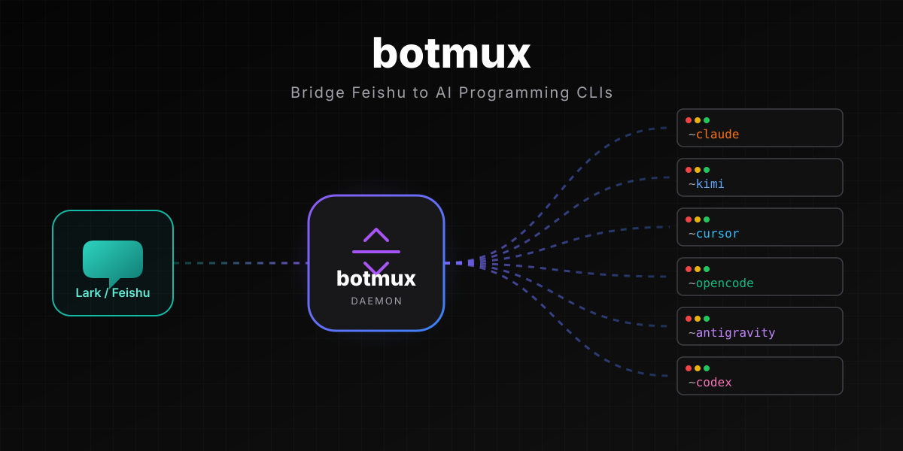

# botmux

<p align="center">
  
</p>

<p align="center">
  <a href="https://www.npmjs.com/package/botmux"></a>
  <a href="https://www.npmjs.com/package/botmux"></a>
  <a href="https://github.com/deepcoldy/botmux/actions/workflows/ci.yml?query=branch%3Amaster"></a>
  <a href="https://github.com/deepcoldy/botmux/actions/workflows/midscene-e2e.yml?query=branch%3Amaster"></a>
  
  <a href="LICENSE"></a>
</p>

<p align="center">
  Add Claude Code, Codex, and other AI coding tools to a Lark group, just like bringing in a teammate.<br>
  Ask them to write code, investigate issues, review changes, or report progress on a schedule.<br>
  Follow, reply, or interrupt from your phone, then pick up the same task when you're back at your computer.
</p>

<p align="center">
  <a href="https://deepcoldy.github.io/botmux/en/"><b>📖 Docs</b></a> ·
  <a href="#get-started-in-3-steps"><b>🚀 3-step setup</b></a> ·
  <a href="#everyday-uses"><b>✨ Everyday uses</b></a> ·
  <a href="README.md">中文</a>
</p>

## Get started in 3 steps

Before you start, make sure your AI CLI is installed, signed in, and working in a terminal. See [Prerequisites](https://deepcoldy.github.io/botmux/en/prerequisites) for the other requirements.

### 1. Install

```bash
curl -fsSL https://raw.githubusercontent.com/deepcoldy/botmux/master/install.sh | sh
```

Open a new terminal afterwards. Linux and macOS (x64 / arm64) are supported, with no Node required to run botmux; on Windows, use WSL2. You can also use `npm install -g botmux` (Node ≥ 22 is required for installation).

### 2. Scan to configure your first bot

```bash
botmux setup
```

Follow the wizard to scan once with Lark, then choose a CLI and a default working directory. App creation, permissions, and publishing are handled for you; the person who scans becomes the admin.

### 3. Start it and add it to a group

```bash
botmux start
```

If the first run asks about storage, press Enter to use the default. Add the bot to a Lark topic group or regular group, then send:

```text
@bot How do I build this project? Please run the tests too.
```

The bot updates its card as it works and posts the result when finished. You can also DM the bot instead of creating a group.

> **Mac users**: [GitHub Releases](https://github.com/deepcoldy/botmux/releases) provides a signed and notarized Botmux Desktop DMG. In the current version, first-time use still requires one command-line initialization using steps 1 and 2 above; an existing configuration opens directly. See [macOS Desktop App](https://deepcoldy.github.io/botmux/en/desktop).

## Everyday uses

- **Write code and fix issues** — “@bot Fix this error and add a test for it.” Follow progress and results in Lark with [live cards](https://deepcoldy.github.io/botmux/en/cards).
- **Investigate incidents and answer on-call questions** — Add the bot to an on-call group and @ it to inspect logs and find the cause. See [On-call mode](https://deepcoldy.github.io/botmux/en/oncall).
- **Review code together** — Have different AI bots review the same change independently and add their perspectives. See [Multi-bot collaboration](https://deepcoldy.github.io/botmux/en/multi-bot).
- **Schedule updates** — “Every weekday morning, summarize yesterday's progress and today's risks.” See [Scheduled tasks](https://deepcoldy.github.io/botmux/en/schedule).
- **Keep up while away** — Reply or interrupt from your phone, or take over in a browser with the [Web Terminal](https://deepcoldy.github.io/botmux/en/web-terminal).
- **Continue work already in progress** — Bring a running session into Lark or move it to another group. See [Adopt and relay sessions](https://deepcoldy.github.io/botmux/en/adopt).

## More capabilities and docs

- **New-user path**: [Documentation home](https://deepcoldy.github.io/botmux/en/) · [Quickstart](https://deepcoldy.github.io/botmux/en/quickstart) · [FAQ](https://deepcoldy.github.io/botmux/en/faq)
- **More ways to collaborate**: [Parallel topics](https://deepcoldy.github.io/botmux/en/multi-topic) · [Roles and teams](https://deepcoldy.github.io/botmux/en/roles) · [Separate sessions per person](https://deepcoldy.github.io/botmux/en/global-settings#xpi) · [Voice summaries](https://deepcoldy.github.io/botmux/en/voice)
- **Supported AI tools**: 30+ CLI / agent adapters, including local NCA and AtomCode. [See the full list and configuration](https://deepcoldy.github.io/botmux/en/adapters).
- **Go deeper when needed**: [Command reference](https://deepcoldy.github.io/botmux/en/cli-commands) · [bots.json configuration](https://deepcoldy.github.io/botmux/en/bots-json) · [Zero prompt injection](https://deepcoldy.github.io/botmux/en/bots-json#zero-prompt-injection) · [Best practices](https://deepcoldy.github.io/botmux/en/best-practices) · [Architecture](https://deepcoldy.github.io/botmux/en/architecture)
- **Multiple machines and teams**: self-host the open-source [Central Platform](https://deepcoldy.github.io/botmux/en/platform); a single machine doesn't need it.
- **Updates and maintenance**: [Upgrade guide](https://deepcoldy.github.io/botmux/en/cli-commands#upgrade) · [Global settings](https://deepcoldy.github.io/botmux/en/global-settings) · [Common pitfalls](https://deepcoldy.github.io/botmux/en/pitfalls)

## Community and contributing

- 🎬 **Video introduction**: [Watch the demo](https://deepcoldy.github.io/botmux/img/video-promo-en.mp4)
- 💬 **Community groups**: the [About & Resources](https://deepcoldy.github.io/botmux/en/about) page has QR codes for internal and external groups; internal users can join an internal group first.
- 🤝 **Contribute**: [Issues](https://github.com/deepcoldy/botmux/issues) and PRs are welcome. To add an adapter, see [CLI Adapters](https://deepcoldy.github.io/botmux/en/adapters).
- 📄 **License**: [MIT](LICENSE)

## Contributors

Thanks to everyone who has contributed code, documentation, bug reports, and suggestions:

<a href="https://github.com/deepcoldy/botmux/graphs/contributors">
  
</a>

## Star history

<a href="https://star-history.com/#deepcoldy/botmux&amp;Date">
  <picture>
    <source media="(prefers-color-scheme: dark)" srcset="https://api.star-history.com/svg?repos=deepcoldy/botmux&amp;type=Date&amp;theme=dark" />
    <source media="(prefers-color-scheme: light)" srcset="https://api.star-history.com/svg?repos=deepcoldy/botmux&amp;type=Date" />
    
  </picture>
</a>
