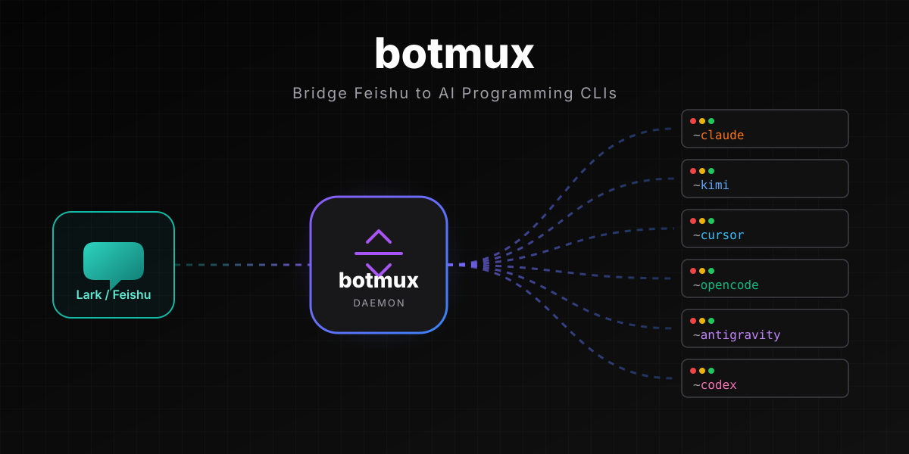

# botmux

<p align="center">
  
</p>

<p align="center">
  <a href="https://www.npmjs.com/package/botmux"></a>
  <a href="https://www.npmjs.com/package/botmux"></a>
  <a href="https://github.com/deepcoldy/botmux/actions/workflows/ci.yml?query=branch%3Amaster"></a>
  <a href="https://github.com/deepcoldy/botmux/actions/workflows/midscene-e2e.yml?query=branch%3Amaster"></a>
  
  <a href="LICENSE"></a>
</p>

<p align="center">
  在飞书里像拉同事一样，把 Claude Code、Codex 等 AI 编程工具拉进群干活。<br>
  让它们写代码、查问题、做评审，或定时汇报进展。<br>
  手机上随时看进度、追问和打断，回到电脑还能接着处理同一个任务。
</p>

<p align="center">
  <a href="https://deepcoldy.github.io/botmux/"><b>📖 文档</b></a> ·
  <a href="#3-步上手"><b>🚀 3 步上手</b></a> ·
  <a href="#日常能怎么用"><b>✨ 日常场景</b></a> ·
  <a href="README.en.md">English</a>
</p>

## 3 步上手

开始前，先确认要用的 AI CLI 已安装、登录，并能在终端里正常对话；其余准备见[前置要求](https://deepcoldy.github.io/botmux/prerequisites)。

### 1. 安装

```bash
curl -fsSL https://raw.githubusercontent.com/deepcoldy/botmux/master/install.sh | sh
```

装完开一个新终端。支持 Linux / macOS（x64 / arm64），运行不需要 Node；Windows 请在 WSL2 中使用。也可以用 `npm install -g botmux` 安装（安装本身需要 Node ≥ 22）。

### 2. 扫码配置第一个机器人

```bash
botmux setup
```

按向导用飞书扫一次码，选择 CLI 和默认工作目录。应用创建、权限配置和发布会自动完成；扫码人自动成为管理员。

### 3. 启动，拉进群开干

```bash
botmux start
```

首次启动若询问存储方式，直接回车使用默认设置。把机器人拉进飞书话题群或普通群，然后发一句：

```text
@机器人 看看这个项目怎么构建，并跑一下测试。
```

机器人会边干活边更新卡片，完成后给出结果。不想建群，直接私聊机器人也可以。

> **Mac 用户**：[GitHub Releases](https://github.com/deepcoldy/botmux/releases) 提供已签名、公证的 Botmux Desktop DMG。当前版本首次使用仍需先按上面第 1、2 步完成一次命令行初始化；已有配置可直接打开 App。详见 [macOS 桌面版](https://deepcoldy.github.io/botmux/desktop)。

### 企业微信智能机器人

支持独立企业微信 WebSocket 网关，复用本机 core-only 执行层，提供私聊/群内 @ 文字连续对话，不使用话题。运行 `botmux setup`（已有机器人时先选「添加新机器人」），在「飞书应用来源」末尾的「企业微信」分区选「扫码创建新机器人」，或对已在企业微信里创建好的机器人选「手动输入 BotID/Secret」；也可在 `botmux dashboard` 的「添加机器人」里点「改为添加企业微信机器人」。再用要授权的企业微信账号私聊发送配对码，完成后自动保存配置并上线。配置与当前能力边界见 [企业微信接入](docs/wecom.md)。

## 日常能怎么用

- **写代码、修问题** — 「@机器人 帮我修复这个报错，并补上测试。」进度和结果都在飞书里看，详见[实时卡片](https://deepcoldy.github.io/botmux/cards)。
- **排查故障、值班答疑** — 把机器人拉进值班群，@ 它分析日志、定位问题，详见 [Oncall 模式](https://deepcoldy.github.io/botmux/oncall)。
- **一起做代码评审** — 让不同 AI 机器人分别检查同一个改动、互相补充，详见[多机器人协作](https://deepcoldy.github.io/botmux/multi-bot)。
- **定时汇报** — 「每个工作日早上总结昨天完成的工作和今天的风险。」详见[定时任务](https://deepcoldy.github.io/botmux/schedule)。
- **出门在外继续跟进** — 在手机上追问、打断，或打开浏览器直接操作，详见 [Web 终端](https://deepcoldy.github.io/botmux/web-terminal)。
- **接着处理手边的任务** — 把电脑上跑到一半的会话接进飞书，或搬到另一个群继续，详见[会话接入与接力](https://deepcoldy.github.io/botmux/adopt)。

## 更多能力与文档

- **完整新手路径**：[文档首页](https://deepcoldy.github.io/botmux/) · [快速上手](https://deepcoldy.github.io/botmux/quickstart) · [常见问题](https://deepcoldy.github.io/botmux/faq)
- **更多协作方式**：[多话题并行](https://deepcoldy.github.io/botmux/multi-topic) · [角色与团队](https://deepcoldy.github.io/botmux/roles) · [多人独立会话](https://deepcoldy.github.io/botmux/global-settings#xpi) · [语音总结](https://deepcoldy.github.io/botmux/voice)
- **支持的 AI 工具**：已适配包括本地 NCA 在内的 30+ CLI / Agent。[查看完整列表与配置](https://deepcoldy.github.io/botmux/adapters)。
- **按需进阶**：[命令参考](https://deepcoldy.github.io/botmux/cli-commands) · [bots.json 配置](https://deepcoldy.github.io/botmux/bots-json) · [零注入](https://deepcoldy.github.io/botmux/bots-json#zero-prompt-injection) · [最佳实践](https://deepcoldy.github.io/botmux/best-practices) · [架构原理](https://deepcoldy.github.io/botmux/architecture)
- **多机器与团队协作**：可自托管开源的[中心化平台](https://deepcoldy.github.io/botmux/platform)，单机使用不需要它。
- **升级与维护**：[升级指南](https://deepcoldy.github.io/botmux/cli-commands#upgrade) · [全局设置](https://deepcoldy.github.io/botmux/global-settings) · [常见踩坑](https://deepcoldy.github.io/botmux/pitfalls)

## 社区 · 贡献

- 🎬 **视频介绍**：[观看演示](https://deepcoldy.github.io/botmux/img/video-promo.mp4)
- 💬 **交流群**：[关于 & 资源](https://deepcoldy.github.io/botmux/about)页提供内部与外部群扫码入口，内部用户可优先加入内部群。
- 🤝 **参与贡献**：欢迎提交 [Issue](https://github.com/deepcoldy/botmux/issues) / PR；新增适配器见[多 CLI 适配器](https://deepcoldy.github.io/botmux/adapters)。
- 📄 **License**：[MIT](LICENSE)

## 贡献者

感谢所有提交代码、文档，以及提出问题和建议的朋友：

<a href="https://github.com/deepcoldy/botmux/graphs/contributors">
  
</a>

## Star 趋势

<a href="https://star-history.com/#deepcoldy/botmux&amp;Date">
  <picture>
    <source media="(prefers-color-scheme: dark)" srcset="https://api.star-history.com/svg?repos=deepcoldy/botmux&amp;type=Date&amp;theme=dark" />
    <source media="(prefers-color-scheme: light)" srcset="https://api.star-history.com/svg?repos=deepcoldy/botmux&amp;type=Date" />
    
  </picture>
</a>
