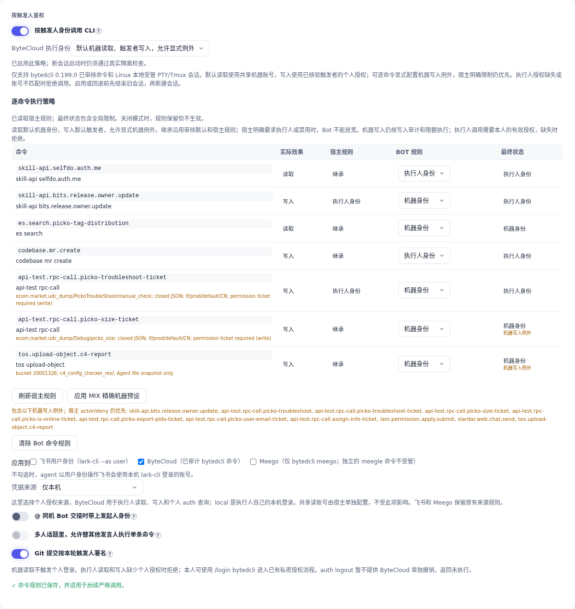

# 受管 Skill 最终 API 与 MIX 精确预设

目录版本 `2026-11-27.2`，原生 CLI 审核版本 `0.199.0`。严格模式的 `bytedcli --json skill-api <operationId去掉skill-api.前缀> --request '<JSON>'` 进入原有 broker/executor；目标、方法、headers、effect 和 credential realm 来自内置目录，调用方不能传 URL、JWT、cookie、账号或执行身份。

大请求使用 `--body-file <Agent文件>` 或 `--body-file -`。现有 CLI client 在 Agent 内快照文件/标准输入，host 只消费有界字节，不读取调用方提供的宿主路径。总输入上限 2 MiB（附件 base64 和 JSON 合计），小请求 argv 上限 64 KiB；提供的 helper 自动写入私有临时 JSON 并清理。host 重解析输入，复用 lease、authority/current 检查、写前 intent、输出限额、脱敏、重复请求缓存和写入结果未知语义；未知结果不自动重试。

## 场景预设

[完整 JSON](examples/bytedcli-mix-machine-policy.json) 与 Dashboard「应用 MIX 精确机器预设」来自同一纯模块。选定 Picko、release-owner、MIX troubleshooting、C4 的精确签名设为 machine；其他所有已登记业务 read/write 显式 actor，因此已有宿主 machine 也不会把未选写操作提升成机器身份。unknown 仍 actor，不能配置 opaque ID。此场景默认覆盖后，用户仍可单独调整已登记操作的机器例外；宿主明确 actor/deny 始终优先。通用模式本身仍是 read machine / write actor。

Skill 名称仅作来源归档，不能声明权限；同一规范命令被多个 Skill 使用时共享一条规则。Dashboard 在应用前列出全部机器写入例外，并完整保存其他 Bot 配置。截图由真实组件在 Chromium 使用假数据渲染，保留七条代表行（含两个同路径 RPC 的唯一规范 ID 和匹配条件），实际保存与宿主上限均已验证；未修改 live 配置。



## Realm 与宿主前提

- BITS、Argos、SelfDo、MindAI 使用被选择的 ByteCloud lease。release GET、关联研发单 POST list 和 PUT approvers 分别计为 read/read/write。SelfDo `GET /quest/draft/creation/<jobId>` 会推进建单，计为 write。MindAI create/resume/upload 为 write，auth/events 为 read；events 每次最多收集 15 秒完整 SSE 帧，helper 通过 Last-Event-ID 继续监听，原 watch 总超时仍生效。
- Picko ES 的固定 psm/index/lf/GET DSL 进入 GDPR realm：实际 HTTP POST 是 Kibana console proxy 携带只读搜索 DSL。宿主启动前显式设置 `BOTMUX_BYTEDCLI_GDPR_MACHINE_FILE` 指向已有平台登录缓存中的纯 GDPR JWT；文件须为当前用户持有、私有权限、普通文件、单 hardlink、无 symlink，且有效期超过 60 秒。没有默认路径扫描、交互登录、安装 DoAs 或自动刷新。指纹绑定 GDPR realm、受保护文件和凭据，不把 JWT 自述 subject 伪装为已核验 ByteCloud 账号。actor GDPR 尚无已验证个人来源，直接拒绝，绝不借用 machine cookie。
- Oncall retrieval 需要启动时显式设置 `BOTMUX_BYTEDCLI_MCP_PROXY_ROOT` 指向已安装的 `@byted/mcp-proxy@1.3.21`。固定 Node/包树完整性，bwrap 最小环境只注入被选 lease 的 `USER_JWT_TOKEN`；固定 PSM、CN、retrieval 工具、space 12、目录 69/71。代理自身可在启动时发现该固定服务的工具，caller 不能改服务器或工具。没有 npx 下载、Agent JWT 导出或继承宿主 secrets。
- HTTP 只使用冻结的启动网络环境与 CA 内容，强制 TLS 校验，不跟随 redirect，不回传上游日志。`SSL_CERT_DIR` 暂不支持且 HTTP fail closed；不影响原生操作。`SSL_CERT_FILE`/`NODE_EXTRA_CA_CERTS` 支持。没有使用 live 认证或业务网络证明实际账号权限。

## 源码与安装交付

`devbox-mix` 隔离分支适配 release-owner、Argos 和 SelfDo；`mix-agent-plugin` 隔离分支适配 C4 三个 wrapper 入口、oncall recall、pipeline 明确 `--yes` 以及 C4 Wiki 命令。C4 原 insearch Wiki 抓取规范化为原生 `lark-cli docs +fetch`：这仍使用 Lark 用户会话 realm，不借用 ByteCloud。SelfDo 受管模式在任何 API 前拒绝 `--executed-as`，因为它指定另一位实际执行人；普通模式、默认 create 和 invitees 保留。原有 release dry-run 零写与确认后的 apply 继续有效。

未找到 MindAI 与 Picko ES 的源码仓，提供 [版本绑定安装产物](artifacts/bytedcli-managed-skills/)。对目标副本先执行：

```sh
python3 docs/artifacts/bytedcli-managed-skills/install.py mindai --root /absolute/path/to/mindai-chart-generation
python3 docs/artifacts/bytedcli-managed-skills/install.py picko --root /absolute/path/to/picko-es-tag-distribution
```

默认只校验；确认目标版本后在相同命令追加 `--apply`。所有 input/output SHA-256 都在 manifest，原版本不匹配即拒绝，所有检查先完成再逐文件原子替换，已安装可重复校验。恢复时使用原 source/release 副本；不要把源码提交或安装产物视为已部署版本。本次只对私有副本测试安装，没有覆盖任何现有安装副本，没有重启 daemon，没有修改现网策略。

## 精确覆盖台账

下面每条是规范 ID；参数、别名和 closed body 以对应内置目录为准，目录外不会因 Skill 来源归档获得机器身份。原 `selected-skill-source-locations.json` 的 224 条路径/行提及包括三套重复安装副本、依赖声明和错误提示；这些不是额外授权。Picko troubleshooting 是叶技能编排，命令覆盖归到 item/soutui/es/tage；没有把被引用的完整官方 bytedcli Skill 扩展成机器授权。Holmes 手动页面、Lark 和 mix-next 属独立能力域。ES 安装/登录提示仅保留普通模式，严格模式用上述显式 host 前提。

| 规范 ID | 实际 effect | scene | 来源 Skill |
| --- | --- | --- | --- |
| bam.method.get | read | machine | picko-item-in-package, picko-soutui-sync |
| api-test.rpc-call.picko-troubleshoot | write | machine | picko-item-in-package |
| api-test.rpc-call.picko-troubleshoot-ticket | write | machine | picko-item-in-package |
| tcc.config.get.picko-rules | read | machine | picko-item-in-package, picko-es-tag-distribution, picko-tage-impact-report |
| api-test.http-call.picko-tag-enum | read | machine | picko-item-in-package |
| rds.db.query | read | machine | picko-soutui-sync, picko-tage-impact-report |
| api-test.rpc-call.picko-size | read | machine | picko-soutui-sync |
| api-test.rpc-call.picko-size-ticket | write | machine | picko-soutui-sync |
| api-test.rpc-call.picko-is-online | read | machine | picko-soutui-sync |
| api-test.rpc-call.picko-is-online-ticket | write | machine | picko-soutui-sync |
| api-test.rpc-call.picko-export-pids | read | machine | picko-soutui-sync |
| api-test.rpc-call.picko-export-pids-ticket | write | machine | picko-soutui-sync |
| api-test.rpc-call.assign-info | read | machine | picko-soutui-sync |
| api-test.rpc-call.assign-info-ticket | write | machine | picko-soutui-sync |
| cache.execute-command.picko-hget | read | machine | picko-soutui-sync |
| iam.permission.apply.check-only | read | machine | picko-soutui-sync, mix-troubleshooting |
| es.search.picko-tag-distribution | read | machine | picko-es-tag-distribution |
| api-test.rpc-call.picko-user-email | read | machine | picko-tage-impact-report |
| api-test.rpc-call.picko-user-email-ticket | write | machine | picko-tage-impact-report |
| bits.release.search | read | machine | release-plan-owner-sync |
| codebase.mr.files | read | machine | release-plan-owner-sync |
| skill-api.bits.release.get | read | machine | release-plan-owner-sync |
| skill-api.bits.release.tasks.list | read | machine | release-plan-owner-sync |
| skill-api.bits.release.owner.update | write | machine | release-plan-owner-sync |
| log.get-logid-log | read | machine | mix-troubleshooting |
| log.search-psm-log | read | machine | mix-troubleshooting |
| iam.permission.apply.submit | write | machine | mix-troubleshooting |
| bits.anywhere.share.get | read | machine | mix-troubleshooting |
| slardar.web.data.list.mix-profile | read | machine | mix-troubleshooting, mix-c4-tracker |
| slardar.web.analyze-url | read | machine | mix-c4-tracker |
| slardar.web.chat.check-auth | read | machine | mix-c4-tracker |
| slardar.web.chat.get | read | machine | mix-c4-tracker |
| slardar.web.chat.send | write | machine | mix-c4-tracker |
| slardar.web.data.get.mix-profile | read | machine | mix-c4-tracker |
| slardar.web.data.session-list.mix-profile | read | machine | mix-c4-tracker |
| libra.layer.get | read | machine | mix-c4-tracker |
| libra.experiment.list | read | machine | mix-c4-tracker |
| libra.experiment.get-batch | read | machine | mix-c4-tracker |
| tos.upload-object.c4-report | write | machine | mix-c4-tracker |
| codebase.repo.file | read | machine | mix-c4-tracker |

未选 read/write 均显式 actor，包含 Argos、SelfDo、MindAI、oncall retrieval、TCE/SCM/pipeline/develop 和 MR create；shared codebase.mr.files 等精确签名则遵循上表共享 machine 规则。
