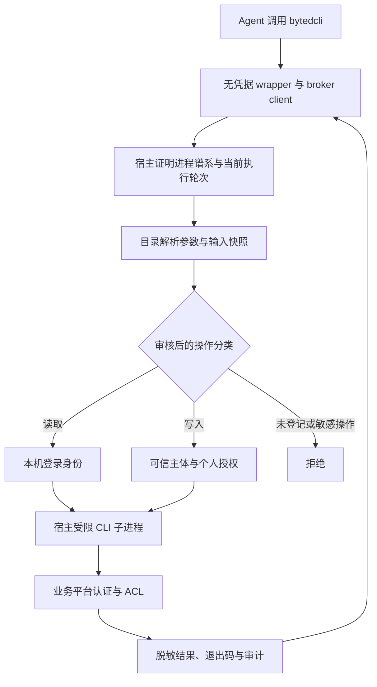

# bytedcli 读取使用本机身份、写入使用触发者身份

状态：待评审的设计方案；本次只提交文档，不改变运行代码和机器配置。

设计日期：2026-11-26。基线：botmux `master`，提交 `4132267e0b409a3539d8f12c5db7d107c777c191`。

设计分支：`feat/bytedcli-read-write-identity`。

## 1. 目标与约束

同一个 Bot、同一个会话中，已登记的业务读取使用宿主机登录账号；业务写入使用本次调用所归属的可信触发者。读取无需该触发者完成 ByteCloud 个人授权。写入缺少触发者、授权过期、账号不匹配或上游拒绝权限时，均拒绝执行，不降级为本机账号、Bot owner 或其他人的账号。

这里的读写是上游业务效果：查询 MR、活动或日志属于读取；创建 MR、更新研发任务、发布、删除、授权和远程执行属于写入。SDK 更新自己的授权缓存不算业务写入，但只能发生在宿主可信凭据存储中。HTTP GET/POST、命令名字和 CLI help 中的描述都不能单独作为操作分类依据。

保留 `bytedcli ...` 的调用入口和非交互命令的 stdout、stderr、退出码语义。增加显式选择的新模式，旧配置继续保持现有行为。新模式只在执行身份和凭据隔离均能被证明的运行组合中开放。

首期不修改 bytedcli 源码、中心平台协议或各业务平台 ACL；按人登录、平台取票、区域选择及撤权复用现有能力。broker 的分类限制补充上游 ACL，不能替代它。

## 2. 当前分支已经具备的能力

| 现有实现 | 可复用的能力 | 本次缺口 |
| --- | --- | --- |
| `src/services/trigger-user-auth.ts` | `lark-user`、`bytecloud`、`meego` 能力开关与配置解析 | 按能力整体选身份，没有按业务操作选身份 |
| `src/core/identity-policy.ts` | 按能力选择 `auto/platform/local` 来源 | 来源决定个人凭据从哪里取得，不决定读写使用谁 |
| `src/services/bytedcli-auth.ts` | 按人独立 HOME、设备授权、JWT mint/renew、持久撤权 epoch | 业务执行需要宿主专用入口和账号核对 |
| `src/core/platform-credential-source.ts` | 以可信用户的 union_id 请求平台 grant | broker 需要直接消费 grant，不能把本机读凭据发布给 worker |
| `src/core/turn-cli-identity.ts` | 按轮发布身份，处理委托、等待、身份替换与撤销 | 新模式应按调用懒取个人凭据，避免读取触发个人授权 |
| `src/core/cli-identity.ts` | PATH 包装器、proven/single 模型、Codebase/Bits/git 联动 | 包装器当前取得凭据后在 Agent 侧 exec，而非宿主代理执行 |
| `src/core/current-execution.ts`、`current-actor-attestation.ts` | 从 socket peer、进程谱系、worker generation 证明执行轮次 | 执行证明本身不证明真人身份或业务操作权限 |
| `src/core/dashboard-ipc-server.ts` | current-execution、identity 等内部路由 | 需要独立执行路由及请求前后检查 |
| `src/adapters/cli/fs-policy.ts`、`read-isolation.ts` | 文件隔离、进程隔离及 worker 报告 | 必须保护宿主 bytedcli 的全部凭据入口，而非只保护个人 HOME |

相比此前讨论时的代码，当前 `credentialSource` 已支持字符串或按能力的对象；还存在 `allowOwnerActor`、`allowSpeakerSwitch`、`gitCommitIdentity` 等选项。设计必须保留这些字段的旧模式语义，不能重新把整个来源字段简化成字符串。

`credentialSource.bytecloud = local` 指“触发者个人授权保存在本机”，不是“以宿主机登录账号执行”。本机共享读身份由独立宿主配置选择。

本次只读检查的 bytedcli 是 `0.199.0`。它支持 `--profile`，但所检查的 MCP command spec 没有足以强制读写分类的 effect 字段。profile 是存储选择能力，不是读写权限边界。

## 3. 方案选择

| 方案 | 能力与代价 | 结论 |
| --- | --- | --- |
| 宿主 broker 校验、选身份、执行 | 需要命令目录、输入适配与隔离接入；凭据不必交给 Agent | 推荐，作为新模式的执行路径 |
| 包装器分类后给 Agent 注入不同凭据 | 改动较少，但本机 token 可被拿去执行其他写命令，绝对路径也可绕过 PATH | 不能满足强制分离，不作为新模式的降级路径 |
| bytedcli 上游增加统一 effect 元数据或只读 token 能力 | 可减少长期目录维护，取决于 CLI 与认证平台支持 | 后续增强；仍需可信执行与凭据隔离 |

不用自然语言或大模型判断一次调用是否只读。运行时只接受审核过、与受支持 CLI 版本绑定的命令和参数组合。

## 4. 范围与首期行为

| 调用类别 | 新模式行为 |
| --- | --- |
| 已登记的业务读取 | 宿主本机个人登录，独立于触发者是否授权 |
| 已登记的业务写入 | 可信工具执行主体的个人授权，仍由上游校验资源 ACL |
| 写操作的权限检查、预读、状态校验 | 在该写调用内部使用同一个人的凭据，不能用共享读账号替代 |
| help / version | 从可信命令目录或固定 CLI 获取，不取个人凭据 |
| 个人 auth login/status/logout/userinfo | 独立的个人授权入口；仅操作本人的授权，投影安全结果 |
| auth export/import、获取/设置 JWT、PAT、应用 AK/SK | 不作为普通读或业务写开放；拒绝 |
| raw API、RPC test、远程 shell、任意 SQL、插件、自升级 | 首期拒绝，需独立能力适配 |
| 未登记命令、未登记参数组合、未审核版本 | 拒绝；不猜读写，不自动转为本人执行 |

新模式必须封住 ByteCloud 凭据出口。当前 `codebase`、`bitscli/bits-cli`、git askpass 会共享 bytedcli 身份材料；如果继续向 Agent 发布这些 token，Agent 可绕过 broker，甚至保留上一轮的个人 token。因此首期在新模式中关闭这些独立凭据出口及未适配的 standalone 远端操作，使用已登记的 `bytedcli codebase ...`、`bytedcli bits ...` 操作替代。旧模式的 standalone 行为保持现状。

这是一项明确的兼容限制：首期新模式不开放 standalone git push、MR create 的 `--push`、本地 MR branch 工作流或 standalone Codebase/Bits 远端命令。git 本地编辑、status、diff 等不需要业务凭据的操作仍可在 Agent 工作区运行。后续增加独立 host adapter 后再开放远端操作，不能在过渡期间恢复 token 导出。已有 `gitCommitIdentity` 仍用于本地署名，不代表拥有推送权限。

Meego 是单独的授权能力。首期新的 ByteCloud 目录不开放 `bytedcli meego`，也不把它的原生分支带进 broker。新模式的全局 ByteCloud 身份选项不能被 Meego 原生分支带出；原生 Meego 若存在获得宿主 ByteCloud 凭据或执行任意子程序的旁路，则该会话组合不可启用新模式。独立 `meegle` 的既有能力边界不因此扩大。

## 5. 配置合同

在现有 `triggerUserAuth` 中新增一个执行方式字段：

```json
{
  "triggerUserAuth": {
    "enabled": true,
    "capabilities": ["lark-user", "bytecloud"],
    "credentialSource": {
      "lark-user": "local",
      "bytecloud": "platform"
    },
    "bytecloudExecution": "read-machine-write-actor"
  }
}
```

`bytecloudExecution` 的合法值：

| 值 | 解释 |
| --- | --- |
| 缺省或 `trigger-user` | 现有 ByteCloud 调用整体使用触发者；保留旧行为 |
| `read-machine-write-actor` | 本文定义的宿主 broker 路径 |

新模式生效必须同时满足 `enabled=true` 且 `bytecloud` 能力开启。字段可以随关闭的策略保留，但此时 UI 不宣称读写分离已生效；开启时检查运行组合。非法枚举拒绝保存。

机器级配置可增加 `bytedcliBroker.machineProfile`，只接受合法 profile 名称；缺省明确使用宿主默认 profile。凭据根从 daemon 的可信 HOME 派生，不接收会话提供的 HOME 或任意目录。管理员可先在宿主普通终端完成该 profile 的登录。选择值是“本机共享读用哪个登录”，不影响个人 `credentialSource`。

目录版本、受支持 CLI release 与可执行程序的可信安装位置由宿主 adapter 管理。Bot 配置和 Skill 不得指定任意命令、任意 executable、任意凭据文件或自定义“只读”判断规则。

旧 UI 保存时须保留新字段；新 UI 保存时保留现有 per-capability 来源、owner、git 和委托字段。所有保存入口经同一个 parser。模式变更按现有配置合同在下一个会话启用；旧会话的 broker 对当前策略变更立即拒绝新增调用，不能把仍运行的严格会话自动降级为原生执行。重建后才按新的模式工作。

旧 daemon 不认识新模式时无法建立新模式证明，wrapper 不执行本地 fallback。旧 wrapper 和新 daemon 混版时，daemon 的 ByteCloud 凭据出口关闭，旧 wrapper 只能被拒绝；通过会话重建进入新路径。原始文件配置被旧版本忽略的风险由升级/降级流程处理：启用新模式前验证 daemon 与 worker 都支持同一 broker 协议；降级前先禁用并结束新模式会话。

## 6. 执行架构



新增模块的职责：

| 模块 | 负责 | 不负责 |
| --- | --- | --- |
| `bytedcli-operation-policy.ts` | 确定性解析、版本匹配、参数白名单、效果分类 | 解析真人身份或读凭据 |
| `bytedcli-broker-authority.ts` | execution fence、工具主体、策略、委托与撤权复查 | 执行任意 CLI 或自动扩大授权 |
| `bytedcli-executor.ts` | 固定 executable、可信 cwd/env、输入快照、子进程、超时和结果 | 直接接受未经审核的原始 argv |
| `bytedcli-broker-audit.ts` | 意图与结果审计、请求关联、敏感字段排除 | 保存完整命令输出或 token |
| `cli/bytedcli-exec.ts` | 无凭据客户端、文件/stdin 打包、结果输出 | 选择身份、判定操作只读 |
| `dashboard-ipc-server.ts` | 路由登记与真实 peer 解析，调用以上模块 | 继续内嵌整套业务流程 |

进程证明与个人凭据解析抽取公共 seam 供旧路径和 broker 复用；不复制 identity 路由中关于 worker、turn、委托和撤权的判断。

## 7. 命令目录与参数校验

一个目录项包含：稳定 operationId、完整命令 path、aliases、精确受支持版本、参数 schema、身份类别、输入策略、超时/输出上限、资源标识提取、输出脱敏策略，以及实际上游效果的审核依据。

目录不使用通配的“所有 get 都只读”“codebase 域都允许”。同一个命令的不同选项可以有不同效果；互相冲突、未知、无法确定 arity 的选项均拒绝。

parser 必须覆盖重复选项、短名/长名、`--key=value`、可选布尔值、negated flags、`--` 和合法 aliases。只支持与目录绑定的 CLI grammar。服务端从解析后的结构重新生成 canonical argv，不能验证一套参数却把原始 argv 原样执行。

身份和诊断覆盖参数在整个 argv 的合法全局位置均被识别，不能通过放在子命令后绕过：调用方不得选择 `--as`、`--profile`、JWT 文件、auth-site、代理、任意 HTTP header、debug、HTTP trace 或关闭脱敏；`--jq` 首期拒绝，因为它可以观察凭据子进程环境，Agent 可在 broker 返回安全结果后自行用 jq。`--site`、`--vregion`、`--vdc` 只开放目录审核过的值；区域不支持时拒绝。

`--yes` 不是身份或目录豁免。只在具体已审核写项需要且允许时接受，不能越过 broker 的 deny。具体操作的 `--username`、owner、reviewer 等业务字段按各自 schema 判断，不做会误伤查询过滤器的全局字符串封禁。

首期候选目录以本次检查的 CLI 路径为基准，进入实现时逐项复核命令源码的实际效果和所有可接受参数：

| 类别 | 首期目录 |
| --- | --- |
| Codebase 读取 | `repo get/list`；`mr get/view/list/count/diff/files/status` |
| Codebase 写入 | `mr create/update/edit/close/reopen`，明确 repo/head/base，不含 `--push`、附件上传、自动关联其他授权域、权限旁路或任意原生 body |
| BITS 读取 | `develop get/list/check-mr/inspect-changes`；`release get/search/inspect/stages/project-configs` |
| BITS 写入 | `develop create/update` 的已知字段子集；任意原生 body、跨域导入、发布/流水线执行首期不开放 |
| 日志读取 | `log get-logid-log/get-log-cluster/search-log-matchers/get-lane-instance-log` 的有限查询；不含无限 watch、任意落盘或无法限定的全量 dump |
| 个人授权 | 安全投影后的 `auth status/userinfo/login/logout`；不开放 token 输出、账号导入和应用凭据配置 |

每一项的未审核选项保持拒绝；help 可列出该版本上游命令并附 broker 支持状态，但 help 可见不代表可执行。目录 release 是独立、可信的发布物，机器升级到未审核的 bytedcli release 后立即停止业务执行；不在调用中自动升级 CLI。后续按业务域扩展目录，不能以保留未知命令原生直连作为兼容办法。

## 8. 可信主体与凭据选择

### 8.1 执行证明

broker 从本次 socket peer 和 host-held worker 状态推导 session、worker generation、dispatch attempt、turnId 和 `identityTurnId`。请求可带 sessionId 用于路由，但不得带 authoritative PID、open_id、email、owner、个人 HOME、JWT 或“这是 read”标志。

`identityTurnId` 优先于新到达的 envelope turnId。A 的调用执行中收到 B 的消息，不会改成 B 的账号。queued、打断和重放都使用宿主当前执行证明；代码不使用会话首个发送者或 shell 的可写环境作为主体。

证明后须单独验证 Bot 使用权、对话范围、当前策略和必要的资源授权。知道 sessionId、能访问 loopback、持有旧客户端响应，都不能授权执行。

### 8.2 业务读取

读取只取宿主指定 profile 的本机个人登录，清除其他来源的身份覆盖变量。不读取本轮个人 HOME，也不请求平台个人 grant，不启动设备登录，不等待个人身份发布或续期。宿主从共享 profile 租用本次所需的短期个人票据，再在请求私有空 HOME 中执行，避免并行读共写共享 profile 的 SDK 文件；不把共享 profile 的长期登录复制到执行 HOME。

本机未登录时返回 `machine_auth_required`，让管理员在宿主完成登录；不能转用触发者来掩盖机器故障。审计写清实际本机账号与调用所在会话。读取暴露的数据范围等于共享账号在上游拥有的权限；Bot 对话准入仍须成立。

### 8.3 业务写入

直接真人轮次使用本轮已验证发送者。带签名的 dispatch/workflow 委托使用既有委托主体，并在每次调用重新验证任务、目标、工具范围和撤销状态。定时任务只有在现有 schedule authority 能验证明确运行主体与 ByteCloud scope 时才允许本人写；ownerless、无有效 scope 或自动恢复出的匿名轮次只有已登记共享读。

`allowOwnerActor` 不能为新模式的写补出隐式 owner；明确的定时创建人/认领人、宿主已认证的 runAs 和有效委托与隐式 owner 不同，继续依据对应 authority 校验。首期 `BOTMUX_AS` 在新模式下拒绝，避免一次调用另选同轮说话人。旧模式保留这些选项的原合同。

个人凭据来源遵循当前 per-capability `credentialSourceOf(config, 'bytecloud')`：`local` 只取个人本机授权；`platform` 只取平台；`auto` 在已绑定机器使用平台、未绑定时使用本机个人授权。平台不可达、不同意本机使用或缺授权时不回退共享机器账号。

本人账号必须与可信企业身份一致。本机授权核对官方 provider 返回的 account identity；区域 token 核对 partition、有效期及经过可信来源解析的账号。平台 grant 复用其已验证用户绑定，必要时在宿主使用请求范围 JWT 查询官方 userinfo，核对邮箱/账号。无法核对时返回 `actor_identity_unverified`，不只依据目录名字或 token 的 base64 payload 建立信任。JWT payload 解析仅用于一致性检查，不冒充签名验证。

写调用取得短期凭据后，在请求私有空 HOME 中执行，避免与持久个人 HOME 的 mint/renew 共写 SDK 登录。沿用当前区域归一和区域材料拒绝行为；缺少所需区域凭据时拒绝，不退回默认区域或共享机器登录。跨站点内部子请求若现有 request-JWT 机制不能安全供票，则该目录项/区域组合暂不开放。

### 8.4 授权生命周期

个人授权状态、begin、complete 与 logout 复用已有宿主逻辑。用户可通过既有个人授权入口或 broker 的安全 auth adapter 授权；complete/device code 留在宿主，不进入请求或输出。群内不把个人授权链接或 token 暴露给全部成员。

个人业务写按调用懒取凭据。不能为了给旧 ByteCloud env 文件预填材料而让每个共享读启动平台取票或授权通知。单独的个人 auth 调用只投影状态、本人账号和经过既有隐私规则允许的授权入口，不投影 SDK 原始返回。

## 9. 输入、cwd 与宿主执行边界

不能把 Agent 的任意 cwd 交给宿主 bytedcli。仓库 `.git/config`、hooks、fsmonitor、credential helper、CLI 插件和本地脚本都可能使“查 MR”变成宿主代码执行。executor 使用请求私有工作目录、可信的 CLI 安装与固定工具 PATH；禁用不需要的插件、自升级和宿主用户配置扩展。

需要 repo 上下文时，调用必须给出审核过的 repo path/id 和分支。wrapper 可以在 Agent 的受限环境中解析当前工作区上下文作为普通资源输入，宿主只接受符合 schema 的值并让业务平台校验权限，不在宿主运行该仓库的 git。MR create 必须显式得到 repo/head/base；不存在隐式宿主分支推断。

stdin 和 body-file 在 Agent 环境中读取，作为有上限的字节输入发送；服务端按该 operation 的策略解析并写入请求私有普通文件，执行时把路径改为该快照。服务端不打开调用方传来的本机路径、软链、FIFO、设备文件或任意 URL。必须分类与执行同一份内容，禁止“校验文件后再次读取”的 TOCTOU。

首期不支持任意输出文件和原生附件上传。后续下载 adapter 只能把 broker 返回的安全文件数据写入 Agent 沙箱可写目录，不能让 CLI 在宿主任意路径落盘。

子进程使用固定 absolute executable 和 argv 数组，`shell=false`，不拼接 shell；可执行安装树在 Agent 中不可写。env 从宿主允许列表构造，清除 caller 凭据、profile、managed-workspace 根、Meego/BITS/Codebase app override 等可能覆盖选定身份的变量。网络代理和证书只能来自可信宿主设置。actor JWT 可经该受保护子进程的 request-scoped 输入或受控 env 传递，但不能进入 Agent、argv、普通日志或可见文件。

输出先在宿主按命令策略过滤，移除活跃凭据的精确值、已知凭据形状及禁止的认证字段，再返回。业务日志的通用脱敏不承诺识别所有第三方秘密，因此有凭据输出能力的命令始终禁用；不能用“会脱敏”代替操作白名单。

## 10. 强制隔离与可用运行组合

新模式开放条件：Linux、受管的本地 PTY/Tmux 会话、真实有效的 execution proof、Agent 文件白名单隔离、宿主凭据/安装树保护和有效进程隔离。代码应复用 worker 实际报告的模型与隔离证明，不仅看配置写了 `sandbox=oncall`。

必须拒绝宿主默认 bytedcli 存储、所有 profile、持久个人 HOME、broker 私有 cwd/审计、平台机器凭据和其它能覆盖 ByteCloud 身份的配置路径。禁止调用方 readOnly/readWrite grant 重新开放这些权限；只读 token 文件仍然能授权远端写，不是安全的例外。

宿主 broker 的凭据子进程必须不在 Agent 可观察的 /proc/ptrace 范围；PID namespace 降级、原生未隔离路径或已开放宿主凭据的 adapter 不宣称新模式有效。Seed/Relay 等模型客户端若需要在 Agent 进程内直接访问同一个宿主 ByteCloud 存储，首期组合拒绝，后续需先分离模型认证通道。当前 Linux allowlist matrix 明确不支持的 codex-app 也不因此自动变成支持。

single、未证明的 adopt/restore、远程 runner、macOS 或未知隔离组合首期返回 `broker_containment_unavailable`，不自动改为整体触发者或本机执行。恢复会话须重新取得 generation 和隔离报告。后续逐组合验证后扩大支持范围。

既有网络 policy 继续生效；broker 是有界的宿主业务出口，不提供通用 HTTP CONNECT、任意 URL 或 arbitrary RPC。无需为了本功能统一封掉所有其他私网排障，但不能经可信 proxy 或既有凭据导出工具把共享机器 token 交给 Agent。若某目录项会将凭据转发到任意用户 URL，拒绝该项。

## 11. IPC 合同与资源限制

新增内部协议 `botmux.bytedcli-exec.v1`，拟定路由 `POST /api/bytedcli-exec`。它与 current-execution 一样经 handler 内的真实 peer 检查授权，不能因 outer IPC 放行就免去校验。

请求字段：schema、sessionId、requestId、argv，以及目录允许的 stdin/file 字节快照；所有身份字段禁止。argv 上限 256 项、合计 64 KiB；默认输入总上限 2 MiB，文件/stdin 使用 base64，HTTP body 另设 3 MiB 硬上限并在解码后再次校验大小。具体目录项可降低上限，增加上限必须重新审核。

响应字段：schema、requestId、operationId、effectiveIdentity 类别、outcome、脱敏后的 stdoutBase64/stderrBase64、exitCode、安全 errorCode。client 解码后写回原 stdout/stderr。effectiveIdentity 只提供 machine/actor 与必要安全账号信息，不携带 grant、设备码、token 或认证 header。

首期非交互、有限时长、缓冲结果返回；不伪装成完整 PTY/watch 支持。默认执行上限 60 秒，审核项可设至 120 秒；授权等待复用现有 grant budget，整个请求具有独立硬上限。combined stdout/stderr 上限 16 MiB；超限报错，不把截断 JSON 当成功。大查询应分页或收窄范围。

每个会话最多 4 个并行读、1 个并行写；daemon 全局最多 16 个执行且其中写最多 4 个，最多 64 个配额等待者，等待 5 秒仍无配额返回 busy。全局缓冲预算 128 MiB，耗尽时拒绝继续分配并按读失败/写未知结果收尾，不能无限排队或缓冲。共享 SDK 取票访问按相应可信 HOME/profile 串行化，业务子进程使用请求私有执行 HOME；已有本机个人 HOME 队列继续复用。多 daemon SDK 共写的现有边界不以新 broker 宣称已经解决。机器共享 profile 的并发和外部管理员登录变更须在前后账号核对中处理，变化则拒绝结果复用。

去重以冻结执行 tuple、requestId 和输入摘要绑定。完全相同的重复在途请求只能等待已有执行；相同 id、不同输入拒绝。客户端不自动重试写；daemon 重启不会重新执行未结束请求。该机制不宣称跨重启 exactly-once，重启丢失结果的写必须回读上游确认。

响应只表示与这次请求关联的执行结果，不是可复用的主体凭证或通用执行授权。客户端无法确认完成时保留 requestId 并报告未知状态，不悄悄再提交新 requestId。

## 12. 变更、撤权和并发 fence

请求在任何可能等待的步骤前冻结：session、worker 对象/generation、execution turn、identityTurn、dispatch attempt、可信主体、策略指纹、凭据来源、平台 binding key、auth epoch、委托/任务版本与输入快照摘要。

peer 证明后、排队结束后、个人取票前后、CLI 启动前以及输出返回前均重新检查。策略修改、主体变化、任务停止、撤权、会话关闭或 worker 替换使旧请求失效；旧 mint/renew 结果不能重新发布新模式凭据。

读账号也固定到本次租用的 account fingerprint；等待期间本机换账号，则重新拒绝或重新取得新的明确租用，不能在一次调用里静默换人。

新模式不通过 `writeSessionIdentity` 发布 ByteCloud token。旧 pending publication、计时续期、Codebase/Bits companion 镜像和 git askpass 的 export 路由都需检查模式与策略版本；新会话初始化先清掉旧 ByteCloud 制品。已有活跃旧模式会话不能原地保证 Agent 忘掉已经拿过的 token，因此必须结束并重建，不能只换一个 wrapper 文件。

在 CLI 派发前失效，保证不提交该次业务操作；派发后失效，只能终止 broker 自己的子进程并报告可能已执行，不能承诺撤回已在途的远端写。两种情况使用不同错误和审计 outcome。

## 13. 审计与错误语义

审计同时记录 requester 与 executor，而非只有“发送消息的人”：requestId、daemon boot、Bot app/session、执行轮次、operationId/目录版本、读写类别、实际账号、资源标识、输入摘要、个人凭据来源、结果、上游 requestId 和耗时。不记录完整 argv/body、日志输出、描述文本、auth header、token、授权链接或 device code。

写操作先成功持久化 intent，再派发；intent 失败则不执行。远端成功后结果审计失败，向调用方报告 `write_outcome_unknown`，保留已写 intent 供排查，不把它当作可自动重试的失败。审计使用宿主私有 append 记录，目录权限和 no-follow/regular-file 检查复用现有安全文件工具。

| 安全错误 | 调用方行为 |
| --- | --- |
| `operation_not_supported` / `option_not_supported` / `cli_version_unreviewed` | 补 adapter 或使用已支持命令，不走原生旁路 |
| `current_execution_unverified` / `broker_containment_unavailable` | 重建支持的会话；业务命令未派发 |
| `machine_auth_required` | 管理员完成共享 profile 登录；不要求触发者补个人授权 |
| `actor_required` / `actor_auth_required` / `actor_auth_expired` | 以同一可信用户完成个人授权后明确重试 |
| `actor_identity_unverified` / `actor_identity_mismatch` | 核对绑定，拒绝执行，不改为 owner |
| 上游明确认证失败 | 停用本次凭据版本；不撤销期间新授权，不自动重试 |
| 上游明确 ACL 拒绝 | 说明本人无该资源权限，不替其申请或借用机器账号 |
| `execution_changed` / `policy_changed` / `authority_revoked` | 派发前拒绝；派发后按未知结果处理 |
| `read_failed` / `output_limit_exceeded` | 收窄读取或处理故障，不输出伪成功的截断结果 |
| `write_outcome_unknown` | 根据资源标识回读确认，禁止自动重试写 |

读取、授权状态与明确成功/失败保留 CLI 常规退出码；broker 拒绝沿用会话工具拒绝的 77。具体上游 401/403 与业务错误的映射必须来自 adapter 可识别的真实响应；不能根据任意 stderr 包含“permission”就宣称写没有发生。

## 14. 修改文件清单

| 文件或目录 | 修改 |
| --- | --- |
| `src/services/trigger-user-auth.ts` | 新字段、枚举校验、规范化与兼容解析 |
| `src/core/identity-policy.ts` | 将个人来源与执行方式明确分开；提供一致的模式判定 |
| 新增 `src/core/bytedcli-operation-policy.ts` 与可信目录数据 | grammar、schema、版本与效果目录 |
| 新增 `src/core/bytedcli-broker-authority.ts` | 公共执行/主体解析 seam 与 fence |
| 新增 `src/core/bytedcli-executor.ts` | 宿主执行、输入、env、cwd、资源上限与退出语义 |
| 新增 `src/core/bytedcli-broker-audit.ts` | 安全审计与结果未知语义 |
| 新增 `src/cli/bytedcli-exec.ts` | 无凭据 client 与 CLI 输入输出适配 |
| `src/core/cli-identity.ts` | 新模式 wrapper 转 broker；封住旧 ByteCloud/companion/git 凭据出口 |
| `src/core/dashboard-ipc-server.ts` | 新路由；identity/auth/background 等旧出口的模式检查；复用 peer 证明 |
| `src/core/turn-cli-identity.ts`、`bytedcli-identity-renewal.ts` | 不为共享读预取授权；旧异步发布/续期不能恢复被关闭的出口 |
| `src/services/bytedcli-auth.ts` | 复用登录/epoch，抽取宿主凭据租用和官方账号核对能力 |
| `src/core/platform-credential-source.ts` | 供 broker 宿主消费 grant，保留 per-capability 与绑定语义 |
| `src/adapters/cli/fs-policy.ts`、`read-isolation.ts`、`src/utils/child-env.ts`、`src/core/env-policy.ts` | 强制凭据保护、执行安装树保护及身份变量清理 |
| `src/core/worker-pool.ts`、`src/worker.ts`、`src/core/types.ts`、`src/types.ts` | 新模式/实际隔离报告/会话 snapshot 的接线；不复制整套权限判断 |
| `src/services/bot-config-store.ts`、`src/bot-registry.ts`、机器 `src/config.ts` | 保存、加载、配置说明、机器共享 profile 与所有入口一致性 |
| `src/dashboard/web/bot-defaults.ts`、`bot-defaults-page.tsx`、`i18n.ts` | 模式编辑、兼容字段保留、支持状态与具体限制展示 |
| `src/cli.ts`、`src/core/self-spawn.ts`、编译 entry 配置 | broker client re-exec 的源码/构建/单文件二进制兼容 |
| execution/identity/credential/broker 相关测试与文档 | 真实行为及影响范围验证，不断言实现源码文本或文案 |

默认实现放在 botmux 核心，避免独立插件再建一套个人 grant 和 peer authority。devbox-mix 的 MIX broker 可参考设计，但本功能不要求修改 MIX 插件、mix-cli 或业务平台。

## 15. 验收与回归矩阵

所有测试使用临时 HOME、假的 CLI/provider 和真实 broker 组件；不读真实个人凭据、不写线上业务、不重启 live daemon。子进程使用仓库 `test/helpers/ts-runner.ts`；独立探针通过 `bun scripts/fenced-run.ts`。

| 验收场景 | 必须证明的结果 |
| --- | --- |
| 本机已登录、触发者未授权，执行业务读 | 只调用本机 provider/CLI，没有个人 grant、device login 或授权等待 |
| 同条件执行写 | 没有任何上游写，返回本人的授权要求 |
| 本机管理员有权限、本人无资源权限 | 读可成功，本人写得到 ACL 拒绝，没有 machine fallback |
| A/B 同话题消息交叠 | A 已执行调用固定 A；B 的新调用使用 B；旧缓存不能导出 A 的票据 |
| 取票期间撤权、换 owner/模式、任务停止或 worker 重建 | 派发前拒绝；旧结果不能恢复身份；派发后返回未知结果 |
| platform/local/auto 与 per-capability 配置 | 完全遵守现有来源矩阵，不把 local 解释为共享机器身份 |
| 错误账号扫码或区域 claim 不符 | 无写派发；不会仅因为 open_id 目录存在就通过 |
| aliases、重复 root 参数、选项挪到 command 后、body-file 变更 | canonical 分类与真正执行一致；身份覆盖拒绝 |
| raw API、SQL、RPC、token export、--jq、MR --push、附件 | 未登记组合不执行；没有凭据输出和宿主 git/hooks 执行 |
| 恶意 repo config、cwd、软链、FIFO、文件路径 | 宿主不打开任意路径，不运行工作区控制的程序 |
| 绝对路径 CLI/curl、自建 wrapper、旧 identity/background/token 路由 | 拿不到共享机器或旧 ByteCloud 凭据；不能绕过新模式获取权限 |
| 宿主后续新增 profile 或个人凭据文件 | 依然隐藏，不只屏蔽启动时存在的文件 |
| 超时、断连、审计失败、broker 崩溃、重复 requestId | 写不自动重试；已派发且无确认时报告未知；配额与子进程资源可回收 |
| CLI release 改变、旧/new daemon/worker/UI 混版 | 新模式拒绝或要求重建，旧模式字段不丢失，不静默原生直连 |

平台/会话覆盖：Linux PTY 与 Tmux；至少 Claude Code、Codex 两类 Agent；普通话题、群 shared 会话、跨用户隔离、授权等待、重启恢复、direct schedule 与签名委托。对 macOS、codex-app、remote、single、未经证明的 adopt 与缺 PID 隔离组合验证明确拒绝。旧模式补 lark-cli、Meego、Codebase/Bits 与 git 回归，验证新模式未误改其旧合同。

命令效果审核与行为测试缺一不可。高风险 fence 测试必须做变异复验：移除 guard 后真实假上游写发生，测试随之失败。实现若改变持久审计/状态语义，按仓库要求在提交实现前做独立对抗复核，覆盖中途干预、部分落盘及长操作重叠。

代码实现阶段的检查顺序：定向 broker/identity/config/隔离测试、受影响跨 CLI 回归、`bun run typecheck`、`bun run build`、相关单文件 binary smoke。只有需要真实飞书体验的 UI/授权路径，在另行安排的部署步骤中进行 live 验证；不能用仅空 Bot 的 smoke 替代实际 daemon 路径。

## 16. 实现与发布顺序

1. 定义配置、协议、目录和纯校验 seam，保持新模式关闭；完成候选命令的参数/上游效果审核。
2. 实现 host executor、两类凭据选择、账号/区域核对、输入快照、审计与未知结果处理；用假上游证明完整读写行为。
3. 封住凭据出口并接入强制隔离、worker 报告、wrapper 与 peer route；闭合 ByteCloud companion/background/旧接口旁路，再开放新模式。
4. 接 Dashboard 与配置所有入口，验证旧配置保留与混版拒绝；本机指定 Bot 的新会话灰度已审核目录。
5. 在新模式闭环通过后按域扩充目录；standalone Codebase/Bits/git host adapter 单独设计并审核后开放。

灰度不改变全机默认。启用前列出该 Bot 现用 bytedcli 命令的覆盖情况，确认共享 profile 登录、受支持 CLI release 和实际隔离组合；不收集现有完整命令 body 或 token。结束旧会话后新建验证，确认读未触发个人授权、写的上游审计为实际本人。

回滚时拒绝新调用并结束新模式会话，保留审计和个人授权数据；管理员明确恢复旧执行模式后重建会话。不要把未确认的在途写自动重跑，不删个人 HOME、不重用旧 worker 的隔离或凭据 snapshot。

## 17. 设计取舍与交付边界

本方案首先闭合权限边界，再扩展命令覆盖。首期不能承诺所有 bytedcli 命令都能直接使用，也不能承诺 git push 或跨区域内部供票已经全面适配；这些限制必须在 UI、目录支持状态和错误中可见。

上游仍把本机 token 视为正常账号 token，它自身可能拥有写权限；软件层分离由 broker 的操作目录与 Agent 无法获得该 token 共同实现。若后续认证平台提供真正只读 scope，可为共享读增加第二道限制。

本次方案的交付物是设计分支与本文。实施所需配置、代码、测试、构建、发布和 live 重启均属于后续工作；当前没有改变任何现有 Bot 的运行方式。
