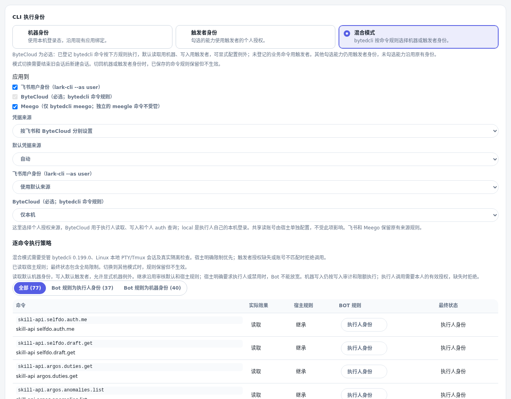

# bytedcli 默认机器读取与触发者写入

这是可选的 ByteCloud 执行模式。默认业务读取由宿主共享账号执行，不要求当前执行人先授权。版本化命令规则可以要求执行人身份、禁用业务命令，或为已登记写入显式选择机器例外。写入默认使用本次执行所归属的已核验真人账号；宿主明确 actor 或 deny 时，Bot 不能放宽。执行人授权缺失、账号不匹配或权限不足都会拒绝。多人话题里后来到达的消息不会替换正在执行的一轮身份。

## 配置与启用

在 Dashboard → Bot 配置 → 权限与安全 → **CLI 执行身份** 中，三个模式并列展示：

| 模式 | 行为 | 配置映射 |
| --- | --- | --- |
| 机器身份 | 沿用本机登录态和现有应用绑定 | `triggerUserAuth` 缺失，或 `enabled` 不为 `true` |
| 触发者身份 | 勾选的能力使用触发者本人授权；未勾选的能力沿用原身份 | `enabled:true`，且未启用 ByteCloud 混合模式 |
| 混合模式 | bytedcli 按命令规则选择身份；其他勾选能力仍使用触发者 | `enabled:true` + ByteCloud + `bytecloudExecution:"read-machine-write-actor"` |

选择混合模式会自动勾选必需的 ByteCloud，保留其他能力范围。只有该模式显示命令列表、身份过滤 Tab 和外部插件预设；预设需要手动应用。选择触发者身份会写入 `bytecloudExecution:"trigger-user"`；选择机器身份只关闭 `enabled`。切回其他模式保留已存命令规则，规则不生效。

旧配置无需迁移：缺省或关闭的配置仍用机器身份；已启用、执行枚举缺省或为 `trigger-user` 的配置仍按原触发者模式运行。存有混合枚举但未启用 ByteCloud 的配置也保持原行为，不会因打开页面自动开启混合模式。在触发者模式编辑能力也不会意外开启混合模式。旧 `tools` 单工具或空范围继续按原范围处理。同范围切换模式或修改来源保留旧飞书身份行为；若明确选择混合模式而原范围没有 ByteCloud，将显式加入 ByteCloud，Meego 不会跟随自动开启。此时采用能力列表的身份语义：未勾选飞书用户身份时，`lark-cli --as user` 使用本机登录。

混合模式的等价 Bot 配置为：

```json
{"triggerUserAuth":{"enabled":true,"capabilities":["bytecloud"],"credentialSource":{"bytecloud":"local"},"bytecloudExecution":"read-machine-write-actor"}}
```

`credentialSource.bytecloud` 仍是**个人授权来源**：`local` 是执行人自己的本机私有登录；`platform` 只从中心平台取该人的 grant；`auto` 在已绑定宿主使用平台，未绑定时使用本机个人登录。它不选择共享读账号，也不会在个人授权缺失时退回机器身份。Lark、Meego、owner、委托、git 等原有配置字段仍可往返保存。切回机器身份保留有效设置；显式清除整份 `triggerUserAuth` 才删除配置。省略执行模式或设为 `trigger-user` 保持原模式。

共享读 profile 是机器级配置，放在宿主 `~/.botmux/config.json`：

```json
{"bytedcliBroker":{"machineProfile":"shared-read"}}
```

省略 `machineProfile` 使用宿主 SDK 默认 profile。指定值只能是 1–64 个字母、数字、下划线或连字符，首字符必须是字母或数字；不是路径。非法选择会拒绝，不能悄悄换成默认账号。首次建立 broker/worker 时冻结同一份宿主布局；修改 profile 需要新的 daemon 代次。Bot env、Agent argv 和请求体不能选择 profile、HOME、账号或可执行文件。

启用前结束旧会话，并新建冷启动会话。曾经看过凭据的进程不能靠改开关变安全。严格会话的凭据封闭标记持久保留；回退时先拒绝新调用、结束严格会话，再由管理员明确恢复旧模式并新建会话。保留审计和个人授权数据；不能自动重跑结果未知的写入。



[手机布局示例](assets/bytedcli-read-write-identity/execution-modes-390.png)

## 逐命令规则与宿主限制

使用混合模式时，Dashboard 显示命令的实际效果、宿主规则、Bot 规则和最终状态。读取和写入均可选继承、机器身份、执行人身份或禁用。写入默认触发者；最终身份为机器时，界面显示“机器写入例外”，实际效果仍显示写入。规则保存在 Bot 配置中，只有 `enabled`、ByteCloud 和 `read-machine-write-actor` 同时启用时生效；切回机器或触发者身份保留有效规则。

宿主管理员通过固定文件 `~/.botmux/host-authority/bytedcli-broker/policy/operation-policy.json` 设置全局规则。文件缺失时沿用审核默认；不从 Agent 参数、环境或请求选择路径。目录须为当前宿主用户所有、权限 `0700`，文件为 `0600` 的单链接普通文件，禁止软链、特殊文件及超过 32 KiB 的 UTF-8 JSON。全局文件示例：

```json
{
  "schema": "botmux.bytedcli-operation-policy.v2",
  "cliVersion": "0.199.0",
  "catalogVersion": "2026-11-27.2",
  "rules": { "codebase.mr.list": "actor", "codebase.mr.close": "deny" }
}
```

Bot 使用同一种版本化对象，例如：

```json
{
  "triggerUserAuth": {
    "enabled": true,
    "capabilities": ["bytecloud"],
    "bytecloudExecution": "read-machine-write-actor",
    "credentialSource": { "bytecloud": "local" },
    "bytedcliOperationPolicy": {
      "schema": "botmux.bytedcli-operation-policy.v2",
      "cliVersion": "0.199.0",
      "catalogVersion": "2026-11-27.2",
      "rules": { "codebase.mr.list": "actor", "codebase.mr.reopen": "machine", "bits.develop.list": "deny" }
    }
  }
}
```

规则使用[审核表](bytedcli-operation-audit.md)中的规范 operationId。`codebase pr list` 等别名先归一化为同一个 ID，再应用规则。省略某项表示继承，`machine`、`actor` 均允许真实读取或写入，`deny` 禁用调用。两层规则中任一 deny 都禁用；任一显式 actor 都优先于 machine；显式 machine 可覆盖默认写入身份。没有身份规则时，read 默认 machine，write 默认 actor。Bot 的机器规则不能覆盖宿主明确 actor 或 deny。未知 ID、错误版本或字段会原子拒绝，原配置不变。

当前 policy 与 status schema 都是 v2，CLI/catalog 版本为 `0.199.0` / `2026-11-27.2`。合法旧 `botmux.bytedcli-operation-policy.v1` 对象先按旧合同严格校验，再规范化为 v2；旧 v1 的 machine write 仍拒绝。Dashboard 只接受 v2 status；面对旧 daemon 禁止保存命令规则，仍允许紧急关闭模式。

现有 PUT `/api/bots/:app/trigger-user-auth` 保存完整对象；旧客户端省略 `bytedcliOperationPolicy` 时保留已存规则，显式 `bytedcliOperationPolicy:null` 清除 Bot 规则并恢复继承。整份 `triggerUserAuth:null` 仍清除全部鉴权配置。源选择、owner、委托、git 等字段随保存保留。

只有已选择严格模式且勾选 ByteCloud 时，状态接口才读取宿主规则；状态接口仍兼容已保存但关闭的严格配置，可返回 `active:false` 的摘要；Dashboard 在机器或触发者模式隐藏命令列表，不请求关闭状态的摘要。原模式或未勾选 ByteCloud 的状态查询不初始化宿主策略目录。

命令策略摘要由已有 GET `/api/bots/:app/trigger-user-auth-status` 从实际冻结的宿主 reader 投影，返回版本、全局规则及修订、Bot 规则与最终效果/身份。该摘要不查询个人授权、不开始登录、不返回凭据或原始宿主路径；带 `openId` 的既有个人授权状态查询保留原合同。界面用同一审核 resolver 合成当前 Bot 编辑。宿主无兼容版本化状态时显示不可用并禁止保存命令规则，须更新宿主后刷新；全局配置无效时显示明确错误并拒绝严格调用，仍可关闭模式。点击“刷新宿主规则”获取热更新后的展示状态。


读取改为执行人身份后，仍按读取额度与结果语义处理，不写业务 intent，不产生写入未知结果；但必须有当前已核验真人的个人授权、正式账号匹配及相应委托/定时任务权限。授权缺失或账号不匹配时拒绝，不退回共享账号。auth/help 不属于业务规则，保留专用个人控制边界；help 同样显示当前有效业务策略，不触发个人授权查询。

## 热更新、失效与恢复

宿主每次读取严格验证固定文件，不使用上次有效配置兜底。建议管理员在同一私有目录先完整写入 `0600` 临时文件，再原子替换目标；半写、非法内容、错误权限或不稳定文件都拒绝本次严格调用。修复为有效对象或移除文件后，新请求重新解析并恢复；删除文件恢复审核默认，但不能恢复旧请求的授权。Bot 或全局修订在排队、取票、派发及返回时重新核验；变化返回 `policy_changed`，已派发写入返回 `write_outcome_unknown` 并抑制旧输出。

同一执行轮的已派发写入 request ID 不因策略修改、修复、删除或缓存清理再次执行，也不重新取票。新的显式执行轮或 worker 代次遵循原退休合同，才能作为新的执行处理。客户端没有自动重试；结果未知时保留 request ID 和审计，先核对上游结果，再由真人决定是否发起新操作。

## 支持条件

当前只支持 Linux、本地受管 PTY/Tmux、proven 执行身份、真实 allowlist 文件隔离和独立 PID namespace、宿主 loopback 或受管且验签的精确 loopback 代理，以及新的冷启动进程。模型认证支持 Claude Code 的实际私有凭据副本，或 Codex isolated auth / isolated instance。

混合模式与插件的 protected HTTP egress 可同时使用：沙箱继续隔离宿主网络，ByteCloud、当前执行与 Git 身份查询仅经精确接口代理；daemon 验证当前 worker/回合签名后仍核验原始进程谱系，不导出 ByteCloud 凭据。混合模式保留插件 Skill，但不注入或启动宿主 MCP 下游；这些下游的私有配置仍保持隔离。依赖宿主 MCP 的功能在此模式下不可用，可使用已登记的受管 `bytedcli skill-api` 命令。Codex 必须在 Dashboard → 权限与安全 → Codex 登录凭证中选择「本 bot 独立登录态」，并在该 Bot 的 CODEX_HOME 中准备认证；已有独立认证文件可继续使用，不复制全局登录态。若独立 Codex config.toml 还配置了宿主 MCP，将对应 `mcp_servers.<name>.enabled` 设为 `false`。remote、macOS、scratch/single、adopt/warm attach、wrapperCli、shell 启动、host Codex RPC / external app server、Seed/Relay/Pi 等其他模型组合会拒绝；界面显示“已启用策略”并不证明会话通过隔离检查。

宿主 bytedcli 和 Botmux 安装树在严格会话内只读，全部 SDK profiles、个人凭据、epoch 与 broker/audit 根不可读写。不能在运行该宿主的安装树里原地开发；其他项目使用独立项目授权。凭据根本身是 leaf symlink 的组合不支持。缺失受保护文件的父目录使用冷启动时的私有目录视图，之后新增的宿主兄弟文件要等新一代才能看到。

bytedcli 的只读边界包括祖先 `node_modules` 搜索路径、兄弟/提升依赖及软链的规范目标，宿主启动时冻结完整文件树，并在探测与执行时核验。Node 标准 runtime-prefix `lib/node` 全局搜索树同样受保护；探测到其他无法由冻结边界覆盖的全局搜索路径时拒绝。私有空 HOME 中的搜索目录无需读取宿主 HOME。外部软链指向工作区时，该依赖和可替换它的祖先也受保护；该工作区不能同时允许修改这段依赖。遍历超过 100,000 个节点、硬链接、特殊文件、断链或不安全权限的安装无法证明完整性，严格执行拒绝；普通旧模式仍可装配。管理员改变安装或证书后应重建严格会话。

网络只继承宿主冻结的 `HTTP_PROXY`、`HTTPS_PROXY`、`NO_PROXY` 及对应小写变量。审核版本的原生传输不支持 `ALL_PROXY`/`all_proxy`；配置这些变量会明确标记严格宿主不可用，须改成所支持的 HTTP(S) 代理后重建，不能静默忽略路由。`NODE_EXTRA_CA_CERTS`、`SSL_CERT_FILE`、`SSL_CERT_DIR` 的规范路径、软链目标及祖先同样受保护并核验；无法证明的证书布局拒绝严格执行。以上限制不改变其他 CLI 或旧身份模式的网络合同。

严格包装器不导出 ByteCloud token；独立 `codebase` / `bitscli` / `bits-cli`、git askpass 和 `BOTMUX_AS` 拒绝。独立 Meego、Lark 和旧模式保留原有合同；严格 bytedcli 中未登记的 Meego 等业务命令可进入下述 unknown/actor 隔离路径，仍须通过身份、参数和执行边界检查。

## 当前命令目录

只支持审计过的 bytedcli **0.199.0** 与 **CN**。未知版本或区域拒绝；已登记操作的非法选项、参数组合也拒绝，不能回退来绕过其合同。认证、安装、插件等控制命令不会作为未知业务执行，个人 auth 仅允许下节的专用适配器。

未登记业务使用 `unknown` 效果和触发者身份，在独立文件系统/PID 隔离内执行，并遵守写入级别的 intent 审计、配额、结果未知与重放限制；不能配置为机器身份，也不能注入凭据或身份覆盖。下表是早期已审计目录的子集；新增精确签名见[业务目录合同](bytedcli-business-command-catalog.md)和[受管 Skill 合同](bytedcli-managed-skill-api.md)，未列在此表不等于一律拒绝：

| 类型 | 命令 |
| --- | --- |
| 默认机器读取 | `codebase repo get/view/list`；`codebase mr get/view/list/count/diff/files/status` |
| 默认执行人写入，可显式机器例外 | `codebase mr create/update/edit/close/reopen` |
| 默认机器读取 | `bits develop list`；`log search-log-matchers`（仅 console 输出） |
| 宿主安全说明 | 根或上述命令/分组的 `--help`；根 `--version`；下述个人 auth 适配器 |

`bytedcli --help` 返回 JSON 命令目录、别名和允许选项；子命令 help 返回对应子集。业务条目还包含当前 `enabled` 和 `executionIdentity` 投影。目录列出审核支持范围，参数仍由严格解析器验证，不能把“某选项在列表里”理解为任意组合都支持。help/version 不运行 native CLI、不读取个人授权；version 输出 `auditedCliVersion`，表示 broker 合同版本，不声称当前宿主安装已经通过探测。实际业务调用会检查可信绝对路径上的 CLI 版本和文件完整性。

已登记 MR 操作须显式提供仓库，不从 Agent cwd 推断。`--body-file` / `-F` 与 stdin 在 Agent 侧读取快照，最多 2 MiB，只把字节传到宿主请求私有目录。已登记操作的 JSON/body、附件和文件参数只接受各自审核的形态；不能扩展为任意目标或请求。BITS 更新/发布/删除、日志等业务先匹配当前精确目录，未登记的业务按上述 unknown/actor 路径处理，而非因缺席旧表直接拒绝。执行不提供交互式 PTY，长运行调用同样受限。argv 上限 256 项 / 64 KiB，HTTP body 上限 3 MiB，合计输出上限 16 MiB，执行默认 60 秒、最大 120 秒；同时每会话最多 4 个读 / 1 个写，daemon 最多 16 次执行 / 4 个写。

## 个人授权命令

所有 `auth` 命令必须来自当前已核验真人执行轮。机器读权限、Bot owner 默认值、业务委托或定时任务的 run scope 都不能获得个人授权控制权。调用前后核对策略、来源、授权 epoch、平台绑定和执行代次。

| 命令 | 返回及副作用 |
| --- | --- |
| `auth status` | 只投影该人的 `authorized` / `needs-login` 与来源；不会显示共享读账号，不自动发起登录 |
| `auth userinfo` | 授权可用且官方账号匹配后，额外返回核验邮箱；不透传 SDK 原始 JSON |
| `auth login` | exit 77、`personal_auth_control_required`、`performed:false`，提示由本人使用 `/login bytedcli`；本命令不开始设备授权 |
| `auth logout` | exit 77、`personal_auth_control_required`、`performed:false`、`scoped-logout-unavailable`；当前没有 ByteCloud 单独撤销入口，不执行撤销 |

`status/userinfo` 复用个人授权来源与官方账号校验，可能在宿主为该人的验证请求 mint 短期票据。所有 CLI 调用使用可信绝对可执行文件、固定 PATH、最小环境、私有 cwd 和有限输出；持久个人 HOME 只留在宿主并进入既有个人序列化队列。没有令牌、设备完成码或原始授权链接进入工具响应。实际登录仍使用既有 `/login bytedcli` 个人私信/个人可见流程，保留原来的撤权 epoch 与隐私处理。

不要用 `/logout bytedcli` 作为替代：现有 `/logout` 不按该后缀区分，会撤销多种个人凭据。平台 grant 的撤销也应由本人在已有个人凭据管理流程中处理。

## 写入结果与审计

写入无论执行身份均须先 fsync 宿主 intent，完成后记录结果；审计通过 source 与账号摘要记录实际机器/个人身份，只保留结构化元数据和摘要，不落完整 body 或 token。机器写入仍按写入额度和防重放处理，且执行器要求宿主冻结的、由当前 parser 生成的有效 policy 明确选中 machine；单独传入 executionIdentity=machine 不能授权写入。排队、取票、派发和返回时都重新检查执行与授权。写入已派发但响应丢失、撤权、超时或结果落盘失败，返回 `write_outcome_unknown` 和 request ID。客户端不会自动重试；先核对上游状态再由真人决定下一步。

审计根为 `~/.botmux/host-authority/bytedcli-broker/audit`。新记录写入私有 `records/<UUID>.pending`，完整写入和文件 fsync 后原子发布为 `<UUID>.json`，目录 fsync 成功才确认 intent。多个 daemon 各自发布独立记录；按 daemonBootId、sessionId、generation、turnId、requestId 关联 intent/result，不依赖目录顺序。旧 `audit.jsonl` 原样保留供历史核对；不再续写或截断它。失败留下的 `.pending` 只能用于排查，不能当成已确认 intent；由管理员核对存储恢复和上游结果后归档，broker 不自动删除或重跑。短写、ENOSPC 或 fsync 失败时，本次派发拒绝，恢复后新记录仍有独立、可解析的持久边界。

HTTP 响应超时与资源清理分别计时。首个执行器授权复查开始前即绑定 request ID、取得配额并注册清理所有权；超时后仍保留名额直到忽略取消的 provider 真正结束，重复 ID 不创建新的同一复查。独立 follower 可取消而不终止 primary；关闭/退役会等待真实清理。拒绝响应只复核冻结宿主状态，不启动新的委托 provider；成功业务结果仍做完整授权复查。

本功能的验收使用临时 HOME、假 provider/CLI、真实 HTTP/client/executor 和 Linux 隔离测试。未做真实业务写入，也未自动修改或重启现有部署。

新增精确业务签名、未知命令 actor 隔离、历史目录迁移与 DB 二进制前提见 [业务目录合同](bytedcli-business-command-catalog.md)。

受管最终 API 与源码安装边界见 [受管 Skill 合同](bytedcli-managed-skill-api.md)；外部业务模板配置见 [插件 ByteCLI 权限预设](plugin-bytedcli-operation-presets.md)。
