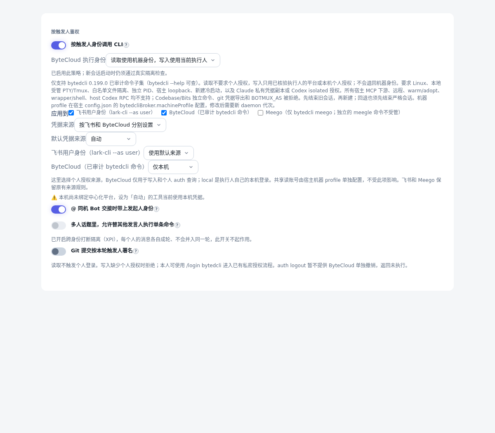

# bytedcli 读取用机器身份、写入用执行人身份

这是可选的 ByteCloud 执行模式。已登记的业务读取由宿主共享账号执行，不要求当前执行人先授权；业务写入只使用本次执行所归属的已核验真人账号，缺少授权、账号不匹配或权限不足都会拒绝。多人话题里后来到达的消息不会替换正在执行的一轮身份。

## 配置与启用

在 Dashboard → Bot 配置 → 权限与安全 → 按触发人身份调用 CLI 中，开启总开关、勾选 ByteCloud，再选择“读取使用机器身份，写入使用当前执行人”。等价的 Bot 配置为：

```json
{"triggerUserAuth":{"enabled":true,"capabilities":["bytecloud"],"credentialSource":{"bytecloud":"local"},"bytecloudExecution":"read-machine-write-actor"}}
```

`credentialSource.bytecloud` 仍是**个人授权来源**：`local` 是执行人自己的本机私有登录；`platform` 只从中心平台取该人的 grant；`auto` 在已绑定宿主使用平台，未绑定时使用本机个人登录。它不选择共享读账号，也不会在个人授权缺失时退回机器身份。Lark、Meego、owner、委托、git 等原有配置字段仍可往返保存。关闭开关保留有效设置；显式清除整份 `triggerUserAuth` 才删除配置。省略执行模式或设为 `trigger-user` 保持原模式。

共享读 profile 是机器级配置，放在宿主 `~/.botmux/config.json`：

```json
{"bytedcliBroker":{"machineProfile":"shared-read"}}
```

省略 `machineProfile` 使用宿主 SDK 默认 profile。指定值只能是 1–64 个字母、数字、下划线或连字符，首字符必须是字母或数字；不是路径。非法选择会拒绝，不能悄悄换成默认账号。首次建立 broker/worker 时冻结同一份宿主布局；修改 profile 需要新的 daemon 代次。Bot env、Agent argv 和请求体不能选择 profile、HOME、账号或可执行文件。

启用前结束旧会话，并新建冷启动会话。曾经看过凭据的进程不能靠改开关变安全。严格会话的凭据封闭标记持久保留；回退时先拒绝新调用、结束严格会话，再由管理员明确恢复旧模式并新建会话。保留审计和个人授权数据；不能自动重跑结果未知的写入。



## 支持条件

当前只支持 Linux、本地受管 PTY/Tmux、proven 执行身份、真实 allowlist 文件隔离和独立 PID namespace、宿主 loopback，以及新的冷启动进程。模型认证支持 Claude Code 的实际私有凭据副本，或 Codex isolated auth / isolated instance。

所有宿主 MCP 下游条目暂不支持。remote、macOS、scratch/single、adopt/warm attach、wrapperCli、shell 启动、host Codex RPC / external app server、Seed/Relay/Pi 等其他模型组合会拒绝；界面显示“已启用策略”并不证明会话通过隔离检查。

宿主 bytedcli 和 Botmux 安装树在严格会话内只读，全部 SDK profiles、个人凭据、epoch 与 broker/audit 根不可读写。不能在运行该宿主的安装树里原地开发；其他项目使用独立项目授权。凭据根本身是 leaf symlink 的组合不支持。缺失受保护文件的父目录使用冷启动时的私有目录视图，之后新增的宿主兄弟文件要等新一代才能看到。

严格包装器不导出 ByteCloud token；独立 `codebase` / `bitscli` / `bits-cli`、git askpass 和 `BOTMUX_AS` 拒绝。独立 Meego、Lark 和旧模式保留原有合同；严格 bytedcli 中未登记的 Meego 子命令仍拒绝。

## 当前命令目录

只支持审计过的 bytedcli **0.199.0** 与 **CN**。未知版本、命令、选项、区域或参数组合全部拒绝。下表是实现范围，不是候选清单：

| 类型 | 命令 |
| --- | --- |
| 机器读取 | `codebase repo get/view/list`；`codebase mr get/view/list/count/diff/files/status` |
| 执行人写入 | `codebase mr create/update/edit/close/reopen` |
| 机器读取 | `bits develop list`；`log search-log-matchers`（仅 console 输出） |
| 宿主安全说明 | 根或上述命令/分组的 `--help`；根 `--version`；下述个人 auth 适配器 |

`bytedcli --help` 返回 JSON 命令目录、别名和允许选项；子命令 help 返回对应子集。目录只列支持范围，参数仍由严格解析器验证，不能把“某选项在列表里”理解为任意组合都支持。help/version 不运行 native CLI、不读取个人授权；version 输出 `auditedCliVersion`，表示 broker 合同版本，不声称当前宿主安装已经通过探测。实际业务调用会检查可信绝对路径上的 CLI 版本和文件完整性。

MR 操作须显式提供仓库，不从 Agent cwd 推断。`--body-file` / `-F` 与 stdin 在 Agent 侧读取快照，最多 2 MiB，只把字节传到宿主请求私有目录。交互式 PTY、watch、任意 JSON/raw 请求、输出文件、附件、任意 BITS 更新/发布/删除以及未列出的日志命令不支持。argv 上限 256 项 / 64 KiB，HTTP body 上限 3 MiB，合计输出上限 16 MiB，执行默认 60 秒、最大 120 秒；同时每会话最多 4 个读 / 1 个写，daemon 最多 16 次执行 / 4 个写。

## 个人授权命令

所有 `auth` 命令必须来自当前已核验真人执行轮。机器读权限、Bot owner 默认值、业务委托或定时任务的 run scope 都不能获得个人授权控制权。调用前后核对策略、来源、授权 epoch、平台绑定和执行代次。

| 命令 | 返回及副作用 |
| --- | --- |
| `auth status` | 只投影该人的 `authorized` / `needs-login` 与来源；不会显示共享读账号，不自动发起登录 |
| `auth userinfo` | 授权可用且官方账号匹配后，额外返回核验邮箱；不透传 SDK 原始 JSON |
| `auth login` | exit 77、`personal_auth_control_required`、`performed:false`，提示由本人使用 `/login bytedcli`；本命令不开始设备授权 |
| `auth logout` | exit 77、`personal_auth_control_required`、`performed:false`、`scoped-logout-unavailable`；当前没有 ByteCloud 单独撤销入口，不执行撤销 |

`status/userinfo` 复用个人授权来源与官方账号校验，可能在宿主为该人的验证请求 mint 短期票据。所有 CLI 调用使用可信绝对可执行文件、固定 PATH、最小环境、私有 cwd 和有限输出；持久个人 HOME 只留在宿主并进入既有个人序列化队列。没有令牌、设备完成码或原始授权链接进入工具响应。实际登录仍使用既有 `/login bytedcli` 个人私信/个人可见流程，保留原来的撤权 epoch 与隐私处理。

不要用 `/logout bytedcli` 作为替代：现有 `/logout` 不按该后缀区分，会撤销多种个人凭据。平台 grant 的撤销也应由本人在已有个人凭据管理流程中处理。

## 写入结果与审计

写入前必须先 fsync 宿主 intent，完成后记录结果；审计只保留结构化元数据和摘要，不落完整 body 或 token。排队、取票、派发和返回时都重新检查执行与授权。写入已派发但响应丢失、撤权、超时或结果落盘失败，返回 `write_outcome_unknown` 和 request ID。客户端不会自动重试；先核对上游状态再由真人决定下一步。

本功能的验收使用临时 HOME、假 provider/CLI、真实 HTTP/client/executor 和 Linux 隔离测试。未做真实业务写入，也未自动修改或重启现有部署。
