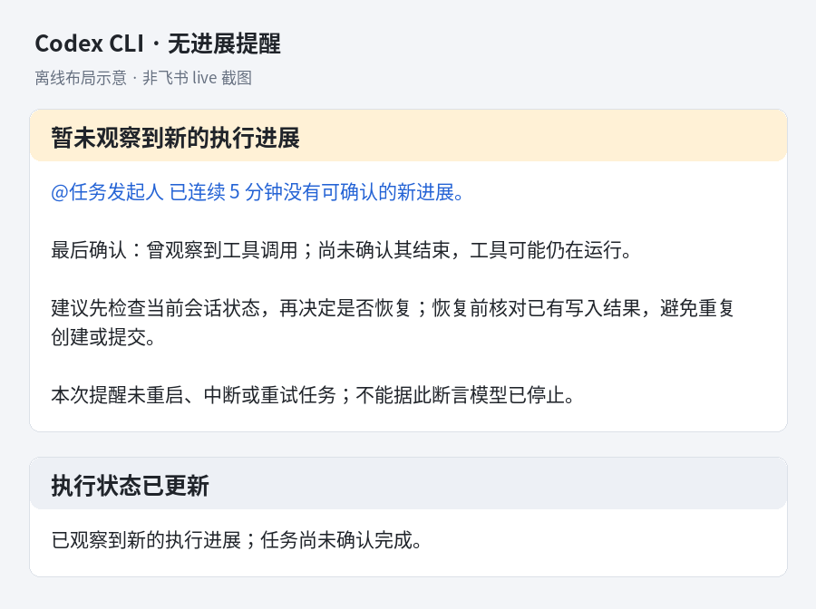

# Codex CLI 无进展提醒（显式开启）

解决的是「停住后只有用户催办才知道」，不是自动恢复任务。提醒由 daemon 的 15 秒定时器驱动，不需要模型生成消息；模型或工具不再返回时仍可触发。**daemon 本身退出、事件循环阻塞、机器离线或飞书不可达，不在这层保证内**。

## 配置

在目标 Bot 的 `noProgressNotify` 中设置：

```json
{ "enabled": true, "cliEnabled": true }
```

也可通过既有 `/config set noProgressNotify {"enabled":true,"cliEnabled":true}` 设置。`cliEnabled` 默认关闭，开启后从下一个 worker 进程生效，不主动重启现有任务。已启用 worker 的 `enabled:false` 会立即静默提醒，也会暂停在途恢复更新；主动关闭时已有橙色卡可能保留原样。清除整个配置恢复默认（CLI 关闭，App 保持原来的默认行为）。

默认连续 **5 分钟**无可确认新进展时提醒一次；达到 **15 分钟**再提醒一次，每个 turn/attempt 最多两条。`timeoutMs` 可调整首次阈值，升级阈值为 `max(15分钟, 3 × timeoutMs)`，允许范围 10–3600 秒，另有最多 15 秒轮询延迟。该字段与 Codex App 共用：App 未设置时仍为 90 秒、每轮一次；CLI 未设置时为 5 分钟。App 设置面板普通保存保留 CLI 开关，恢复默认会清除全部覆盖。

## 进度与通知边界

- 只监测 Codex CLI 的真人私聊和明确 @ Bot 的群 IM 回合。必须有冻结的原始真人与回复位置；未知身份不回退成会话所有者。普通 listener、定时/HTTP 合成 turn、文档、会议接收器、adopt 和私密代回复不启用。其他 CLI 与 Codex App 原有流程不变。
- 从执行端实际开始提交输入计时，不把排队当成执行。收到新的结构化模型输出、工具调用/返回或明确消息交付时重置计时；终端 spinner、心跳和重复展示不计进展。结构化进度信号独立于展示用 CoT 截断限制，不携带正文、参数或工具结果。
- 在原 turn 冻结的回复位置发送，@ 原始真人，不改成最近催办者。内容仅说明最后确认阶段、静默时长、不确定性与下一步建议；工具可能仍在运行，不能据此诊断模型死亡。
- 已知等待 Ask、TUI 授权或「需要用户处理」时不再追加停顿提醒；等待解除后重新计时。纯自然语言提出问题但未上报等待状态无法可靠识别。
- 恢复进展/正常终止/明确 final 后尽力更新已知提醒，不再新发恢复消息或重复 @。更新失败沿后续 15 秒 tick 重试同一已知 message ID，每次显示状态最多尝试 3 轮，预算持久化；耗尽后停止并记日志，不新发卡片。恢复到终态等新状态有独立预算，旧更新回执不会清掉新状态。进程被替换/退出时旧定时器停用；已有进程错误通知仍由原故障路径处理，不把进程退出宣称为业务成功。
- 发送前持久化 claim 与未确认标记，再使用稳定 UUID 发送。收到 ACK 才保存 message ID 并解除未确认标记；断线、daemon 中断或 ACK 丢失时不盲目重发，也不继续升级外发。恢复后重复执行起始信号保留原回执与原发起人；只有当前 worker 重新证明执行的回合才重新取得监测权，不猜测重启期间是否仍在执行。
- 本机制不重放工具、不重试任务、不切模型、不自动恢复或停止任务。恢复前需要核对已有写入结果，避免重复创建/提交。

## 卡片示意

以下是由同一 schema 2.0 卡片正文生成的**离线布局示意**，不是飞书 live 截图；最终字体与 @ 展示以飞书客户端为准。



## 验证

`test/cli-progress-notice.test.ts` 验证状态机时序、发送中断、ACK 竞态、持久去重与恢复更新；`test/worker-pool-cli-progress.test.ts` 从真实 worker handler 的 IPC 入口注入事件，以假时钟推进 daemon 定时器，验证原始收件人/位置、主动 @、等待状态及失效 worker 隔离。不需要真实模型、飞书凭证或运行实例重启。
