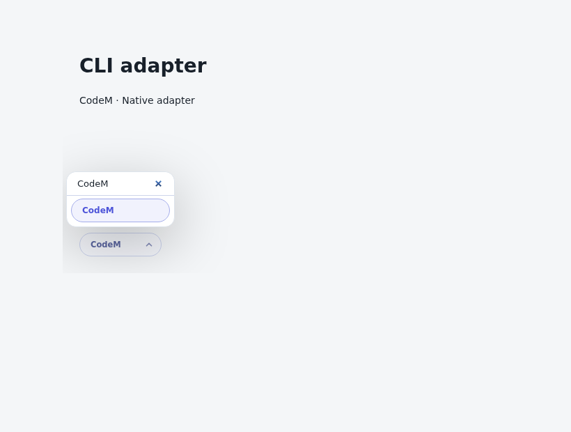

# CodeM

Select **CodeM** in `botmux setup` or the Dashboard CLI picker, or use `cliId: "codem"`.
The adapter launches CodeM directly; no `codem-wrapper` npm package or Kimi installation is required.

The shared Dashboard CLI control with this branch's registered options (isolated component preview):



## Prerequisites

Install CodeM with its official installer and sign in as the OS account running Botmux:

```bash
codem --version
codem login
codem auth status
```

`auth status` must report `loggedIn: true`. The installer-managed launcher is
`~/.codem/bin/codem`; Botmux detects it even when that directory is absent from PATH.
Otherwise it looks for `codem` on PATH. The official launcher requires Node.js 20.10.0+
on the bot process's PATH. Custom installs can set `cliPathOverride` to an absolute executable.

## Configure a bot

For an existing bot, replace the placeholder with its App ID:

```bash
botmux setup edit cli_REPLACE_WITH_TARGET_APP_ID \
  --cli codem \
  --cli-path - \
  --cli-runtime - \
  --wrapper-cli - \
  --model -
```

This clears settings from a previous CLI/wrapper and inherits CodeM's own authenticated
model configuration. An explicit Botmux model is passed to CodeM. Configure intelligence
and reasoning effort in CodeM itself; this adapter inherits those settings rather than
exposing Botmux's reasoning-effort selector.
Apply the change by restarting only the target bot at an appropriate time:

```bash
botmux stop-bot cli_REPLACE_WITH_TARGET_APP_ID
botmux start-bot cli_REPLACE_WITH_TARGET_APP_ID
```

For a new bot, choose CodeM in setup and complete the normal application/owner onboarding.
Verify in a **new topic**; already-running sessions retain their original CLI selection.
The cards, CLI selection and session list display **CodeM**.

## Sessions and permissions

Fresh topics pass `--session <botmux-session-id>`. CodeM creates that history once and
reopens the same history after a worker restart. An imported native session uses
`--resume <native-session-id>` with strict must-exist semantics. Neither path selects
the globally latest session. To resume locally, use the command in the closed-session
card from the same working directory.

Botmux's default CLI approval bypass maps to `--yolo`; `disableCliBypass: true` omits it.
Multiline messages use bracketed paste followed by Enter on PTY and persistent terminal backends.

The default auth/runtime/history directory is `~/.codem`. The file sandbox binds that
directory to persistent host storage. Nondefault CodeM state roots and external runtime
dependencies need an explicit sandbox policy; per-bot read isolation and transcript-based
reply forwarding are not advertised by this adapter. The normal `botmux send` reply path
is used. Existing Kimi/wrapper bots keep their configuration until explicitly migrated.
