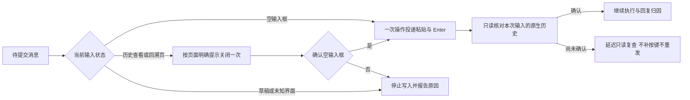

# Codex 终端消息提交

本文描述 `codex` CLI 适配器的终端路径；`codex-app` 的结构化 RPC 路径不受影响。



## 提交边界

支持 `captureInputState` 的终端必须证明当前为空输入框。原生 `TRANSCRIPT` 标题与底部导航、退出提示同时匹配时，才允许使用页面明确显示的 `q`；不发送会进入回溯的 Esc，也不发送会再次打开页面的 Ctrl+T。退出后若露出人工草稿、菜单，或快照不可用，不追加或提交消息。

页脚识别覆盖 `q to quit / esc to edit prev` 和 `q close · f3 find · esc browse prompts` 两种原生形态；新版形态仍要求完整的标题、滚动导航、`q close` 与 `esc browse prompts` 提示。未知或缺少提示的页面不写入按键。

退出只等待有限时间。同一终端进程的关闭动作若尚未确认，后续调用只观察，不再次发送 q；进程更换后重新判断。对正常完成的关闭，后续独立打开的历史页仍可恢复。

等待关闭完成期间，单帧看似草稿可能来自终端重绘，因此在原等待窗口内继续只读观察；确认空输入框才允许提交，到期仍为草稿则拒绝并保留内容。没有待完成关闭动作时，草稿立即拒绝，不等待用户清空。

消息的粘贴边界和 Enter 一次投递：PTY 写入一个完整输入帧；tmux 先加载命名缓冲区，再由同一命令批次依次发送粘贴起始标记、原始换行正文、结束标记与 Enter。标记走 literal `send-keys`，避免新版 tmux 把缓冲区中的 ESC 转义为可见文字。空字符串也投递完整空帧与 Enter；tmux 不为零长度输入创建缓冲区，因此空帧由一次 literal `send-keys` 直接发送，不经过 `paste-buffer`。其他 CLI 的 `pasteText` 行为保持不变。

删除粘贴后的延迟 Enter 与缺回执时补按 Enter：长消息即使在界面被折叠为字符数提示，也不依赖字符数来推断草稿身份。传输返回 false 或抛异常仍可能已经交付，只读取本次历史增量；不重投原文、不重启会话、不根据进程存活认定提交成功。原有会话归属校验和 Worker 未确认输入隔离继续负责后续派发。

## 能力与验证边界

- 没有输入快照能力的后端无法自动识别或关闭历史页，但同样只投递一次，确认阶段不写键。
- 新版 `Browsing transcript` 回溯页不属于已识别的 `TRANSCRIPT` 查看页，仍拒绝自动输入；不能将查看页恢复外推为所有版本的回溯页均已支持。
- 这是终端输入修复，不提供跨任意人工操作的事务锁。人在快照检查后同时切换界面，仍可能导致提交未确认；若未确认关闭与人工关闭交叠，迟到 q 也可能留下草稿，下一次输入检查会拒绝追加。不能宣称覆盖任意并发操作的全局 exactly-once。
- 自动化验证使用合成消息、本机模拟模型服务和独立 HOME、tmux socket；不代表生产已发布，也不代表已恢复之前失败的业务任务。

原生复验入口：

```bash
BOTMUX_CODEX_TRANSCRIPT_TEST_BIN=/path/to/codex \
  bun x vitest run --project e2e test/codex-transcript-input.e2e.ts
```

该用例的启动就绪与回溯页判定目前覆盖 Codex 0.153.4，核对普通、历史页与回溯页下的原生输入历史及 `task_started` / `task_complete`，并覆盖 Markdown 换行、长粘贴；不能直接作为新版 Codex 的三轮验收入口。模型 HTTP 请求次数不等于任务执行次数，不以它替代任务回执。
