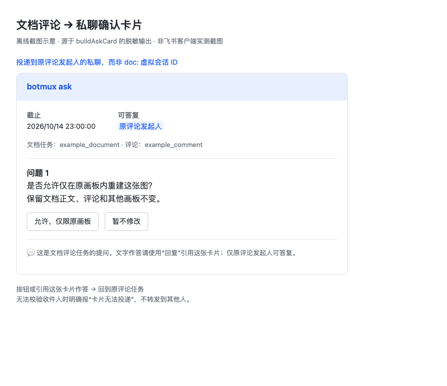

# 文档评论任务的 Ask 路由

## 问题与修复范围

文档评论会话的 `chatId` 是 `doc:<fileToken>:<commentId>`，不是 IM `chat_id`。
当 CLI 主动调用 Ask 时，非 `om_` 的 root 被清空，旧发送器会误将这个虚拟 ID
传给 IM 发消息接口，得到 `invalid receive_id`。普通评论答复不走这条路径，
因此评论答复成功并不能证明确认卡片可投递。

本修复只改变已发起的 Ask 如何投递、答复和报错，不改变模型何时要求用户确认。

## 路由与权限

- 原 `sessionId`、`chatId` 和 turn 仍绑定原评论任务，不转换成私聊会话。
- daemon 从精确 `originTurnId` 对应的持久化 `docCommentTargets` 读取原发起人。
  不接受客户端传入收件目标，也不回退到 owner、最近发言人或另一条评论。
- 原应用的人类身份校验和私聊 `canTalk` 校验通过后，冻结文档/评论/turn/收件人。
  查询期间会话关闭、worker 或来源代际变化时拒绝发送。
- 卡片与长问题附件均通过 `receive_id_type=open_id` 投递到原发起人私聊；
  重试保留 UUID，请求大小按实际收件 ID 计算。
- 按钮只接受原发起人的回答，作答时重新检查 `canTalk`。转发卡片不触发提权申请。
- 文字回答必须在同应用私聊中**引用回复那张确切的卡片**。不截获普通私聊、
  群聊、其他人的消息、斜杠命令或另一张卡片的回复。
- 卡片提示来源文档/评论与引用回复方式；问答结果仍交给原任务的等待方。

无有效来源、无权限或发送失败时明确报告“卡片无法投递”，而非“用户未回答”。
不会向其他用户或群聊尝试回退投递。密文/秘密问题仍遵守原有原生输入限制。

## 恢复边界

Ask 持久化保存冻结收件人、作答人锁和卡片 ID；可恢复的原调用方以同一 invocation
重连时复用原卡、领取原答案，不生成新卡。

**文档显式 Ask 暂不支持脱离原调用方的自动新 turn 续跑。** 通用恢复入口无法为
新 turn 建立原评论落点，因此安全拒绝该路径并保留答案凭据，等待原调用方重连。
普通 IM 显式 Ask 的自动恢复保持不变。这不扩大原生输入本身的跨进程恢复能力。

## 验证与交付边界

回归涵盖真实 HTTP/HMAC Ask 路由、精确私聊引用的两个 daemon 入口、
同应用/原发起人授权、发送失败/瞬时重试、附件预算和原卡重启恢复，
并运行普通群聊/私聊 Ask、Claude/OpenCode/Dsh hook 与统一回复卡测试。

本次未重启 daemon、未切换全局运行包、未发送线上测试卡片、未改动来源文档。
以下是生产 `buildAskCard` 脱敏输出的 HTML 离线截图示意，**不是飞书客户端实测截图**；
原生 mention 以示例名称呈现，按钮无线上回调。

可编辑示意源文件：`docs/assets/document-ask-preview.html`。
