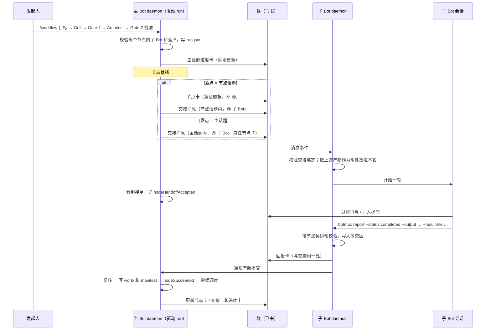

# Workflow v3：节点改由群里的 Bot 接力执行（设计）

状态：D1–D8 已由维护者确认（D2 有修改）。新增的三项要求（交接落点由主 Bot 决定、按需进入工作流编排、运行中动态修改）里冒出的新选择列在 0.3，已全部定下：N3、M1 按推荐，M2 改为乙（发起人本人的修改只有对外动作要确认，13.5），M3 改为不设硬上限、由主 Bot 自行判断并记录理由（13.6）。

相关文档：

- 现状：[`workflow-v3-current-implementation.md`](workflow-v3-current-implementation.md)
- 派发委托：[`docs/adr/dispatch-user-delegation.md`](../adr/dispatch-user-delegation.md)、[`docs/adr/schedule-dispatch-delegation.md`](../adr/schedule-dispatch-delegation.md)
- 侧边栏先例：[`2026-10-24-decision-board-steward.md`](2026-10-24-decision-board-steward.md)
- Dashboard 上编排、复用和复制工作流：[`2026-11-03-workflow-dashboard-orchestration.md`](2026-11-03-workflow-dashboard-orchestration.md)

---

## 0. 摘要

### 0.1 改什么

1. **节点按 Bot 派**：每个 LLM 节点（goal 节点）指派给本部署 `bots.json` 里的一个具体 Bot（下称子 Bot）。子 Bot 用它在群里的正常会话执行，daemon 不再为节点起临时 CLI 进程。
2. **交接在群里发生，落点由主 Bot 决定**：主 Bot（发起 `/workflow` 的那个 Bot）给每个节点定落点：
   - 开一个节点话题；
   - 或者直接在主话题里交接（适合简单节点）。

   交接消息 @ 子 Bot，写清做什么、输入、要交的产出、怎么交。子 Bot 做完在同一处回报。
3. **完成仍按结构化产物判定**：子 Bot 用 `botmux report --dispatch-root … --status completed --output … --result-file …` 提交。daemon 用现有的 outputs / resultSchema / manifest 规则校验，通过才算完成。
4. **身份从 run 出发签发**：每次交接由主 Bot 的 daemon 按发起人身份签委托，不从上一个 Bot 的回报里继承。默认关闭。
5. **只在确定要用工作流时才注入**：
   - 工作流开关关闭时，任何 Bot 都不注入（现状已满足）。
   - 开关打开时，普通会话只保留一行发现提示；完整的 workflow skill 只在 `/workflow` 或用户确认后按需读取。
   - 子 Bot 的节点会话不注入 workflow 相关内容。
6. **运行中可以改流程**：主 Bot 可以增删改节点、改依赖、改派。每次修改是一个新的流程版本，记进运行日志；看板和侧边栏实时显示。越过审批边界的修改要发起人确认。
7. **看板流程图**：在 Dashboard 现有的 v3 运行拓扑图（自绘 SVG）上，每个节点加负责 Bot、五类状态、耗时、落点，并能跳到对应的群消息。
8. **侧边栏入口**：工作流里的任务消息，签名行最右侧加一个「工作流」按钮，点开在飞书侧边栏看这个 run 的实时流程图。打开需要鉴权。
9. **临时 CLI Worker**：daemon 驱动的 run 在新模式下不再用它。`botmux goal run`、`botmux v3 run` 和 Architect 继续用。

### 0.2 已确认的决定

| # | 决定 |
|---|---|
| D1 | 新增 Dashboard 开关「节点交给群里的 Bot 执行」，默认关；只影响新建的 run，执行方式写进 `run.json` 冻结；改默认值、删旧路径以后单独决定 |
| D2（改） | 开不开话题、哪个节点开话题，由主 Bot 按任务决定；判断依据和不开话题时的消息位置见第 5 节 |
| D3 | 指派顺序：用户点名 → Architect 按名单分配 → 主 Bot 自己；Gate-2 摘要逐个列出，可改 |
| D4 | 结构化提交为准，回报只是触发校验 |
| D5 | 发起人身份按 run 星形签发，默认关 |
| D6 | 侧边栏：Dashboard 管理员看完整视图；本群当前成员看精简视图；其他人 403 |
| D7 | 节点超时转 blocked，同时停掉子 Bot 当前这一轮 |
| D8 | 新模式不用临时 Worker；`goal run`、`v3 run`、Architect 保留 |

### 0.3 新冒出来的选择

以下选择已全部定下（11-03）：N3、M1 按推荐，M2 改为乙（发起人本人的修改只有对外动作要确认，见 13.5），M3 改为不设硬上限。

| # | 问题 | 推荐 | 处理 |
|---|---|---|---|
| P1 | 落点由谁定 | Architect 按判断依据给每个节点初定落点并写理由；主 Bot 在 Gate-2 前或节点开始前都能改；硬规则由校验器把关（5.2） | 按推荐做 |
| P2 | 主话题落点时，节点卡放哪 | 不单独发节点卡，由交接卡兼任，状态行就地更新 | 按推荐做 |
| P3 | 回报绑定的 key | 两种落点统一按交接消息 id 绑定，不按话题根 | 按推荐做 |
| P4 | 没有主话题根的 run（私聊、整群一个会话的群） | 私聊 run 仍走旧方式（其他 Bot 进不了私聊）；整群会话的群里所有节点都开话题 | 按推荐做 |
| N1 | 开关打开后，普通会话里还保不保留一行发现提示 | 保留一行（改写为「先征得同意，再按需读取」）；否则主 Bot 无从判断是否该提议用工作流 | 按推荐做 |
| N2 | 要不要加「本 Bot 可发起工作流」的单 Bot 开关 | 不加。子 Bot 的节点会话本来就不注入；普通会话只多一行提示 | 按推荐做 |
| N3 | 子 Bot 的节点会话除 workflow 家族外，要不要再去掉多 Bot 编排类 skill（`botmux-orchestrate` 等） | 去掉。节点里再派子任务，等于把发起人的委托再往外传一跳 | **已定：去掉**（11-03）。两类节点会话（子 Bot 节点会话、旧模式临时 Worker）都不提供 `botmux-orchestrate`、`botmux-handoff`；判定统一在 `src/workflows/session-kind.ts`（#2710） |
| M1 | 谁能改运行中的流程 | 主 Bot，仅限两类回合：发起人本人触发的回合；本 run 的事件唤醒的回合。其他人触发的回合里提出的修改，一律转为待发起人确认 | **已定：按推荐**（11-03） |
| M2 | 哪些修改要发起人重新确认 | 见 13.5 的清单 | **已定：乙**（11-03）：发起人本人的回合只有对外动作要确认；事件唤醒的回合按完整清单；他人回合一律确认 |
| M3 | 主 Bot 自动重试 / 改派 / 重做的次数上限 | 原推荐每个节点最多 2 次 | **已定：不设硬上限**（11-03）。何时交给人决定由主 Bot 按情况判断（反复失败、拿不准、需要人提供信息等），每次自动处理和每次交给人都要在节点卡和运行记录里写明理由，见 13.6 |
| M4 | 修改怎么记录 | 每次修改生成一个完整的流程版本文件，日志里记版本号、摘要和操作人（13.3） | 按推荐做 |
| M5 | 已完成 / 进行中的节点怎么处理 | 见 13.4 的表 | 按推荐做 |
| M6 | 主 Bot 什么时候被唤醒去调整流程 | 只在这几种时候：节点卡住或失败、子 Bot 报做不了、标记为检查点的节点完成；不在每个节点完成时都唤醒 | 按推荐做 |
| M7 | 修改后要不要往群里另发通知 | 不另发；进度卡就地显示「第 N 版 · 改了什么」，看板显示版本历史；需要确认的修改发确认卡 | 按推荐做 |
| M8 | 和 Saved Workflow 的关系 | `/workflow save last` 保存的是最终生效的版本；已保存的定义本身不可变；从 Saved Workflow 物化出来的 run 一样能改 | 按推荐做 |

---

## 1. 现状和目标差在哪

| 方面 | 现状（代码依据） | 目标 |
|---|---|---|
| 谁执行 LLM 节点 | daemon 用 `ephemeral-pool.ts` 给每个节点 fork 一个临时 Worker（PTY 后端），节点结束就销毁。Architect 的提示词不要求填 `bot`（`architect.ts:55-141`），节点基本都继承主 Bot 的配置（`host.ts:501-516`） | 每个节点指派给一个具体 Bot，由它在群里的会话执行 |
| 群里能看到什么 | 主话题里一张就地更新的进度卡，加上审批、重试、追加轮次卡（`daemon.ts:6587-6705`）。Worker 内禁止 `botmux send` / `botmux ask`（`cli.ts:10459`、`16556`） | 每个节点有一条 @ 子 Bot 的交接消息；子 Bot 的过程和回报都在群里 |
| 完成判定 | Worker 写 `manifest.json`，进程关闭后由 runtime 校验 | 校验规则不变，触发点改为子 Bot 的显式提交 |
| 中途问人 | `ask.json` → `ASK_HUMAN` → blocked → 重试 | 子 Bot 直接在群里问，同一轮接着做 |
| 身份 | Worker 只拿到 run 冻结的 `ownerOpenId` 环境变量 | 每次交接带发起人委托（默认关） |
| daemon 重启 | 运行中的尝试成为孤儿，杀掉后自动重派，最多 2 次（`shared-node-runtime.ts:943-953`、`1316-1342`） | 节点在 Bot 会话里跑，重启不打断；重启后重新挂上等待 |
| 流程能不能改 | `run.json` 冻结 DAG 摘要；运行中只能 retry / grant / revisit，不能增删改节点 | 运行中按版本修改，越界的修改要确认 |
| workflow 提示注入 | 开关打开时，本机所有 Bot 的所有会话都带 workflow 提示和 skill（见 4.1） | 只在确定要用工作流时，注入给主 Bot |
| 并发 | 全局 4 / 同一 Bot 1 / 同一 CLI 2。同一 Bot 的计数 key 是选择器字符串而不是 larkAppId（`shared-node-runtime.ts:1032`） | 保留上限，key 改成 larkAppId；新模式不计 CLI 上限 |
| 看板 | `#/workflows` 详情页有自绘 SVG 拓扑图（`v3-components.tsx:334`），节点框只有 id 和状态；API 不给负责 Bot、时间、消息 | 节点框显示负责 Bot、五类状态、耗时，能跳到群消息 |
| 消息入口 | 进度卡里有「Web 详情（需登录）」链接（`dashboard-url.ts:290`） | 任务消息签名行最右侧加侧边栏入口 |

---

## 2. 名词

| 名词 | 含义 |
|---|---|
| 主 Bot | 发起 `/workflow`（或 `/workflow run`）所在会话的 Bot。它的 daemon 拥有并驱动这个 run（和现在一样，`daemon.ts:7569-7574`）。它在主话题里的会话叫「主会话」 |
| 子 Bot | 被指派执行某个节点的 Bot。可以是主 Bot 自己 |
| 主话题 | 发起 `/workflow` 的话题。放需求澄清（Grill）、两次确认、进度卡、审批卡；主话题落点的节点也在这里交接 |
| 节点话题 | 为某个节点单独开的话题。同一节点的重试、改派、Loop 各轮、Revisit 新版本都放在里面 |
| 交接 | 主 Bot 的 daemon 发出、@ 子 Bot 的任务消息 |
| 提交 | 子 Bot 用 `botmux report` 交回结构化产物 |
| 流程版本 | 运行中每改一次流程，生成一个新的完整 DAG，编号递增。原始批准的是第 1 版 |

---

## 3. 整体流程



调度器（`decideNext`）、条件边、汇合、Loop、Revisit、Host 节点和 Gate 的规则都不变。变的是 goal 节点「怎么开始、怎么结束、怎么跨重启存在」，以及流程允许按版本修改。

---

## 4. 什么时候进入工作流编排（只在确定要用时注入）

### 4.1 现状：workflow 的 skill 和提示在哪里、对谁、什么条件下注入

| # | 注入的内容 | 代码位置 | 对谁 | 条件 |
|---|---|---|---|---|
| 1 | 三个 skill 文件：`botmux-workflow`、`botmux-workflow-create`（v2 迁移用）、`botmux-goal-ask` | `installer.ts` 的 `ensureWorkflowSkills`，由 `worker-pool.ts:6353`（Claude 家族的插件目录）和 `:6395`（其它 CLI 的全局 skills 目录）在每次起会话时调用 | Claude 家族：插件目录是本机共享的，本机所有 Claude 家族 Bot 都看得到。其它 CLI：只有 skill 注入模式为 `global` 的 Bot | 开关开（每次起会话时重新判断，关掉后下个会话就删除） |
| 2 | prompt 注入模式下的技能目录条目（三条描述常驻在提示里，合计约 770 字） | `injection-mode.ts:54` `baseBuiltinSkills`、`:211` `builtinSkillEntries` | 所有 skill 注入模式为 `prompt` 的 Bot（这是默认模式） | 开关开 |
| 3 | 路由提示里的一行「Workflow：有界的多步目标可用自然语言或 `/workflow` 自动拆成 DAG；成功后可保存复用。」（文案键 `ai.routing.workflow_hint`，可在提示词自定义页改） | `shared-hints.ts:54` `workflowDiscoveryHint`，经 `:137`、`:336` 两条路径注入 | 所有带路由提示的会话（零注入的 Bot 除外） | 开关开 |
| 4 | skill 注入为 `off` 时，帮助指针里把 `workflow` 列为可用子命令 | `injection-mode.ts` `builtinSkillHelpPointer` | skill 注入为 `off` 的 Bot | 开关开 |
| 5 | `/help` 里的 Workflow 段 | `command-handler.ts:6765` | 给人看，不进模型 | 开关开 |
| 6 | 环境变量 `BOTMUX_WORKFLOW_ENABLED` | `worker.ts:21419`、`23452` | 所有会话 | 总是设置，值随开关；不是提示文本 |
| 7 | `/workflow <目标>` 被改写成一段要求使用 `botmux-workflow` skill 的提示 | `workflow-slash-command.ts:26` `buildWorkflowGrillPrompt`；`daemon.ts:25159`、`27595` | 收到命令的那个 Bot 的会话 | 开关开；关时直接回复功能未开 |
| 8 | 临时 Worker 的 `/goal` 目标和 `BOTMUX_GOAL_*` 环境变量 | `ephemeral-pool.ts` | 旧模式的节点进程 | 运行时 |

结论：

- **开关关闭时**，第 1–5、7 项都不注入，第 6 项只是值为 `false`。「开关没开就不注入」已经成立，本设计不改这部分，只补回归测试。
- **开关打开时**，第 1–3 项对本机所有 Bot 的所有会话常驻，不区分这个会话是不是要用工作流。这是要改的部分。

### 4.2 目标

| 场景 | 注入什么 |
|---|---|
| 开关关 | 什么都不注入（同现状） |
| 开关开，普通会话（还没确定要用工作流） | 只保留一行发现提示（N1），改写成：「有界的多步任务可以先问用户要不要拆成工作流；用户同意或发 `/workflow` 后，先运行 `botmux skill show botmux-workflow` 读完整流程再开始。已保存的流程用 `/workflow run｜list｜show`。」三个 skill 不再常驻：插件目录、全局目录、prompt 目录条目都去掉 |
| 用户发 `/workflow …` | 改写后的提示直接要求先运行 `botmux skill show botmux-workflow`，再进入 Grill |
| 主 Bot 判断任务适合工作流 | 先问用户；用户同意后，主 Bot 按发现提示读取 skill，再运行 `botmux workflow new` |
| 运行中主 Bot 被事件唤醒（M6） | 唤醒消息里带一行：需要改流程时先读 skill 的「运行中修改」一节 |
| 子 Bot 的节点会话 | 不给发现提示，不给 workflow skill 家族（连 `botmux-goal-ask` 也不给，节点在群里问人），也不给多 Bot 编排类 skill（N3）；节点要求全部写在交接消息里 |
| 旧模式的临时 Worker | 不给发现提示；`botmux-goal-ask` 只在这里需要，改为只在临时 Worker 里提供；也不给多 Bot 编排类 skill（N3） |

实现要点：

- `botmux skill show <name>` 已经能按需返回 workflow skill 正文，并且只在开关打开时返回（`injection-mode.ts` `builtinSkillContent`）。所以「按需读取」复用现有入口，不新增命令（3.3）。
- 子 Bot 的 daemon 在核验交接绑定后起会话时，给会话打上「工作流节点」标记。路由提示和技能目录的构建（`shared-hints.ts`、`injection-mode.ts`）看到这个标记，就跳过 workflow 相关条目。
- 主话题落点时，子 Bot 可能复用它在主话题里早就有的普通会话。那个会话启动时已经带了一行发现提示，这一行不会被撤回。影响很小，在这里记录。
- 「用户同意」靠模型照提示先问，不做成代码强制。真正的人工关口仍是 Gate-1 和 Gate-2。

### 4.3 提示变化与 token 成本（3.6）

| | 现在（开关开） | 改后（开关开） |
|---|---|---|
| 普通会话的常驻提示 | 一行发现提示（约 45 字）+ 三条 skill 描述（约 770 字；Claude 家族作为原生 skill 描述，prompt 模式作为目录条目） | 一行发现提示（约 90 字） |
| `/workflow` 会话 | 同上，模型按 skill 描述调用 | 改写提示多一句「先运行 `botmux skill show botmux-workflow`」，正文按需读取一次 |
| 子 Bot 的节点会话 | （旧模式没有这类会话） | 无 workflow 内容 |

每个普通会话大约少常驻 700 字。这项改动修改了所有 Bot 共享的提示，属于 3.2(c) 一类。维护者已明确要求这样做，PR 描述会附前后逐字对比。

---

## 5. 交接落点（D2）

### 5.1 两种落点

每个 goal 节点有一个 `placement` 字段：

- `topic`：开节点话题。节点卡作为新话题根，交接消息在话题里。
  - 话题群：节点卡发成群里的新话题。
  - 普通群：节点卡是群顶层消息，交接回复在它的话题里。这和 `botmux dispatch` 新开子项目的形态一致。
- `main`：在主话题里交接。不发节点卡；交接消息、子 Bot 的过程消息和回报都在主话题里。

没写时默认 `topic`。

### 5.2 主 Bot 怎么判断

由 Architect 给每个节点初定落点，并在 `architect-notes.md` 写一句理由；Gate-2 摘要列出来。主 Bot 可以在 Gate-2 前（`revise-dag`）或节点开始前（第 13 节的运行中修改）改。

**判断依据**（写进 Architect 提示和 workflow skill 的「落点」一节，属于按需内容）：

| 开节点话题，满足任一条 | 放主话题，要同时满足 |
|---|---|
| 预计超过约 10 分钟，或要多轮往返 | 一步能做完的小活：汇总、改写、格式化、查一个数 |
| 可能要问人、要讨论 | 前后都是串行，不和别的主话题节点同时跑 |
| 过程消息多：改代码、跑测试、抓数据 | 结果就是主话题里的人想直接看的 |
| Loop 的 body 节点，或可能被 Revisit 返工 | |
| 和其他节点并行 | |

**硬规则**（由校验器在 `approve-dag` 和每次运行中修改时检查，不依赖模型判断）：

1. 主话题里，同一个子 Bot 的两个节点不能有机会同时运行，必须一个是另一个的祖先。原因是会话按「Bot × 话题」划分，同一个 Bot 在主话题里只有一个会话。
2. 主 Bot 自己的节点放在主话题时，就在主会话里执行，同样受第 1 条约束。它执行期间，唤醒主会话的事件（M6）会排队，等这一轮结束再处理。
3. run 没有主话题根时，不允许 `main`。这包括 P4 的情况：主会话是整群一个会话（普通群不在话题里）。私聊 run 不进入新模式。

违反硬规则时：Architect 阶段返回校验错误让它重排；运行中修改直接拒绝，并说明违反的是哪一条。

### 5.3 节点卡（只在节点话题落点）

由主 Bot 发出，**不 @ 任何 Bot**，之后就地更新：

```text
🔧 工作流「代码风险报告」· 节点 3/4：write-report
执行：文档Bot（Claude Code）
状态：进行中 · 已用 6 分钟（第 1 次）
上游：inspect-changes ✅  inspect-tests ✅
───────────────────────────────────────
botmux · 主话题                          [工作流 ›]
```

状态变成「Bot 已停下但没提交」、超时或失败时，卡片显示原因，并给出「提醒提交」「重试」「改派」「取消工作流」按钮。只有发起人能改派；其余按钮沿用现有阻塞卡的权限（`canOperate`）。

### 5.4 交接消息

交接消息是卡片形式。签名行的「发送给：@子 Bot」负责触发对方，和 `botmux send --mention` 交接 Bot 的现有形态一致（`cli.ts` 的 `withCustomCardMentionFooter`）。签名行最右侧是「工作流 ›」入口（第 11 节）。

```text
【工作流任务】代码风险报告 · write-report（第 1 次）
状态：进行中 · 已用 6 分钟                 ← 仅主话题落点时有，就地更新（P2）

要做什么：
读取上游产物，生成 risk-report.md……（= 节点 goal 原文）

完成标准：有风险等级、证据、建议和测试结论。（= spec 中对应节点的 acceptance）

输入（已作为本条消息的附件放进你的会话）：
· inspect-changes / changes：changes.md（代码Bot 产出）
· inspect-tests / tests：tests.md（测试Bot 产出）

要交的产出：
· report：risk-report.md（markdown）
· result.json，字段：message（字符串，必填）、conclusion（字符串，必填）

期限：开始后 30 分钟。

怎么交：
做完运行
  botmux report --dispatch-root om_<本条消息> --status completed \
    --output report=risk-report.md --result-file result.json --content-file summary.md
做不了：botmux report --dispatch-root om_<本条消息> --status blocked "原因"
需要问人：直接在这里问，发起人会在这里回复。
───────────────────────────────────────
botmux · 发送给：@文档Bot                  [工作流 ›]
```

说明：

- 所有说明都在这条可见消息里，不往常驻 prompt 或内置 skill 加文字（3.6）。零注入（`promptInjection: none`）的 Bot 也能照着做。
- **按交接消息 id 绑定（P3）**。主话题落点时，多个节点共用同一个话题根，按根绑定分不开，所以两种落点统一用交接消息自己的 id。`--dispatch-root` 现有格式（`om_…`）不变。登记项从「回到某个会话」扩展为「回到某个 run 的某个节点尝试」：

  ```text
  { dispatchRoot: <交接消息 id>, publishRoot: <节点话题根或主话题根>,
    workflow: { runId, nodeId, instanceId, attemptId, revision },
    targetLarkAppId, targetChatId, sourceLarkAppId }
  ```

  签名沿用现有宿主密钥和 `dispatch-report-binding.ts` 的签名方式，另起协议域。
- 重试、改派、Loop 下一轮、Revisit 新版本，都在节点原来的落点再发一条交接，标题注明「第 N 次 / 第 N 轮 / 第 N 版」，写上次的原因或反馈。每条交接各自登记；新交接发出时，旧尝试的登记作废。

### 5.5 主话题落点时，各类消息和入口在哪

| 内容 | 节点话题落点 | 主话题落点 |
|---|---|---|
| 节点状态 | 节点卡（话题根），就地更新 | 交接卡上的状态行，就地更新 |
| 交接消息 | 节点话题内 | 主话题内 |
| 子 Bot 的过程消息、提问 | 节点话题内（子 Bot 在该话题的新会话） | 主话题内（子 Bot 在主话题的会话，可能是已有会话） |
| 回报卡 | 节点话题内 | 主话题内 |
| 看板「打开位置」链接 | 节点话题（`threadAppLink`，`lark-hosts.ts:96`） | 主话题，同时显示交接时间和摘要，方便在主话题里找到。代码里目前只有群和话题两种 AppLink，没有稳定的单条消息 AppLink，所以不承诺直达单条消息 |
| 侧边栏入口 | 节点卡、交接卡、子 Bot 在该话题的回复卡和回报卡 | 交接卡、回报卡；子 Bot 在主话题的回复卡只在本节点尝试进行期间带入口（从接单到结束） |
| 接单判定 | 子 Bot 新会话登记了这条交接 | 同左；如果子 Bot 的主话题会话正忙，交接先进队列，以进入队列为接单，期限从这一轮真正开始时计 |

---

## 6. 节点怎么选 Bot（D3）

### 6.1 候选名单

满足以下全部条件的 Bot 才能执行节点。名单由主 Bot 的 daemon 现场计算：

1. 是本部署 `bots.json` 里配置的 Bot，在同一宿主信任域内；跨机器的 Bot 不支持。
2. 当前是 run 所在群的成员（`resolveCurrentChatBotOpenIdsByLarkAppIds`，`im/lark/client.ts:2730`）。
3. daemon 在线。
4. 能和主 Bot 建立群内协作授权：复用 `ensureBotChatGrantMatrix`（`cli/exact-chat-grant-client.ts:118`），也就是 `dispatch --bot-app` 建立 talk-only chatGrant 的那条路径。
5. 群协作模式允许派发：复用 `evaluateProjectDispatchPolicy`。
   - 有节点用 `topic` 落点时，还受整机开关 `isMultiTopicOrchestrationEnabled`（`global-config.ts:1132`）约束。
   - 这个开关关闭时，只能全部用 `main` 落点；做不到就在 Gate-2 说明原因。
6. CLI 在 `V3_SUPPORTED_CLIS` 里。第一版沿用这份名单，放宽另做验证。
7. 能为节点起独立会话。普通群里配置为「整群一个会话」的 Bot，被 @ 时如果不能起话题会话，就判为不合格；按 dispatch 现有的 `foldableChatSessionAppIds` 处理并实测。

Architect 拿到的名单只含：larkAppId、显示名（`bots-info.json`）、CLI、模型、Bot 配置里的角色说明。不含密钥、工作目录、沙盒配置。

### 6.2 分配顺序

1. **用户点名**：记进 spec 节点草图的新字段 `assignee`。Architect 必须照用；用不了就在 `architect-notes.md` 写明原因，Gate-2 标红。
2. **Architect 按名单分配**：每个节点写一句理由。
3. **默认**：主 Bot 自己。

### 6.3 批准时和运行时的检查

- **`approve-dag` 时**：对每个 goal 节点检查 6.1 和 5.2 的硬规则。有不合格的就拒绝批准，并列出原因。例如：「inspect-tests → 测试Bot：不在本群（请拉进群，或改派）」。botmux 不会自动把 Bot 拉进群（3.9）。
- **派发每个节点前**：再查一次 6.1 的第 2–5 条。不满足就不发交接，节点转 blocked，原因写明（`BOT_NOT_IN_CHAT` / `BOT_OFFLINE` / `COLLABORATION_DENIED`）。主话题发阻塞卡，按钮为「重试」「改派」「取消工作流」。
- **交接后没人接单**：在接单期限内子 Bot 没接单，节点转 blocked（`HANDOFF_NOT_ACCEPTED`）。期限沿用 dispatch 的 15 秒（`BOTMUX_DISPATCH_ACCEPT_TIMEOUT_MS`）；冷启动慢的 CLI 可能不够，实现时实测后重定并写明依据。
- **冻结什么**：`run.json` 冻结「节点 → larkAppId」的指派和落点。`bots.snapshot.json` 只作展示和审计：执行时用的是子 Bot 当时的实际配置，因为节点在 Bot 自己的会话里跑。

### 6.4 Bot 忙

- 节点话题落点：每个节点是独立会话，一个 Bot 可以同时跑多个会话，不存在「忙」的锁。
- 主话题落点：靠 5.2 的硬规则 1 避免同一 Bot 在主话题里撞车。
- 保留「同一 run 内同一 Bot 最多 1 个节点同时在跑」的默认上限，key 改成 larkAppId。轮不到的节点保持「等待」，看板标「排队：等 <Bot> 空出」。
- 新模式去掉「同一 CLI 2 个」的上限：CLI 进程由各 Bot 的 daemon 自己管理。
- Bot daemon 不在线等于接不了单，按 6.3 处理。

### 6.5 指派给主 Bot 自己

飞书不会把 Bot 自己发的消息作为事件推回给它，所以主 Bot 不能靠 @ 自己接单。这类节点的交接消息照常发，不 @ 任何 Bot，签名行写「执行：主 Bot 自己」。主 Bot 的 daemon 在本进程内直接开一轮：

- 节点话题落点：在节点话题起新会话；
- 主话题落点：在主会话里开一轮。

开轮复用定时任务和决策看板已经在用的内部路径（`session-manager.ts:4417` `executeScheduledTask`、`:5084` `deliverOwnerBatchTurn`）。之后的提交、校验、回报与其他 Bot 完全一样。

---

## 7. 输入、提交和回报

### 7.1 输入怎么交给子 Bot

子 Bot 的会话可能在沙盒里，看不到 `~/.botmux/v3-runs/…`，所以不让它读 run 目录。做法是：

- 子 Bot 的 daemon 校验交接绑定后，按节点声明的 `inputs`，从上游已通过校验的 manifest 里取出文件，放进**这一轮的附件目录**。这和人在飞书里发文件给 Bot 走同一条附件管线（`session-manager.ts` 的 `getAttachmentsDir` 和附件提示）。
- 上游被跳过、条件边未激活时，沿用 `GoalInputs.omitted` 的语义，在交接消息里写明「这一项已知缺席」。
- 每次重试或每一轮都重新放一次。

### 7.2 提交

复用 `botmux report --dispatch-root`，不新增命令（3.3）。命中工作流节点绑定时，多认两个参数：

| 写法 | 含义 |
|---|---|
| `--status completed`，加 `--output <key>=<路径>`（可多次）、`--result-file <路径>`、`--content-file` 或位置参数 | 完成提交。key 必须是节点 `outputs` 里声明的 |
| `--status blocked "原因"` 或 `--status failed` | 子 Bot 说做不了。节点转 blocked，原因原样展示给人 |
| 不带 `--status`，或 `in_progress` | 进度说明。只更新状态行和看板的「最新进展」 |

`--output` / `--result-file` 用在非工作流的 dispatch 根上直接报错。

处理过程：

1. **CLI 读文件**：CLI 在自己的视图里（包括沙盒内）读文件，经现有 daemon IPC 交给子 Bot 自己的 daemon。单文件和单次总量设上限，具体值按现有 IPC 上限定，并写依据。代码改动之类的大产物应该交分支名或 PR 链接，写进 `result.json`。
2. **子 Bot 的 daemon 预校验**：用纯函数按节点契约检查 key、文件和 `resultSchema`。不通过，CLI 立刻非零退出并列出缺什么；节点保持进行中，子 Bot 可以在同一轮里补交。
3. **写入提交区**：预校验通过后，原子写入该尝试目录下的提交区（`<attemptDir>/submission/`，先写临时目录再 rename），然后通知主 Bot 的 daemon。
4. **主 Bot 的 daemon 复核并记账**：它是唯一写 journal 的一方。复核同一套规则，把文件放进 `work/`，**自己生成 `manifest.json`**，走现有 manifest 校验，追加 `nodeSucceeded`。下游输入解析、Saved Workflow 和看板读 manifest 的代码都不用改。
5. **回报卡**：子 Bot 的 daemon 在节点落点（话题或主话题）发回报卡，内容是摘要、产出清单（文件名和大小）、用时。回报正文按不可信数据渲染。

主 Bot 的 daemon 不在线时，第 3 步照常完成，CLI 返回「已提交，编排方上线后处理」；它启动后扫描提交区补处理（9.5）。

### 7.3 中途问人

子 Bot 直接在落点里问，人直接回复，子 Bot 在同一个会话接着做。新模式不再走 `ask.json` → `ASK_HUMAN` → 重试那条路。

---

## 8. 节点完成怎么判定（D4）

**结构化提交为准，回报只是触发点。** 节点成功的条件和现在相同：

- manifest 合法；
- 声明的公开产物都在；
- 声明了 `resultSchema` 的，必须有且只有一个 `result.json`，并通过校验。

不看回报文字的原因：

- 条件边、汇合、Loop 退出、Host 节点的 `$ref` 都读 `result.json` 里的字段；
- 模型说「已完成」不可靠（3.7）；
- 提交时有即时校验，子 Bot 能在同一轮里补齐。

**子 Bot 停下了但没提交**：子 Bot 的 daemon 知道会话这一轮什么时候结束（`/api/turn-idle`）。轮次结束、但这次尝试还没有有效提交时：

- 节点显示「进行中 · Bot 已停下，未提交」。
- **不自动 @ 子 Bot 催交**：它可能在等人回答，自动 @ 会让它空转，也容易形成 Bot 间互相 @（3.9）。
- 由人决定：在群里回复它；或点「提醒提交」（发一条 @ 子 Bot、列出缺项的消息）、「重试」「改派」。

**超时（D7）**：

- `timeoutSec` 的数值规则不变（默认 1800 秒，上限 14400 秒），但新模式下从**接单**开始算。截止时间写进 `nodeHandoffAccepted`，重启后按它重挂定时器。
- 到期后：节点转 blocked（`NODE_TIMEOUT`）；停掉子 Bot 当前这一轮（与 Dashboard / 卡片上「停止」同一路径）；作废登记；更新状态；主话题发阻塞卡。

---

## 9. 重试、取消、人工确认、重启恢复

### 9.1 新增事件

journal 仍是唯一事实源。新模式下，goal 节点新增以下事件：

| 事件 | 何时写 | 关键字段 |
|---|---|---|
| `nodeHandoffPrepared` | 发消息前，作为持久意图 | instanceId、attemptId、targetLarkAppId、placement、各消息的幂等 uuid |
| `nodeHandoffSent` | 消息发出后 | 节点卡 id（如有）、交接消息 id、话题 id |
| `nodeHandoffAccepted` | 子 Bot 会话登记了这条交接 | sessionId、截止时间 |
| `nodeStalled` | 轮次结束但未提交，只影响显示 | 时间 |
| `nodeReassigned` | 改派 | from、to、操作人 `by`（主 Bot 自动改派时为 `main_bot`，并带 `auto: { reason }`，13.6） |
| `nodeRetryRequested`（已有，补字段） | 重试 | 原有字段不变；主 Bot 自动重试时加 `by: main_bot` 和 `auto: { reason }`；人在自己的回合里给了 `--reason` 时加 `by: <open_id>` 和 `note`；不给理由的重试与原来逐字节一致（13.6） |
| `nodeHandedToHuman` | 主 Bot 决定把节点交给人（13.6）；只作记录，随后必写 `nodeBlocked(HANDED_TO_HUMAN)` | nodeId、instanceId（如有）、attemptId（如有）、`reason`、`by: main_bot`、触发回合的 turnId |

结束仍用现有的 `nodeSucceeded` / `nodeBlocked` / `nodeFailed` / `nodeCancelled`。新增错误码：`BOT_NOT_IN_CHAT`、`BOT_OFFLINE`、`COLLABORATION_DENIED`、`HANDOFF_NOT_ACCEPTED`、`HANDOFF_UNCERTAIN`、`BOT_REPORTED_BLOCKED`、`NODE_TIMEOUT`、`IDENTITY_UNAVAILABLE`、`HANDED_TO_HUMAN`（13.6）。

`run.json` 增加 `nodeExecutor: "bot"`；没有这个字段的 run 一律按旧方式执行。流程版本相关事件见第 13 节。

**runtime 的改法**：现在的 `RunNode` 是一个在内存里等待的 Promise，进程没了就只能当孤儿处理。新模式下，goal 节点改成和 suspend Gate 一样的「落盘等待」：

1. 派发时只写意图、发消息；
2. 没有其他可做的事时，drive 返回「等待外部」，相当于现在的 `awaitingGate`；
3. 提交、超时、人工操作到来时追加事件，再 drive 一次。

新模式节点因此不会进入 `openV3WorkerAttempts` 的孤儿回收逻辑。

### 9.2 重试和改派

- **重试**：同一实例加一次尝试，在原落点再发交接，写上次的原因。子 Bot 的会话还在，能接着上次的上下文做。
- **改派**：写 `nodeReassigned`，下一次尝试交给新 Bot，仍在原落点。主话题落点改派时，也要先过 5.2 的硬规则。
- 现有约束不变：普通重试不能绕过 Revisit 预算；Loop 超额仍要一轮一轮授权。

### 9.3 取消

沿用「先落盘 `runCancelRequested`，再发信号」。对每个进行中的节点：

1. 作废登记，之后的提交一律拒绝；
2. 停掉子 Bot 当前这一轮；
3. 更新状态，并在落点发一行不 @ 任何人的说明；
4. 写 `nodeCancelled`。

不关闭子 Bot 的会话。「关闭证明」改为证明登记已作废；runtime 写 run 终态前，对新模式节点检查的就是这一点。

### 9.4 Gate、Loop、Revisit、Host 节点

- **Gate**：不变，审批卡发在主话题。节点状态显示「等人工确认」，并带跳到审批卡的链接。
- **Loop**：每轮的 body 节点仍是独立实例。交接发到该 body 节点的落点，标「第 N 轮」，上一轮的反馈作为输入附件。
- **Revisit**：新实例的交接发到原节点落点，标「返工 · 第 N 版」。
- **Host 节点**：不变，由主 Bot 的 daemon 执行。流程图上显示为「主 Bot · 宿主动作」。

### 9.5 主 Bot 的 daemon 重启

冷启动时，逐个检查进行中的新模式尝试：

| 中断位置 | 处理 |
|---|---|
| 写了 `Prepared`，没写 `Sent` | 用同一个幂等 uuid 重发（飞书按 uuid 去重 1 小时）。超过这个窗口就无法确定是否已发，节点转 blocked（`HANDOFF_UNCERTAIN`），请人看一眼再点重试，不盲目重发 |
| 写了 `Sent`，没写 `Accepted` | 去会话登记里查。已接单就补写；没接单且已过期限就转 blocked |
| 写了 `Accepted` | 按截止时间重挂超时定时器 |
| 提交区有文件，journal 里没有结果 | 复核后补写 |
| 有待确认的流程修改（13.5） | 和待审批的 Gate 一样，重发确认卡 |
| 有 `nodeHandedToHuman`，没有随后的 `nodeBlocked`（13.6 的两次写入之间崩溃） | 补写 `nodeBlocked(HANDED_TO_HUMAN)`，原因取 `nodeHandedToHuman` 里的理由；不等运行期限 |
| 有等待中的 Gate、阻塞卡 | 和现在一样重发 |

### 9.6 子 Bot 的 daemon 重启，或会话没了

子 Bot 的会话由它自己的 daemon 恢复，编排方不用处理。如果会话恢复失败或被人关掉，就不会再有提交，最终由超时兜底；「重试」会在原落点再发交接。

### 9.7 迟到和重复提交

提交按 `(runId, instanceId, attemptId)` 精确匹配当前有效的尝试：

- 已成功的尝试再交一次：拒绝，提示「本节点已完成」。
- 尝试已被重试、改派、取消、超时、Revisit 或流程修改替代：拒绝并说明原因。
- 提交的会话不是接单的那个：拒绝。

以下竞态都要有带假时钟的回归用例：提交与超时同时到达，与取消同时到达，与改派同时到达，与流程修改同时到达。

---

## 10. 发起人身份怎么传下去（D5）

**总原则**：不管是主 Bot 还是子 Bot，只有模型确实要用别人的身份、手上又没有时，才停下来要权限。批准、交接、派发这些环节不因身份提前卡住任何节点：带不上发起人身份时照常进行，只是不带，并把原因写在用户看得到的地方；真正用到需要个人授权的工具时，工具按现有机制拒绝并提示授权，模型可以 `botmux report --status blocked` 说明需要什么权限，由主 Bot 交给人。任何时候都不退回去用 Bot 或 owner 的身份（3.10）。

### 10.1 现状

- `botmux dispatch --bot-app` 发出的消息，由来源 daemon 按**当前回合的真人**签委托。目标 daemon 校验后，把 union_id 换成目标应用视角的 open_id，检查群成员关系，再按人发布工具凭据（ADR `dispatch-user-delegation.md`）。
- 委托只附着在实际发出的那条消息上，而且要求当前回合有真人。定时任务和无身份的自动触发都不带委托。
- `botmux report` 回到编排方时是合成触发（`trusted: false`，`buildOrchestratorReportTrigger`），不带个人身份。所以「主编排收到回报 → 再派下一个 Bot」这一跳，身份会断掉。

### 10.2 方案：按 run 签发，不沿着回报传递

1. **发起人**：Gate-2 批准时，`run.json` 已记录 `authorization.authorizedByOpenId`。新模式在批准时再解析并冻结发起人的 union_id 和发起人当时在主 Bot 上能以本人身份使用的工具，写进同一个摘要锁定的授权段。Saved Workflow 的 run，发起人是发出 `/workflow run` 的那个人。只有发起人本人在群里发来的消息所在的回合才能冻结；定时任务、事件唤醒等合成回合没有真人，不冻结（dispatch 委托 ADR 第 7 条）。拿不到身份时（合成回合、没有已认证的发起人、缺 scope 或查询失败、主 Bot 没有可交出的工具）**照常批准**：授权段记下「不带身份」和原因；run 里有开了「按触发人鉴权」的 Bot 时，Gate-2 摘要写明「这个 run 不带发起人身份：<原因>；开了按触发人鉴权的 Bot（节点 → Bot）调用需要个人授权的工具时，会提示授权」。
2. **每次交接由主 Bot 的 daemon 签发**：签名载荷是 `workflow` 来源类型，含 runId、节点、实例、尝试、流程版本、子 Bot、群、落点话题根、交接消息 id。签名密钥、存储、发送前 pending、发送后绑定 message id，都复用 `deliverDispatchWithUser` 这一套。
3. **子 Bot 的 daemon 校验方式和 dispatch 委托完全一样**；此外还要检查发起人**现在**还在群里。
4. **星形签发**：每一跳都从 run 出发重新签，从不拿上一个节点的回报去换下一个节点的身份。因此「回报不带身份」对工作流没有影响，也没有借 Bot 回报冒充发起人的通道。
5. **工具只能收窄**：可委托的工具不超过批准时发起人在主 Bot 上本来就有的范围。

### 10.3 边界

- 只在本次交接的尝试有效期内生效：run 终态、取消、超时、重试、改派、替代或节点完成后作废。节点提交或交接被停下时，立即撤回子 Bot 这一轮已发布的身份；此外每次取用身份都重新核对一遍（只读本地文件），停止信号没有送达子 daemon 时也会拒绝。发起人被移出群按 dispatch 委托 ADR 的「下一次发布身份前生效」处理，不在每次调用时实时查群成员。
- 只对本 run 批准范围内的 Bot 生效，与运行中修改用的是同一个范围（13.5）：批准时指派的 Bot，加上已生效的运行中修改带进来的 Bot（发起人在自己的回合里直接改的，或发起人在修改确认卡上同意的），以及发起人在受阻卡上亲自改派到的 Bot。别人提出、发起人还没确认的修改不算；已生效的修改文件校验不通过时只按批准时的 Bot 算，不放宽。交接签发、子 Bot 收到时的校验、往下传都按这一个范围判断。
- 只在 run 所在群、本 run 的落点生效。
- 只有发起人能改派。
- **交接一律不因身份停住节点**：子 Bot 那边的委托校验不通过（发起人已不在群里、没有对话权限、跨应用身份查不到、主 Bot 没有可交出的工具、子 Bot 不在批准范围、批准时就没取得身份），都照常交接，只是不带发起人身份，交接消息里写明「未带发起人身份：<原因>；需要个人授权的工具会在调用时提示授权」。校验暂时跑不了（查询出错、子 daemon 连不上）时先按 5 s / 15 s / 40 s 自动重试约 1 分钟，仍不行也照常交接。不降级为用 Bot 或 owner 的身份去跑（3.10）。
- 目标应用缺个人授权时，沿用 `botmux auth request` 流程。
- 节点会话不提供多 Bot 编排类 skill（N3），提示层面不再引导子 Bot 转派。委托允许往下传，每一跳只能收窄：子 Bot 若仍自行运行 `botmux dispatch` 或 `botmux send --mention`，每跳重新检查，只有目标是本 run 批准范围内的 Bot、在 run 所在群里，才带上发起人身份，而且这份孙级委托绑定同一次尝试，随它一起失效；目标不在批准范围时照常派发，只是不带发起人身份（不报错、不阻塞；命令本身没有拦）。孙级会话收不到主 Bot 的停止信号，只能靠每次取用时重查来失效，所以只有按次校验的会话（身份留在 daemon 内存里的 proven 模型）才会拿到转派过来的身份；身份落在文件里的会话（single 模型）只发布明确的拒绝，需要个人授权的工具会提示授权。
- 开关：Dashboard「全局设置 → 实验性配置 → Workflow」，默认关。关闭时，节点用 Bot 自己的身份执行。

---

## 11. 签名行最右侧的侧边栏入口

### 11.1 加在哪些消息上

- 交接卡；
- 节点卡；
- 子 Bot 在节点落点的回复卡和回报卡（规则见 5.5）；
- 主话题进度卡：它现有的「Web 详情（需登录）」链接改成同一个入口；
- 流程修改确认卡，以及同属运行中修改的「追加重做额度」卡：和进度卡一样，把卡上的「Web 详情（需登录）」换成同一个入口（这两张是旧版卡片，没有签名行）。发卡、点击后的回卡、就地刷新三条路径都按 run.json 判断，只有冻结了 `nodeExecutor: "bot"` 的 run 才换；其他 run 的这两张卡与改动前逐字节相同（`test/fixtures/workflow-sidebar-cards-before.json` 存着改动前构建器的产物，测试逐字节比对）。

纯文本、post 消息和流式卡片没有签名行，不加。

### 11.2 做法

- **位置**：签名行由 `buildReplyCardChromeRow`（`reply-card-actions.ts:65`）排版，左边一列是签名文字，右边几列放按钮（`attachOncallGroupButton` 是往右侧加一列的先例）。入口作为**最右侧一列**，是一个小按钮「工作流 ›」。
  - 不放进签名文字：页脚扩展的内容会被转义成纯文本、放不了链接（`md-card.ts:818-821`），而且维护者要求的是最右侧。
- **链接**：
  - 用品牌感知的 `sidebarAppLink`（`core/decision-board/model.ts:355`）生成飞书侧边栏 applink，目标是 `<Dashboard 地址>/workflow/<主 Bot appId>/<runId>`。不用 `card-builder.ts` 的 `sidebarUrl`，它把飞书域名写死了。
  - Dashboard 地址按 `resolveDashboardOrigin` 的现有优先级取。
  - **链接里不带任何 token。**
- **入口路由**：参照 `decisionBoardEntryRedirect`（`decision-board-api.ts:48`）：
  - 已登录：跳到 `/#/workflows/<runId>` 的侧栏版式；
  - 未登录且开了 H5 免登：走 `/auth/feishu?returnTo=/workflow/...`；
  - 否则：落到登录层。

### 11.3 鉴权（D6）

| 访问者 | 能看到什么 |
|---|---|
| Dashboard 管理员 | 完整视图（同 Dashboard 详情页，含终端和日志入口） |
| 本群当前成员 | 精简视图：节点名、目标（交接消息里本来就发过）、负责 Bot、状态、耗时、落点链接、流程版本历史。不含终端、日志、产物内容、参数值、错误详情 |

- **成员看到的流程版本历史**：从看板用的 `RunRevisionView` 按白名单重新构造，只列已生效的版本，每个版本只有版本号、时间、角色（主 Bot / 发起人 / 其他成员）、生成的计数摘要（如「+1 节点、改派 1」）、是否经过发起人确认；当前版本号一并给出。不给 open_id，也不给修改说明（note 是自由文本，可能写了参数值）；还在等确认的修改和被拒绝的修改不算版本，不列。管理员拿到的仍是完整 `RunView`（含待确认、未生效的记录），与看板一致。侧栏页面在图下方用看板的同一个版本面板展示，两种身份都显示；没改过流程的 run 不出这一块。
| 其他人 | 403 |

- **成员的身份来源**：飞书 H5 免登的会话，或平台登录透传的身份。H5 现在对非白名单用户只签发 `resultOnly` 会话；这里扩展成按路径限定的只读会话，只能访问 `/workflow/...` 和对应的只读接口。
- **成员检查**：用主 Bot 的应用实时检查是否在群里，复用委托校验里已有的群成员检查，短时缓存；查询失败按拒绝处理。
- **平台部署**：平台 m- 域名上 Dashboard 页面的请求只带 actor 和 scopes、不带 role，机器端会把它当成本机管理身份，所以经 m- 到达的人看到的是完整视图。非 owner 的群友能否经 m- 到达这个页面，取决于平台侧是否按路径放行（`/plugin-result` 的非 owner 访问依赖同一前提），需要平台侧确认并跟进；如果平台不放行，群友精简视图在平台部署下到不了，只能走飞书 H5 免登。botmux 侧按「拿不到身份就 403」实现。

### 11.4 侧边栏页面

复用第 12 节的流程图组件，按 350–800px 宽度改成竖排；每 2 秒刷新；点节点展开详情。

---

## 12. 看板流程图

### 12.1 现状

`#/workflows` 详情页已有自绘 SVG 拓扑图：按深度分列，贝塞尔曲线连边，运行中的边有动效（`v3-model.ts:93` `buildGraphLayout`、`v3-components.tsx:334` `DagGraph`）。节点框只显示 id 和状态；`GET /api/v3/runs/:id` 不返回负责 Bot、时间和消息。仓库里没有图形库依赖。

### 12.2 改动

不引入图形库，在现有 SVG 上扩展。

**API**（`v3/ops-projection.ts` 的 `RunNodeView`）增加：

- `bot`：larkAppId、显示名、CLI。新模式取指派；旧模式取 `bots.snapshot.json` 或节点的 `bot`。
- `displayStatus`：见下表。
- `startedAt` / `endedAt`：来自 journal 事件的 `ts`。
- `attempts[]`：每次尝试的 Bot、起止时间、结果。
- 新模式另有：`placement`、落点链接、交接时间。

`RunView` 增加：

- 主话题链接、发起人显示名；
- 当前流程版本和版本历史（第 13 节）；
- 有待确认的修改时，附提议内容。

**状态映射**：

| 显示 | 来源 |
|---|---|
| 等待 | `pending`（含排队等 Bot 空出） |
| 进行中 | `running`；子状态：交接中 / 已接单 / Bot 已停下未提交 |
| 完成 | `done` |
| 失败 | `failed` |
| 等人工确认 | `gateWaiting`，需要人处理的 `blocked`（显示原因，含主 Bot 交给人的 `HANDED_TO_HUMAN`），被待确认修改挂起的节点 |
| 跳过 / 已取消 / 已替代 | `skipped` / `cancelled` / `superseded`，灰色 |

**节点框**：三行，依次是节点名；Bot 名字和落点标记（「话题」或「主话题」）；状态标签加耗时。进行中的耗时实时走秒。Loop 节点保留轮次圆点。

**流程版本**：

- 本版新增的节点加「新增」标记，改过的节点加「已改」标记；
- 删掉的未开始节点从图上移除，记进版本历史；
- 待确认的修改用虚线框和虚线边画出，标「待确认」。

**点开节点**：显示目标、上游、每次尝试的记录，以及打开落点、交接、回报的链接。旧模式的 run 保留现有终端入口。

**对旧 run 同样生效**（显示负责 Bot、状态和耗时），所以可以最先单独合入。

### 12.3 权限

Dashboard 页面和 `/api/v3/*` 保持现有规则（登录即管理员）。侧边栏精简视图见 11.3。

---

## 13. 运行中修改流程

### 13.1 谁能改（M1，已定）

- **主 Bot（主会话）**：通过 `botmux workflow edit <runId> --patch-file <文件> --base <版本>` 提交修改。必须处在与 run 绑定的同一应用、群、主会话的已认证回合里。
  - 发起人本人触发的回合：除了新增或修改对外动作（13.5），全部直接生效。
  - 本 run 事件唤醒的回合（M6，主 Bot 自己决定）：按 13.5 的完整清单直接生效或进入待确认。
  - 其他人触发的回合：所有修改一律转为待发起人确认。
  - 哪个回合算「发起人本人的」：以触发该回合的消息的发送者为准。主 Bot 处理事件唤醒回合期间有人在主话题插话（消息被吸收进当前回合或排在其后）时，请求改按插话的那条消息的回合鉴权：发起人本人插话按发起人回合，其他成员插话按他人回合。
    - 补充：这一改判只用于鉴权（请求照样通过，不报过期、不让人重来），不升级权限。进程标记里的回合仍是唤醒回合，做决定的仍是主 Bot 的模型，插话那条消息它可能还没看到。所以发起人插话后，这一回合的修改仍按「本 run 事件唤醒的回合」处理：走 13.5 的完整清单，不自动追加重做额度，`by` 记 `main_bot`。只有进程标记里的回合本身就是发起人发来的消息，才算发起人本人的回合。其他成员插话仍按他人回合（M1，转待确认）。
    - 定时任务触发的回合（`schedule:<taskId>:<uuid>`）同样没有人在场：任务创建者是发起人时，与事件唤醒回合同级（完整清单、不自动追加额度、记 `main_bot`）；创建者是别人时按他人回合。
    - **什么算「插话」（5b-1 定）**：签发唤醒回合时记下主会话的两个回合指针（`turnPointersAtIssue`）。之后指针被推进，只有推进它的不是无人值守的合成回合，才算被插话：`trg_…`（外部触发，例如 `botmux report` 回报中继）、另一个 `workflow-event:…` 唤醒回合、`schedule:…` 定时回合推进指针都不算，唤醒回合照常代表主 Bot。其余一律算插话，包括 `om_`/`join_` 消息、`cct_` 卡片点击、恢复回合和未知前缀；插话后只有 `om_`/`join_` 能按插话者的回合鉴权，其余拒绝（与原来一致）。理由：回报中继排在唤醒回合后面是常态（子 Bot 的回报和事件可能同时到），若因此让唤醒回合失效，主 Bot 就无法处理事件；而真人插话的保护（发起人插话仍按主 Bot、其他成员插话转待确认）不受影响。没有采用「只认 `om_`/`join_` 为插话」：卡片点击是真人操作，按它不算插话会让成员借卡片点击的内容被唤醒回合以发起人身份执行。实现见 `isUnattendedSyntheticTurnId`（`src/core/workflow-event-turn.ts`）。
    - 因此原有一条回归用例的期望改变：主会话指针被另一个唤醒回合推进时，原来判为过期并拒绝，现在唤醒回合照常有效（`test/v3-workflow-event-turn.test.ts`）。
- **鉴权怎么实现**：现有鉴权对上面两类新回合都走不通，需要按以下方式改。
  - **事件唤醒的回合**：
    - 现有的合成触发 turnId 是 `trg_…`，`resolveCurrentTurnProvenance` 只认 `om_` / `join_` / `schedule:` 三类，会拒绝它。判定在 `src/core/current-turn-provenance.ts` 的 `resolveCurrentTurnProvenance`，实际拒绝点是它调用的 `src/core/reply-target.ts` `registryTurnMayAuthenticateHuman`。
    - 做法：照 `schedule:` 的先例（`src/core/current-turn-provenance.ts` 与 `session-relay.ts` 的 scheduled 分支）新增一类 turn 来源 `workflow-event:<runId>:<事件序号>`。它只能由拥有该 run 的 daemon 签发，并与主会话绑定，daemon 侧认它为「本 run 事件唤醒的回合」。
    - 身份：这类回合的调用者身份取 run 冻结的发起人。即兴 run 取 `run.json` 的 `authorization.authorizedByOpenId`；Saved Workflow 的 run 授权段没有这个字段，取 `chatBinding.ownerOpenId`（发出 `/workflow run` 的人，10.2）。两者都来自认证过的当前回合，语义相同。所以 `retry`、`ask-human` 等命令现有的「调用者等于发起人」校验不用改，语义就是「主 Bot 以发起人的名义处理本 run」。
    - 其它合成 turnId 仍然一律拒绝。
  - **其他人的回合**：
    - 现在 `authorizeV3RunMutationForCurrentTuple` 要求调用者等于 run 的 owner，非发起人会被直接拒绝。
    - 做法：只对 `edit`，把校验放宽为「应用、群、主会话一致」，调用者身份只用来决定直接生效还是转待确认。
    - `retry` / `grant` / `cancel` 的鉴权不变。新命令 `ask-human` 与 `retry` 一样严格校验：只在发起人本人触发的回合，或本 run 事件唤醒的回合可用。
  - **谁做的决定（5b-1）**：`retry`、`ask-human` 与 `edit` 用同一套判定得出「操作人」：本 run 的唤醒回合、被发起人插话的唤醒回合、发起人创建的定时回合记 `main_bot`；发起人本人消息开启的回合记发起人。主机路径由 CLI 从进程标记得出后随签名请求发给 daemon；沙盒主会话经 relay 时由 daemon 按自己的会话记录重新推导，请求体里带的操作人一律丢弃（`v3ActionCallerFor`，relay 的 retry/ask-human 与 edit 共用 `v3ScheduleTurnRelayAuth` 构造的定时回合鉴权）。
- **人**：在主话题里跟主 Bot 说，由主 Bot 转成修改。第一版不在 Dashboard 上做编辑。
- **子 Bot**：不能改流程。可以 `botmux report --status blocked` 说明做不了、给出建议，触发主 Bot 被唤醒。

另外新增 `botmux workflow status <runId>`，给主 Bot 读当前生效的流程版本和各节点状态。现有的 `workflow show` 只针对已保存的定义，没有让 agent 读运行状态的入口。

### 13.2 能改什么

一次修改是一组操作，整体生效或整体拒绝：

| 操作 | 说明 |
|---|---|
| `addNode` | 加 goal / host / loop 节点，含依赖、输入、产出、子 Bot、落点 |
| `removeNode` | 删节点 |
| `updateNode` | 改目标、完成标准、产出、`resultSchema`、超时、落点、检查点标记、`humanGate` |
| `setDepends` | 改依赖和输入 |
| `reassign` | 改派子 Bot |
| `rerunNode` | 重做已完成的节点 |

同一次修改里对同一节点多次 `reassign` 只算净变化：从修改前实际执行它的 Bot（受阻卡改派过的以改派后的为准，否则是定义里的 Bot）到最后一次的目标。绕一圈回到原 Bot 不算改派，也不会停掉正在跑的那一轮。

### 13.3 怎么记进运行记录（M4）

- `dag.json` 保持为第 1 版，仍被 `run.json` 的摘要锁定，不改动。
- 每次修改生成 `dag-revisions/<NNN>.json`（修改后的完整 DAG）和 `dag-revisions/<NNN>.patch.json`（本次的操作），都原子写入。
- journal 事件：
  - `dagRevised { revision, baseRevision, sha256, summary, by, approval?, auto?, effects? }`：修改生效。
    - `by` 记操作人，主 Bot 自动处理时为 `main_bot`；`auto` 只放理由 `{ reason }`（13.6）。
    - `effects` 是本次修改带来的作废、取消、重跑、指派，写在同一条事件里，崩溃时不会出现「定义改了、作废没写」的半截状态。发起人本人回合自动追加的重做额度也记在这里（`effects.budgetGrants`，每条等同一条 `revisitBudgetGranted`），不单独写一行，所以不会出现「额度加了、修改没生效」的孤儿额度。
    - effects 与专用事件的分工：
      - 取消：只由 effects 生效，不再另写 `nodeCancelled`；
      - 重跑、指派：仍由专用事件 `nodeRetryRequested` / `nodeReassigned` 推进状态，在同一把锁里与 `dagRevised` 一起写，effects 里只做记录、重放时不重复推进。
      - 作废（13.4「进行中」节点的「作废当前尝试、作废登记」）：在同一把锁里写 `nodeAttemptDrained { reason: 'obsoleteAttempt' }` 关闭旧尝试，effects 里只记录，不额外写 `nodeCancelled`。只写 `nodeRetryRequested` 关不掉旧尝试：它不带 attemptId，旧绑定会一直留在 open 状态，占用全局并发名额，还挡住 run 的终态发布。
    - 取消的节点中如果有受阻节点，`dagRevised` 生效时同时解除 run 的 blocked：`runStatus` 恢复为 running，清空 `blockedNodeId`，与 `nodeRetryRequested` 的现有做法一致。否则驱动循环在 run 级 blocked 时直接退出，下游的跳过动作不会执行，run 会一直停在 blocked。
  - `dagRevisionProposed { revision, sha256, reasons[] }` 加一个等待记录（与 Gate 一样放在 `waits/`）：需要确认的修改；
  - `dagRevisionApproved`、`dagRevisionRejected`：确认结果。
- 状态重放：按 journal 顺序取「第 1 版 + 已生效的修改」得到当前流程，`decideNext` 用当前版本调度。每个版本文件的 sha256 必须与事件里记录的一致，不一致就 fail closed。
- 并发：修改要带 `--base <版本>`，只有 base 等于当前版本才生效（先到先得），否则返回冲突和最新状态，由主 Bot 重新读取后再改。
- 直接生效的修改遇到已有的待确认修改：
  - 两者涉及的节点有交集时，待确认的那份作废（`stale`），确认卡冻结。「涉及的节点」包括改、删、改派、重做的节点，重做连带替代的下游实例，新增的节点，以及新增或改依赖的节点所依赖的上游。
  - 不相交时不作废：在同一把锁里把它的 patch 重新套到刚生效的版本上，以下一个版本号重新挂起。只写一行新的 `dagRevisionProposed { carriedFrom }`，提出人、理由、原因照旧；这一行落盘时，fold 就把原来那份记为 `superseded`，所以崩溃时不会出现「旧的已关、新的没挂上」的半截状态。前提是套上后的变化和确认原因与原卡完全一致。套不上（例如重做额度已被这次修改用完）、变化或原因变了、顺延记录写不进去，都照旧作废。
  - 原确认卡原地更新为新版本；更新之前有人点了旧卡，这次点击转给新版本处理。如果旧卡已经先被点了（点击与修改同时到），旧卡显示那次点击的结果，新版本另发一张卡。新版本的等待记录写不进去时没人能确认它，这份修改作废，旧卡冻结。
  - 卡片更新按消息串行：同一条消息同时只有一次更新在途，每次更新落地后重读等待状态，变了就按实际状态再更新一次，直到一致。点击回复、作废冻结、连续两次顺延与更新的网络往返交错时，卡片最终都停在真实状态。
  - 冷启动时，如果 journal 已有顺延那一行、等待记录还没跟上，就补完迁移（旧卡指向新版本、原地更新），不冻结、不另发。
  - `edit` 的返回逐条列出作废的修改（带原因：涉及同一批节点 / 套到新版本已无法生效 / 内容或确认原因变了 / 没能顺延）和顺延的修改，以及各自确认卡的去向，由主 Bot 照实告诉用户。
- 每个节点实例记录它是在哪个版本下派发的，交接绑定里也带版本号（5.4）。

### 13.4 已完成和正在跑的节点怎么处理（M5）

| 节点当前状态 | 允许的修改 | 效果 |
|---|---|---|
| 未开始 | 全部 | 直接按新定义调度 |
| 等人工确认（Gate 等待中） | 改定义、改派、删除 | 作废等待中的 Gate，卡片冻结为「流程已修改，本次审批作废」，再按新定义重新走 Gate |
| 受阻（`blocked`，含 `NODE_TIMEOUT`、`BOT_REPORTED_BLOCKED`、`HANDED_TO_HUMAN`） | 改定义、改派、删除 | 此时没有在跑的尝试，不需要停轮。<br>改派、改定义并要求重跑：与现有改派同一路径，一并写 `nodeRetryRequested`，把 run 从 blocked 恢复为 running 后再发新交接；只写新定义的话，run 处于 blocked 时派不出交接。<br>只改定义、不要求重跑：节点保持受阻，等人或主 Bot 之后重试。<br>删除：作为 `dagRevised` 的取消效果生效，重放时把受阻节点也收成「已取消」；下游按现有规则跳过或失败。注意：不能只追加一条 `nodeCancelled`，现有重放把 blocked 当终态，这样写不会生效，而且 `nodeCancelled` 的 reason 是闭集（`earlyReleaseLoser` / `runCancelled`） |
| 进行中 | 改定义、改派、删除 | 作废当前尝试（停掉子 Bot 这一轮、作废登记）。改定义和改派会在原落点发新的交接，注明「要求已修改」；删除作为 `dagRevised` 的取消效果生效（同上）。依赖不能改（已经开始了） |
| 已完成 | 只能 `rerunNode`，或在它下游加节点 | 不能删、不能改定义（产出可能已被下游用了）。`rerunNode` 按 Revisit 的方式建新实例，已经用过旧产出的下游节点一起标为已替代并重跑。这走 Revisit 预算，不另开额度 |
| 跳过 / 已取消 / 已替代 | 不能改 | 需要的话加新节点 |
| Loop 运行中 | 不能改 body；可以改 Loop 下游 | 改 body 要等 Loop 结束，或者删掉整个 Loop 再加新的 |

校验：把修改应用到当前版本后，跑完整的 `validateDag`（无环、输入是依赖的子集、条件字段已声明等），再加三条：

- 5.2 的落点硬规则；
- 新加节点依赖已完成的节点时，引用的产出必须在该节点的 manifest 里；
- 从已完成节点出发的新条件边，在生效时按其 `result.json` 求值一次，并写 `edgeResolved`，以后不再重算。

### 13.5 哪些修改要发起人重新确认（M2，已定：乙）

确认清单：

1. 用到不在已批准范围里的 Bot（新增节点或改派）。开着委托时，这还意味着发起人身份会交给新的 Bot。
2. 新增或修改 Host 节点，或修改 Host 节点的输入（对外的副作用：发消息、建定时任务）。
3. 删除或放宽人工确认：去掉 `humanGate`、改批准选项、改审批人。新增 Gate 不需要确认。
4. 扩大额度：Loop 的 `maxIterations`；把超时改到超过节点原值；单个 run 的节点总数超过原批准数量的 2 倍。Loop 追加轮次和 Revisit 追加额度仍走现有的授权卡。
5. 改变工作目录，或扩大委托的工具范围（目前流程里没有这两类可改的字段，实现中没有对应判定）。

按回合区分（M2 乙）：

- **发起人本人的回合**：只有第 2 条（对外动作）进入待确认，其余全部直接生效：
  - 用到不在批准范围里的 Bot：生效时直接加入本 run 的批准范围（与经确认卡批准加入的 Bot 等同），之后受阻卡改派也能选到它；
  - 删除或放宽人工确认、扩大超时 / 轮数上限 / 节点总数：直接生效；
  - 同一次修改里只要含第 2 条，整次修改进入待确认，确认卡上只列第 2 条这个原因；
  - `rerunNode` 遇到重做额度用完：直接生效，同时按需追加额度，不发「追加重做额度」卡。一次修改里每个要重做的节点各补足自己需要的那一份：本节点额度用完补 1 次，整个 run 的额度用完也补 1 次，两层都用完就各补 1 次；同一次修改里前面的重做已经占用的额度也算在内，保证生效后「已用 ≤ 上限」。追加记在本次修改的 `effects.budgetGrants` 里（记为发起人，13.3）。整次修改若因第 2 条进入待确认，则不自动追加，照旧拒绝并发追加卡。
- **本 run 事件唤醒的回合**（主 Bot 自己决定；被发起人插话的唤醒回合、发起人创建的定时任务回合同级，见 13.1）：命中清单任一条就进入待确认；`rerunNode` 遇到额度用完照旧拒绝并发「追加重做额度」卡。同一次修改里的多个重做合起来超过额度时，也按用完处理。
- **其他人的回合**：所有修改一律进入待确认（M1），确认卡原因里加「由发起人以外的人提出」。

各种回合都不需要确认、直接生效的修改（发起人本人和事件唤醒的回合）：

- 改未开始节点的目标、完成标准、产出；
- 在已批准的 Bot 范围内新增节点、改派、`rerunNode`；
- 删除未开始的节点；
- 改未开始节点之间的依赖；
- 改落点或检查点标记。

确认方式：主话题发一张「流程修改确认」卡，列出新增、删除、修改的节点，新 Bot，新的对外动作，Gate 的变化，只有发起人能点「同意」或「拒绝」。待确认期间，受影响的节点不派发，其余节点照常跑。卡片作废、重启重发都按 Gate 的现有做法。

### 13.6 主 Bot 什么时候参与调整（M3、M6 已定）

- **唤醒时机（M6）**：主 Bot 的 daemon 在这几种时候往主会话投一条结构化事件（复用 report 回传的合成触发形态，正文按不可信数据处理）：
  - 节点卡住或失败；
  - 子 Bot 报 `--status blocked`；
  - 标了 `checkpoint: true` 的节点完成。

  检查点由 Architect 或主 Bot 在流程里标出，用在「做完这一步要看看结果再决定后面怎么走」的地方。检查点节点完成后，依赖它的节点暂不派发，等这次唤醒对应的主 Bot 回合结束再继续（回合里主 Bot 可以改后面的流程，不改就按原流程走）。不在每个节点完成时都唤醒，避免空耗和插话。唤醒只在新模式下发生。
- **自动处理（M3，已定：不设次数上限）**：被唤醒后，主 Bot 可以自己重试、改派（在已批准的 Bot 内）或 `rerunNode`，也可以决定交给人。什么时候交给人，由主 Bot 按情况判断，例如反复失败、拿不准下一步、需要人提供信息或做取舍。
  - **必须写明理由**：主 Bot 每次自动处理都要带上理由，命令为 `botmux workflow retry|edit … --reason "<为什么自动处理>"`；交给人时运行 `botmux workflow ask-human <runId> --node <id> --reason "<为什么交给人>"`。理由记进运行记录：自动处理在 `nodeRetryRequested` / `nodeReassigned` / `dagRevised` 事件上记 `by: 'main_bot'`，理由放独立字段 `auto: { reason }`（`nodeRetryRequested` 原本没有 `by`，一并加上）。`nodeRetryRequested` 已有的 `reason`（闭集取值 `blockedRetry`）不复用、不改；交给人写一条新事件 `nodeHandedToHuman`。
  - **由事件唤醒的回合缺理由就拒绝**：CLI 在这类回合里不带 `--reason` 时直接报错。人本人触发的回合可以不填。
  - **交给人之后节点处于什么状态**：
    - `ask-human` 只用于有在跑尝试、或有最近一次尝试的节点。从未派发的 pending 节点没有 attemptId，命令直接拒绝；这种节点要先补信息，就改它的定义。
    - `ask-human` 在同一把 journal 锁内依次做三件事：先停掉该节点正在进行的尝试（与超时同一条关闭路径），再写 `nodeHandedToHuman`（只作记录），然后写 `nodeBlocked { errorClass: 'workerError', recovery: 'retry', errorCode: 'HANDED_TO_HUMAN' }`（与其它外部受阻原因相同的取值，不新增错误类别），理由原样展示。尝试的关账和节点状态都由这条 `nodeBlocked` 决定，与其它受阻原因一致；只写 `nodeHandedToHuman` 不会关闭尝试。
    - 之后沿用现有阻塞卡（重试、改派、取消），不另设超时，等人处理。
    - 人在主话题里回复，算发起人或其他人触发的普通回合，按 M1 区分能否直接改流程；处理完由人点卡片，或由主 Bot 在发起人回合里 `retry` / `edit`。
  - **在哪里展示**：节点卡上显示最近一次的「主 Bot 自动重试 / 改派 / 重做：<理由>」或「交给人决定：<理由>」；看板节点详情列出全部记录；交给人时节点状态显示为「等人工确认」。
  - **不设上限靠什么兜底**：Loop 轮数和 Revisit 额度照旧要人逐次授权；13.5 的确认清单照旧生效；每一次自动处理都可见、可追溯。
  - 回合本身由主 Bot 的模型执行，所以这些规则写在 workflow skill 的「运行中修改」一节，按需读取，不进常驻提示（3.6）。
- 主 Bot 和人同时操作时，靠版本 base 和 journal 先到先得解决冲突。

#### 13.6.1 实现细节（5b-1）

**哪些事件唤醒**（`src/workflows/v3/main-wake.ts` `pendingV3MainWakes`）：

- `nodeBlocked`：错误码为 `BOT_REPORTED_BLOCKED` 时算「子 Bot 报做不了」，其余算「节点卡住」。`HANDED_TO_HUMAN` 不唤醒：那是主 Bot（或发起人）自己交给人的，唤醒只会让主 Bot 把它再交回去。
- `nodeFailed`：算「节点失败」。
- `nodeSucceeded`：只有当前生效流程里标了 `checkpoint: true` 的顶层 goal 节点。
- `nodeStalled`（Bot 停下未提交）不唤醒：它常常是子 Bot 在等人回答，按第 8 节由人处理。
- 事件只在「仍代表节点现状」时唤醒：事件的 attempt 是该节点（实例）最新的 attempt、节点状态仍与事件一致、run 仍是 running/blocked 且没有取消请求。已被重试、改派、流程修改替代或 run 已结束的旧事件不再唤醒，因此重启后不会为陈年事件唤醒。
- 事件用它在 journal 里的 1 起序号标识，与唤醒回合 id `workflow-event:<runId>:<序号>` 一致。
- 已交给人的尝试不再唤醒：同一 attempt 上有 `nodeHandedToHuman`（不论在受阻之前还是之后）就视为已处理，唤醒只会招来主 Bot 推翻人的决定。
- 检查点只认「当前、未放行、且发生在标记生效之后」的完成：运行中给节点补标，只对之后的完成生效（规划器本就拒绝改已完成的节点，这一条是兜底）；revisit / 重做产生的新实例完成算一次新的完成，会再暂停、再唤醒一次（次数受 Revisit 额度约束，额度外每次都要人授权，不会像 Loop 那样每轮刷屏）。

**怎么投递**（`src/core/workflow-main-wake.ts`）：

- 复用 report 回传的合成触发：daemon 进程内调用 `triggerSessionTurn`，回合 id 固定为唤醒回合 id。事件数据放在 `trusted: false` 的信封里（子 Bot 写的文字、检查点节点的摘要和 `result.json` 只在信封里），可信的指令只由节点 id 和引擎错误码拼成：先 `botmux workflow status`；要改流程先 `botmux skill show botmux-workflow` 读「运行中修改」；自动处理都带 `--reason`；需要人时 `ask-human`；处理完在话题里简短说明。
- 投递目标：主话题里有活着的会话就投给它；没有活着的会话时按主话题根投递，由触发路径在主话题里开新会话，与有人在主话题发消息的效果相同。**不走恢复已关闭会话的路径**：会话是有人关掉的，自动恢复等于悄悄撤销这个操作（3.9）；恢复路径还有工作区回收、话题被占用、远端解归档等失败面，而唤醒消息自带 runId 和要做的事，新会话也能处理。
- **只投给空闲的主会话，作为独立回合**：支持 type-ahead 的 CLI（如 Claude Code）会把回合进行中到达的输入并进当前回合，而进程标记要到这一轮结束才前移，唤醒的处理就会挂在那个人的回合上（发起人回合 → 免理由、走轻清单；成员回合 → 被拒且不再补发）。所以主会话正忙时（worker 在、提示符未就绪或屏幕不是 idle，与 `cli-idle-wait` 同一套空闲证据；daemon 重启后、restore 还没把存活的 CLI 重新接上 worker 之前，所有会话一律按忙处理，tmux 等持久后端里的 CLI 可能正在回合中）唤醒留在 daemon 侧等待，不占重试次数；会话回到 idle（屏幕从非 idle 变 idle）时立即再扫，另有 15 秒轮询兜底。写前钩子里再同步查一次忙闲，忙则中止交付（不写记录）。**一个会话同时只交出一条唤醒**：交出后，在看到这条唤醒回合结束之前（见下面「放行时机」的回合结束判定），同一会话的下一条唤醒（本 run 或别的 run）继续在 daemon 侧等，不排进 worker 队列；同一次扫描最多交出一条。没有 worker 的会话（CLI 没在跑）照旧直接交出，由触发路径起一个新 CLI。交付时还要求 worker 把它排在同一瞬间开始的回合之后（`queueAfterActiveTurn`，与定时任务同一机制），不被并入。兜底：鉴权时进程标记的排队列表里若有本 run 已签发的唤醒，按「被插话的唤醒回合」处理（发起人宿主 → runEvent、必须带理由、记 `main_bot`；成员宿主 → 按成员回合，edit 转待确认、retry 照旧被拒）。沙盒主会话的 relay 路径看不到进程标记，只靠前两道。
- **每个事件只唤醒一次**：签发记录（`main-wake-ledger.ts`）在触发路径的写前钩子里写，也就是回合交给空闲会话 worker 之前的最后一刻（即这个独立回合开始时），记下实际承接的会话和它当时的回合指针。记录是 create-once 文件：重启、重放、重复投递时同一序号再签发会失败并中止投递。
  - 钩子之前失败（会话还在建、选目录中等）：不写记录，按 60 秒退避重试，每个事件最多 5 次；用完写明确的「放弃」日志，等下一次驱动、主会话变空闲（比如选完目录、首启完成）或重启再从头试。
  - worker 同步拒收（refused before acceptance，可证明没拿到）：收回签发记录，按上面的方式重试。
  - 钩子之后的其他失败（记录已写、回合可能已起）：不再重发，记日志（至多一次）。
  - 新开会话时签发记录写失败：不能中止（会留下半启动的会话占住话题），这一轮照常开始但其中的流程命令一律被拒；本进程记下「已投递、无记录」，之后的扫描跳过该事件并告警，不会再唤醒一次。
- 何时扫描：每次驱动 run 结束时（`onDriveEnd`）、主会话回到 idle 时、轮询时；daemon 冷启动时扫描本 bot 拥有的全部 run，补上崩溃或重启前没来得及签发的唤醒（受阻的 run 冷启动时不会被重新驱动，单靠驱动钩子会漏）。同一 run 的扫描串行，同一事件在本进程内不会并发投递。
- **检查点暂停与放行**（`src/workflows/v3/checkpoint-hold.ts`）：运行时每一拍从 journal 推出「当前、未放行的检查点完成」，依赖它的节点不派发、不解析条件边、不判跳过，`one_success` 的提前放行也不取消落败者（取消是被挡住的那个节点的决定，主 Bot 看完结果可能还要用落败者）——与待确认修改的暂停同一处。放行写一条 `checkpointReleased { nodeId, instanceId?, attemptId, eventSeq, reason }`，重放可得、重启不丢，旧版本读到会跳过。放行时机：
  - 唤醒回合结束 → `wakeTurnEnded`，然后重新驱动。「结束」指该回合自己的 turn terminal；没有 terminal 的 CLI 兜底看屏幕：先看到**屏幕所属回合就是这条唤醒**的 working，之后会话变 idle 才算。排在别的回合（人的消息、上一条唤醒）后面、还没开始的唤醒，不会被前一个回合的结束放行；
  - 承接唤醒的会话被关闭、或它的 CLI 停了（worker 退出且没有新的在起）→ `wakeSessionEnded`，在下一次扫描/轮询时放行（不必等满上限）；会话还在首启（选目录、开场输入未起 CLI）不算停；
  - 唤醒投递不出去（重试用完、或记录已写但回合没起来）→ `wakeNotDelivered`；
  - 安全上限：完成后 60 分钟仍未放行 → `holdTimeout`（覆盖主会话长时间忙、唤醒回合卡住等情况）；
  - daemon 重启后（内存里没有这一回合的任何信息）：唤醒已签发的检查点登记为「重启找回」，每次扫描、每次轮询、会话每次变 idle（包括重启后第一帧「未知 → idle」）都复查承接会话：已证明空闲（worker 在、提示符就绪、屏幕 idle）→ 放行（`wakeTurnEnded`，回合已结束或随旧进程丢失）；会话已关或 CLI 不在 → `wakeSessionEnded`；仍忙或还没重新接上 → 继续等。
  非 `wakeTurnEnded` 的放行记告警，节点卡写「没能唤醒主 Bot / 主 Bot 的会话中途结束 / 等待超时，已按原流程继续」，看板节点详情同样显示。旧模式的 run 不暂停（DAG 校验不拦旧模式里的标记，标了也照常往下走）。
  - 已结束的 run（成功、失败、已取消或取消中）不再有任何暂停：未放行的检查点不再轮询、不往已结束的 journal 追加放行、节点卡和看板也不显示「后续暂停」。检查点是汇点时 run 随它完成而结束，不唤醒主 Bot（与其它已结束 run 的事件一致）。
- 普通群「整群一个会话」的主会话：在群顶层发起的 run 没有话题根，`decideV3NodeExecutor` 不让它进新模式（原因 `no_thread_root`，Gate-2 写明照旧用临时进程），所以不会被唤醒，与 P4 一致（这类群的节点要开话题，而主会话本身没有根）。在某个话题里发起的 run 有根，唤醒按话题根投递，在该话题开一个话题会话，而不是投回整群会话（整群会话的当前回复位置可能已在别处，签发记录对不上）。若扫描时发现 run 没有可唤醒的主话题，检查点立即以 `wakeNotDelivered` 放行。
- 只有新模式（`run.json` 冻结了 `nodeExecutor: "bot"`）的 run 会被唤醒；其它 run 读到信封就返回。

**`checkpoint` 字段**：

- goal 节点可选 `checkpoint: true`。DAG 校验为可选布尔；只保留 `true`，不写或写 `false` 时序列化结果与没有这个字段时逐字节一致，已保存的模板不用迁移。host 节点、loop 节点和 loop body 节点不支持（loop 每轮都唤醒会刷屏，且主 Bot 不能改运行中的 body）。
- 检查点完成后，依赖它的节点暂停到这次唤醒的主 Bot 回合结束（见上「检查点暂停与放行」），回合里没改流程就按原流程继续。
- 运行中修改的 `updateNode` 可以改它，不需要确认；只改它不算改了执行内容：不作废正在跑的执行、不让受阻节点重新审批（`nodeWorkDefinition`）。
- Architect 只在新模式的提示里说明什么时候标（「做完这一步要看结果再决定后面怎么走」），旧模式的 Architect 提示不变。

**`--reason`**：

- `retry`、`edit`、`ask-human` 都接受 `--reason`（≤500 字）。CLI 进程处在 `workflow-event:` 回合里（包括被插话的唤醒回合）时不带就报错；daemon 对 IPC 和 relay 两条路径再查一次。人触发的回合、发起人创建的定时回合可以不带：定时回合里的 `retry` 在本 PR 之前就能用，不能因此变成必填。
- 记录：主 Bot 的决定记 `by: 'main_bot'`，理由放 `auto: { reason }`（`edit` 没给 `--reason` 时沿用 patch 的 `note`）；人的回合给了理由时，`retry` 记 `by: <open_id>` 和 `note`，`edit` 在 patch 没写 `note` 时用它作 `note`；不给理由时事件与原来逐字节一致。`nodeRetryRequested` 已有的闭集 `reason: 'blockedRetry'` 不动。

**`ask-human`**（`handNodeToHuman`，`src/workflows/v3/external-control.ts`）：

- 只用于新模式 run 里正在跑或已受阻的节点。从未派发的节点、已完成/等待中/跳过的节点、有待确认修改涉及的节点直接拒绝。
- 正在跑：三步。①在 journal 锁内确认它仍是当前打开的尝试、且没有待确认修改涉及它，写 `nodeHandedToHuman`——从这一刻起决定已落盘，子 Bot 对这次尝试的提交一律拒绝（`handed-to-human`，「本节点已交给人决定，这次提交不再算数」）；②停掉执行 Bot 这一轮（与超时相同：撤销交接绑定并停轮，停止原因 `handedToHuman`）；③锁内写 `nodeBlocked { workerError, recovery: retry, HANDED_TO_HUMAN, message: 理由 }` 关闭尝试。
  - ①之前提交先到：提交生效，`ask-human` 拒绝（节点已完成，什么都不写）。
  - ①之后提交才到（停轮期间）：提交被拒，节点照常转为交给人。
  - ①与③之间别的操作先关闭了尝试（人改派、取消、超时）：以那次关闭为准，③不再写，理由留在记录里，CLI 如实说明；这条超时受阻也不会再唤醒主 Bot（已交给人）。
  - ①与③之间出现待确认修改：③照常写，节点不会停在「运行中但没人干活」。
  - ①与③之间崩溃：运行时下一次驱动立即补写同一条 `nodeBlocked`。
- 已受阻：尝试早已关闭，只写 `nodeHandedToHuman` 记录；原来的受阻原因和恢复方式（例如「需要修订流程」）保持不变，不用一条新的 `nodeBlocked` 覆盖它。
- 崩溃对账选「补写」：打开的尝试上有 `nodeHandedToHuman` 而没有关闭事件时，运行时下一次驱动立即停轮并补写 `nodeBlocked(HANDED_TO_HUMAN)`，原因取记录里的理由，不等运行期限（`reconcileExternalAttempts`）。
- 展示：节点卡状态行「等人工确认：主 Bot 交给人决定」，下一行「交给人决定：<理由>」；主话题受阻卡标题「交给人决定：节点 X」；看板节点状态「等人工确认 · 交给人决定」。

**展示**（`src/workflows/v3/interventions.ts`）：

- 节点卡显示与这张卡所代表的那次尝试有关的最近一条：「主 Bot 自动重试 / 改派 / 重做：<理由>」或「交给人决定：<理由>」。改派把受阻节点移到新 Bot 时附带的那条重试算在改派里。
- 看板 `RunNodeView.interventions` 列出全部记录（时间、种类、角色、理由），只投角色（主 Bot / 发起人 / 其他成员），不投 open_id；人的操作（卡片点击、发起人自己的重试）不列入。侧边栏成员视图是白名单重建，不含这一项。流程版本历史里主 Bot 的版本附理由。

### 13.7 看板和侧边栏怎么实时反映

- 看板和侧边栏读的投影改为按当前生效版本出图，每 2 秒轮询，新版本生效后最多 2 秒可见。
- 进度卡按当前版本计数（现在 `counts.total` 固定取原始 DAG，要改为当前版本），并显示「第 N 版 · 最近修改：+2 节点、改派 1」（M7）。
- 版本历史面板：每个版本的时间、操作人（主 Bot 或发起人）、摘要、是否经过确认。

### 13.8 和 Saved Workflow 的关系（M8）

- `/workflow save last` 保存的是 run **最终生效的版本**，也就是真正跑成功的那份流程。删掉的未开始节点不保存；被替代的实例不影响定义。
- 保存时照常 lint、计算 `gateDigest`、生成保存确认卡。确认卡上注明「本流程在运行中修改过 N 次」，方便用户核对。
- 已保存的 revision 本身不可变。从 Saved Workflow 物化出的 run 一样可以运行中修改，修改只影响这个 run；想更新定义，要显式再保存一次（沿用现有的同名保存出新 revision）。
- 参数蒸馏作用在最终版本上。

### 13.9 两种执行方式都支持

流程版本是引擎层能力，旧模式的 run 也能用 `workflow edit`。这是新命令，不用就没有任何变化。唤醒主 Bot（M6）只在新模式下发生。

---

## 14. 临时 CLI Worker 留不留（D8）

| 使用方 | 处理 |
|---|---|
| daemon 驱动的 run，goal 节点 | 新模式不用；开关关闭时旧模式继续用。以后改默认值时，连同 `ASK_HUMAN` 文件协议和 `botmux-goal-ask` skill 一起删 |
| Architect（`architect.ts`） | 保留，新模式下多传 Bot 名单和落点判断依据 |
| `botmux goal run`（`goal-cli.ts`） | 保留，是不依赖 daemon 和群的无头入口 |
| `botmux v3 run`（`cli-run.ts`） | 保留，用于引擎开发调试 |

---

## 15. 对现有用户的影响

前提：Workflow 总开关 `workflow.enabled` 默认关，只有开了它的部署才可能受影响。

### 15.1 不开新开关时

- **提示注入变化（第 4 节）**：开了 Workflow 的部署，普通会话不再常驻三个 workflow skill，只留一行改写过的发现提示；`/workflow` 改为按需读取 skill 正文。功能入口不变，常驻提示每个会话约少 700 字。这是维护者明确要求的改动，PR 附前后逐字对比。
- **看板（PR 1）**：节点框显示负责 Bot、状态和耗时。只读展示，属于 3.2(b2)。
- **运行中修改（第 13 节）**：新命令 `workflow edit` / `workflow status`，不用就没有变化。
- 其余命令、消息数量和位置、卡片、配置和持久化格式都不变。

### 15.2 已保存的 Saved Workflow

- **格式不变，不需要迁移**。节点的 `bot` 在保存时已规范成 larkAppId（`library-materialize.ts:121-144`），新模式直接用作指派。
- 旧 revision 没有 `placement`，按默认 `topic` 处理。
- 旧 revision 的节点大多指向主 Bot 自己，新模式下由主 Bot 自己在节点话题里执行。
- 新模式运行前按 6.3 检查 Bot 是否在当前群。global scope 拿到别的群跑时可能缺 Bot，会在启动前报错。
- `gateDigest` 防降级规则不变。保存最终版本时，发起人在保存确认卡上能看到 Gate 的实际情况。

### 15.3 正在跑的 run

- **没有 `nodeExecutor` 字段的 run**：按旧方式跑完，包括之后的重试、Loop 追加、Revisit。开关切换不影响已经开始的 run。
- **降级到旧版本时（新模式的 run）**：新模式写出的 `run.json`，旧版本 daemon 读到会因 schema 的 `.strict()` 校验失败而拒绝驱动，不会被误当成旧方式执行。这一点在 PR 里用旧版本构建实测一次。
- **降级到旧版本时（改过流程的 run）**：`.strict()` 拦不住，旧版本 daemon 会照常驱动。原因是流程版本不写进 `run.json`：版本记录在 journal 的事件（`dagRevised`、`dagRevisionProposed` 等）和 run 目录下的 `dag-revisions/` 文件里，`run.json` 和 `dag.json`（第 1 版）都不变。旧版本重放 journal 时不认识这些事件，直接跳过，于是按第 1 版继续执行：可能执行已经删掉的节点、按改前的定义跑改过的节点，也会绕过还在等发起人确认的修改（旧版本不知道要停住修改涉及的节点）。
  - 对用户的建议：改过流程的 run（run 目录下有 `dag-revisions/`，看板上显示的版本大于 1）不要降级 daemon。确实要降级，先把这些 run 取消（进度卡上的取消，或 `botmux workflow cancel <runId>`），或者等它们结束后再降级。
- **子 Bot 是旧版本时（指定了工作目录的 run）**：上面的 `.strict()` 只管主 Bot 侧——旧版本子 Bot 的 daemon 收交接时不读 `run.json`，会在它自己的默认目录起会话，直到提交才被拒。所以带 `nodeWorkingDir` 的 run 交接前，主 Bot 先看目标 daemon 的 descriptor 是否声明 `workflowNodeWorkingDir: "v1"`（新版本 daemon 启动即写）；没有声明就不发交接，节点直接受阻（`WORKING_DIR_REFUSED`，原因「执行 Bot 的 daemon 版本过旧，不支持指定工作目录」），升级后重试或改派。不带 `--working-dir` 的 run 不查，旧版本子 Bot 照常执行。

### 15.4 `/workflow` 命令和 CLI

- `/workflow` 和 `/workflow new｜save｜run｜list｜show｜cancel` 的语法和语义不变。
- 新模式下，Gate-2 摘要多出「节点 → 子 Bot（落点，理由）」，阻塞卡多一个「改派」。
- `botmux report` 新增 `--output`、`--result-file`，只对工作流节点的交接有效。
- 新增 `botmux workflow edit`、`botmux workflow status`、`botmux workflow ask-human`。
- `botmux workflow retry` 和 `botmux workflow edit` 新增 `--reason`。由本 run 事件唤醒的回合必须带它（13.6）；人触发的回合可以不带，不带时行为与现在相同。
- **`approve-dag --working-dir`**：新模式下节点在子 Bot 自己的会话目录里跑。指定的目录必须在该 Bot 配置的目录范围内（`defaultWorkingDir` / `workingDirs`），由子 Bot 的 daemon 起会话时校验并应用；不在范围内就在 Gate-2 拒绝。实现细节：
  - **目录范围只有一处判定**（`src/core/working-dir-range.ts`），Gate-2 和子 Bot 的 daemon 都调它。范围 = Bot 的有效默认工作目录（`defaultWorkingDir`，或 Oncall 模式的 `defaultOncall.workingDir`）加上仓库目录（`workingDir` / `workingDirs`，含逗号分隔的旧写法），目录等于其中之一或在其下即在范围内。目录必须已存在且是目录（与 `/cd` 相同的校验，不自动创建）；比较前两侧都展开 `~`、`resolve`（去掉尾斜杠和 `..`），再 `realpath` 解析软链接，所以范围内指向范围外的软链接不算，macOS 上 `/tmp` 与 `/private/tmp` 视为同一处。一个目录都没配的 Bot 不能被指定目录。现有的 `/cd`、`/repo <路径>`、dispatch `--repo` 都只做存在性校验、不限范围（信任模型是「有操作权的人显式选了目录」），所以这里没有可直接复用的范围判定；新模块复用的是已有的 `configuredWorkingDirs`、`effectiveDefaultWorkingDir` 和沙盒路径规则的 `coversPath`。
  - **Gate-2**：先做存在性校验，再对每个执行 Bot（主 Bot 自己的节点也查）按 bots.json 当下的配置判定；任一节点不满足就拒绝批准，逐个列出「节点 → Bot：原因」，此时不跑在群 / 在线 / 授权等实时检查，也不写任何东西。拒绝文案不列出别的 Bot 配置了哪些目录。
  - **软链接**：判定通过的目录一律按 realpath 冻结和应用——指定软链接时，实际用的是它指向的目录。若冻结链接本身，之后把链接改指到范围外，已建会话的重启、冷恢复或 `/restart` 不会再经过判定，CLI 就会在范围外起。
  - **冻结**：与临时进程模式一样，把 realpath 写进 `bots.snapshot.json` 每个 Bot 快照的 `workingDir`；另在 `run.json` 记 `nodeWorkingDir`（只允许和 `nodeExecutor: "bot"` 同时出现），作为「这是 Gate-2 指定、要在子 Bot 侧应用的目录」的标记——新模式下快照里的 `workingDir` 平时只是展示用的默认目录，单凭快照分不清是否指定过。旧版本 daemon 读到这个键会因 `.strict()` 拒绝驱动。关开关时（临时进程模式）行为不变：原样冻结 `--working-dir` 的原始值，不做范围检查，`run.json` 不出现这个键。
  - **子 Bot 起会话时**：daemon 收到已核验的交接后、登记接单和放入附件之前，读 `run.json`，按自己**当时**的配置再判定一次。通过：没有会话时新会话直接在这个目录起（不走 oncall / 继承 / 默认目录的解析，判定与起点在 `workflow-node-daemon.ts` 的 `admitInbound` / `workflowNodePinnedStart`，daemon.ts 只接线）。节点话题里已经有会话（有人先在话题里 @ 过子 Bot，或 `/cd` 过）时，再比较两边的 realpath，不一致就按不通过处理（「节点话题里已有会话，工作目录与指定的不一致」），不把交接塞进在别处跑的会话；一致（同一 run 前一次尝试建的会话）就继续用它。不通过：不起会话、不登记接单，向主 Bot 报 `refused`，主 Bot 把这次尝试记成受阻（`WORKING_DIR_REFUSED`，消息写明目录和原因），不改用默认目录；`run.json` 读不到也按不通过处理。`refused` 不带会话 id，已被某个会话接单的尝试不会被它关掉。
  - **拒绝原因怎么送到**：子 Bot 先把原因签名记在这次交接的 registry 条目上（与撤销记录同一处，主 Bot 判断是否接单时会读），再直接通知主 Bot；直接通知失败（报错应答或连不上）重试一次。两次都没送到时，节点在接单期限到期时以 `HANDOFF_NOT_ACCEPTED` 受阻，消息里带上这条目录原因，子 Bot 日志里也有。
  - **主 Bot 自己执行的节点**：走同一个判定（按主 Bot 当时的配置），而且在发节点卡和交接卡**之前**判定——不通过就什么都不发，节点直接受阻；开轮次前再查一次。
  - **运行中修改带进来的 Bot**（改派、新增节点）不在修改时预查，由它起会话时按同一规则检查。
- **节点的 `override.model`**：只有子 Bot 的 CLI 支持按派发指定模型时（目前是 Codex 的 dispatch 启动规格）才生效，否则 Gate-2 报错。
- **节点的 `override.systemPromptAppend`**：拼进交接消息正文。
- **另开小 PR 修**：`/workflow resume` 的报错让用户改用 `/workflow retry <runId>`，但 `retry` 不是保留动词，会被当成新目标进入 Grill。

### 15.5 配置项

| 配置 | 变化 |
|---|---|
| `workflow.enabled` | 不变；关闭时仍不注入任何 workflow 内容 |
| 新增：节点交给群里的 Bot 执行 | 全局，默认关，放「实验性配置 → Workflow」，紧挨 `workflow.enabled`；等于默认值不写盘；`botmux setup` 不加 |
| 新增：交接带发起人身份 | 全局，默认关，同一区块 |
| 侧边栏成员可见 | 依赖已有的 H5 免登配置，不另加开关；没配 H5 时只有管理员能看 |
| 提示词自定义页的 `ai.routing.workflow_hint` | 默认文案改写。用户自定义过的仍以自定义为准 |
| 并发 4 / 1 / 2 | 数值不变；同一 Bot 的计数 key 改为 larkAppId；新模式不计 CLI 上限 |
| 节点 `timeoutSec` | 数值规则不变；新模式从接单起算，到期转 blocked |
| `BOTMUX_DISPATCH_ACCEPT_TIMEOUT_MS` | 复用为接单期限 |

### 15.6 只在新模式下出现的差异

- **消息量**：
  - 节点话题落点：每个节点至少多两条消息（节点卡、交接），话题群里每个节点多一个话题；
  - 主话题落点：每个节点多一条交接；
  - 两种落点都还有子 Bot 自己的过程消息和回报。
- **子 Bot 能在群里说话**：它是普通会话，可以发消息、提问。
- **批准后改 Bot 配置会生效**：执行用的是子 Bot 的实际配置，不是批准时的快照；Gate-2 摘要里写明。
- **主 Bot 会被事件唤醒**：节点卡住或失败、子 Bot 报做不了、检查点完成时，主 Bot 会在主话题里说明情况。
- **不再有 `ASK_HUMAN` 重试链**。

---

## 16. PR 拆分与顺序

每个 PR 单独可合。0.3 的选择已全部定下（11-03）。原第 5 行拆成 5a、5b；原第 8 行的内容并入第 4 行和 5b，不再单列。5b 再拆成 5b-1（主 Bot 唤醒与理由记录）、5b-2（主话题落点）、5b-3（工作目录以子 Bot 为准）。

| 顺序 | PR | 内容 | 依赖 |
|---|---|---|---|
| 1 | `feat(dashboard): 工作流运行图显示负责 Bot、状态和耗时` | 本设计文档；`RunNodeView` 增加 bot、displayStatus、时间、attempts；SVG 节点框三行化；详情面板显示尝试记录。对旧 run 生效 | 无 |
| 2 | `feat(workflow): workflow skill 改为确定使用时按需注入` | 第 4 节：去掉三个 skill 的常驻注入，改写发现提示，`/workflow` 改为按需读取；补「开关关闭时完全不注入」的回归测试。节点会话的跳过逻辑放到 PR 5a | 无 |
| 3 | `feat(workflow): 节点改为落盘等待的外部执行（引擎层）` | 第 9 节：`nodeExecutor`、新事件和重放、等待外部、冷启动对账、超时与可注入时钟、取消与迟到提交、计数 key 修正。传输层用假实现 | 1（文档） |
| 4 | `feat(workflow): 运行中按版本修改流程` | 第 13 节：`workflow edit/status`、版本文件与事件、13.4 的处理规则、校验；M1 的回合鉴权（他人回合转待确认）；新增 `workflow-event` turn 来源（本 PR 的 `edit` 与 5b 的 `retry` / `ask-human` 共用，在本 PR 落地）；M2 的确认清单与确认卡；看板和进度卡的版本显示 | 3 |
| 5a | `feat(workflow): 节点交给群里的 Bot 执行（默认关）`（已完成：#2710） | 开关；只做节点话题落点；节点卡、交接、签名登记与撤销；chatGrant 与接单；附件输入；`report --output/--result-file` 与提交区（主 Bot 离线时暂存）；回报卡；停下、超时、取消；指派给自己；节点会话不注入 workflow 与编排类 skill（N3）；文档站更新 | 3 |
| 5b-1 | `feat(workflow): 主 Bot 按事件被唤醒调整流程，自动处理与交给人都写明理由` | 主 Bot 唤醒（M6）与签发记录；`checkpoint` 字段；`retry`/`edit` 的 `--reason`、`ask-human`（M3）；合成回合推进指针不算插话；节点卡、受阻卡与看板展示；skill「运行中修改」一节 | 5a、4 |
| 5b-2 | `feat(workflow): 主话题交接` | 落点字段与主话题落点的硬规则（5.2，含主 Bot 自己的主话题节点执行期间唤醒排队） | 5b-1 |
| 5b-3 | `feat(workflow): 工作目录以子 Bot 为准` | `approve-dag --working-dir` 以目标 Bot 的目录范围为准（15.4） | 5a |
| 6 | `feat(workflow): 按群成员和能力给节点分配 Bot` | `assignee`；Architect 名单、理由和落点依据；`approve-dag` 合格检查；Gate-2 摘要；阻塞卡改派 | 5 |
| 7 | `feat(workflow): 交接带上发起人身份（默认关）` | 第 10 节 | 5 |
| 9 | `feat(workflow): 任务消息签名行加工作流侧边栏入口` | 第 11 节：签名行按钮、入口跳转、侧栏版式、D6 的鉴权与精简视图、进度卡入口切换 | 5 |
| 单独 | `fix(workflow): /workflow resume 报错指向可用的重试方式` | 15.4 提到的问题 | 无 |

推荐合入顺序：1、2 → 3 → 4、5a → 5b-1、5b-3、6、7、9 → 5b-2。逗号隔开的可以并行。表中第 6、7、9 行依赖的「5」指 5a。

---

## 17. 验证计划

- **引擎（PR 3、4）**：
  - 用真实 runtime 加假传输、假时钟，覆盖第 9 节和 13.4 的每一行。
  - 持久状态语义有变化，按仓库要求做独立对抗复核，至少攻三类场景：
    - 人中途干预：改派、取消、重试、流程修改和提交交错；
    - 多步写入只完成一半：`Prepared` 写了没发出去，提交区写了 journal 没写，版本文件写了事件没写；
    - 超时与提交、轮次结束、daemon 重启、版本生效交叠。
  - 新增守卫都做变异验证：去掉守卫后测试必须变红。
- **注入（PR 2）**：
  - 开关关 / 开 × 三种 skill 注入模式 × Claude 家族 / 其它 CLI，断言实际生成的提示和落盘的 skill 文件，不读源码文本。
  - `/workflow` 和自然语言确认两条路径各跑一次真实会话。
- **飞书接线（PR 5a、5b、6、7、9）**：
  - 在隔离环境用两到三个测试 Bot 实测：两种落点、接单、附件输入、提交被拒后补交、回报、超时、取消、主 Bot 的 daemon 重启、子 Bot 不在群、运行中修改。
  - 身份部分补全 ADR 验证清单里的多跳、撤权、换回合场景。
  - 侧边栏分三种身份实测：管理员、群成员、非群成员。
- **UI**：PR 1、9 附合成数据的截图。
- 交互体验的最终判断需要维护者在飞书真机里看，会在对应 PR 注明。

---

## 18. 本次不做

- 跨机器的 Bot 执行节点。
- Gate-2 卡片上逐节点选 Bot 的下拉，以及 Dashboard 上的流程编辑。
- Architect 改到主 Bot 的会话里做。
- 放宽 `V3_SUPPORTED_CLIS`。
- 节点之间直接互相 @。所有交接都由主 Bot 的 daemon 发出，避免 Bot 之间形成循环。
