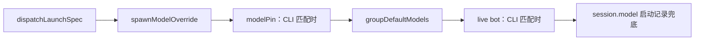
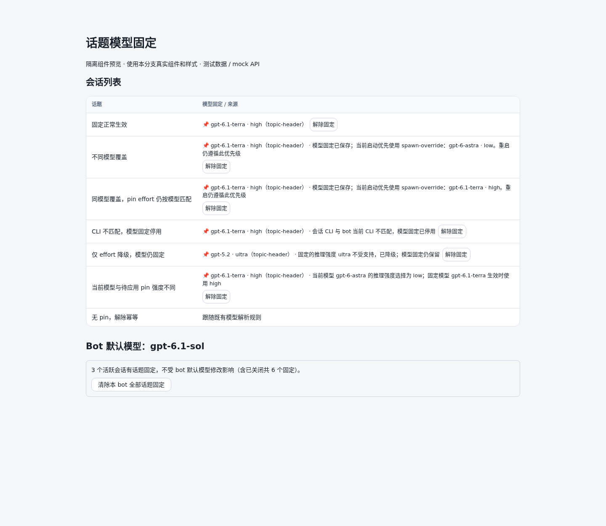

# 话题模型固定：实现与验证

本功能将用户显式选择的模型与可选推理强度保存到话题，供后续 CLI 启动、重启和恢复使用。

## 使用和状态语义

```text
/t /model gpt-6.1-terra /effort high 任务
/modelpin gpt-6.1-terra high
/modelpin --follow-bot
/models
```

- 指令头显式模型写入 `Session.modelPin`，同一指令头的 effort 绑定在 pin 内。仅 `/effort` 的指令头沿用原有 `reasoningEffort` 字段。不会把 bot 默认值转成 pin。
- `/modelpin` 需要 `canOperate`，仅作用于已有会话。设置时若 CLI 空闲且可安全重启则重启应用；忙碌时保存，下次启动应用。解除立即删除模型选择来源；正在运行的 CLI 在下次启动时应用。卡片与 Dashboard 的解除回执明确说明这一点。
- `/models` 会话选模保存 `source: card`。若没有更高优先级覆盖，保留既有原生透传并发起相关联的 CLI 重启；若存在覆盖，只保存 pin 并明示当前启动模型/effort，不透传、不为 pin 重启。选模卡预先提示重启与后台终端任务停止；原生透传失败、重启发送失败及异步重启失败分别提示，已落盘的用户选择保留。adopt、远端后端、迁移/重启中的会话拒绝应用。
- 解除后的解析顺序仍包含已有群默认快照。因此带群默认快照的话题恢复群快照，其它话题跟随 bot 默认；不会为“follow bot”删除群快照。
- 普通 CLI 原生 `/model` 的透传仍是临时选择。需要固定时使用上述显式入口。



箭头表示从高到低的优先级，命中即停止。pin 的 effort 只对同一模型且 CLI 匹配时生效；能力信息不支持该档位时降级，卡片、状态和 Dashboard 展示原因。没有 pin 的启动参数解析沿用既有路径。

## 持久化和并发边界

`modelPin` 包含 `model`、可选 `effort`、`source`、`setBy`、ISO 时间 `setAt`，存于现有 SQLite session row，不迁移存量会话。

普通 metadata 更新保留磁盘上的 pin，防止迟到的整行写入复活已解除的 pin、或抹掉新选择。只有显式 writer 使用 `modelPinWrite: true`，创建指令头、fork/恢复继承和 App 接管清理也明确使用这一入口。批量清除使用 `mutateOwnedSessionsAtomically`：任一写失败全部回滚，提交后才同步内存并发布事件。迁移/重启/原生 effort 修改中的任一目标会使整批操作拒绝。HTTP 409 返回 `error: session_busy`、`busySessionIds` 与带 reason 的 `busySessions`。UI 显示具体会话、忙碌原因及稍后重试；不承诺等待时长。目标不含 pin 时直接返回空 cleared，不进入写事务。

被 dispatchLaunchSpec / spawnModelOverride 覆盖时，保留其原有优先级与生命周期，不重做 override 生命周期。卡片、状态、Dashboard 均展示被覆盖来源及真实启动模型/effort；同模型 override 下 pin effort 仍按既有模型匹配规则参与，dispatch 的模型与 effort 则优先于 pin。

live worker 的 restart 与 crash-park message 两条 IPC 通道同时携带模型和 pin effort；解除后携带明确的 effort 清理/回退值。从未有 pin 的会话不增加 effort 热更新载荷。worker 用同一 `applyWorkerLaunchModel` seam 消费两条通道，保留 undefined/null 三分态。

卡片解除按钮携带原 pin 的 `setAt`；旧卡不能清除后来设置的新 pin。Dashboard 写接口需要管理身份并经 host HMAC 代理；会话 turn capability 不允许访问这些接口。匿名列表隐藏 pin 元数据，已认证只读界面隐藏清除按钮。

## fork / relay 的默认决定与依据

| 路径 | 现有约定 / 依据 | 本次行为 |
|---|---|---|
| 原生 fork、失败轮 clean recovery | `session-launch-inheritance.ts::inheritSessionLaunchConfiguration` 复制完整启动配置，`session.model` 仍是历史记录 | 深拷贝已经存在的显式 pin，保留原 source/setBy/setAt；无 pin 不创建 |
| relay | `worker-pool.ts::transferSession` 修改同一个 session 的锚点、群和 scope，再持久化；不创建替代 session | 保留同一 pin，无额外继承来源 |
| 独立启动姿态 / principal lane | 既有 `cloneIndependentLaunchPosture` / `PRINCIPAL_LANE_RUNTIME_KEYS` 复制启动配置 | 仅复制已有显式 pin，不从默认模型生成 pin |
| Codex App 接管 | 强制 codex-app 并清理 model / spawn override | 同时清除 modelPin，持久化清理 |
| 传统 /adopt 与 codex `--remote` 共享接管（`isSharedAdoptSession` 四形状：`ds.adoptedFrom` / `session.adoptedFrom` / `initConfig.adoptMode` / `session.existingAppServerEndpoint`） | 接管的 CLI 由外部所有，botmux 从不带启动参数重新 spawn；`codex --remote <ws> resume <thread>` 的 buildArgs remote 分支整段 early-return，不拼 `--model` / effort | 设置入口（命令/卡片）拒绝**新写** pin；已存在的 pin **保留但停用**——模型/effort resolver 与所有展示面把它视作与 CLI mismatch 同级的 `inactiveReason`，restart IPC 回落 bot 默认；断开接管后原 pin 自动恢复，无需重写。选 (b) 停用而非删除，因为接管是观察不是驱动，用户可能临时接管后断开 |

## 配置与兼容约定

| 情形 | 行为及依据 |
|---|---|
| 指令头 model + effort | 两者共同写入 pin；effort-only 仍保留原有字段 |
| 会话选模卡 | 显式选择写 pin；被更高优先级来源覆盖时只保存并解释 |
| fork / relay | 沿用已有启动配置继承与同记录搬迁约定；只复制已有显式 pin，不从 bot 默认生成 pin |
| CLI mismatch | 按 FR-12 保留并停用，CLI 切回后不丢失选择 |

## 行为边界与回归

| 场景 | 当前行为 | 回归证据 |
|---|---|---|
| 覆盖与回执 | 共享 resolveSessionModelPinView 按实际 launch resolver 计算 shadowedBy / launchModel / launchEffort；不更改 spawnModelOverride 生命周期；覆盖下 command/card 不为 pin 重启 | model-pin / model-pin-presentation / card-handler-reply-card-actions；不同模型、同模型不同 effort 的启动配置及展示比较 |
| 较晚 effort | 真实冷偏好入口、Codex 原生菜单回执、Codex App 回执、TraeX 话题入口均在同一 row 写入新偏好与匹配模型的 pin effort；更新 source/setBy/setAt | model-pin-effort：真实 SQLite 重开、restart payload、失败原子回滚、真实 /effort 权限撤销、假时钟等待与 pin/批清竞争 |
| 解除幂等 | 无 pin 时 writer 返回 false；命令不重启；API 不进入写事务；无 SSE、modelPinCleared、effort payload 变化 | command 和真实 HTTP API 的副作用探针 |
| 批清 busy | 保留全有全无；结构化列出所有阻塞会话；提交前拒绝，稍后可重试 | model-pin-api / model-pin-store；Playwright busy 单清/批清与重试截图 |
| 省略 effort | command/card 同模型均保留既有 pin effort；不同模型不复制旧 pin effort。未固定 effort 时仍使用原有会话/CLI fallback | 两个实际写入口的回归，含原生透传参数检查 |
| 降级与停用 | inactiveReason 仅指 CLI 不匹配；shadowNote 指高优先级覆盖；effortDowngradeNote 只说明适用 effort 降级，不称模型失效 | 真实卡片/行快照与浏览器三类状态截图 |

原生 effort 修改等待期间阻止 pin 改写/清除和另一 effort 请求；receipt 回来时复核 worker/native ID、pin/偏好版本与调用者权限，过时或失败不提交持久选择。原生 CLI 可能已经响应了设置而磁盘写失败，此时返回 error，内存偏好、pin、启动快照和磁盘均保留原值，不报持久化成功。


## FR 对照与证据

| FR | 实现落点 | 验证证据 |
|---|---|---|
| FR-1 | `types.ts`、`model-pin.ts`、`session-store.ts` | `model-pin-store`：真实 SQLite 重载恢复 model/effort/provenance；存量无 pin |
| FR-2 | `topic-spec.ts::applyTopicModelSpec`、daemon 创建话题 | `topic-spec`：显式 model+effort 写 pin；effort-only 保留旧字段 |
| FR-3 | `session-model.ts::resolveSessionLaunchModelChoice` | `model-pin`：dispatch → once → pin → group → live → record；含 p2p；摘除 pin 优先级测试咬红 |
| FR-4 | `sessionAgentConfig`、`latestModelForRespawn`、`latestPinEffortForRespawn`、worker 两条 IPC | `session-lifecycle-start`：真实 init 构造 fresh/restore；`restart-live-worker-model`：slash/dashboard/cwd_move/cli_crash；真实 Codex worker init/clear/restart/refork/SQLite 冷重载见下文 |
| FR-5 | `recordLaunchModel` 的原有策略不变 | `restart-live-worker-model` / `session-lifecycle-start`：记录 pin 实际启动模型，one-shot 不写记录 |
| FR-6 | `resolveSessionLaunchEffort`、`modelPinView` | 模型绑定、能力门控、降级原因测试；摘除模型绑定条件时测试咬红 |
| FR-7 | `validateModelPin`、`resolveTopicSpec`、卡片最终提交前的检查 | `model-pin`：不支持 CLI/后端/effort/模型名拒绝；`launch-model-capability`：注册适配器真实 buildArgs 能力检查；TraeX effort-only 旧校验保留，显式模型 pin 使用能力门 |
| FR-8 | `/modelpin --follow-bot`、卡片解除、Dashboard 单清/按 bot 批清 | `model-pin-api`：真实 HTTP + HMAC + SQLite；`model-pin-store`：单清、含 closed 批清、跨 bot 隔离、第二写失败回滚；浏览器验证两类按钮及 DOM 更新 |
| FR-9 | `card-handler.ts`、`session-model-picker.ts` | 卡片选择 source/card/setBy；透传与 restart；busy/权限/异步目录检查后变代拒绝；失败回执 |
| FR-10 | 流式/静态会话卡、`/status`、Dashboard 表格/看板、bot 模型区统计 | 实际卡片 JSON 展示 model/source/inactive reason；Dashboard 组件浏览器截图及 mock API 请求记录；真实统计端点测试 |
| FR-11 | `clearTakeoverModelSources` + daemon 接管 writer | `model-pin`：三种模型来源共同清除；接管代码使用显式持久化写入 |
| FR-12 | `cliMatchesBot`、模型/effort resolver、modelPinView | CLI 不匹配时模型及 effort 都不使用 pin，pin 本身保留且界面提示；能力测试含第二种 CLI |

## 共享路径与并发验证

改动覆盖共享 session/store、模型和 effort 解析、worker IPC、命令授权、Lark 卡片及 Dashboard。无 pin 的模型解析、effort-only 指令头沿用原有语义；无 pin 解除不写库、不发 SSE、不重启，也不改变 effort 热更新载荷。

effort 入口在重启或另一原生 effort 操作期间统一拒绝新选择，**也包括无 pin 会话**：影响 managed Codex/Codex App 的 effort 命令和卡片入口，TraeX topic effort 同样串行化，不承诺固定等待时间。

匹配当前模型的 effort 写入在 SQLite 事务内读取新行、比较 pin 完整内容（含 setAt/provenance）。陈旧副本遇到已清除或已替换的 pin 时拒绝整个选择；提交后才同步内存。当前模型与待应用 pin 模型/强度不同，展示同时说明两种模型及强度；TraeX 使用当前模型绑定的 topic effort。不支持的 pin effort 只显示降级提示，不承诺应用该档位。

| 异常场景 | 真实组件探针结果 |
|---|---|
| 菜单等待时人工替换 pin，含相同 setAt 但 provenance 不同 | SQLite 保留新 pin 与其它字段，旧回执不能提交或复活旧选择 |
| 行持久化失败后重试 | pin、effort 偏好、启动快照和调用者内存保持原值；解除故障后一次提交，busy 不残留 |
| 请求 A 超时后发起 B，再收到 A 的旧回执 | 旧 requestId 不消费 B；最终只提交 B 的值 |
| 被覆盖 pin 的解除 | 真实命令清除落盘，worker 收不到 restart/kill，override 生命周期不变 |

移除事务内 pin 比较、提交后内存更新或回执 requestId 匹配等守卫，相关行为探针会失败；变异后均恢复原实现。

## 实际验证与边界

验证环境为 Linux、Bun 1.4.3、Codex CLI 0.167.0。执行过 `bun run build`、模型固定相关 34 文件测试套件，以及语法修复后的定向命令：

```bash
bun run test -- test/card-handler-reply-card-actions.test.ts test/topic-spec.test.ts test/passthrough-delivered-before-turn.test.ts
```

定向命令 164 项通过。测试覆盖真实 SQLite/HTTP、解析优先级、全部 respawn 通道、fork/relay、权限、原子清除、冷恢复、失败回滚、卡片 wire、文档漂移及无 pin 兼容。完整套件的最终结果列在 PR 验证记录中。

### 真实执行证据分层

| 层次 | 已验证行为 | 边界 |
|---|---|---|
| 真 worker + 真 Codex + SQLite | 初始 terra/high；产品 effort 入口经原生菜单成功回执保存 low；下一轮、restart、原生 clear 新线程、SQLite 重开且 bot 默认改为 astra 后，rollout turn_context 仍为 terra/low | 独立临时 HOME、cwd、apiOnly bot 与 Linux PTY；未启动完整 daemon，未复制 hooks/MCP/plugins |
| 真隔离 core-only daemon + 假 codex argv | daemon 冷恢复、worker restart 保持 pin 参数；清除后恢复 bot 默认参数；忙碌期间批清返回结构化 409 且无部分提交 | 证明 daemon 启动链路，不能当作真 Codex 推理证据 |
| 真 Codex 原生 model 语法 | 初始 high；裸位置参数 `/model gpt-6.1-terra low` 被明确拒绝，下一轮仍 high；`/model gpt-6.1-terra --reasoning=low` 获原生设置回执，未 restart 的下一轮已为 low | 因此仅修复卡片 Codex suffix，未用另一 effort 入口代替语法验证 |
| 实际 picker/card-handler/daemon 透传 helper + 真 worker/Codex | 卡片保留 low pin 并 restart 成功；重启窗口内强制将同一命令进入真实 worker 队列，prompt 后重放及下一轮仍为 low | 在隔离 harness 调用卡片入口，未验证线上 IM 回调。普通卡片首条 raw IPC 在并发 restart 拆后端时被打断；不冒称它在 restart 前已有原生成功回执 |

rollout 抽取按 timestamp 排序，并确认新增记录晚于阶段起点；原生 effort 成功回执来自实际 worker，没有手工构造成功事件。原生日志、账户与临时认证不随源码发布。

**未验证**：完整 daemon + 真 Codex 全链路、线上飞书和真实 Dashboard 服务、Codex App 的真实原生 effort 回执、非 Linux、其它 CLI/wrapper/远端后端及旧版 Codex 的真实 E2E。模型能力与后端门控仅有行为测试覆盖。

## 界面示意

下面为本分支实际组件、解析器和 CSS 的 Playwright 截图，使用示例数据和 mock API；覆盖固定、override、CLI 停用、effort 降级和待应用强度提示，**不是线上验收**。


