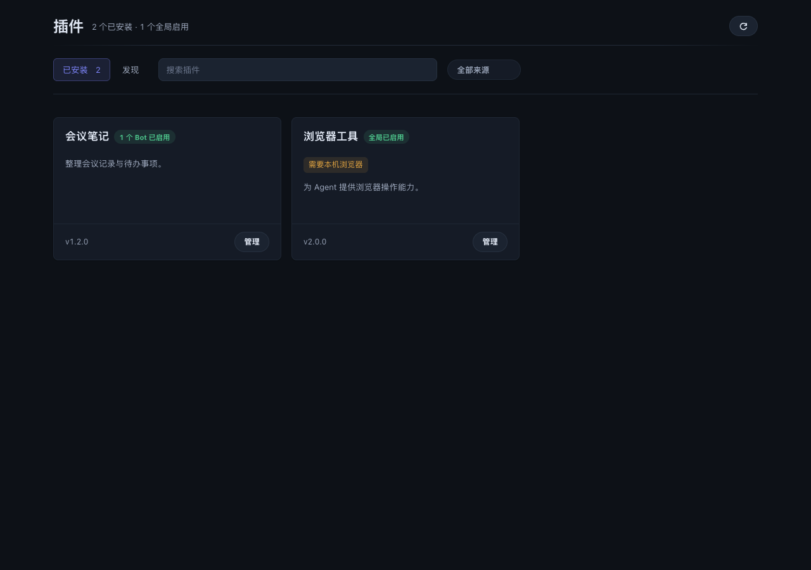
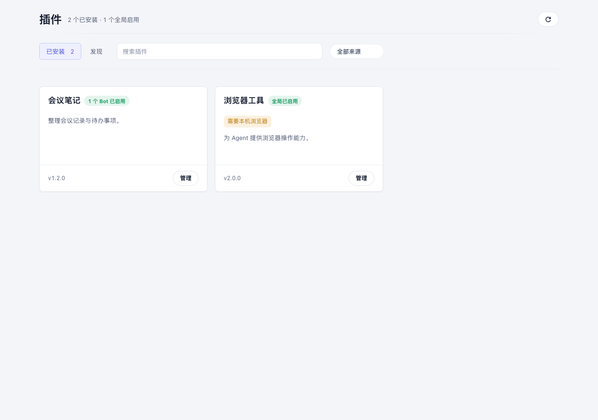
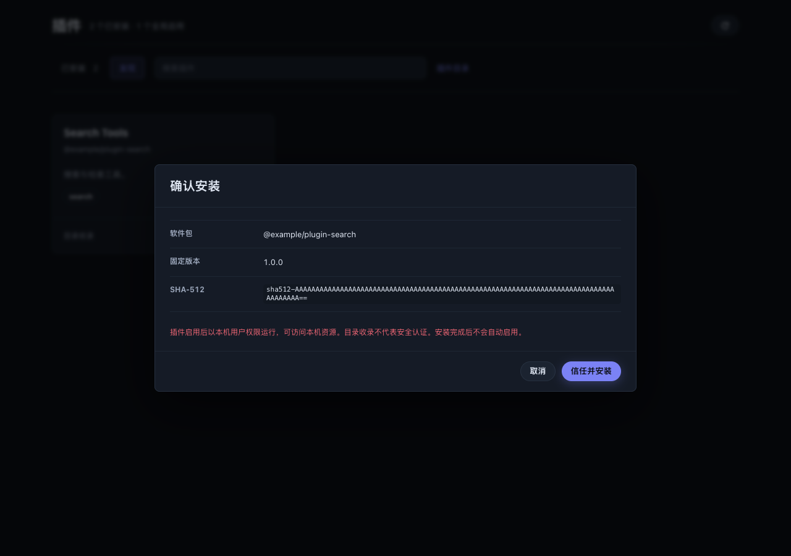
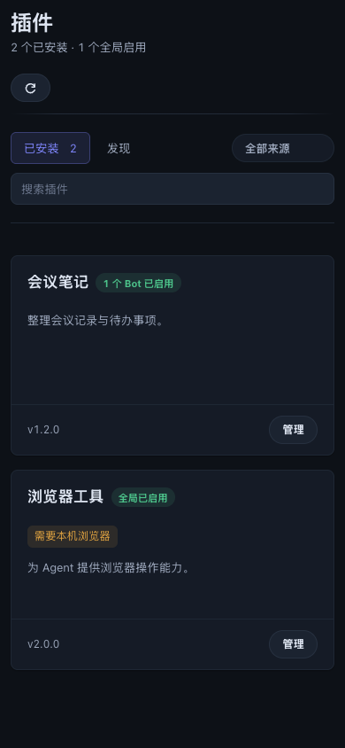

# 原生插件页与确认安装

## 范围

在既有 `#/plugins` 内提供「已安装 / 发现」，不新增第二个插件中心。
沿用宿主主题、对话框、全局与按 Bot 作用域及 Service 管理。
不包含任何业务插件实现、自动接入模型或自动启用插件的行为。

介绍使用 npm `description`，可选 `botmux.audience` 仅作展示。
默认视图保留名称、介绍、状态和管理入口，技术能力与服务控制默认折叠。
旧插件缺少介绍时仍可正常管理。

## 安装边界

1. 从 `botmux-ai/plugin-market` 读取并校验静态目录；五分钟缓存，失败时允许显示过期缓存。
2. 向 npm 查询精确版本与 SHA-512，生成五分钟有效、绑定管理身份的单次确认。
3. 下载固定版本 tarball，核对完整性、包名、版本与插件 ID。
4. 通过 `install-verified` 进入实际安装器；缺少 guard 或旧 CLI 不支持命令时失败关闭。
5. npm 安装跳过生命周期脚本；实际写入前在生命周期锁内重查确认状态。

目录只负责发现，不是安全认证。插件运行后拥有当前系统用户权限；
跳过安装脚本也不代表执行其代码是安全的。插件需要自行交付预构建的 `dist/`。
普通 CLI 安装保留原行为，不把已有需要安装脚本的用法静默改掉。

## 并发与失败

- 确认同时记录插件状态 hash 和 registry 文件内单调递增的修订号（每次原子写入 +1），防止同 ID 替换及空槽位 ABA。修订号不能用文件 stat（inode/大小/时间戳）：ext4 上背靠背等长重写会复用 inode 且落在同一时间戳粒度，A→B→A 无法区分。
- 管理 token 的摘要在真实落盘前重查，等待期间撤销管理凭据不会继续提交。
- 启用范围写入、设置保存、安装和卸载共用生命周期锁。
- 设置请求先读取 body，再在锁内检查包身份；等待时已卸载返回 404，已替换返回 409。
- 卸载要求全部作用域关闭、后台服务已停，并在异步清理后重新核验确认。
- 清理成功前保留 registry 以便重试；移走旧目录后 registry 删除失败会恢复原目录。
- 最后删除退役目录失败时保留 `.removed-*` 并告警，不再删除新装的同 ID 插件。
- 同 ID 再安装时，在生命周期锁内、确认校验通过后重试回收退役目录；仅处理原 ID 与目录名都未注册的精确 `<id>.removed-<pid>-<timestamp>` 普通目录。保留符号链接、其它插件以及本地安装源所在目录；清理失败告警但不阻断安装，清理后重新核验确认权限。
- 在任何惰性迁移前检查注册表完整性；缺失、损坏或无法完整解析时不回收。本次为链接安装、暂存/已安装 runtime 含符号链接、扫描超过一万项或无法确认本地源路径时也保守跳过，避免破坏其它插件的间接依赖。
- 确认不跨 Dashboard 重启保留，过期或重启后需要重新确认。

尚未验证断电恰好发生在目录重命名与 registry 提交之间的恢复；
不再安装的插件、仍无法删除或为恢复保留的退役目录需人工清理。此改动不宣称完整的跨文件事务。

## 接口

| 接口 | 用途 |
| --- | --- |
| `GET /api/plugins/market` | 目录与缓存状态 |
| `POST /api/plugins/market/refresh` | 强制刷新目录 |
| `POST /api/plugins/market/prepare` | 固定版本确认 |
| `POST /api/plugins/market/install` | 消费确认并安装 |
| `POST /api/plugins/market/uninstall` | 核对身份与作用域后卸载 |

接口使用既有本机管理身份、Origin 和 CSRF 校验，不向 Bot/会话访问凭据开放安装权限。
使用 `resolveCliSpawn` 兼容源码与编译态；依赖 `npm` 和 `tar` 在 PATH 中。
共享行为影响所有 CLI 的插件管理，不改推理、消息或会话调度。

## 验证入口

```bash
bun run build
bun run test test/dashboard-plugin-market.test.ts test/plugin-mutation-guard.test.ts \
  test/plugin-market-final-verification.test.ts test/plugin-presentation-metadata.test.ts \
  test/dashboard-plugin-settings.test.ts
bun scripts/fenced-run.ts -- node scripts/verify-plugin-market-ui.mjs

# 先使用 build:bun 或 verify:binary 生成本机架构的可执行文件。
bun scripts/fenced-run.ts -- node scripts/verify-plugin-market-cli.mjs /path/to/botmux
bun scripts/fenced-run.ts -- node scripts/verify-plugin-market-api.mjs /path/to/botmux
```

UI 脚本使用真实 React 页面与宿主样式，全部 HTTP 请求由测试夹具接管，
不会操作运行中的 Dashboard。可通过 `CHROME_PATH` 指定本机 Chrome，
通过 `PLUGIN_UI_EVIDENCE` 指定截图目录。默认使用 Playwright Chromium。
编译态 CLI 脚本执行真实本地包、npm tarball 安装和卸载；
API 脚本启动隔离 Dashboard，访问真实目录及 npm 元数据，但不安装远程包。
所有脚本使用临时 HOME；调用时仍应使用仓库 `fenced-run` 保护。

## 截图

以下为匿名夹具，不是已发布的插件目录条目。





