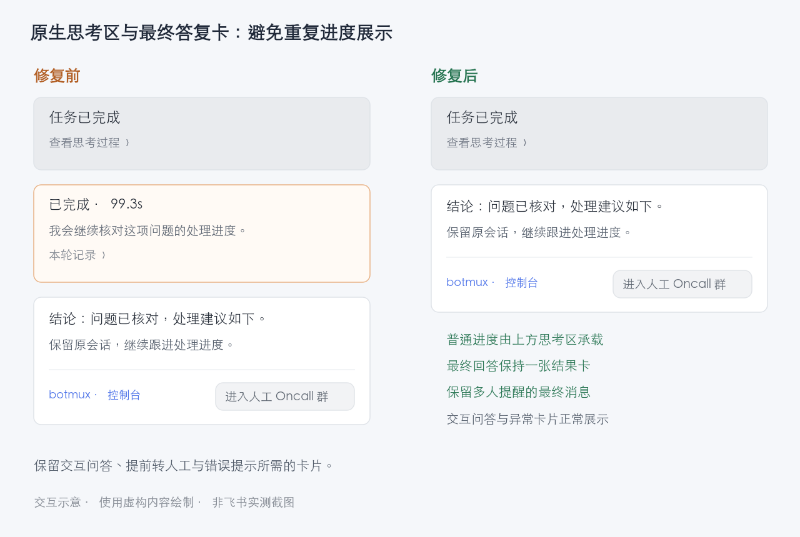

# 原生思考区与最终答复卡

启用单卡＋原生 CoT 时，普通进度仅写入本轮记录，由灰色思考区展示。白色卡片用于最终答复、错误终态、交互问答和需要提前展示的 Oncall 控制。

这一分工以思考区确实在承载本轮为前提：

- 答案卡首次发布前的顺序屏障（daemon 侧直接等待，CLI 侧经 `reply-card-ready`）回报原生 thinking 是否已创建、仍可推送且通道开启，结果随 `nativeCotReady` 一起写入记录的 `nativeCotVisible`。创建失败、超时、业务错误、建成前已 `/cot off`，或未回报可见性的旧 daemon，都不写该字段，答案卡照旧承载进度，与未启用原生 CoT 时一致。
- 思考区在本轮自身终态之前退场时——追发消息让新一轮接管了思考区、推送失败、`/cot off` 或关闭开关、worker 断开、daemon 重启后内存里已没有它——daemon 处理本轮下一次更新时撤销 `nativeCotVisible`（落盘、本轮不再恢复），答案卡接回进度展示。CLI 进程看不到 daemon 内存里的思考区状态，只看落盘字段：撤销之前 CLI 发的进度照常写入记录，并在答案卡出现时作为最新进度显示。本轮自身终态收尾思考区、或 steer 把本轮剩余工作并入新一轮，都属于正常结束，不触发撤销；本轮终态到达后也不再交回。交回后即使重新开启通道，本轮也留在答案卡上，不在两处重复展示（`/cot show` 除外）。

带多人提醒等原因、作为独立消息留在本话题的最终答复，由 `botmux send` 在送达后把记录标为 `externalFinal`；同一 final 的重试走复用路径时补标，标记幂等。发到群顶层（`--top-level`）、别的话题（`--into`）或别的群（`--chat-id`）的 final 不算本话题的收尾，不打标记。completed 时只有带此标记才不再创建完成摘要卡；本轮没有任何最终答复时（final 为空、只有普通进度），completed 照旧发出完成卡，显示进度原文，final 时机的 Oncall 控件也随之出现。已有卡片和未知 POST 保留原 UUID、负载与恢复协议；未启用原生 CoT 的展示保持。

使用虚构内容绘制的交互示意，非飞书实测截图：

相关回归覆盖：进度抑制；思考区不可用（创建失败、业务错误、首段推送失败、建成前关闭、旧 daemon）时的白卡兜底；思考区中途退场（新一轮接管、worker 断开、关闭通道）后交回答案卡；最终发布；多人提醒与独立 final 标记（含发往别处不标记、丢标记后重试补标）；无最终答复的完成卡；Oncall 首次与完成阶段；交互问答；失败/取消/待确认；已有卡片继续更新与收尾；`/cot show`；重开存储及未知 POST。

已知边界：

- worker 断开或 daemon 重启后，若本轮再无任何更新，恢复流程不会为没有答案卡的轮次新建卡片（恢复只更新已有卡）；此时由思考区写入的中断说明收尾，已记录的进度不再展示。
- 思考区承载的轮次在最终答复前没有白卡，卡上的停止按钮随之不出现；保留独立状态卡时由状态卡提供停止，关闭独立状态卡（`disableStreamingCard`）时轮内停止使用 `/stop`。
