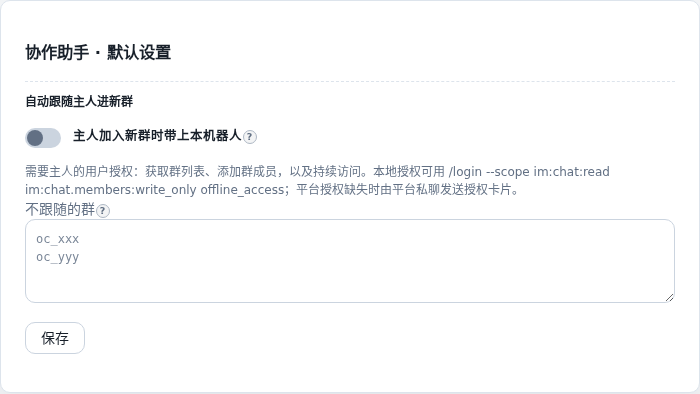

# 用户加入新群时自动邀请机器人

当机器人主人被邀请进一个机器人尚未加入的群时，机器人收不到该群的用户进群事件。新增 `ownerGroupFollow`，通过主人的用户授权读取完整群列表，识别新增成员关系，再以主人身份邀请当前机器人。每个机器人独立配置，缺省关闭。

## 使用

Dashboard「Bot 默认设置 → 常用 → 工作目录」中有「自动跟随主人进新群」。也可在飞书执行：

```text
@机器人 /botconfig set ownerGroupFollow {"enabled":true,"excludeChatIds":["oc_example"],"pollIntervalSeconds":60}
@机器人 /botconfig unset ownerGroupFollow
```

默认跟随全部新群。Dashboard 可切换为「仅按规则筛选」，手动编辑规则或选用「缺陷同步群」「告警/值班描述」等预设，再用示例群名和描述试测草稿。「告警/值班描述」可匹配「自动创建的报警处理群」等通用群描述。切回「跟随全部新群」后保存会清空包含规则，排除规则和群 ID 仍然有效。

```json
{
  "enabled": true,
  "includeRules": [{ "field": "name", "op": "endsWith", "pattern": "[缺陷同步群]" }],
  "excludeRules": [{ "field": "name", "op": "contains", "pattern": "[已关单]" }],
  "excludeChatIds": ["oc_example"],
  "pollIntervalSeconds": 60
}
```

规则字段可选 `name`、`description` 或 `any`（群名或群描述任一命中），匹配方式支持 `contains`、`startsWith`、`endsWith`、`regex`。默认忽略大小写，可设置 `caseSensitive: true`。每类最多 50 条，匹配值最多 200 个字符。正则必须能编译，也会拒绝高风险的嵌套重复、带分支的重复组和反向引用。每个顶层分支最多允许 8 个可变宽度量词，其中宽通配最多 2 个，相邻的可变宽度段最多 2 个。固定次数的量词不计入这些限制。

先检查排除群 ID，再检查排除规则，两者任一命中即跳过。有包含规则时至少命中一条才跟随。省略包含规则时，所有未被排除的新群都符合条件。群名和群描述取自现有群列表回包。

应用需开通获取群列表和添加群成员的用户权限，主人完成用户授权并允许续期，例如：

```text
@机器人 /login --scope im:chat:read im:chat.members:write_only offline_access
```

已有 `im:chat` 的授权亦可覆盖这些群操作。凭据按当前机器人的应用和主人严格匹配，不接受无归属旧凭据或其它人的授权。启用了 `triggerUserAuth` 的平台凭据策略时，复用同一受管解析器，平台只提供该主人的短期用户凭据；只启用本功能不会改变工具授权策略。确定缺少平台授权、机器同意或 scope 时，调用平台授权请求接口，由平台私聊发送授权卡片；只有旧接口才回退到增量授权链接。平台不可用或拒绝时如实报告，不声称卡片已发送。同类授权提示最多六小时一次。成功授权后的第一次完整扫描建立基线。

## 行为

- 首次开启、关闭后再次开启、主人或品牌变更时，只记录现有群，不补拉旧群。
- 功能仍为 enabled、但主人身份暂时未解析出来时，不写入空身份 scope，也不清空原主人的基线与移出标记；配置通知仍在原 scope 上推进 epoch，以围栏其它 daemon 的旧响应。恢复为同一主人后继续原状态，解析为不同主人时才按身份变更重置。
- 已建立的基线跨 daemon 重启保留；停止期间新出现的群会在下次完整扫描后处理。
- 默认每 60 秒扫描，允许配置 30–3600 秒；配置热更新，关闭会取消当前请求并阻止后续邀请。已由飞书接受的邀请无法撤回。
- 只处理仍可用的群聊，排除 p2p 与已解散或解散保留群。所有有效群 ID 都纳入基线，即使未通过过滤。放宽规则或取消排除后不会补扫仍在列表中的已有群。
- 收紧规则后，下一次完整扫描会取消不符合条件的待发邀请或待重试认领。机器人已经入群时，以实际成员关系为准，继续跟踪后续移出。每次拿到新凭据后、认领邀请前都按实时配置再次检查规则。
- 每次处理前检查主人和机器人各自的完整群列表；同一群重复出现时，筛选和邀请前复核统一使用首次出现的信息。机器人已经在群内则跳过。分页失败、循环游标、超过 100 页或格式异常均整轮失败，不能用不完整结果更新基线。
- 机器人被移出时记永久阻止标记；漏收事件时，先前已加入而当前不在群中的列表差异也会阻止补拉。关闭重开保留同一主人的移出标记。
- 邀请仍受主人的邀请权限、群成员上限和机器人的外部群能力限制。永久错误停止，临时错误最多三次尝试、按退避时间重试；授权错误暂停，不消耗临时错误预算。
- 飞书返回待审批名单时记录等待审批，只通知主人一次，不误报入群成功或反复申请；后续群列表确认机器人已经加入后才记成功。不存在的应用名单视为永久失败，同群并发操作错误 232019 按临时错误重试。
- 轮询无法捕获两次扫描之间完成的进群再退群，也无法区分停机期间加入再移出的机器人。不会声称实时或无条件覆盖所有群。

## 状态和异常恢复

状态位于 session dataDir 的 `owner-group-follow/<app-id-hash>.json`，仅存主人身份范围、基线群 ID、配置代次、邀请认领和移出标记。群名、群描述、token 和聊天内容均不落入该日志。目录权限 0700、文件权限 0600，使用跨进程文件锁与 durable 原子替换。

每轮读实时配置，等待凭据、分页或邀请后复核主人、品牌、开关和配置代次。配置修改会取消请求并推进代次，旧响应不能恢复旧状态。邀请先持久化认领，成功后结算。移出事件通过同一个锁写入，晚到的成功响应只能结算自己的认领，不能覆盖移出标记。通知除在组装前复核外，还把同一复核传入 `sendUserMessage` 的 `beforeWrite`，保证 Lark gate 排队或重试之后、每次实际写入之前再次阻止旧主人/已关闭配置的通知。

读取群列表前捕获 journal revision，提交列表差异时在锁内比较。另一 daemon 在这期间完成认领、邀请或移出记录时，旧列表整轮丢弃；晚到的空列表不能把刚邀请成功的机器人误记为被移出。observe 返回本轮 revision，后续 claim 携带该游标；每次成功写入推进游标，若另一 daemon 已写入更新状态，旧轮次不能继续发出邀请。claim/finish 的无效认领或不匹配结算不推进 revision。

单个 daemon 内扫描不重入，重启交叠时通过持久认领避免立即重复请求。邀请传输或成功回包解析失败时结果不明，保留 inviting 认领，先核对机器人实际群成员关系，仍不在群时等待认领满两分钟后才允许重试；只有服务端明确返回的可重试错误才进入普通 60/120 秒退避。三次耗尽的未知请求停止并提示主人。通知是尽力投递，通知失败不重放邀请。

## 影响面与验证

改动涉及飞书/Lark 群 API、Bot 配置读取与写入、Dashboard 设置和 daemon 生命周期。不经过 CLI 适配器、PTY/Tmux 会话、消息路由或 workflow；apiOnly Bot 不启动跟随服务，未开启的 Bot 不读取用户凭据或调用群 API。

行为测试覆盖关闭默认值、首次基线、新群邀请、严格主人归属、授权失效、完整分页、排除群、移出事件与晚到响应、重启恢复、认领耗尽、中途关停及多 daemon 交叠。既有配置、平台授权、群创建、入群事件和 Dashboard 回归另行执行。运行日志与交付结果记录实际验证结论。

异常探针复现并修复了四种场景：两个 daemon 的晚到列表覆盖刚完成的邀请、code=0 但应用不存在或需要审批、平台拒绝后错误引导本 Bot 授权、或遗漏上游授权卡片请求、同群并发错误被错误视为永久失败。回归通过真实跟随组件、API 回包和可控时钟验证这些结果。



[桌面过滤规则示意](../assets/owner-group-follow/filters-desktop.png) · [360 像素窄屏示意](../assets/owner-group-follow/filters-narrow.png)
