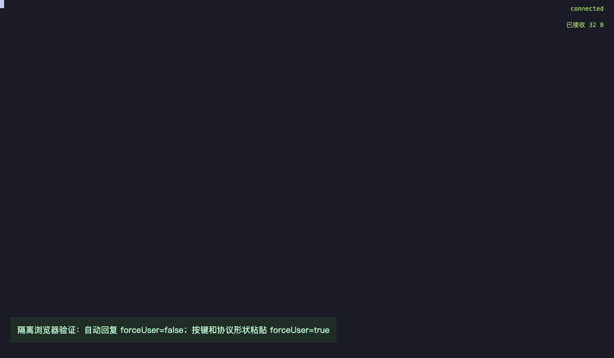

# Web 终端协议回复与首次输入恢复

## 问题与边界

xterm 的 onData 既发送键盘/粘贴，也发送终端自动回复。将中性回复记作人工输入，会反复重置 TraeX 首次输入静默窗口；把 Web 输入代次作为采样器存活条件，又会使一次输入永久终止采样。排空失败后的观察需要继续，但不能以超时强制 Enter。

本修改是普通 Web 终端与本地首次输入链路的修复，不依赖特定网关，不转换历史、不改模型或凭据。

## 输入合同

- 服务端每连接、每物理目标维护有界状态。默认未定前缀75ms、256 UTF-8 bytes，后续分片不续期。
- 只豁免完整的 OSC 10/11/12 rgb 色彩回复和 focus 报告；不泛化所有 ESC/CSI，也不将与修饰 F3 同形的 CPR 当作自动回复。
- 用户/未知、混合包、畸形或到期残片保持动作语义；原字节不删除、不重写、不换序。
- bracketed paste 流式追踪，内部的协议形状仍是用户内容，paste 内换行不算提交。
- 明确UI调用、onKey及事件内paste可增加forceUser提示；该提示只能让服务端更保守，不能授予写权限或反向豁免。
- 中性回复正常转发，但不撤销Codex continuation、不取消effort、不污染人工代次或手工命令来源。
- 用户接纳只在同一个物理CLI的浏览器写入之间排序；普通协议回复不等待取消，没有跨机器人/模型的统一队列。接收解析仍每WS独立。
- 每个人工批次及待attach队列各自最多128段/256KiB。包括首批在内，超限整批拒绝并以WS 1009关闭，不静默截断。这是新增的显式容量边界。

## 身份与交付

分类前与每个await后都复核写授权、关闭状态、backend、CLI lifetime/generation、runtime scope/binding和fork。只读type=input始终拒绝，既有窄scroll合同不改变。

未定前缀、未完成用户接纳及待attach字节共同参与首次输入hold。关闭/失效时清理状态，不把旧前缀或队列交给替代目标。pre-attach的forwarded仅表示入队，不是CLI已收；replay仍复核目标。

释放hold先发布清空状态再通知观察者，使用当前首次输入检查，不另起poller或刷新其总期限。

接收态与实际writer状态分开。同一物理目标的多连接共享writer/paste结束屏障，中性回复不得穿过尚未写出的粘贴结束标记；他连接不能把用户批次插入当前粘贴。queued attach只表示入队，replay真正write后才推进writer状态。已写粘贴的完成无法确认时保持明确dirty状态，暂停后续自动投递并通知；网页重连或重获权限不等于恢复，只能由新的物理CLI代次解除。该状态不声称能跨Worker/daemon重建自动证明旧原生进程已恢复，需要明确重建真实CLI。

完整 queued 粘贴仍保留 outstanding ownership，不能仅凭解析器已看到 END 就放行另一连接。同连接可把中性回复排在自己已接纳的 END 后面；其它连接必须等物理 replay 确认。等待者在占用 user tail 之前等屏障，以免反向堵住原 owner 的 END；关闭等待连接会退休其 wait。关闭或溢出时只释放该连接的未写记录并从物理 writer 重建 accepted 状态，明确的 write=false 不误判为部分物理写入。

接收前缀仍有原来的时限；物理 writer 上确定的粘贴标记前缀不能被异步 admission 的间隔抹掉。普通 Escape 仍可退休，新 introducer 会结束旧候选，OSC 分片 ST 保持完整。部分已写标记的完成不明时沿用 dirty，而不以时间流逝作为物理输入已干净的证据。

自动消息与注入在入口、各写前 await 后、出队和实际写事务边界复核 dirty；确定未写的队列项保留原顺序。raw command 的逐字写入及 text→Enter 间隔后也复核物理代次，TraeX 的 adapter setup await 后在 paste 之前再查一次；已经部分写出的输入不盲目重放。

## 首次输入恢复

- 采样器存活绑定backend、renderer、CLI generation和原90秒期限；Web代次仅否定当次采样，下一tick重新取证。
- renderer排空拒绝或证据变化时保留队列，以同runtime/renderer单一、有界重试继续检查；不放松画面、PTY输出、人工输入及跨await守卫。
- TraeX先复用精确Botmux→native映射，再确定实际fresh/resume；adapter声明没有无ID的continue能力。
- adapter 参数、worker launch 与恢复回执共用同一个精确 native ID 解析入口，不能在已找到精确映射时仍把恢复回显为 fresh。
- 实际fresh启用fresh护栏，真正resume、persistent reattach、adopt、remote和旧版本保留各自合同。精确恢复不借此降为无关新会话。
- 细化卡片等待原因/手动检查UI另行处理，本改动不声称已完成该展示改进。

## 验证

行为回归覆盖持续/分片/混合回复、动作控制码、粘贴、半完成排空、人工干预、长await、后端/renderer替换、授权/关闭和队列上界；变异应捕获被删除的关键守卫。

真实Worker+模拟CLI+认证可写WebSocket验证PTY/tmux的fresh和缺ID恢复：初始化前零原输入，就绪后只提交一次，并取得native提交回执。不将模拟CLI称为真实TraeX二进制或真实模型验收。

本机Chrome真实xterm页面验证：自动色彩回复forceUser=false；按键和协议形状粘贴forceUser=true。下图叠加的是隔离验证结果，不是新增产品UI；页面中没有真实任务或私密凭据。

