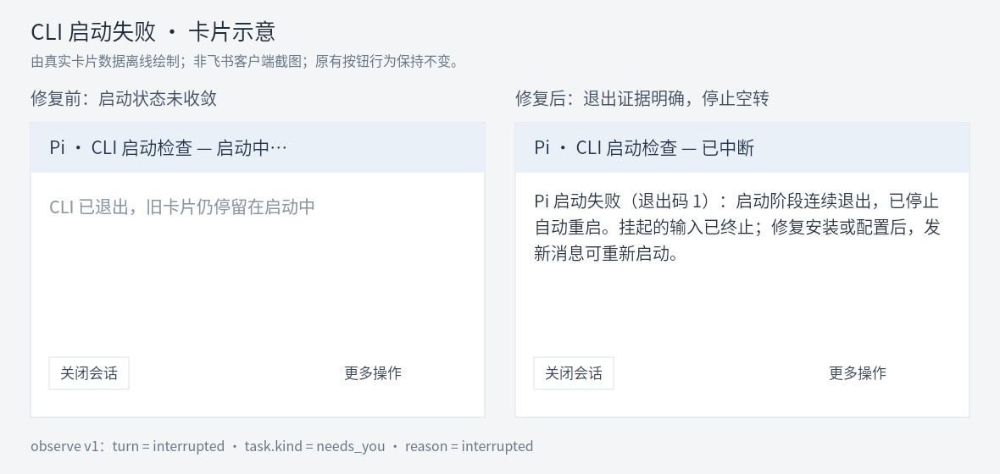

# CLI 启动失败的重启归属与熔断

## 原因

argv 携带首条任务的 CLI 可以先启动，再写 transcript。进程在这两步之间退出时，
会话契约已有 queued execution，却还没有将它绑定到 runtime。

原退出事件同时携带物理 runtime 与这条 execution；事件网关把“任务还没证明开始”
当成“不能相信进程退出”，以 `execution_scope_unproven` 拒绝 `claude_exit`。
worker 已将 backend 置空，而 daemon 没收到可处理的退出事件，也就没有实际重启者。
后续输入命中 `cliRestartInProgress || !backend`，日志一直说 restarting，
实际上并不证明存在任何重启操作。活着的 Node worker 和遗留 working 状态一起造成
“卡片启动中、observe 工作中”的假象。

物理退出现在仍校验 runtime producer、worker channel 和 execution 引用，但不要求
一个尚未执行的任务已经绑定到退出的 runtime。它不会因此给任务授予执行权；
历史 runtime 的退出、正在进行的物理 replacement、其它 worker 的事件仍受原有围栏约束。

## 启动失败判定与预算

只处理实际观测到的非零退出，不为仍在运行的 CLI 添加启动超时：

- 新起、未就绪的 CLI，或 argv 首轮尚无开始证据，即为启动失败。
- 结构化 CLI 在启动后 30 秒内，仍有排队或在途输入、且没有 native user/final/input-consumed
  证据时退出，也算启动失败。死 pane 的静默画面可能被启发式地识别为 ready，不能以此绕过熔断。
- 已有 native 输入/首轮证据优先：长任务没有出现 idle prompt 不等于启动失败。
- warm reattach、adopt、主动进程切换不走此判定。共享 tmux/hc outage 由 daemon 原有
  outage 协调器先行处理；最后一个 pane 的自然退出导致 server gone 时，仍是单会话退出。
- 首次启动失败允许一次自动重试，沿用 multiplexer 抖动与 500ms respawn 延迟；
  第二次启动失败熔断。计数跨失败时间窗累计，真正 ready 后稳定存活满原健康窗口才重置。
- 正常运行中的退出与已知永久错误，保留原来的重启预算。

## 收敛与恢复

退出一被确认，本地托管 CLI 状态就投影为 `interrupted`，不再用活 worker 推导 working。
重启后的 prompt-ready 或精确匹配的成功回执会清除前一个进程的中断状态。

熔断时保留轻量 worker，但不再起诊断 shell或定时 respawn；终止 ordinary pending 与
carry-over 输入。durable/at-most-once 输入继续由原有 receipt 所有者对账，不在 worker
重新执行。输入结果发送部分失败时，不回滚终态去重器、不重放未知送达结果，而是退出
worker，交 daemon 的既有 worker-exit 路径继续对账。

延迟重启使用 epoch 围栏，覆盖 jitter、teardown、plugin/RPC、spawn 和 title 初始化的
等待边界。熔断会结算被取消重启的 completion callback；旧 continuation 不能在新一轮
重试期间清除它的状态、触发 fatal 或重新拉起旧进程。

失败卡在原启动卡上追加明确说明，保留原有按钮回调语义。说明只包含 CLI 名称和数字退出码，
不向飞书转发原始 stderr/命令；完整诊断留在本机日志。晚完成的 starting-card POST/patch
也不能覆盖这次失败状态。修复安装或配置后，同话题的新消息开启新的有界尝试，不再暗中重放
已失败的队列；显式 `/restart` 仍按既有语义工作。

`observe` 继续使用 schema v1 已有字段：`turn=interrupted`、
`task.kind=needs_you`、`task.reason=interrupted`，原因通过 attention/detail 给出。
`liveness=alive` 仍只表示桥接 worker 存活，不表示 CLI 正在工作。

## 验证边界

自动化以真实 worker、私有 tmux、真实 SQLite 会话契约和 fake Pi 重现 pane 消失、
非零退出、一次自动重启、失败卡更新、排队收敛、observe 投影和新消息重新启动。
可控时钟探针另覆盖手动取消、半发送、长 await 与取消窗口交叠，并做移除守卫的变异复验。

没有部署、重启或修改开发机的在线 daemon。真实飞书渲染、真实 provider 与 macOS
环境仍需要独立端到端验证；不能把离线图或 Linux fake CLI 结果当作这部分已经通过。
