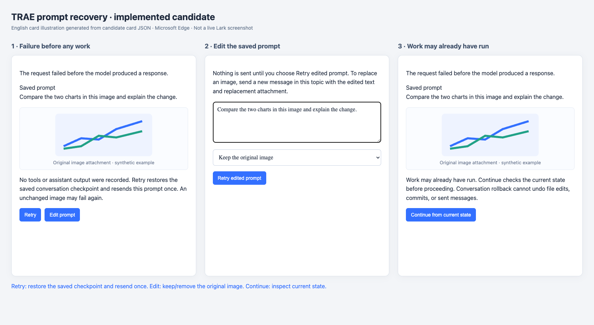

# TRAE failed-prompt recovery

When a prompt fails before any work ran, the failure card offers **Retry** and **Edit prompt**. Retry restores the saved conversation boundary and resends the original text and image once. Edit opens a form on the same card, prefilled with the original text. The original image is kept by default; the user can select removal. Nothing is submitted until **Retry edited prompt** is pressed. To replace an image, the user sends a new message in the same topic with the edited text and replacement attachment.

This is an illustration rendered from the candidate's actual English card JSON in Microsoft Edge with an isolated temporary profile. It is not a live Lark screenshot. The image shown in the illustration is a synthetic attachment. The illustrated browser actions exercise the local preview; native retry, permissions, and transcript changes are verified separately by worker and filesystem tests.

## Decisions and image behavior

| Evidence | Card action | Input and conversation behavior |
| --- | --- | --- |
| Input demonstrably never reached the CLI | Retry / Edit prompt | Send the original or edited input once; there is no failed native turn to remove. |
| Frozen boundary, exact native failed terminal, no tools or assistant output | Retry / Edit prompt | Back up and remove only the failed request, then resume the same native session before submitting the original or edited input. |
| Work ran, or no-work evidence is missing | Continue from current state | Send a checkpoint-aware continuation; inspect existing work and avoid repeating completed actions. |
| Saved tool images poison earlier history | Remove tool images and continue | Explicitly repair saved tool-image blocks first, preserving user images and text. |

Removing an image in the editor applies to the failed prompt being retried. Earlier user images remain in the preserved conversation prefix. Keeping an invalid image can reproduce the same failure. A broken tool image from an earlier turn also survives a latest-prompt rollback, so the separate repair action remains available. Conversation rollback cannot undo file edits, commits, or messages already sent.

## Saved boundary and no-work evidence

The worker freezes the rollout's byte offset, native session ID, and SHA-256 prefix hash at the actual independent input-write boundary. It uses TRAE's structured rollout (`codexBridgeRolloutPath`), rather than the Claude transcript path. Missing, incomplete, oversized, or inaccessible history provides no checkpoint.

A failed terminal carries its checkpoint only when the complete suffix has exactly one matching user request and an ordered `task_complete` error with no assistant output. Tools, reasoning or assistant records, compaction, another prompt, a partial tail, unknown records, external send markers, Web input changes, and a different worker generation prevent that proof. The daemon persists the exact prompt, attachments, caller, and checkpoint on the failed-turn record.

The worker verifies the same native session and suffix again before maintenance. Reads and cuts share a held descriptor inside the pinned sessions root, with a bounded read and a final modification check before truncation. The original prefix, including native ordinals and batch offsets, is retained byte for byte. Removed bytes are backed up outside the native sessions tree.

## Recovery and callback guards

Retry/Edit use the existing operator permission gate, precise session/turn binding, cooldown, reply routing, restart process-exit proof, and exact native resume. Form values contain only the edited prompt and image selection; the client cannot choose a checkpoint, path, or caller. The edit preserves the original frozen envelope instead of rebuilding identity or adding newer chat context. The editor stays on the original card, retaining its provenance for principal-lane checks.

Checkpoint retries fail closed. A busy CLI, changed transcript, unproven exit, or superseded restart prevents submission. Stop or a new accepted prompt cancels a held retry. If the replacement fails, the cut is restored when its prefix and inode remain unchanged. A changed native tail is never treated as harmless Claude metadata. If restoration cannot be proven, the backup remains and the retry is excluded from the successor input journal. Rejected attempts return their cooldown and prompt state.

Supported here: locally owned interactive TRAE sessions with a live worker. Shared/adopted, remote, headless, protected, and transferring sessions retain their existing control boundaries. The existing Claude rewind and image repair behavior remains covered by regression tests. Text follows the bot's configured locale; the PR illustrates the English variant.

## Validation

- macOS arm64, Bun 1.4.4: full build, typecheck, dashboard bundle, and build audits.
- Regression tests cover actual input-write checkpoint capture, strict worker restart/Stop/new-input handling, image keep/remove, form submission, permissions, stale cards, double clicks, prefix changes, backups/restoration, and existing Claude/Codex/TRAE transcript and recovery behavior.
- TRAE CLI 0.216.0: an isolated native app-server accepts both a first-prompt rollback (zero earlier turns) and a follow-up rollback (one earlier completed turn), preserving the exact native session ID and prefix. A synthetic provider is configured; no model request is made.
- Edge renders the actual candidate card JSON using headless automation with a temporary profile, `--no-first-run`, and `--no-default-browser-check`.

The candidate is submitted for maintainer review. It has not been deployed to the running bots. Live Lark callback behavior and the upstream image-upload service are outside the executed validation above.
