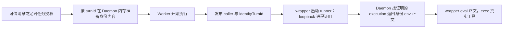

# 任务执行与工具身份

工具身份跟随正在执行的任务。身份只存在于两个互斥的模型之一，由 **worker 实际 spawn 的决策**（沙盒是否真正生效、daemon loopback 在该 spawn 内是否可达）唯一决定：受管证明通道可达时走 **proven**（身份内容只在 Daemon 内存、经进程证明通道下发），其余路径走 **single**（单快照文件、每轮覆盖或删除）。

## 两种身份模型与路径矩阵

| 会话/后端路径 | 触发身份的方式 | 是否仍支持 triggerUserAuth | 身份选择权威 |
|---|---|---|---|
| Linux 本机受管 PTY/tmux（无沙盒或仅 oncall + 主机 loopback 可达） | wrapper 经 `cli-identity-runner` 走 `/api/current-execution-identity` | 是 | current-execution 进程证明（内存内容，eval，不落盘） |
| bwrap `--unshare-net`（sandboxNetwork:false） | 沙盒启动前按 single 模型初始化 | 是（行为收窄） | 单快照文件 + 2 行 turn marker |
| slirp network policy（`--disable-host-loopback`） | 同上 | 是（行为收窄） | 单快照文件 |
| adopt（tmux/herdr/zellij 收编 pane） | 不挂 runner | 是 | 单快照文件 |
| remote（riff / mojo / remote-runner） | 不挂 runner | 是 | 单快照文件 |
| 已有 external app-server endpoint | 不挂 runner | 是 | 单快照文件 |
| workflow 临时 Worker（v3 ephemeral） | 不挂 runner | 是 | 单快照文件 |
| 非 Lark 传输（apiOnly / headless / http_async） | 不挂 runner | 是 | 单快照文件 |
| 非 Linux（macOS 等） | 不挂 runner | 是 | 单快照文件 |

模型的唯一事实源是 **worker 实际 spawn 后的决策**：worker 用 `resolveLocalSandboxMode`（含 `BOTMUX_SANDBOX` 操作开关与 remote 后端豁免）解析出本次 spawn 的真实沙盒，用 `resolveSpawnNetworkShape` 得出「沙盒是否生效 / bwrap argv 是否带 `--unshare-net` / 主机 loopback 是否可达」，再经 `resolveIdentityStorageModel`（Linux + binding + 沙盒不切断 loopback）得出模型，渲染 wrapper 后立刻经私有 IPC（`session_identity_decision`）上报 daemon。daemon 只消费当前 worker 世代的上报值发布身份，**不再从冻结配置或自己的 `BOTMUX_SANDBOX` 环境二次推导**——配置与环境在沙盒事实上分叉时（如 worker 进程带了与 daemon 不同的开关），两侧各自选模型正是旧实现「工具恒 77 + 明文落盘」的根因。worker 未上报（冷启动 / daemon 重启后重报前）fail-closed 按 single 发布、proven 内容路由拒绝；上报 proven 但会话结构（adopt/remote/apiOnly/binding 关闭）不允许时，两个模型都拒发布直到活 worker 重新上报。环境开关 × 冻结配置的五格矩阵与真 bwrap 探针见 `test/identity-spawn-matrix.test.ts`。

**accept→fork 窗口与模型翻转重发**：daemon 在消息接受时（先于 worker fork）就要发布开场轮身份，此时尚无上报，故按 single 兜底写入根快照。worker 无 marker 的首次 single 初始化只清理 R3 时代的 `turns/<sha>/` 残留，**保留**该根快照（首轮不被清成 77）；首次 proven 初始化则清空根明文。daemon 以「上一次实际发布使用的模型」（内存 `lastPublishedIdentityModel`，不依赖上一帧上报，故重启窗口也成立）判定翻转：收到与发布模型不一致的上报时，先删除错误模型的制品（single→proven：删根明文；proven→single：忘 proven 内存），再在该 turnId 仍是活轮次时重发。活轮判定以「当前 worker 世代的决策消息（已过 stale 世代闸、只在 spawn 同步发）」为权威——这覆盖新话题开场边界（此时 `currentTurnId`/`pendingTurnId` 等 daemon 字段还没指向开场轮）——但 turn 已在当前 worker 终态集合（`turn_terminal` 观察）中的不重发。重发结果记 `lastIdentityDecisionRepublish{model,turnId,ok}`：成功才移动基线（相同决策不再重放）；失败显式 `logger.error` 收口、基线不动且记 `ok:false`，随后同模型决策可重试、另一模型决策可修复已做的清理。

会话目录的 `identity-layout` marker 记录当前模型；**任何**模型初始化（含无 marker 的旧布局、模型切换）都先清空全部身份制品再初始化，两个模型绝不复用同一份目录。

## proven 模型（默认受管路径）

- wrapper 不读任何会话目录文件来**选择**身份：runner 证明当前进程树属于正在执行的 turn，Daemon 直接返回 env assignment 正文，wrapper `eval` 管道内容。同 uid 的 agent 既不能枚举排队者 token（盘上没有），也不能改写 turn 文件把选择指向别人。
- 终态回收：turn 终态/拒绝后，内存中该 turn 的身份内容被遗忘；保留集由 Daemon 活态算出（见下）。

## single 模型（无证明通道的路径）

保持既有契约：每个工具一个根文件 `.data/<tool>.env`，daemon 每次接受消息时覆盖（换人）或删除（无凭证）。wrapper source 该文件并用前两行 turn marker 做跨轮拒绝；同一 open_id 的尾部调用放行。

## 终态回收保留集（proven 内存 GC）

turn 到达终态后回收内存身份时，以下身份轮次必须保留，缺一会误删在途凭证：

1. 当前执行的 `identityTurnId ?? turnId`——跨主体隔离关闭时 envelope 已切 B、身份仍是 A；
2. 已派发未开始/准备→发布窗口（daemon 接受即登记的 turn 账本）；
3. 定时任务、失败恢复与 readonly continuation 的 turnId（含 backoff 重铸、prompt_ready 缓冲）；
4. 进行中授权请求冻结的 `identityTurnId`（授权链接发出后用户点击可跨越多个 turn，300s 内不能回收，否则授权被静默丢弃成超时）；
5. 内存 lark-tool delegation 表仍记录的全部 turnId（64 LRU 淘汰后自动退出保留集，之后 fail-closed）。

另有周期 GC（搭车 sandbox reconcile）兜底异常路径；`closeSession` 清空内存与盘上全部身份制品。

## 定时任务与授权等待

Direct 定时任务沿用持久化的可信创建者。Delegated 定时任务可以没有真人 actor，凭精确执行绑定的有效工具委托解析授权目标。每次运行继续执行已有的任务状态、目标用户、工具范围和凭证检查。撤销授权、范围不符和凭证失效仍会阻止对应调用。

`auth request` 固定应用、授权用户及 scopes，`auth wait` 固定 requestId。隔离会话每次轮询读取当前执行 claim；服务端核对该执行与原授权用户。相同用户的后续执行可以接收完成的授权；其他用户开始执行时拒绝原请求。目标身份材料缺失是终态错误（`auth_identity_snapshot_missing`，同轮重试无效），材料存在但活动 turn 标记未翻转才保持 `pending`。

## 常用 Case

| 场景 | 预期结果 | 对应验证 |
|---|---|---|
| A 执行时 B、C 入队（proven） | 内存中各自内容互不干扰，盘上无 token；A 工具只取 A | `turn-cli-identity`、`identity-storage-model` |
| A 结束，B 开始 | 通道证明 B 后下发 B 的内容；A 终态被 GC | `cli-identity`、`identity-storage-model` |
| 改写 turn 文件/枚举 turns/ 目录冒名 | proven wrapper 不读盘选择，身份不变，攻击无效 | `turn-cli-identity`、`cli-identity` |
| 网络隔离沙盒/adopt/remote/workflow/非 Linux | 渲染无 runner 的 single wrapper（无 `--ipc-port`） | `trigger-user-shell-env` |
| 跨主体隔离关闭，B 补充 A 的执行 | 消息归属更新；身份引用保留 A；B 自身发布物可回收 | `active-turn-authority`、`identity-storage-model` |
| pending 授权跨越多个 turn | 冻结的 identityTurnId 内容被 GC 保留直到授权落定 | `identity-storage-model`、`ipc-auth-request` |
| 同一次执行重复发布 managed origin（含 callerless） | 已启动工具继续通过；trustedCaller:null 不被 replyTarget 顶替 | `session-lifecycle-start` |
| A 遗留 shell 在 B 执行期间派生工具 | Linux 本机入口进程证明失败，拒绝获取 B 的身份 | `ipc-current-execution-route`、`ipc-lark-tool-identity` |
| marker 中 identityTurnId 畸形（数字/换行/超长/空格） | 丢弃该值，回退 envelope turnId | `worker-turn-idle` |
| PID marker 由外部推进或恢复 | marker、活动身份文件、managed origin 一致 | `worker-turn-idle` |

## 验证与适用范围

使用仓库固定版本 Bun 安装依赖，运行 `bun run build`。上述 Case 的原生测试入口为 `bun run test --maxWorkers 4 test/<name>.test.ts`；真实 Worker 与工具测试采用隔离 HOME、临时数据目录和测试凭证。

进程证明依赖 Linux `/proc` 与本机受管 Worker/CLI 血缘。macOS、remote、adopt、外部 app-server、workflow 与网络隔离沙盒路径使用 single 模型，不提供进程证明通道。

**发布要求：fleet 整体重启**（daemon + 全部 session worker/CLI pane，停服窗口内执行 `botmux restart`），不能新旧 daemon/worker/wrapper 混跑：wrapper 渲染、identity-layout marker、managed origin 字段与 current-execution-identity 协议必须同版本；滚动升级期间 single 路径的身份会在模型切换时被清空（fail-closed，下一轮重新发布）。真实第三方 OAuth、线上定时任务、bwrap/slirp 网络拓扑与 macOS 运行结果需要部署环境验证。
