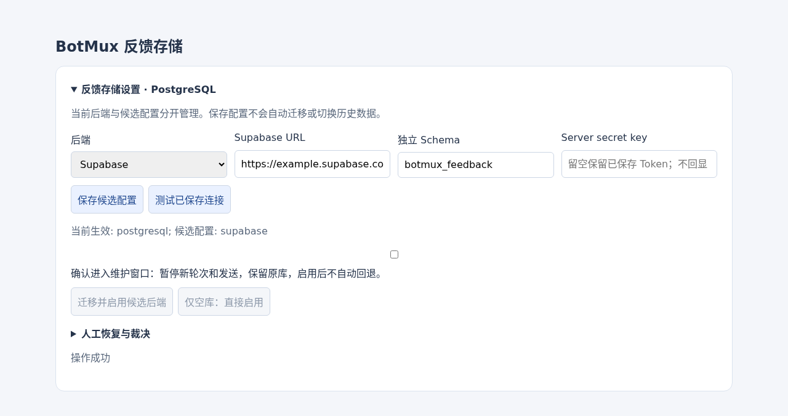

# Feedback migration to Supabase

This service migrates BotMux **feedback only**, directly from SQLite or an
existing PostgreSQL feedback schema to a bootstrapped Supabase schema. Sessions,
schedules, grants, and other stores are not migrated. PostgreSQL sources are
never converted through an intermediate SQLite database.

## Bootstrap and credentials

An administrator must generate and review the bootstrap SQL using
`botmux feedback storage supabase-schema > /secure/supabase.sql`
after saving the candidate, then execute it independently in the
target project's SQL editor or through an administrator-owned DB connection.
Use the `instanceId` from the source `feedback-storage.json`; an unrelated
installation identity will be rejected. Expose the selected schema to the
project's Data API and grant the server-side SDK role the permissions needed by
the generated SECURITY INVOKER RPC. Review grants and schema exposure before
using any real project. The migration service does not bootstrap schemas or
grant permissions automatically.

The runtime target is:

```json
{
  "backend": "supabase",
  "supabase": {
    "url": "https://PROJECT.supabase.co",
    "keyRef": "env:BOTMUX_SUPABASE_KEY",
    "schema": "botmux_feedback",
    "requestTimeoutMs": 10000
  }
}
```

Use a Supabase server secret key (`sb_secret_…`) or a legacy `service_role` JWT;
publishable/anonymous keys are not accepted. Keep the key in an environment
variable or BotMux's private secret storage (`file:<uuid>`). Never put a key in
the journal, CLI arguments, screenshots, or checked-in configuration.
The SDK uses the HTTPS project URL, not a PostgreSQL connection string.

No direct target database connection is needed for normal feedback operation or
this migration service. A direct database connection is optional for reviewed
bootstrap/migration administration and local integration testing. A PostgreSQL
**source** uses its existing configured credential, including the existing
BytePG credential provider when configured; there is no credential fallback.

## Maintenance and APIs

Configure a candidate first; configuring it does not change `active`.
The normal CLI flow is:

```bash
botmux feedback storage configure --config-file /secure/supabase.json
botmux feedback storage supabase-schema > /secure/supabase.sql
botmux feedback storage test
botmux feedback storage migrate --to supabase --yes --request-id ORIGINAL_REQUEST_ID
botmux feedback storage status
botmux feedback storage resume MIGRATION_ID
```

The generated SQL must be reviewed and installed before testing. The migration
command requires a separately authorized maintenance window; these examples are
not instructions to execute a production cutover automatically.



Run migration from an **independent maintenance host/process**, not an active
BotMux conversation that would prevent its own drain. Obtain separate approval
for that maintenance window. The implementation does not stop daemons,
force-kill turns, acknowledge delivery uncertainty, or start production migration
on installation.

The service exports:

- `prepareSupabaseFeedbackMigration(dataDir, { requestId, expectedGeneration, maintenanceConfirmed: true })`
- `resumeSupabaseFeedbackMigration(dataDir, migrationId)`
- `cancelSupabaseFeedbackMigration(dataDir, migrationId, recoveryDecision)`
- `listSupabaseFeedbackMigrations(dataDir)`
- `getSupabaseFeedbackMigration(dataDir, migrationId)`

Preparation only records the operation. It does not connect to either database.
Reusing a request requires the same full configuration and generation. A new
request is blocked by unfinished SQLite-to-PostgreSQL migrations, other
Supabase migrations, or another maintenance marker. The unified CLI/API router
uses the exact original journal ID on resume/cancel; never guess which backend
owns an operation from the current candidate alone.

Saving a new candidate is refused while either migration backend owns an
unfinished job, including the preflight and irreversible cutover stages.
Cancel or finish the original operation before changing connection settings.
Candidate saves and both migration preparers share the same operation lock,
so a configuration change cannot create a second cross-backend migration slot.

Listing/reading missing journals is read-only. Writes are durable, atomic and
private: migration directories are `0700`, journals/snapshots are `0600`.
Symlinked journal directories and non-private/non-regular journal files are
rejected. The service shares the existing migration operation/runner locks,
plus its own operation lock, so independent processes cannot interleave runs.

## Source freeze and snapshot

The sequence is maintenance/drain → source freeze → durable snapshot → chunked
import → verification → source retirement → target activation → configuration
cutover → maintenance generation acknowledgment.

SQLite reuses the native source freeze, backup, integrity checks, and working
snapshot upgrade. Its staging directory is nested below
`dataDir/feedback-supabase-migrations/<id>/sqlite`, so even the reused backup
helper's artifacts stay under the Supabase migration directory.
It uses a native backup/serialization, not a copy of only the WAL database's
main file. Extra guards prevent direct writes to optional event stream/counter
tables. The snapshot preserves the `sqlite_sequence` allocation high-watermark,
including gaps above the largest surviving event.

PostgreSQL freezes the existing schema directly. A separate
`feedback_supabase_source_guard` records the new freeze ID. Original
`migration_id`, `source_fingerprint`, and `verified` fields remain unchanged;
only source lifecycle state changes from active to frozen/retired (or back to
active on cancellation). `ENABLE ALWAYS` statement triggers reject
INSERT/UPDATE/DELETE/TRUNCATE on all feedback/event tables. The trigger's
schema-qualified search path and metadata row lock also fence stale clients
that established a repeatable-read snapshot before the freeze. These guards
are for normal application roles, not a security boundary against a database
owner deliberately removing triggers.

The PostgreSQL snapshot is collected in a repeatable-read, read-only
transaction and then atomically persisted with a SHA-256 content fingerprint.
The private JSON snapshot retains the original source metadata/provenance.
Target installation metadata is **not** imported or overwritten: the SQL
allowlist contains the nine feedback tables and optional stream/counter only.

All nine `FEEDBACK_TABLES` are preserved, including IDs, JSON payloads, feedback
revision order and explicit `feedback_order`. Existing optional
`feedback_event_stream` and `feedback_event_stream_counter` rows retain their
sequences/counter; SQLite's native counter is converted to the same counter
row. A legacy source without an event stream leaves creation to the target's
activation logic.

Unsettled outbox work blocks freeze. Inflight rows always block, even if a
receipt exists; an acknowledgment is not proof that a live writer drained.
Existing unknown-delivery acknowledgments
must match the exact existing recovery fingerprint, including source identity,
full active configuration, status, attempts and marker. The service never
creates acknowledgments or resets claims. Both sources refuse inflight claims;
only non-inflight unknown rows can use an exact existing acknowledgment.

## RPC and verification

The SDK calls one `botmux_feedback` RPC with exactly `p_instance_id`,
`p_operation`, and `p_args`. Its response envelope is unwrapped by the adapter.
Migration arguments are:

| Operation | Arguments | Result |
| --- | --- | --- |
| `migration_status` | `[]` | metadata |
| `migration_prepare` | `[id, fingerprint]` | metadata |
| `migration_import` | `[id, table, rows]` | metadata |
| `migration_snapshot` | `[id, table, offset, limit]` | `{rows, meta}` |
| `migration_activate` | `[id, fingerprint]` | metadata |

Initial metadata has `state: "empty"` and the bootstrapped source `instance_id`.
Preparation binds the target's new migration ID and snapshot fingerprint.
Every later result must match those original markers. Imports use bounded
chunks of 250 rows; verification reads 500-row pages, canonicalizes JSON and
numeric transport representation, compares counts and SHA-256 row content,
and separately compares revision IDs in `feedback_order`.
Preparation validates and removes the initial zero-valued target counter row
so the imported counter preserves the source high-watermark exactly.
Only a verified target permits source retirement and the shared config switch.

## Unknown outcomes and cancellation

Every external mutation has a durable pending marker **before** execution.
An error leaves the operation blocked; subsequent resume first inspects the
original source/target markers.

- Unknown import: read target snapshots and prove every exact expected chunk
  row is present. Only then advance the durable chunk offset. No blind resend,
  even though SQL imports themselves are idempotent. Missing/conflicting rows
  remain blocked.
- Unknown prepare: original target metadata must prove the exact prepared
  marker. An unchanged empty target remains unknown; do not submit again.
- Unknown retirement: original source guard must already say retired. A frozen
  marker is not proof of retirement and does not authorize retry.
- Unknown activation: original target must say active, verified, with the
  exact migration ID/fingerprint. A migrating marker remains unknown.
- Configuration acknowledgment loss: exact full active configuration at
  `expectedGeneration + 1`, verified target and original retired source marker
  allow completing maintenance without repeating import or activation.

Before retirement, cancellation requires a `RecoveryDecision` with
`confirmed: true`, `actor`, `reason`, and `evidence`. It restores source write
access, retains the original source/snapshot/target, records the decision, and
invalidates the snapshot for migration reuse. It does not clear a prepared
target schema; a new operation requires an independently reviewed fresh target.
Cancellation resumes safely after a crash between unfreeze and journal update.
After retirement or target activation, cancellation is refused; resume the
original operation rather than attempting rollback.

## Local verification only

Unit tests use disposable files. E2E tests use the real SQLite engine and
Supabase SDK, with HTTP transport as the only external boundary. When
`BOTMUX_TEST_POSTGRES_URL` points to an explicitly disposable loopback server
on a non-default port, PostgreSQL-source tests also execute the generated RPC
against actual random schemas and remove only those test schemas afterward.
They cover stale clients, provenance, event sequence gaps, uncertain imports,
activation loss, cancellation and exact outbox recovery acknowledgments.

No actual Supabase cloud project, production database, maintenance deployment,
or automatic production migration is part of these tests. A successful local
run is not production cutover acceptance.
