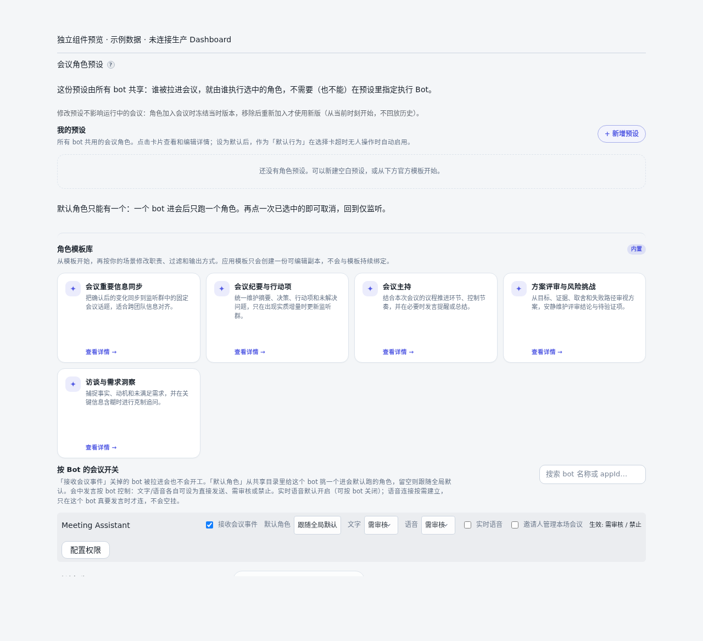
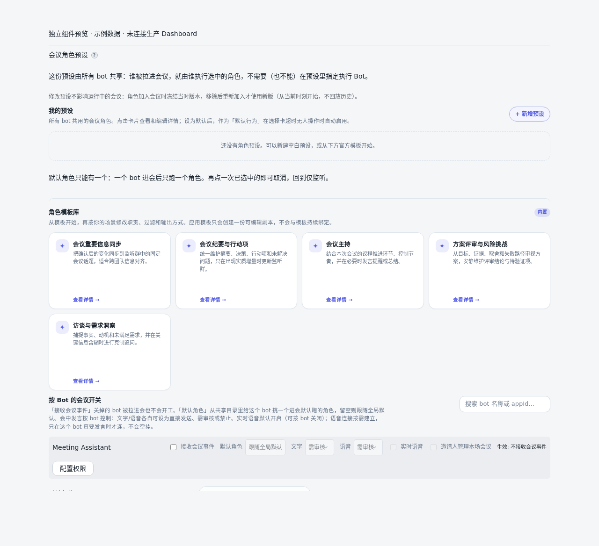

# 让真实邀请人管理本场会议助手

这是按 Bot 配置的可选授权，**默认关闭**。开启后，新的真实邀请人完成监听群成员核验，即可管理自己邀请的那场会议助手；不会成为 Bot owner 或获得宿主管理权。

## 开启与关闭

在 Dashboard 的「设置 → 会议 Agent → 会议角色预设 → 按 Bot 的会议开关」中，勾选对应 Bot 的「邀请人管理本场会议」并保存。写入沿用 Dashboard 的宿主管理身份校验，普通 Workbench 用户不能修改。Bot 关闭「接收会议事件」时，邀请人开关不可编辑，但会保留已保存的选择；重新接收会议事件后恢复可编辑。

- 开启只对启用后收到的有效邀请生效，不回填历史会议。
- 关闭后，后续权限检查不再接受邀请人管理授权。已加入的群成员不会被自动移出，既有 owner、管理员及其他独立授权不变。
- 再次开启会更新授权代次。旧邀请、旧授权不会恢复，需重新邀请助手。
- 会议结束后，本场邀请人授权失效；守护进程重启则从本场运行记录恢复，不重复建群。

下图是实际组件的独立浏览器预览，使用示例数据，不是线上配置截图：

下图展示关闭会议事件后的禁用态（同样使用独立组件和示例数据）：

## 邀请人能做什么

通过既有会议授权检查，邀请人可以选择／调整本场 Agent、处理恢复和重新入会、审批会中弹幕和语音输出，以及管理本场临时指令授权。输出仍受 owner 配置的 allow / approval / deny 策略约束，不因邀请人身份绕过禁用项。

监听群内问答仅增加对**可唯一定位的、仍活跃的本场 Agent 接收会话**的访问。不会给普通会话、其他会议、其他群、Bot 配置或 daemon 管理命令增加权限。跨应用问答必须有可信事件建立的 union_id 对应关系，不能复用另一个应用的 open_id。固定群同时承载多场会议时，不通过这条新授权自动放行有歧义的普通消息；精确绑定本场的管理卡片仍走本场检查。

## 身份与入群边界

身份仅来自飞书原生 `vc.bot.meeting_invited_v1` 的 `inviter`，不能用消息文本、主持人、群主或固定 owner 替代。当前实现要求真人类型 `user_type=1`、本应用 `ou_*` 身份、事件 ID 和有效的原生 `invite_time`；事件须晚于本次开启时间，且距接收时不超过 30 分钟，最多容忍 60 秒的未来时钟偏移。`invite_time` 缺失或无法解析时不授权，不以信封的 `create_time` / `event_time` 等字段替代邀请发生时间。无法核验则不授权，并提示原授权人。

- 助手为本场新建的专用监听群：保留原 owner 的入群和群主逻辑，另加真实邀请人；独立回读群成员成功后才激活授权。
- owner 预设的固定群、共享群或准备群：不自动扩大成员可见范围。邀请人已在群内才激活授权，否则提示群管理员先加人，再重新邀请助手。
- 入群失败保留待核验状态；重复邀请或进程恢复可重试，不重新建群。
- 同场多次真实邀请可增加多个本场管理人；重复事件不重复加人。黑名单用户不能因此获权。

## 实现与验证边界

策略位于 `vc-meeting-inviter-policy.ts`，本场授权随 `vc-meeting-runtime-store.ts` 持久化；daemon 的统一会议授权检查消费这些授权。`allowedUsers`、`attentionTargetOpenId` 和全局管理权限不变。旧配置缺字段、旧 Dashboard 客户端不提交新字段，都保持原行为。

回归覆盖默认关闭、严格字段解析、启停代次、原生事件解析、入群失败重试、固定群、重复及第二邀请人、跨会议拒绝、非 owner 选择 Agent、弹幕／语音审批、临时授权、重启后重新入会及普通 IM／全局命令隔离。UI 使用实际组件验证默认关闭与切换。

这些是隔离测试，不代替真实飞书验收。部署候选版本后仍需使用非 owner 账号完成一次原生邀请，确认生产事件的 `inviter.id` 类型、入群可见范围、卡片操作、开关关闭与重新开启。若原生身份并非本应用的 `ou_*`，或没有有效 `invite_time`，当前实现会拒绝自动授权。尚未取得真实生产事件样例，不能假定这些字段普遍存在；若真机缺字段，需要依据真实协议重新设计可信身份／时间来源，不能按姓名猜人或退回信封时间。
