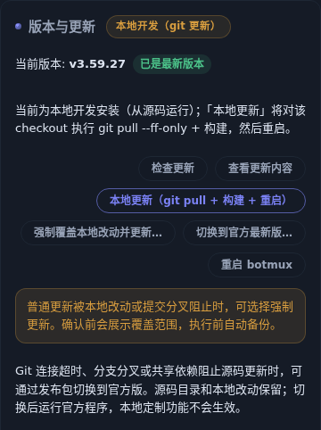

# 本地源码更新

在 Dashboard「设置 → 版本与更新」里，源码安装提供以下更新方式：

- **本地更新**：要求工作区干净，执行 `git pull --ff-only` 后构建。不会丢弃本地提交或文件。
- **强制覆盖本地改动并更新**：先获取当前跟踪分支的版本，展示文件改动（含未跟踪文件）和本地提交。确认后，保存 Git 备份，将源码重置到预览的上游提交，安装锁定依赖并构建，再通过现有重启确认应用。
- **切换到官方最新版**：当 GitHub 的 Git 连接超时、分支分叉或共享依赖阻止源码更新时，可下载官方发布的程序。源码目录、本地提交、未提交改动和依赖目录均保留；备份原启动入口后安装官方程序，再单独确认重启。重启后运行官方程序，本地定制功能不会生效。此操作也支持安装与当前源码标签相同的正式版本。

官方版安装优先下载当前配置 registry 中对应版本的平台发布包，并校验 SHA-512 和程序版本；该路径失败时再尝试 GitHub Release。下载、校验或主机兼容性验证失败时，当前启动入口保留。下载期间启动入口被其他操作修改时，中止切换。

页面展示原启动入口备份路径，形如 `~/.botmux/source-update-backups/<id>/launcher`。要恢复源码运行，可从保留的源码目录执行 `bun run use:here` 和 `bun run daemon:restart`。安装记录保存在本机私有配置目录中；页面进程重启或安装响应丢失后，会核验实际程序并恢复待重启状态。



强制更新会移除当前源码中的本地定制功能。忽略文件（如依赖、本地配置）保留；如果上游新增文件与忽略文件冲突，则中止。未完成的合并、变基或挑选提交必须先处理。

如果 `node_modules` 是被 Git 忽略的符号链接（包括悬空或自环链接），强制更新会在覆盖前中止，避免改写另一源码目录的依赖；Git 备份不能恢复这类共享依赖。请改用独立依赖目录。未跟踪的嵌套 Git 仓库等目录也需先保存并移走，才能完成预览。

确认有效期为五分钟且只能使用一次。源码内容、暂存内容、更新分支、上游提交或源码目录发生变化时，需要重新预览确认。下载失败时不会开始覆盖。构建失败时不自动重启，页面显示备份位置，修复构建问题后可重新更新。

无跟踪分支时，从 `origin` 的默认分支获取目标；游离提交状态会在覆盖后创建跟踪分支。网络不可用或目标不是 botmux 源码时中止。

## 恢复覆盖前的源码

页面会显示备份前缀，形如 `refs/botmux/update-backups/<id>`。该备份存在于源码仓库中，重启后仍保留。`head` 保存覆盖前的提交，`worktree`（有文件改动时）保存暂存、未暂存和未跟踪文件。恢复前先保存恢复操作之后产生的新改动，再在该源码目录执行：

```bash
git checkout -b recover-local-update <备份前缀>/head
# 只有覆盖前存在文件改动时才执行下一行
git stash apply --index <备份前缀>/worktree
bun install --frozen-lockfile
bun run build
bun run daemon:restart
```

`worktree` 的恢复也会带回被移走的 `dist` 等未跟踪符号链接；恢复后如需构建，请先处理 `dist` 链接，并在真实依赖目录中安装依赖。

备份不会自动应用，也不会自动删除。确认不再需要后，可分别用 `git update-ref -d <备份前缀>/head` 和 `git update-ref -d <备份前缀>/worktree` 删除。

如果写入 `worktree` 备份引用失败，会尝试把文件恢复到原工作区并中止更新；页面另行显示准确的 stash 提交哈希。此时如需手动恢复，先保存当前文件，再执行 `git stash apply --index <页面显示的 stash 哈希>`。该哈希对应的备份仍由 `refs/stash` 保留。

## 接口

仅允许拥有整机控制权的 Dashboard owner 调用；协管权限不足以覆盖源码。

1. `POST /api/update/local-dev/preview` 返回目标提交、文件/提交列表与一次性确认 token。
2. `POST /api/update/run`，JSON 为 `{ "forceLocal": true, "previewToken": "..." }`，在普通更新共用的安装锁与重启检查内执行备份和覆盖。
3. 成功后 `restartRequired: true`，继续现有 `/api/update/restart` 流程。重启仍校验构建目录与提交，失败响应可携带 `backupRef`。
4. 源码安装切换官方版：`POST /api/update/run`，JSON 为 `{ "installRelease": true, "version": "X.Y.Z" }`。版本必须与页面查询的最新正式版一致；不能同时指定强制源码更新参数。仅允许 Dashboard owner，使用与源码更新共用的安装锁和重启租约。成功响应包含 `sourceReleaseInstalled: true`、`backupLauncher` 和 `restartRequired: true`；后续重启验证并使用已安装的程序，不再回到原源码目录。
