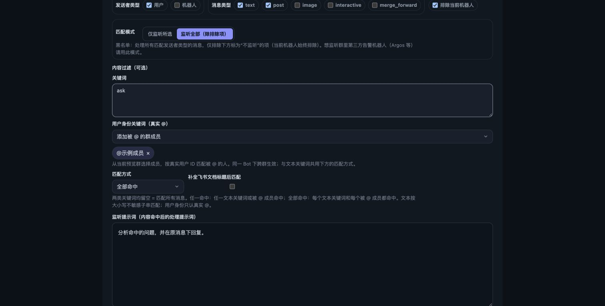

# 消息监听的用户身份关键词

在「消息监听 → 关键词匹配」中，可以添加普通文本关键词，也可以从成员列表中选择「用户身份关键词（真实 @）」（全局规则取预览群成员，群自定义规则取该群成员）。两种关键词共用匹配方式：

- **任一命中**：任意文本关键词出现，或任意选定成员被真正 @。
- **全部命中**：每个文本关键词都出现，且每个选定成员都被真正 @。

例如，文本填写 `ask`，身份选择某位成员，匹配方式选择「全部命中」，即可要求同一条消息包含 `ask` 且 @ 该成员。只添加身份关键词时，只判断成员是否被 @。发送者筛选仍然单独控制谁可以触发。

身份匹配使用飞书结构化 mentions 中的 `open_id`，也支持原生富文本中的 at 节点。正文的 `@_user_1` 是单条消息内的占位符，不参与身份识别；手打姓名、发送者本人或转发卡片中的历史 @ 不满足身份关键词。

同一 Bot 应用内的身份可跨群使用，全局规则会应用于继承它的群；群自定义规则只作用于该群。`open_id` 属于当前飞书应用，不能复制到另一个 Bot 应用使用。更换成员来源群只改变可选成员，不会删除已选身份；成员不在当前成员列表时显示其 ID，仍可移除。

配置示例：

```json
{
  "enabled": true,
  "prompt": "分析命中的问题，并在原消息下回复。",
  "contentPolicy": {
    "includeKeywords": ["ask"],
    "includeMentionedOpenIds": ["ou_example"],
    "matchMode": "all"
  }
}
```

旧的纯文本规则保持原行为。身份列表存在但为空或格式无效时，规则不会匹配消息，启用保存时会要求重新选择成员，避免错误配置意外变成监听所有消息。界面移除最后一个身份关键词会明确移除该条件。

实时监听、历史补扫、预览使用同一匹配逻辑。开启文档标题匹配时，标题只能补充文本关键词，不能补足缺失的 @ 身份。直接 @ 当前机器人的消息仍走原有显式调用流程。


