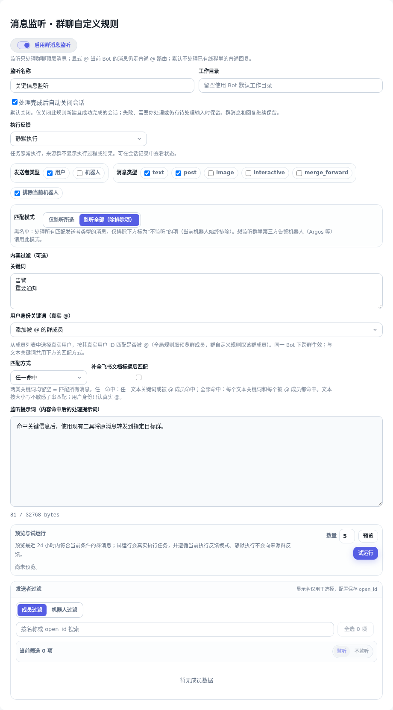

# 消息监听：静默执行

消息监听规则的「执行反馈」新增「静默执行」。命中消息后，Botmux 照常创建任务、运行 CLI、调用已有 Skill 和工具，但不向来源群发送启动、过程、思考气泡、结果、错误提示或表情。显式 @ 当前机器人的消息仍走普通对话路由。

## 配置与使用

在 Dashboard → 消息监听 → 全局设置或群聊自定义规则中，将「执行反馈」设为「静默执行」并保存。继承全局设置的群会继承这个模式。原有规则缺省仍为回复原消息。

```json
{
  "enabled": true,
  "prompt": "命中后，使用已有工具将原消息转发到指定目标群。",
  "contentPolicy": { "includeKeywords": ["告警"] },
  "replyPolicy": { "mode": "none", "sessionMode": "per_message" },
  "autoCloseAfterCompletion": true
}
```

任务提示、转发方式和目标群权限沿用现有配置。例如使用现有 `botmux send --chat-id <目标群> --top-level --no-mention <内容>` 发布到另一个群。默认发送、通过其他会话绕回来源群、来源群的 report 和卡片更新都会被拒绝。Botmux 不新增转发执行器或动作重试。

「预览」只检查匹配；「试运行」会真实执行任务，遵循所选模式。静默任务在成功的回合终态后显示「静默完成」，无需取得原消息回复 ID。这个状态表示任务回合完成，具体转发结果仍以工具结果为准。

任务记录与终端继续保留在 Dashboard。需要处理授权或执行异常时，在 Dashboard/终端查看并处理。完成后自动关闭沿用现有选项，等待处理或失败的任务不会被当成成功关闭。



截图由真实编辑器组件和示例配置生成。

## 会话与兼容性

静默任务使用独立的每消息会话，保留真实来源群和消息 ID，以内部 `ml:` 锚点隔离普通消息会话。静默策略写入首次会话持久化；修改监听规则只影响后续任务，重启、恢复和迟到事件继续遵守已有任务的策略。

自动回复、流式卡片、思考气泡和表情在公共出口抑制；结果结算继续执行。远程 Riff 和本地 CLI 都保留静默会话身份。来源话题可用性检查使用真实消息 ID，不把后台锚点交给飞书。

改动仅在 Botmux。任务 Skill、业务脚本、飞书 API 转发实现不需要修改。Botmux 管理的输出遵守静默策略；独立外部脚本使用自带凭据直接发送消息时，应由任务配置约束其目标。

## 验证范围

行为用例覆盖配置保存与继承、编辑器模式切换、实时监听路由、普通会话隔离、SQLite 首次写入与恢复、真实 CLI 来源群拒绝/目标群允许、远程身份、自动输出、思考气泡和试运行快速终态。

异常场景覆盖中途改规则/取消、终态持久化失败后重放，以及自动关闭等待期间进入人工输入。发现并修复的输出问题包括：通过另一会话绕回来源群、report/卡片更新旁路、默认开启的思考气泡输出，以及内部锚点阻断合法目标群发送。试运行先登记回合索引再触发，迟到的触发结果只补齐记录，不倒退已完成状态。

真实大群监听、小群转发场景仍需飞书手动验收：命中一条消息后，确认来源群没有任何反馈、目标群收到任务预期内容，Dashboard 显示对应任务状态。
