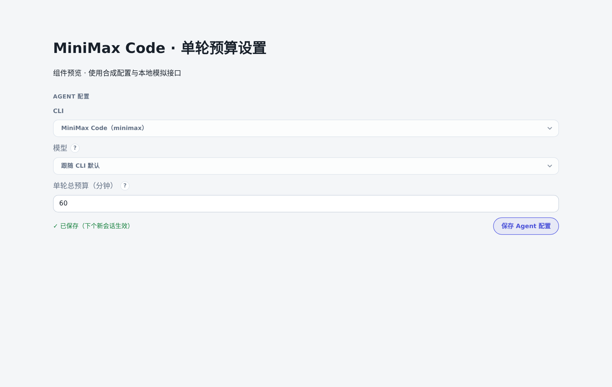
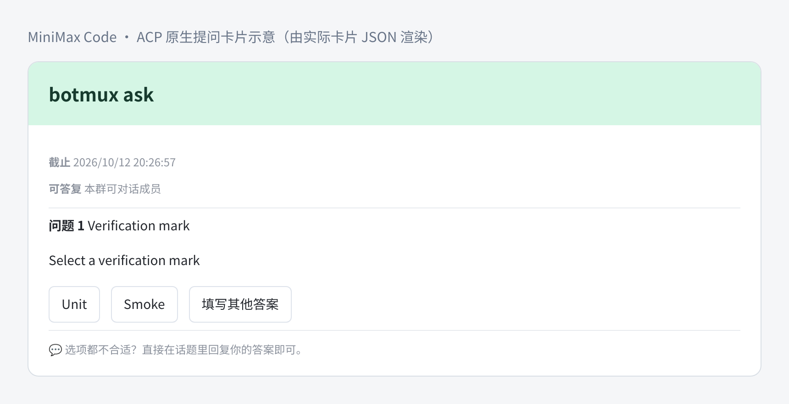
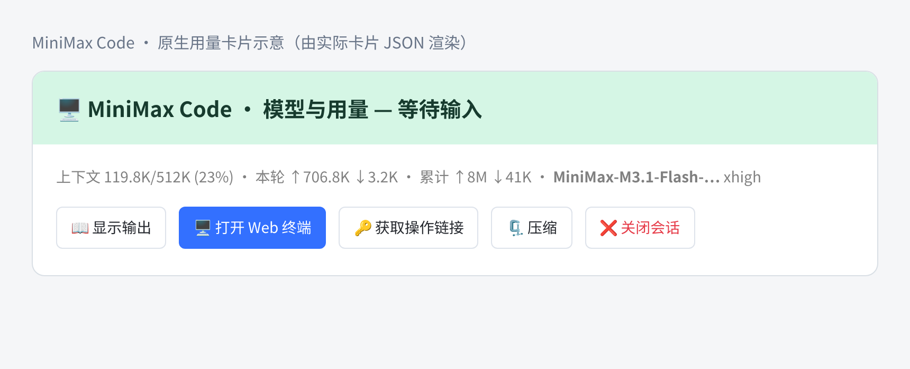
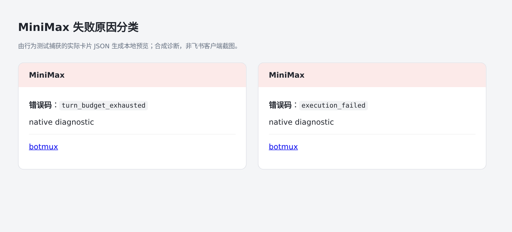

# MiniMax Code（mcode）

Botmux 的 `cliId: "minimax"` 使用官方 MiniMax Code（npm 包 `@minimax-ai/code`，可执行文件 `mcode`），替换原来的纯聊天 mmx-cli。setup 序号 `30` 保持稳定。

## 安装和登录

按 [MiniMax 官网快速开始](https://agent.minimax.cn/docs/cli/quick-start)安装：

```bash
curl -fsSL https://filecdn.minimax.chat/public/install.sh | bash
mcode --version
mcode login                    # 国内账号
# mcode login --region global  # 国际账号
```

官方安装器会准备兼容的 Node.js。手动 npm 安装需 Node 22.19+（22.x）、24.2+、25 或 26。首次登录需要浏览器；Botmux 不复制 mmx 的登录态。也可按[官方配置与模型文档](https://agent.minimax.cn/docs/cli/configuration)配置 MiniMax API Key 或自定义 Provider。

```json
{
  "cliId": "minimax",
  "model": "minimax/MiniMax-M3",
  "env": { "MINIMAX_DATA_DIR": "/absolute/path/to/mcode-data" }
}
```

`model` 可省略，沿用 mcode 默认模型；自定义模型使用原生 `provider/model[#variant]` 格式。旧配置中 `MiniMax-*` 裸模型名会转为 `minimax/<模型名>`。API Key 账号应使用其实际 Provider ID，可由 `mcode provider list --json` 查看。旧 `cliPathOverride` 若指向 mmx，须清除或改为 mcode；不保留 mmx 兼容入口。

数据根默认 `~/.minimax`，`MINIMAX_DATA_DIR` 优先于兼容变量 `MAVIS_DATA_DIR`。目录包含 config.yaml、登录态、SQLite 和会话，文件沙盒会保留整个目录；全局 Skills 位于 `<data-dir>/skills`。不同账号/区域使用独立的绝对路径，并在对应数据目录下分别登录。

mcode 的 OAuth 账号键包含数据目录的原始路径。Linux 上 HOME 或数据目录含软链接时，仅为 mcode 在沙盒内保留该目录到已授权真实数据目录的路径别名，避免路径规范化后误报未登录；别名必须对应精确的可写授权，不额外挂载宿主目录，也不改变其他 CLI 的沙盒路径。

文件沙盒自动识别两种安装布局：官方安装器的 `install.json` 根目录，以及 npm 全局安装中真实可执行文件所属的 `@minimax-ai/code` 包根（通过最近的 `package.json` 校验）。官方安装根或 npm 包及其内部依赖只读挂载，不扩大到整个全局 npm 目录；仅数据目录和官方 `.mcode-active` 标记目录可写。官方安装器若复用安装根外的 Node，还会按 `install.json` 的 `nodeExecutable` 加入运行时可执行目录的只读覆盖。npm 布局则解析当前/机器人配置 PATH 中的 Node 并传给 runner，在沙盒内使用同一个真实运行时；Bun 启动 Botmux 时也仍需安装兼容的 Node。未知的自定义包装布局需自行在文件沙盒 policy 中允许读取安装依赖及运行时。

适配器的 `buildArgs` 同时承担启动准备：在 worker 对沙盒 bind 源进行存在性过滤前，预建数据目录与官方 `.mcode-active`。这是首次启动持久化所需的顺序，不能延迟到沙盒内的 runner；准备步骤幂等，不覆盖既有会话数据。

## 执行与恢复

接入使用常驻 Botmux runner，每条消息通过 ACP 的 `session/prompt` 交给原生 `mcode acp`，保留多行文本，不把用户正文拼进 shell 或命令参数。mcode 仍可读写文件、执行 Shell、加载原生 Skills/插件，并执行 `botmux send`；网页终端展示流式文本和工具进度。ACP v1 通过双向 NDJSON 通信，无新增 SDK 依赖。

第一轮从 `session/new` 取得原生 Session ID，后续轮次和重启后的第一轮均按精确 ID 调用 `session/resume`（不支持时使用 `session/load` 并忽略历史回放）。不使用最新会话查找，避免同目录多个话题串线。缺失精确 ID 时启动新会话并沿用 Botmux 的恢复失败提示。协议不完整、提前退出、恢复身份不匹配和超时均报告失败。Ctrl+C 中断当前任务并取消待答卡片；runner 退出会终止其原生进程组。会话关闭卡中的 `mcode --session <id>` 仍可在原数据目录下进入 TUI。

默认权限对应 ACP 的 `bypassPermissions`，`disableCliBypass: true` 时对应原生 `auto`（与原 exec 的 `full` / `smart` 一致）。模型和思考等级通过原生 `session/set_config_option` 配置，只接受 CLI 实际提供的选项，不支持时明确失败。Botmux 会话 fork 仍明确拒绝。

### 单轮预算与压缩

Dashboard 的机器人 Agent 设置支持 MiniMax Code 的「单轮总预算（分钟）」，保存到 `turnTimeoutMs` 并传入 runner 的 `--turn-timeout-ms`。**缺省不设置整轮时长上限**，正常长任务不再被 Botmux 在 10 分钟时中止；需要主动限制成本时可设为 60 分钟（`3600000`ms）。合法范围为 `1..2147483647` 毫秒，清空取消上限，修改其他设置保留原值。保存后在下一次会话拉起时生效，不会更新已运行 runner 的参数。

只有显式配置才启用累计执行时间预算，模型输出、读代码、执行工具均不会续期；通过默认 ACP 传输等待真人选择或权限确认时暂停，作答后继续扣除剩余预算。耗尽提示明确给出预算上限，与主动中断和原生执行失败区分；预算耗尽本身不能证明无进展。中断后下一轮仍可按同一原生 Session ID 继续。

这与 dsh、Codex App 的默认策略一致：把正常轮次的结束交给原生协议，不设置隐式的整轮倒计时。dsh 显式配置的 `turnTimeoutMs` 是可续期的静默超时并有 4 倍总时长上限；MiniMax 保留此前显式配置的**总预算**含义，界面分别说明，避免已有配置改变行为。Codex App 的常规无进展检测仅提示、不会取消任务；MiniMax 不把静默等同于失败，也不新增静默自动取消。ACP 初始化、恢复和配置请求仍有 30 秒响应超时；原生进程退出、协议错误、用户取消和关闭会话仍会回收进程并结束当前等待。

兼容 exec 传输未配置时不向原生注入 `--timeout`；这只保证 Botmux 不强加整轮上限，原生版本或 Provider 自身的限制仍可能生效。exec 是单向非交互传输，没有接入 Ask/权限选择卡，不能套用 ACP 的真人等待暂停语义；显式预算同时传给原生 `--timeout`，按原生墙钟规则执行。需要真人交互时使用默认 ACP 传输。

当前 framed runner 没有原生压缩接线：卡片不显示压缩按钮，旧卡片回调也会拒绝；手动斜杠命令不会走裸输入透传。普通消息和恢复仍使用结构化消息帧。需要使用原生 TUI 功能时，可在原数据目录下通过 `mcode --session <id>` 进入会话。



页面组件预览使用合成配置和本地模拟接口；截图不代表线上配置已经修改。

### 原生提问选择卡

mcode 调用原生 `ask_user` 工具时，ACP 发出 `elicitation/create` 表单请求；runner 将其转换成现有 Botmux Ask 服务的问题，显示飞书选择卡。用户提交后按原始选项 ID 返回 ACP 响应，原生会话接着执行。纯选择题可批量展示；自由文本按字段分别收集；原生 Other 字段仅在选择 Other 时追问。单个允许 Other 的选择题也接受直接文字回复，多题文字不会被猜测分配到每个字段。可选项允许明确跳过。推荐项不会自动作答。

原生 `session/request_permission` 也通过 Ask 服务收集显式权限选择。沿用现有会话归属、当轮 capability、点击权限和取消机制，不增加公共 Markdown 解析，也不改变其他 CLI 的提问路径。正文里的普通编号列表仍是普通文本；`botmux ask` 保留为模型主动调用的方式。

支持范围是原生问卷的字符串、单选、多选及对应 Other 字段；URL、数值或带额外校验约束的表单明确拒绝，避免漏题或返回伪造答案。用户等待时间不消耗模型执行超时预算，Ask 仍有自己的截止时间。

mcode 0.6.5 实测会在问卷作答时提前结束原来的 ACP prompt，答案的续跑仍在运行。Botmux 用只读原生 SQLite 按问卷请求 ID 关联续跑轮次，等实际完成再交付最终回复；数据库不可读、问卷失效、续跑失败或中断都不会被当成成功。一次用户回复内的原轮次与问卷续跑用量合并显示为「本轮」，累计和当前上下文仍读取该原生会话。

每轮 `session/prompt` 发出前，Botmux 尝试记录该原生会话问卷表的 SQLite 插入序号（`rowid`）边界。问卷扫描和完成检查仅纳入边界之后的记录，避免强制回收留下的旧 `pending` 问卷阻塞下一轮，也能区分同一毫秒创建的问卷；本轮续跑产生的新问卷仍必须完成作答。缺库、缺表或持锁导致边界不可读时，无问卷的普通轮次和恢复轮次仍可完成；游标保持未知，不以 0 猜测。本轮确实收到原生问卷时，未知边界、问卷表不可读或本轮记录缺失均明确失败，不修改原生问卷状态。runner 仅在原生会话 ID 首次获得或变化时发送身份标记。



示意图来自真实 ACP 问卷转换后的卡片 JSON，不代表飞书客户端截图。Linux 上已用真实账号在 PTY、tmux 和文件沙盒 PTY 下验证原生提问、通过实际 Ask broker 的受控客户端提交第二选项、拒绝未授权提交、答案后续跑、精确会话恢复，以及模型／思考等级／上下文／用量读取；PTY 下等待问卷时中断并重新恢复同一会话也已通过。文件沙盒下真实账号的 Shell 写入与读取已通过。客户端点击体验仍需在飞书话题中实测。

取消后的重新提问已在 Linux PTY 下用真实账号验证：普通取消后旧问卷为 `dismissed`；暂停测试原生进程再取消，触发强制回收后，旧问卷仍为 `pending`。两种情况下，销毁 runner 后按同一原生 ID 恢复，再触发新问卷，通过实际 Ask broker 的受控客户端作答，答案续跑均成功。强制回收场景中，mcode 在新问卷生成后将旧记录改为 `superseded`，新记录最终为 `answered`；另有回归用例刻意保留旧 `pending` 不更新，确认完成检查不依赖这项原生清理行为。

runner 忽略坏帧及非协议输入，后续合法消息仍可执行。输入缓冲区超过 `4 * 1024 * 1024` 字符时报告错误并关闭 runner；SIGTERM 也会关闭 runner，两者均清空待执行队列并中断当前原生进程，不发送成功 final。

对话卡片的用量栏按精确原生 Session ID，只读查询当前账号数据目录下的 `v2/sqlite/runtime-state.sqlite`，一次读取中的上下文、本轮和累计用量使用同一个数据库快照。上下文使用原生 `context_usage` 的当前占用和窗口上限，累计输入包含新输入、缓存读取和缓存写入；二者分别展示，压缩后的上下文不会被累计输入替代。模型和思考等级取该会话的原生请求记录，模型还可从原生用量记录补充；恢复后的会话沿用同一读取方式。缺少原生记录时不推测上下文或思考等级。卡片显示仍遵循机器人的用量显示配置，不读取登录凭证。

卡片示意（使用原生用量读取结果生成的卡片 JSON 渲染，实际样式以飞书为准）：



本次升级影响 `minimax` 的 PTY/tmux 普通话题和恢复会话，并增加 runner 的编译态入口；其余 CLI 的参数与输入方式不变。MiniMax TTS/语音配置不受影响。

原来的 mmx model-only 实现已移除。mcode 的 Agent exec 尚未验证零工具和隔离认证契约，因此 model-only API 明确返回不支持，避免把完整 Agent 当作纯推理调用。

协议依据：[官方 Headless 与 CI](https://agent.minimax.cn/docs/cli/automation)、[官方命令参考](https://agent.minimax.cn/docs/cli/reference)及 [MiniMax-AI/minimax-code](https://github.com/MiniMax-AI/minimax-code)。验收版本为 mcode 0.6.5（2026-10-10 官方 npm latest）。

## 验证

MiniMax 的 final `errorCode` 会进入 worker 的真实终态：`turn_budget_exhausted` 与 `execution_failed` 为 `failed`，`cancelled` 为 `cancelled`。普通回复卡显示两类失败的错误码；主动取消通过既有停止状态收尾。HTTP 等待不会把错误诊断当成成功答案，异步结果保存原始失败码或 `interrupted` 状态；开启轮次结果查询时，`execution.errorCode` 保留原因。后续成功轮次不会继承前一轮的错误。



仓库的 **MiniMax native long task** 工作流每天 UTC 03:20 在主线自动执行，也可通过 Actions 的 **Run workflow** 对指定分支手动运行。它在隔离目录安装固定的 mcode 0.6.5，在 Node 与 Bun 两个 job 中各跑新建/恢复两条 610 秒探针，日志保留 14 天。合成 Provider 由测试自动创建，不需要真实模型账号。该工作流独立于普通 PR CI；普通测试不依赖安装 mcode。

```bash
bun run test -- test/minimax-acp.test.ts test/minimax-user-input.test.ts test/minimax-acp-continuation.test.ts test/minimax-usage.test.ts test/sandbox.test.ts test/fs-policy.test.ts
bun x vitest run --project unit test/minimax-runner.test.ts test/cli-adapters.test.ts test/cli-runner-compiled-entries.test.ts test/cli-id-roster-derivation.test.ts test/ipc-constrained-invocation.test.ts test/worker-app-runner-control-wiring.test.ts test/worker-pipe-initial-screen-order.test.ts test/runner-control-channel.test.ts test/constrained-invocation.test.ts test/model-only-print.test.ts
BOTMUX_MCODE_E2E_BIN=/absolute/path/to/mcode bun x vitest run --project e2e test/minimax-mcode.e2e.ts
# 本地显式运行：真实 exec 默认预算的 610 秒边界探针
BOTMUX_MCODE_LONG_E2E=1 BOTMUX_MCODE_E2E_BIN=/absolute/path/to/mcode bun x vitest run --project e2e test/minimax-exec-long.e2e.ts
BOTMUX_MCODE_SANDBOX_E2E=1 BOTMUX_MCODE_E2E_BIN=/absolute/path/to/mcode bun x vitest run --project e2e test/minimax-mcode.e2e.ts
BOTMUX_MCODE_TMUX_E2E=1 BOTMUX_MCODE_E2E_BIN=/absolute/path/to/mcode bun run test:e2e -- test/minimax-tmux.e2e.ts
bun run test -- test/pty-reader-compat.test.ts
bun run test -- test/minimax-usage.test.ts
bun run build
```

显式设置 `BOTMUX_MCODE_LONG_E2E=1` 后，缺少 `BOTMUX_MCODE_E2E_BIN` 或原生 CLI 无法执行均会失败；未开启时仍跳过长测。Bun 原生测试入口为 `BOTMUX_MCODE_LONG_E2E=1 BOTMUX_MCODE_E2E_BIN=/absolute/path/to/mcode bun test ./test/minimax-exec-long.e2e.ts --timeout=750000`。

原生测试使用隔离 HOME/数据目录及本地合成 OpenAI 服务，实际执行 Bash 写文件，检查 Shell owner 身份和第二轮原生历史。Linux 文件沙盒场景用真实 PTY 拉起 mcode，保持运行超过 90 秒，再验证同一会话恢复；Node 和 Bun 直接驱动均已通过。tmux 测试通过 daemon 使用的 `TmuxPipeBackend` 验证工具、owner、用量回传以及销毁并重建 runner 后按精确 ID 恢复历史，Node 和 Bun 均已通过。该测试仅销毁自己创建的唯一命名会话，不操作共享 tmux server 或其它会话。

Bun 的 `tty.ReadStream` 会将非阻塞 PTY 暂时无数据产生的 `EAGAIN` 当作读失败，关闭 master 并导致子进程收到 SIGHUP。公共 `utils/pty.ts` 仅为 Bun Unix 的单个 reader 重试 `EAGAIN`/`EWOULDBLOCK`/`EINTR`，保留 node-pty 的编码、输入、resize、暂停/恢复与退出逻辑；Node 和 Windows 沿用原始 reader。回归测试在 Node/Bun 下覆盖空闲间隔、跨块 UTF-8、交互输入、resize、主动中断和大块输出暂停/恢复。

Linux 上已使用登录的真实 MiniMax OAuth 账号验证服务端 `MiniMax-M3.1-Flash-Preview`：两轮 Shell 文件工具执行、原生精确 ID 恢复和用量回传通过。真实服务的 tmux 完整流程也已通过：首轮工具写文件及 owner 透传，销毁旧 runner 并确认新 runner 的 PID 改变，再指定同一原生 ID 恢复；第二轮不读取验证文件，仅从会话历史回忆首轮随机标识并写出相同结果，两轮 final 的 turnId 和用量回传均正确。macOS 未作实机运行验收。
