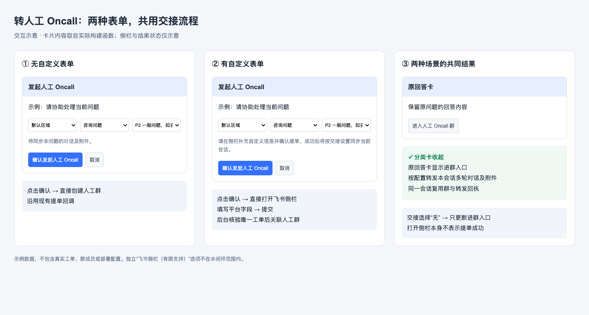

# 转人工 Oncall：配置与交互

转人工在现有“消息卡片”配置内扩展，保留原直接建群。分类提单默认在当前群／话题发送第二张普通分类卡，所有成员可见、仅发起人操作；同时保留飞书原生侧栏和普通群个人临时卡兼容配置。分类的附加字段可在原生侧栏或 Botmux 分类卡内填写。转人工入口位于回答卡片底部右侧；同一 session 的各轮回答卡片共用人工群状态，建群后统一显示进群入口。

上图使用示例数据和实际卡片构建函数生成，仅说明交互；侧栏与结果状态为示意，不是飞书实机截图。

| 配置 | 选项与作用 |
| --- | --- |
| `enabled` / `chatIds` | 沿用开关及来源群多选；默认关闭，空列表不生效 |
| `flowMode` | `direct`：固定目标、P2 直接建群；`classify`：用户先选分类 |
| `formDisplay` | 仅 classify 使用：`thread_card` 发当前会话公开分类卡（新配置默认）；`native` 打开飞书内侧栏；`private_card` 保留普通群个人临时表单兼容 |
| `customFormMode` | 群内或仅本人可见分类卡的附加表单方式：`native` 使用 Oncall 原生侧栏（默认）；`botmux` 优先在原分类卡填写 |
| `forwardMode` | `none` 不自动转发对话记录，保留建群及进群入口；`individual`（默认）逐条转发；`merge` 合并转发为聊天记录，超过 100 条按顺序分批。提交时固定本次方式，后续改配置不影响已发起的交接；`none` 跳过对话记录读取、机器人入群等待和自动补发，提单问题描述仍保留 |
| `button.timing` | `first` 本轮开始显示；`final` 最终答复显示。首卡依赖实际动态回复卡能力 |
| `button.minTurns` | 1–100，从本 session 第 N 个已登记用户请求开始显示 |
| 业务目标 | 当前 Bot 的租户 ID，以及部署方提供的网关、邮箱域；direct 另需固定区域和分类 |

未填写新增字段的旧配置仍采用 direct、final、第 1 轮。基础设置以左右两列展示业务线和服务凭据，页面仅保留底部一个保存按钮；编辑只修改草稿，保存时仅提交变化的部分，部分失败可重试剩余项。凭据在管理员密码框内以圆点遮罩回填，保存后保留，仅修改时提交；问号提示说明获取方式；更换后需更新实际运行进程。目标 ID 当前为输入框，尚无租户名称搜索器。不能将此版本宣称为 PRD 全部验收完成。

单卡模式下，最终答复用 `botmux send --response-kind final` 发送并挂在同一张回复卡上；未指定 `--response-kind` 的发送按过程消息（progress）处理，更新同一张卡，不另建最终卡片；final 之后如需补充用 `--response-kind auxiliary`。“按钮显示时机”只控制转人工入口，不改变最终答案样式；旧版独立消息发送保持兼容。

## 页面名称与支持范围

“建群方式”区分“先选分类再建群”（点击转人工后，由用户选择或确认问题区域、分类并提交）和“按预设直接建群”（使用建群方式下的预设区域、分类，无需用户选择）。内部配置值保持 `classify` / `direct` 兼容。

“提单入口”只在先选分类模式下显示，决定用户从哪开始选分类。选择卡片入口后，可以设置“自定义字段在哪填”。

| 页面选项 | 可用范围与限制 | 验证范围 |
| --- | --- | --- |
| 群内分类卡（推荐） | 普通群、话题群；所有成员可见，仅发起人操作；支持关联人工群与转交对话 | 已有真实建群、回执回读和对话转交记录 |
| 仅本人可见的分类卡 | 只支持普通群，话题群和私聊明确拒绝 | 已有隔离回调测试，尚无完整真实提单验收记录 |
| 直接打开 Oncall 侧栏 | 打开 Oncall 平台表单；不自动关联人工群或转交当前对话 | 已接入并验证入口，尚无完整提单闭环验收 |

不能将配置值可保存等同于三个选项都已完整验收。

## 分类交互

**原生侧栏。** 使用平台 `tools/lark_dialog_url` 生成飞书 AppLink，在飞书内打开原生 launch-oncall 页面并预填原问题，不把用户送到外部浏览器。链接生成是只读操作，不记录工单成功。目前没有经过验证的 AppLink 提单完成回调或 session 关联契约，因此此路径尚不能自动绑定人工群、阻止平台内重复提交或自动转交对话。网页 SDK 的完成事件不能视为 AppLink 的完成回调。

**群内分类卡片（默认）。** 点击右下角按钮后在当前会话发送独立普通卡，所有成员可见、仅发起人选择和提交。区域和分类从平台读取，不依赖 AI 答复完成。草稿按 Bot、session、发起人隔离，24 小时失效。选择先持久化，回调 ACK 后更新原分类卡，避免飞书恢复旧视图；丢失更新后旧版本只恢复当前状态，不应用旧输入。取消及成功终态更新失败可重放，不重复提单。提交时重读平台配置，推荐自助阶段不阻断明确的转人工。无附加字段时直接建群。需要原生表单时提前准备侧栏链接，点击“确认发起人工 Oncall”可直接打开，保留已选区域、分类、问题等级及完整问题描述。畸形表单、跨租户配置和特殊分类动作仍拒绝。

选择“留在分类卡填写”后，区域、分类和优先级会与同一张卡上的静态文本字段联动。切换选项会刷新字段，未提交的输入需要重新填写。提交时重新核对字段定义。校验通过且请求已受理后撤回分类卡，原回答卡显示进度。建群成功后原回答卡显示进群入口，按已配置的方式交接对话。确认建群失败时可从原回答卡重新发起。P0 自定义表单及无法完整呈现的表单仍由原生侧栏处理。

自定义分类的原生入口包含本次草稿的唯一标识，放在来源地址前部，适配平台仅保存前 200 字符的限制。显式设置飞书用户可访问的 `BOTMUX_PUBLIC_URL` 后，侧栏先打开 Botmux 托管页，页内嵌入同一个 Oncall 原生表单。托管页用随机凭证固定卡片发布时的表单选择，取消、过期、交接或配置变更后入口失效。托管页回应 Oncall 对外层来源地址的询问，提供带唯一标识的来源地址，避免浏览器来源覆盖该标识。没有配置该地址时沿用原生 AppLink。中心平台 SSO 和 Devbox 私有短链不用于托管侧栏。

打开侧栏不表示提单成功。后台先按托管页提交的唯一来源地址精确查询；零命中时回退到按 origin、路径和唯一 `bm_form` 匹配的有界扫描，兼容平台追加渠道参数。兼容旧入口时，按已验证的发起人、更新时间下界和固定创建时间上界分批读取候选工单，跨轮从已保存的工单 ID 继续扫描。跨轮或多页扫描、以及精确来源查询得到候选后不立即认领，而是保存候选 flowId 并从头复核。每次新复核重新冻结创建时间上界，纳入候选等待期间新建的工单；复核只有从 ID 0 开始且单页完成时才可认领，复核自身跨页或跨轮则重新开始，连续无法完成则清空进度并转人工核对，避免复核过程重演旧 ID 游标盲区。完成复核后再校验唯一来源、租户、区域、交接时间及当前配置。新链接为每种已发布的表单选择保存一个独立标识，所以工单建群后改分类仍可回填。历史链接只含草稿标识，继续校验分类。只有复核后仍唯一匹配且人工群已创建时，才写入已有 session 的交接记录。非服务时段已建群的工单以建群时间为交接时间，值班人随后进群时无需再次回填。仅含托管入口的草稿在最近一次发布后的 2 分钟内按 5 秒间隔尝试查询和复核，之后和旧入口一样按 15 秒间隔查询。失败后等待 60 秒再试，草稿 24 小时失效。近期托管查单、兼容查单和已关联群的交接独立运行，旧入口的分页查询不会阻塞近期托管查单，原生查单也不会延后其它已确认工单的卡片刷新和转发。真实提单结果以工单查询为准。该查询使用已有服务凭据，需拥有工单查询及群标识转换接口的读取权限。

**平台契约边界。** 已有只读验证覆盖来源等值过滤及创建时间、更新时间和 ID 的组合筛选；这不等同于验证 `sort.field=id asc`，该排序仍需真机／平台侧确认。平台不支持或返回乱序 ID 时，扫描会抛错并保持未认领，不把缺失排序当成空结果或继续猜测工单。

结果关联使用一次原子写入，保留同 session 已有或待确认请求的归属。原回答卡统一显示进群入口，分类卡收起，按已保存的交接方式同步提交前的完整多轮对话及附件；只转发本 session，排除控制卡和提交后的消息。卡片更新或转发失败走已有恢复流程，重启后沿用同一群和转发回执，不再次建群。选择“无”时只更新进群入口。平台同一来源若出现多个工单，保留待核对状态，不自动选择；公开链接由其他人提交时，不冒用原发起人身份关联。

取消只收起 Botmux 入口并停止本草稿的自动关联，不会撤销已在平台提交的工单。问题等级暂用 P2/P1/P0 标准选项，未接入租户等级策略。此闭环用于群内／个人分类卡中的自定义表单；独立的“飞书侧栏（有限支持）”配置仍只提供通用入口。

**个人表单卡片。** 飞书 ephemeral 接口只支持普通群，卡片只发给回调认证的点击者。话题群和私聊明确拒绝，不发公开表单、不改发私聊。草稿按 Bot、session、提单人隔离，24 小时失效；选择产生新版本卡，旧版本及跨用户回调被拒绝。取消不提单。区域和分类从平台读取，提交时重新验证。create_chat 空表单直接建群，自定义表单沿用上述原生衔接；不能丢字段绕过。问题等级暂用 P2/P1/P0 标准选项，未接入租户等级策略。

## 会话状态与对话转交

新来源按 Bot＋session 认领一次人工请求；同一 session 的已登记结果卡统一显示该 session 的人工群状态，新 session 不继承旧群。请求认领、完成结果有持久锁和 attempt 标识，重复回调不重复创建，迟到结果不得覆盖新尝试。已有成功记录不换群，pending/unknown 不盲重试；旧问题记录在证明同一 session 后继续复用。

直接建群或分类卡提交成功后，该 session 的结果卡统一改为“进入 Oncall 群”，后续轮次继续使用该群。同一 session 的历史卡也会刷新为进群入口；旧卡点击仍复用该会话的请求，不会重复建群。

提交前读取原始公开消息并冻结快照，按配置逐条或合并转发，包含可证明属于当前会话的图片和附件。原生话题容器按时间顺序读取；按持久草稿消息 ID 排除本 session 分类控制卡（列表接口会省略回调字段）；普通群只采用已登记消息及明确 root/parent 关联回复，不能把整个群的时间窗当成一个 session。无法读取原问题和回复卡时不创建工单。

逐条或合并批次的确定回执落盘；合并返回无效原消息时不标为成功，仅补缺失项，不偷偷降级。发送前保存结果未知的那一条，短期重试沿用相同 UUID。超出飞书一小时去重窗口前的保守边界后停止重发，交由管理员核对。未完成时保留人工群绑定并展示“重试转交对话”，仅原提单人可操作；不通过重复建群补偿转发失败。转发前实际核验机器人在目标群内；平台邀请延迟时持久保存等待状态，每 5 秒重试未完成消息，重启继续。关闭配置和停止 daemon 中断后续发送。逐条保存目标消息回执以便回读验证，不能用建群 HTTP 成功替代。

飞书明确返回转发受限（230070）时，逐条模式持久跳过该条并继续后文，受限记录与成功回执分别保存；单条合并批次采用相同处理。多条合并批次无法确定受限原文，保留快照并停止重发，不改为逐条发送。解除限制后也不会自动重放这些终态记录。

## 身份与运行边界

`Authorization: Bearer <Service Secret>` 表示服务身份，`x-api-user` 由点击者在当前应用下的 open_id 解析邮箱得到，不能取会话 owner 或机器登录用户。密钥不得进入 Bot JSON、目标 JSON、卡片、会话 CLI 或日志。原生链接读取无需冒充用户。

详细配置、旧接口协议与回归命令见 [开发文档](oncall-group-development.md)。

## Session 级交接修复

人工群绑定、建群去重和补发锁统一按 Bot + session 保存，questionId 只标记其中一轮。刷新会覆盖已登记的全部会话结果卡；失败会留下持久待刷新标记，后台继续处理。会话快照包含提交前的全部已登记轮次和可验证归属的公开回复、图片与附件，排除分类控制卡；同话题重置后的新 session 独立计算范围。

兼容短期按 question 落盘的结果：只有能够证明属于当前 session 的记录才会被接纳；多个记录绑定不同群时保留待核对状态，禁止重复建群。接纳单一成功记录后按原始提交时间补齐会话范围，保留原群、原投递回执及尚未确认批次的 UUID；已成功的消息不重发，提交后出现的消息不混入旧交接。“无”仍跳过会话读取与转发。

## 预设建群配置与确认

基础设置只保留业务线与服务凭据。“按预设直接建群”在选项下就地展示预设区域、问题分类联动下拉框，分类显示平台名称；更换业务线或区域会清除失效的下级选择，不自动替用户选第一项。

Dashboard 通过 `POST /api/bots/:appId/oncall-target/choices` 预览草稿业务线的选项，daemon 对应 `/api/bot-oncall-target/choices`。该接口只读平台，不保存业务路由或凭据；展示元数据按应用和业务线隔离缓存。平台只返回区域编码时使用其原值，不推断地理名称。

仅直接模式的“转人工”创建按钮增加飞书原生确认，显示已读取的业务线、区域、分类名称及对话交接范围；名称缓存不可用时明确使用管理员预设配置。取消不会发送建群回调，确认后仍执行原有身份、配置和会话去重校验。分类表单提交、进入已有人工群均不额外弹窗。
