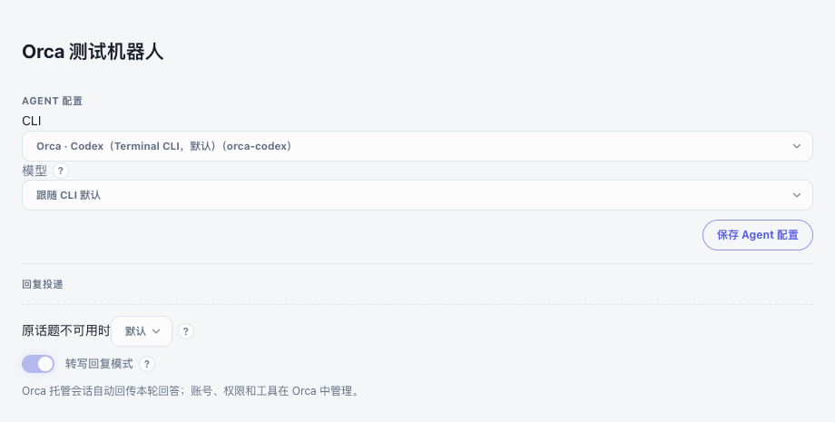
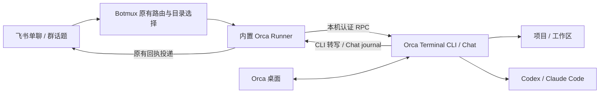

# Orca 托管会话

选择 Orca 后，飞书触发的每个新 Botmux 会话都会自动创建在其工作目录对应的 Orca 项目/工作区中。支持 **Terminal CLI（默认）和 Chat** 两种模式。飞书与 Orca 使用同一段对话；在 Orca 中可以查看工具执行、处理权限确认，并继续工作。

已有的 `/adopt` Orca 接入仍适用于接管先前手动创建的会话。这里的入口用于自动创建新会话。

## 使用

1. 在 **Botmux 所在机器**启动 Orca，先确认目标 Agent 能在所选 Orca Terminal / Chat 模式中正常使用。已验证 Orca **1.4.239** 的 Codex 和 Claude Code；适配器还会检查所需运行时能力，缺失时明确提示升级。
2. 在 Botmux 的 Bot 设置中选择 **Orca** 下的 Agent 和模式，设置默认工作目录。Terminal CLI 选项在前，Chat 为显式选项。无需安装独立 runner，也不依赖 `orca` shell launcher。
3. 私聊 Bot，或在群内按原有触发规则调用 Bot。新会话出现在对应的 Orca 项目中，任务进度在两端可见。
4. 在 Orca 中打开对应 Terminal / Chat 继续工作，回到飞书的消息仍进入原会话。两端交接时先结束当前任务并清空未提交草稿；Terminal 模式不支持两端同时输入，发现竞争输入时停止归属并提示检查。Chat 的竞争输入由 Orca 排队。

| `cliId` | Agent | 新会话模式 |
|---|---|---|
| `orca-codex` | Codex | Terminal CLI（默认） |
| `orca-claude` | Claude Code | Terminal CLI（默认） |
| `orca-codex-chat` | Codex | Chat |
| `orca-claude-chat` | Claude Code | Chat |

下面是一个 Bot 条目的相关字段；保留现有飞书应用 ID、凭据及其他必要字段：

```json
{
  "cliId": "orca-codex",
  "defaultWorkingDir": "/absolute/path/to/project",
  "replyDelivery": "transcript"
}
```

使用 Chat 时将 `cliId` 换为表中的 `-chat` 选项。`backendType` 自动配对为现有的 `remote-runner`，无需填写。可选 `model` / `reasoningEffort` 传给新建 Orca 会话；已有会话沿用 Orca 的设置。

| 场景 | 目录与会话安排 |
|---|---|
| 业务告警排查 | 沿用 Botmux 的告警/群绑定和默认工作目录，定位服务代码、日志工具及运行手册 |
| 群聊需求开发 | 每个话题对应 Botmux 会话，在选定项目创建 Orca Terminal / Chat；需要独立代码修改时使用 Botmux 原有 worktree 流程 |
| MR Review | 将请求路由到对应仓库目录；Agent 使用 Orca 中已有的代码平台工具和账号 |
| 业务知识问答 | 普通目录也会注册为 Orca folder project，无需创建 Git 仓库 |

工作目录必须已经存在。工作区隔离指目录、项目和会话的分开管理，**不构成 OS 沙箱或账号隔离**。不同会话共用一个目录时，仍可能修改同一工作副本。

多 Orca profile 可显式指定其本地用户数据目录：

```json
{
  "env": { "ORCA_USER_DATA_PATH": "/absolute/path/to/orca-profile" }
}
```

会话创建后固定模式、profile、Agent 和目录。更改默认模式只影响新会话；早期版本没有保存模式的会话按 Chat 恢复。修改这些设置时应新建 Botmux 会话，避免旧会话被悄悄移动到别处。



## 执行与生命周期



- **Botmux 重启 / detach**：只断开连接，保留 Orca 会话；恢复时继续原会话和未完成的任务。
- **显式关闭会话**：停止所属会话并关闭标签，保留历史。Chat 会清理本 Bot 尚未提交的队列并恢复原 Chat。Terminal 重建 CLI 进程并用原 provider session ID 续接，终端 handle/incarnation 会更新；恢复参数在调用前保存，响应丢失时重放同一次启动。
- **桌面续接**：桌面回合不会被当作前一条飞书请求的答案转发。Chat 按提交和 turn 身份归属；Terminal 按发送前转写边界、唯一匹配输入和新的 provider 完成事件归属。转写窗口丢失、额外用户输入或 provider 身份变化时拒绝转发。
- **权限确认 / 提问 / Stop**：在 Orca 内操作。现有 Remote Runner 不支持 Botmux `/stop` 的单轮中断契约；不要用关闭会话代替日常 Stop。
- **长回复**：飞书正文最多回传 32 KiB，超限时附截断提示，完整答案保留在 Orca。
- **消息被暂停、删除或投递未确认**：明确报告不确定状态，保留原会话供检查。Terminal 在调用前记录发送尝试，超时后仅观察转写，不自动重贴或再次 Enter；启动提示、登录、审批在 Orca 处理。飞书最终回复使用宿主投递回执；丢失回执时不会自动重发可能已经送达的答案。

Orca 使用自己的账号、工具、MCP、项目指令和权限策略。Botmux 的 sandbox/read isolation、严格环境/网络限制、按触发人授权、独立 Bot 凭据、环境删改、CLI wrapper/启动命令等不能传给已运行的 Orca，因此配置时拒绝不支持的组合。`ORCA_USER_DATA_PATH` 是唯一支持的 per-bot 环境变量。

自动回传回复固定开启，不要求 Agent 调用 `botmux send`。Botmux 不会向原生 Orca Agent 注入自己的工具和定时任务能力；在 Orca 内配置所需业务工具。

## 维护说明

实现复用 `RemoteRunnerBackend` 的握手、恢复、状态、进度和带回执的最终投递；不新增 backend 或网络服务。四个选择项只决定 Orca 的 Agent 与模式；已有会话以保存的模式为准。

- 认证：读取本机 Orca 的 `orca-runtime.json`，使用认证 Unix socket / named pipe；token 不进入命令行或日志。
- 创建：精确解析目录，必要时注册 Git / folder project，通过 `agent.launchReplay` 创建显式 `surface: terminal` 或 `chat`。启动 ID 在 RPC 前持久化，丢失响应后重放同一 ID。
- Chat 输入：持久化带 fence、指纹和稳定 operation ID 的 `agentSession.send`；恢复重放原提交，使用 `queue-if-active`。
- Terminal 输入：验证所属工作区、handle、PTY incarnation 和 provider 身份，检查忙碌/审批与草稿状态，再分别粘贴正文与发送 Enter。每一步都要求宿主 `requireAgentStatus: sendable`，避免 CLI 退出后将任务写入 shell；每一步调用前保存阶段，部分写入、断连和重启后只观察转写，不自动补贴或补 Enter。当前路径不使用仅适用于组合 prompt 的持久回执接口。
- 输出：Chat 每 400ms 按 cursor 读取 journal 并合并 revision/removal；Terminal 使用 `nativeChat.readSession` 读取原生转写及生命周期，单次最多 2000 条，缺失归属边界时报错。空闲时不轮询；不把屏幕 idle 或助手前言当成任务完成。
- 恢复：`SESSION_DATA_DIR/orca/` 保存原生身份及未完成任务；原有文件锁防止同一 Botmux 会话由两个 runner 同时持有。请保留该目录。

运行时协议依据：[Orca RPC 方法](https://github.com/stablyai/orca/blob/874a251cb459d5f3fc71fa7a8866860fb7401269/src/main/runtime/rpc/methods/structured-agent-session.ts)、[launch replay](https://github.com/stablyai/orca/blob/874a251cb459d5f3fc71fa7a8866860fb7401269/src/main/runtime/rpc/methods/agent-launch-replay.ts)、[journal 契约](https://github.com/stablyai/orca/blob/874a251cb459d5f3fc71fa7a8866860fb7401269/src/shared/agent-session-journal-types.ts)、[Terminal 转写接口](https://github.com/stablyai/orca/blob/874a251cb459d5f3fc71fa7a8866860fb7401269/src/main/runtime/rpc/methods/native-chat.ts)。运行时升级后若契约不兼容，适配器会报错，不回退到终端抓屏或猜测会话。

## 验证

```sh
bun install --frozen-lockfile
bun run build
bun x vitest run test/orca-*.test.ts test/worker-orca-policy.integration.test.ts
bun run verify:binary
```

使用仓库 `packageManager` 指定的 Bun 版本。真实飞书验收应使用测试 Bot：分别从私聊/群话题创建两个项目的会话，确认 Orca 自动归档、工具进度、桌面续接、Botmux 重启续接及显式关闭后恢复。测试不得把模拟的宿主投递回执写成真实飞书收发结果。

已构建源码后，可运行以下 opt-in 原生验收（会使用 Orca 的模型账号产生实际调用）：

```sh
node scripts/orca-managed-smoke.mjs --cwd /existing/test-project --agent codex
node scripts/orca-managed-smoke.mjs --cwd /existing/test-project --agent claude
node scripts/orca-managed-smoke.mjs --cwd /existing/test-project --agent codex --surface chat
node scripts/orca-managed-smoke.mjs --cwd /existing/test-project --agent claude --surface chat
```

脚本验证首轮、detach/restart 续接、显式关闭/rebuild 后继续同一原生会话；每次关闭还检查桌面标签消失和子进程退出。最终回复回执由测试宿主模拟。可用 `--binary /path/to/botmux` 验证单文件构建的内置 runner。
