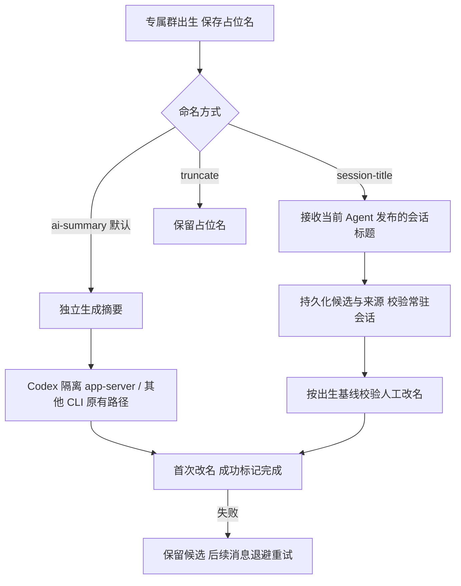

# 专属群命名选项与 Codex 隔离摘要

保留默认 `ai-summary` 和已有 `truncate`，新增可选 `session-title`。Dashboard 按 Bot 保存命名方式；Codex 的独立摘要改用已有隔离 app-server 标题生成器，可单独指定摘要模型，留空沿用 Bot 模型。

涉及文件：`session-group-title.ts` 统一调度与 Codex 摘要；`session-groups-store.ts` 保存候选及自动命名基线；`worker-pool.ts` / `worker.ts` 传递原生标题；`daemon.ts` 接收 Agent 会话改名事件；`session-group-birth.ts` 保存可信出生名；Dashboard IPC/代理与 `session-group-naming-row.tsx` 提供配置入口；`bot-registry.ts` 定义模式与可选模型。

## 行为与边界

- AI 摘要默认不变。Codex 改为隔离临时 home、low 推理、禁用 hooks/插件/MCP/工具/项目指令的现有生成器。摘要模型只作用于专属群 AI 摘要；共享生成器也服务 `/g`，但 `/g` 继续使用 Bot 模型及原有启动门控。保留 launcher wrapper 与 Bot 环境策略。
- 复用模式接收 Codex 原生语义标题或通过 Botmux 会话改名发布的标题。普通群、子话题、关闭/替换的会话、已命名群不接纳。没有标题或缺少可信出生名的旧记录保留原状。
- 新候选绑定 sessionId 与来源；重复事件不重置退避。发送请求前重检策略和来源，人工改过群名不覆盖。首次成功后不追随改名。
- 远端成功而本地标记失败时，下一轮可核对目标名并补记；旧远端请求完成后推进实际自动写入的基线，并接续期间到达的新候选。此逻辑覆盖同模式更换会话和 AI 摘要切换到复用模式。

## 验证记录

真实 store + rename + session-title/eventbus 与假时钟覆盖人工改名、部分持久化失败恢复、旧请求/新 resident 交叠、长请求去重、退避和跨模式切换；复核发现的跨模式基线停滞已修复并加入回归。

配置路由覆盖默认值、校验、字段保留、热更新与写入失败。隔离生成器使用 fake app-server 验证模型、low、hooks/插件/MCP/项目配置禁用与 wrapper 前缀。另有 worker IPC 及其他 CLI/`/g` 回归。

Dashboard 使用真实 React 组件、模拟配置 API 在 ego-lite 验证保存/刷新、模式切换与输入禁用；截图见 `docs/assets/session-group-naming-reuse.png`。这不代表真实飞书改名或生产 daemon 部署已经完成。

变异复验：临时移除人工群名 CAS、结束后的新候选重调度、自动写入基线推进、部分成功补记四类守卫，相关用例均失败；源码恢复后 8/8 时序回归通过。

最终定向回归：14 个文件，676 passed / 7 既有 skipped；Dashboard 390px 宽度无横向溢出，摘要模型清空后保存可恢复 Bot 默认。

## 补充：隔离标题 home 的 provider 接线（P2 修复）

`isolatedCodexTitleEnv` 原实现只复制 `auth.json`。这在生成器仅服务 Codex 内部语义标题时是 latent，但本 PR 把默认 `ai-summary` 整条接上后成为回归：源 `config.toml` 里的 `model_provider` + `[model_providers.*]` 是自定义网关 Bot 唯一的 provider 来源，缺了它会掉回 Codex 内置 `openai` provider——要么直接失败（永久占位名），要么改用宿主 ChatGPT 账号在默认端点计费。

新模块 `src/services/codex-title-config.ts` 只继承白名单三键 `model` / `model_provider` / `model_providers`，写进同样的 0700 临时 home，`0600`（provider 段可能带内联 `http_headers` 凭证，与 `auth.json` 同一边界）。读取口径对齐 `codex-profiles.readToml`：拒绝 symlink/多硬链接、256 KiB 上限、读取前后身份复核、解析异常不外泄片段。`model_reasoning_effort` 仍由 `thread/start` 的 `config` 固定为 `low`；调用方的 `model`（`naming.model` / Bot 模型）在线程级 `config.model` 注入，优先级最高。

**fail closed**：源 `config.toml` 存在但读不安全/解析失败时不生成标题（记 warn 后返回 `undefined`），而不是带着默认 provider 继续——走错 provider 的代价（悄悄吃别人额度）高于少一次改名。

探针（本机 codex-cli 0.164.0 + 本地假网关，逐项串行）：
- 自定义 `model_providers` + 内联 `http_headers`：网关收到请求，`x-gw-key: inline-secret-ok`，`model=local-model`，标题正常生成。
- `env_key` 型 provider：请求带 `Authorization`（来自透传 env），标题正常生成。
- 仅 `auth.json`、无 `config.toml`：不发生任何宿主 provider 命中（假 `$HOME/.codex` 配好网关后网关零请求），保持原有无标题行为。
- `config.toml` 额外带 `mcp_servers` / `features.hooks` / `projects`：MCP 命令未执行，隔离 home 落盘仅白名单三键。
- 调用方 `model` 覆盖：网关收到 `model=override-model` 且 `effort=low`（源文件的 `xhigh` 未泄漏）。
- 源 config 损坏：`codex` 进程根本没起（fail closed 在 spawn 前生效）。
