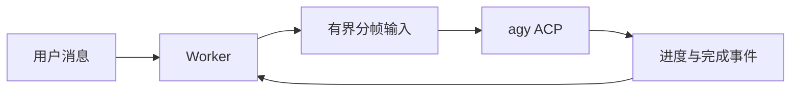

# Antigravity ACP 输入

为单个 bot 提供显式启用的 ACP 输入路径，避免将长上下文逐行输入原生 TUI。沿用已有 runner 的分帧、终端输出隔离和完成回执，原生会话 ID 由 ACP 返回；后续轮次精确恢复该 ID，不使用最近会话猜测。默认终端路径保持兼容。



## 范围

- `AGY_BOTMUX_TRANSPORT=acp`：仅通过该 bot 的 `env` 显式启用；未配置仍使用原生终端。
- `antigravity-acp.ts`、`antigravity-runner.ts`：完整消息、精确恢复、取消、进程回收、错误终态。
- 适配器、worker 与自执行入口：复用 runner 控制通道；原生终端不解析 runner 控制帧。
- ACP 不支持的 fork、wrapper、startupCommands、零注入原生终端与交互权限模式在启动前明确拒绝，不能静默切换执行权限或启动新会话。

## 启用与兼容

在需要优化的 Antigravity bot 配置中设置以下字段，然后创建新会话。不要改变正在运行的会话的传输方式；存续终端与配置的协议不一致时，worker 会在写入前拒绝连接。恢复原配置可继续连接原终端，或在该会话结束后新建 ACP 会话。

```json
{
  "cliId": "antigravity",
  "env": { "AGY_BOTMUX_TRANSPORT": "acp" }
}
```

ACP 模式的网页终端展示 runner 输出，不提供原生 agy TUI 的交互选择器或 slash 命令。只支持原本已经自动批准工具的 bot；不改变交互审批 bot 的权限。模型与推理设置必须由 ACP 返回的配置列表确认，不支持的配置在提交提示词前报错。

runner 沿用有界输入分帧；每轮创建一个受管 ACP 进程，并通过原生 session ID 精确恢复后续轮次。进程回收覆盖整个自有进程组，包括主进程先退出后仍忽略 SIGTERM 的后代。模型/工具内容逐行加前缀，包含 Unicode 行分隔符也不能伪造 ready 或控制回执。

## 本机隔离与验收

测试使用独立 worktree 与独立依赖目录，不运行 `switch:here`、`use:here`、`restart` 或全局安装。临时探针通过 `scripts/fenced-run.ts`，隔离 HOME、SESSION_DATA_DIR、tmux socket 与用户总线。原生 CLI 测试只复制必要认证文件到临时目录，不共享 history、brain、settings 或原生日志；会消耗同一模型账号的少量额度和本机 CPU。

验收覆盖长 UTF-8 多行消息完整性、精确恢复、取消、进程退出、错误终态、恶意终端控制字符，以及其它 runner 的回归。真实 agy 验证分别记录传输、原生接收与完成耗时；初始化耗时不能作为提交性能。

真实验证命令：先将必要认证文件复制到仅供测试的目录，再运行：

```bash
bun scripts/fenced-run.ts -- bun scripts/verify-antigravity-acp.ts \
  --agy-bin /absolute/path/to/agy \
  --auth-dir /absolute/path/to/disposable-auth-snapshot \
  --model gemini-3.8-flash-high --effort high --tools \
  --report /tmp/antigravity-acp-results.json
```

2026-11-09 在 agy 1.5.3 上实测：18,090 字节、403 行消息在 3,007ms 内出现在原生 USER_INPUT 中，完整性匹配；后续同一原生会话恢复在 2,723ms 内记录输入。首段模型输出分别为 8,401ms、14,600ms，整轮完成分别为 9,558ms、15,179ms。这些是两次实际样本，不代表延迟保证，也不能用来等同比较不同模型/会话的处理速度。

显式选择 `gemini-3.8-flash-high` + `high` 的复测中，长消息、恢复、工具调用三轮的原生输入观察时间分别为 2,548ms、2,695ms、2,756ms；三轮回复均匹配，最后一轮实际调用工具读取临时工作区文件。CLI 的 effort 后缀别名通过 `models.availableModels` 精确验证并调用 `session/set_model`，不拿别名冒充 configOptions 的基础模型 ID。

## 验证结果

- `bun run build`：通过源码、scripts 类型检查与构建审计；Linux x64 单文件打包通过，真实编译入口能处理中文帧并返回正确 turn ID 与 final。
- 26 个定向测试文件、470 项测试通过，包含 ACP 的 PTY/tmux Worker 集成、原生恢复/fork/transcript、其它 runner、公共输入和 per-bot env。
- 自有进程组回收与 Unicode 显示边界测试：修复后通过，摘除守卫后失败；审查发现的启动命令兼容问题已改为启动前明确拒绝。
- 扩展原生回归时，`worker-agy-delivery.integration.test.ts` 的 `keeps an active command working despite its visible empty composer` 在分支与未修改的基线 `7c0ad137` 上均发生相同 20 秒超时。该用例与源码未在本变更中修改；结果单独记录，不能声称原生整文件全绿。
- 验证前后全局 launcher、bots.json 和原生 settings.json 的哈希一致，现有 supervisor/daemon PID、版本与重启次数保持不变。
