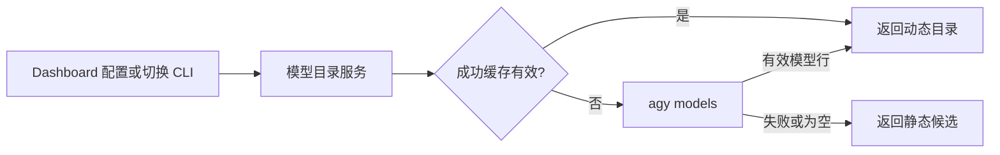

# Antigravity 动态模型目录与 CLI 核对

Antigravity 的 Dashboard 模型候选原先只读取静态快照。通过原生 `agy models` 查询当前账号可见模型，复用现有目录服务的按需探测、10 分钟成功缓存、并发去重与失败回退。终端和 ACP 适配器都使用原生可执行文件，并传入目标 Bot 的探测环境。

涉及文件：`antigravity.ts`、`antigravity-acp.ts` 增加探测；`antigravity-models.ts` 解析制表符分隔的模型 ID / 显示名；`model-catalog-json.ts` 的共享执行器新增可选环境参数，已有调用保持默认环境。

## 核对结果

| CLI | 现有来源 |
|---|---|
| Codex / Codex App、CoCo / TraeX | CLI 模型能力目录 |
| OpenCode、Doubao、Aiden Codex、MimoCode | CLI 按需查询 |
| Pi / ZCode | 本地配置文件，不查询远程账号目录 |
| Antigravity（本次修改前）、Claude Code、Cursor、Genius、Copilot、Kimi、Grok、Reasonix、DSH / DSH TUI、Mojo、MiniMax | 静态候选 |
| ttadk | 静态建议列表，不调用底层模型探测 |

其余没有声明候选和探测方法的 CLI 不提供自动发现目录。动态探测不等于每次打开下拉都访问服务端：已有服务缓存成功结果 10 分钟；失败不缓存，下一次请求重试。目录服务判定为 live 的 Pi / ZCode 也只是本地配置发现。

## 验证与影响

`agy models` 在当前安装版本可返回模型 ID 与显示名，包含静态列表没有的 Gemini 4 Argon 和 Claude 5.5。解析只接受模型行，忽略进度、错误和不完整行，并按原顺序去重。

回归覆盖终端 / ACP 原生可执行文件、有效环境、live 目录替代快照、缓存复用、失败与空结果回退及重试。共享执行器保留既有超时、输出上限与失败处理；已有 CLI 未传新参数，执行行为不变。无需修改数据库或持久状态、会话输入输出协议、PTY / Tmux 后端。

## 模型探测的副作用

两个 Antigravity 适配器都在 `agy models` 的子进程环境中设置 `AGY_CLI_DISABLE_AUTO_UPDATE=true`。探测保留调用方传入的 Bot 环境；未传入时继承当前进程环境，不修改原环境对象。

该命令仍会启动 Antigravity 本地后端，并写入日志与摘要库，不创建对话、不执行推理。

`botmux dispatch --model` 也会经 `resolveDispatchLaunchSpec` 调用目标适配器的 `detectModels()`，使用编排方会话环境。Antigravity 的 live 目录内模型 ID 可以通过校验；目录外 ID、探测失败或空结果仍被拒绝。MimoCode 经 `createOpenCodeLikeAdapter` 运行 `mimo models`，属于动态目录。
