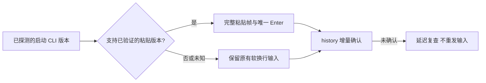

# Antigravity 原生终端输入提速

agy 1.5.4 已实测支持 bracketed paste：约 35KB、1000 行中文消息可整段提交并在原生 transcript 完整记录。旧适配器仍为 agy 1.0 的限制逐行发送 M-Enter，并加入行间节流及提交前 300ms 等待。本次复用已存在的原子粘贴提交能力，减少终端调用和固定等待，继续通过 history 增量确认及 deferred recheck 判断提交。

修改原生 `antigravity.ts` 与相应测试、实测脚本；`types.ts` 和 `worker.ts` 仅传递是否恢复存续进程的上下文。复用 `SpawnContext.cliVersion`，不新增启动探测进程或公共后端实现。不改 ACP，不使用 `-i`：首轮和后续轮次继续共用同一确认链路，避免引入首轮 history 不记录的差异。

版本未知、旧版、预发布版、未经过 buildArgs 的 adopt 适配器以及暖恢复的存续进程保留旧路径。Worker 通过已有后端判断显式传递 reattach，只有确定创建新进程时才使用安装版本判断，避免磁盘升级后误判旧 pane。现代路径在后端明确支持原子 `submitBracketedPaste` 时复用它，其余后端使用一次 write 写入完整帧与提交键；写入异常/未确认不切换另一种输入方式，以免重复提交。

验证覆盖 PTY、Tmux 风格能力、版本隔离、中文/空行/长消息、慢确认、写入未确认/异常、旧版兼容；真实 CLI 使用临时 HOME、工作目录、日志和窄认证副本，并校验原始认证未修改。只提交 PR，不切换全局 launcher 或重启现有 daemon。

实测使用 `bun scripts/fenced-run.ts -- node --import tsx scripts/verify-antigravity-terminal-input.ts --agy-bin <cli> --auth-dir <authentication-directory> --report <report.json>`。node-pty 探针由 Node 执行，Bun 仅执行围栏。agy 1.5.4 对 1004 行、约 29KB 中文和 emoji 输入，在真实 PTY 与私有 tmux 两条路径都只提交一次，原生完整 transcript 各仅出现一条完整输入。单次测得 history 确认分别为 113ms、268ms，完整原生记录出现分别为 3499ms、3855ms；这些是一次观测，不是模型响应耗时或性能保证。认证源文件哈希保持不变。

对抗验证发现磁盘版本不能代表暖恢复进程版本，已通过显式 reattach 上下文修复；暖恢复和未知边界保留旧路径。额外验证了写入结果不明与迟到确认、并发输入完整帧、非法 ESC 和 CRLF 归一化。

最终验证：在 master `5011868` 上重放本次提交后，完整构建通过。通过 fenced runner 清理会话身份/IPC 环境并串行运行 6 个相关测试文件，64 条中 63 条通过；唯一失败为 `worker-agy-delivery.integration.test.ts` 的 `keeps an active command working despite its visible empty composer`，在输入前等待 screen_update 超时。另建未修改的 master `5011868` 工作树执行同一用例，同样超时，故未将其归因于本次输入改动，根因仍未确定。PR 保留草稿，未部署。跨 CLI 的 Grok tmux 启动及 Claude 启动回归通过。分别移除暖恢复与 ESC 保护的变异测试均准确失败，随后恢复源码。
