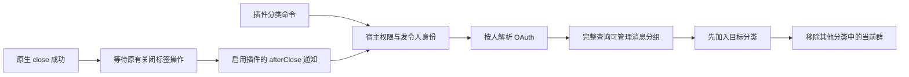

# 群分类插件命令与关闭通知

沿用现有 group-rename 插件，增加 `/p0`、`/p1`、`/pending`、`/watching`：查询发令人的个人消息分组，确认目标分类存在并加入成功，再从其他可管理分类移除当前群。最终只保留目标分类；不删除分类或其他群。`/close` 保持 Botmux 内置命令，只有正常明确关闭成功后才通知显式声明 `commands.afterClose: true` 的启用插件进行清除。

## 合同与范围

`src/services/chat-feed-groups.ts` 负责分类变更与串行化；IPC 新增 `PUT /api/groups/:chatId/feed-group`，参数是 `actorOpenId` 与 `label`（p0/p1/pending/watching/null），只接受当前 Bot 的可信宿主请求并重复校验用户管理权限。严格使用 `resolveUserToken` 按发令人读取凭证，禁止使用 owner-only 的旧 per-app 凭证兼容入口。

`PluginCommandsContribution.afterClose` 是显式 opt-in，不把 `/close` 加入插件命令表。扫描器仍拒绝插件覆盖保留命令；网关只通知当前 Bot 启用的服务，使用原有签名请求、大小/超时与卡片策略。显式 `replacesCloseTag: true` 且 afterClose 启用的插件接管关闭分类，不再运行旧 closedName 迁移；其余插件在旧标签操作后执行，旧回执发送失败不阻断插件。关闭被拒绝、残留、共享 adopt、后台清理、崩溃、stop 与 primary durable control 的旁路不触发本通知。

操作对象为**发令人在当前应用下可管理的个人消息分组**，不保证能删除其他应用或其他用户管理的标签。缺授权、分页不完整、权限错误、部分删除失败或超时均不宣称全部成功。客户端断连会取消仍在排队或网络中的后续操作；已完成的部分不回滚，新的命令事件可幂等重试。

宿主传入原始 IM createTime 作为 issuedAt。插件在 app/actor/chat 串行区内读比较并持久化最新指令水位，再执行操作，迟到或同时间的旧 close 不会覆盖已受理的新分类；重启后水位仍有效。插件保留原有事件持久占位与去重；相同事件不再次变更。发布包不包含 Bot secret / OAuth / 宿主代码。新插件依赖新 Host 接口，旧运行版本尚不兼容，因此本次只提交源码与构建包，不自动替换现有插件或重启 fleet。

## 验证

覆盖当前群/发令人目标、缺权限/授权、旧 owner token 不可借用、完整分页、目标加入失败不移除旧分类、部分移除失败报告、重复事件去重、关闭后通知与原命令保留。角色界面另有真实浏览器截图和排序断言，均为离线测试数据。未操作真实个人分类，未消耗模型推理额度。
