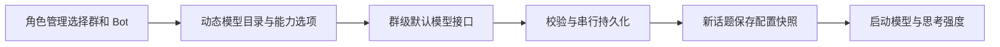
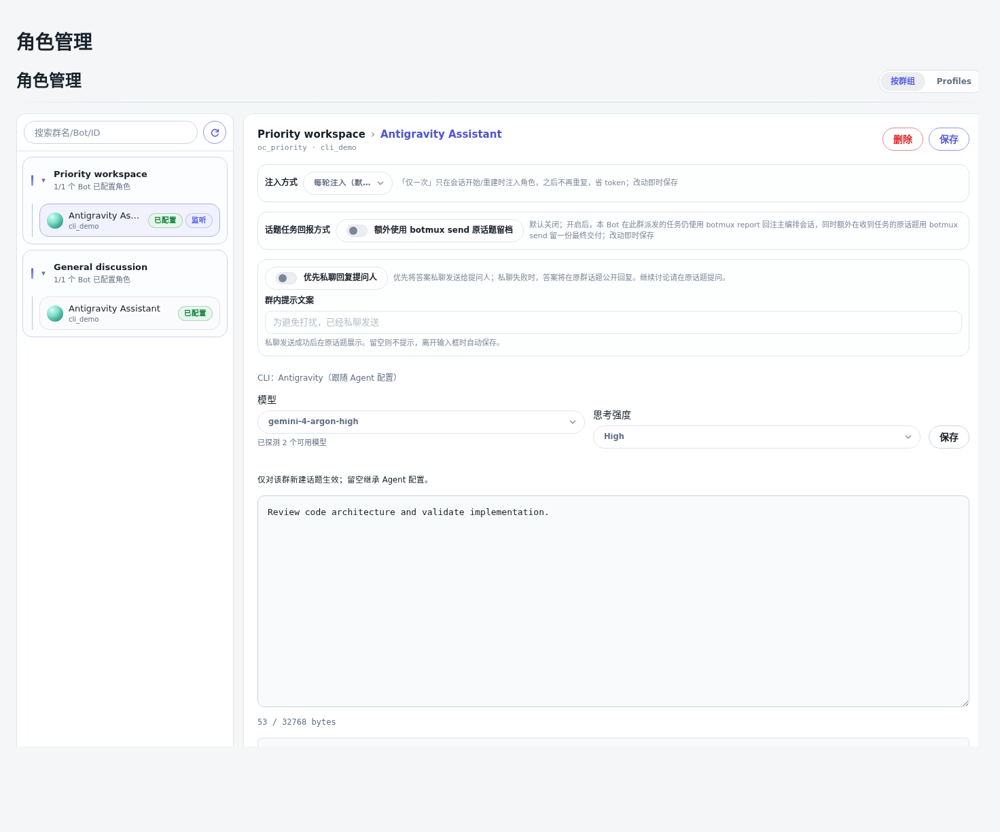

# 角色管理排序与群级模型设置

角色管理的群聊列表先按已配置监听的在群 Bot 数量降序，再按在群 Bot 数量降序，同分保留接口已有顺序。配置过但暂停的自定义监听也计入，不将已经离群的 Bot 计入。

角色编辑器复用群管理的模型与思考强度组件，按“群 × Bot × CLI”保存，仅用于新话题创建快照，留空继承 Agent 设置。群级模型合同在 Codex、Claude Code 基础上加入 Antigravity，动态目录沿用前一项模型目录改动。Antigravity 只提供终端与 ACP 均已验证的 low、medium、high；CLI help 虽列出更高等级，原生适配器目前未传递它们，不开放无效选项。

涉及文件：`roles.ts` / `roles-page.tsx`、`group-default-models.tsx`、`group-default-models.ts`、`session-model.ts`、`codex-reasoning-effort.ts`；群接口只增加监听配置存在标记，原监听启用标记不变。

不改变既有话题快照、角色提示词文件、其他 CLI 的群级准入或任务级模型覆盖策略。复用当前接口鉴权与存储，不新增数据库字段或索引。代码交付通过 PR，尚未替换运行中的 Dashboard。

浏览器预览：
