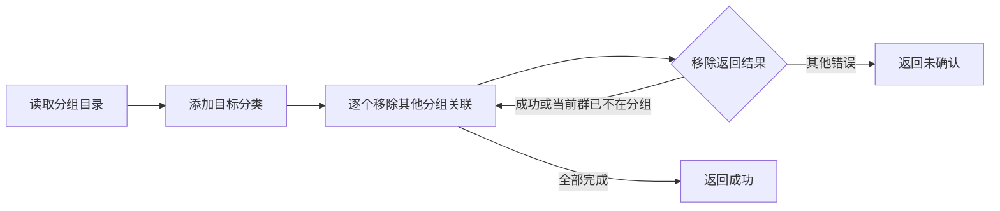

# close 分类移除幂等处理

`/close` 后，分类插件依次清理当前群的个人分组关联。群已经不在某分组时，飞书返回 `code: 0`，但 `data.failed_items` 包含 `230005 / item not in feed group`。原 Host 将其视为失败，中断剩余分组清理并显示“分类操作未全部确认”。修复只把移除阶段、当前群、`chat` 类型的 230005 视为已达到目标状态，继续处理后续分组。

## 涉及文件

- `src/services/chat-feed-groups.ts`：在业务操作处检查 failed_items，按添加与移除语义区分错误。
- `test/chat-feed-groups.test.ts`：异常返回的身份、类型、错误码和混合失败边界。
- `test/chat-feed-groups-idempotency.test.ts`：Host 入口、人工提前移除、部分失败后的新请求以及并发顺序。

## 关键边界

保留原有授权、超时、串行队列、分组选择范围以及先添加后移除顺序。添加阶段仍拒绝 230005；非当前群、非 chat、缺少身份和其他错误码均不可忽略。不会增加自动重试或修改插件事件去重。

真实接口复现：读取 P0 分组确认测试群无关联后，对同一群执行移除，返回 `230005 / item not in feed group`。移除前后该测试群均不在 P0 分组。
