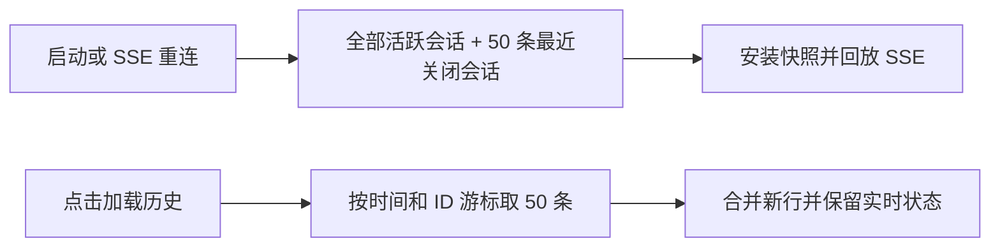

# Dashboard 会话快照分页

首屏保留全部未关闭会话，只携带最近 50 条已关闭会话；更早历史由会话页显式分页加载。旧的无参数列表接口保持兼容，分页发生在展示补全和权限投影之前，避免为不会发送的历史行执行展示处理。

涉及 `src/dashboard/session-pagination.ts`、`src/dashboard.ts`、`src/dashboard/web/store.ts`、`src/dashboard/web/sessions-page.tsx` 和翻译表。所有 CLI、IM、后端共用这一只读展示路径；不改变持久状态或会话生命周期。

游标使用关闭时间（缺省用最后消息时间）与 ID 的稳定排序，不依赖上一页记录仍然存在。断线重连重置为第一页；旧分页响应不得写回新快照。分页期间的 SSE 更新在新增历史行上回放，避免旧历史响应覆盖恢复中的会话。历史搜索明确提示只搜索已加载行；单会话深链接按需补取且复用相同权限投影。

验证：服务端分页边界、同时间游标、数据插入/删除、非法参数、旧调用兼容；客户端实时更新、失败重试、并发加载及重连时旧响应丢弃；build、typecheck 与相关 Dashboard 测试。

## 验证结果

- 7 个相关单测文件、150 项测试通过，覆盖分页、SSE 重连与更新竞态、展示投影和权限脱敏。
- Chromium E2E 通过：2098 条夹具数据首屏只发送 119 条；一次点击追加 50 条；旧会话详情通过单条请求补取。
- `bun run build`（含 typecheck 与构建审计）通过。
- [会话页分页入口截图（仅使用夹具数据）](assets/dashboard-session-pagination.png)。

本次不改变首个 SSE open 时再次对账的正确性约束；两次对账都使用有界快照。服务端内部聚合和无参数 API 继续保持兼容。浏览器内搜索仅覆盖已加载历史，会话页在存在下一页时展示提示。
