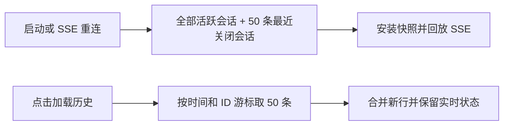

# Dashboard 会话快照分页

首屏保留全部未关闭会话，只携带最近 50 条已关闭会话；更早历史由会话页显式分页加载。旧的无参数列表接口保持兼容，分页发生在展示补全和权限投影之前，避免为不会发送的历史行执行展示处理。

涉及 `src/dashboard/session-pagination.ts`、`src/dashboard.ts`、`src/dashboard/web/store.ts`、`src/dashboard/web/sessions-page.tsx` 和翻译表。所有 CLI、IM、后端共用这一只读展示路径；不改变持久状态或会话生命周期。

游标按关闭时间与 ID 稳定排序，不依赖上一页记录仍然存在；dashboard 运行中刚关闭、尚未从会话库回填的行没有关闭时间，按最后活动时间排。旧分页响应不得写回新快照；分页期间的 SSE 更新在新增历史行上回放，避免旧历史响应覆盖恢复中的会话。单会话深链接按需补取且复用相同权限投影。

断线重连（含标签页在后台满 60 秒后回来）重拉第一页快照，但已经加载、搜到或深链接补取的已关闭行保留在页面上，快照里的行优先；之后再点「加载更早」会跳过全部已在页面上的页，直到加到新行。点击时恰逢快照替换，作废的那页会按新快照的游标自动重试一次。

⌘K 全局搜索和 Agent 工作台的会话搜索读的是同一份浏览器缓存。为了不丢「搜得到已关闭的历史会话」这项能力，输入查询词（防抖 250ms）时向 `view=closed&q=<词>` 查询：服务端在**全部**已关闭会话上按空白分词、全部命中的子串匹配，字段与 ⌘K / 工作台展示的一致（标题、群名、Bot 当前名、CLI、仓库、目录、工作区路径与分支、会话 ID、chatId；不含 larkAppId），每页最多 50 条，仍按上面的稳定顺序；结果合进缓存后由各自的匹配规则排序。查询词超过 200 字或含控制字符时服务端拒绝，浏览器端发送前先裁剪；看板视图不接受查询词。浏览器已拿到全部已关闭会话时不发请求。会话页内的搜索和筛选仍只覆盖已加载的历史，页面上有提示。

验证：服务端分页边界、同时间游标、数据插入/删除、非法参数、旧调用兼容、关键词搜索的字段与边界；客户端实时更新、失败重试、并发加载、重连时旧响应丢弃与已加载历史保留、⌘K 与工作台的搜索接线；build、typecheck 与相关 Dashboard 测试。

## 验证结果

- 7 个相关单测文件、150 项测试通过，覆盖分页、SSE 重连与更新竞态、展示投影和权限脱敏。
- Chromium E2E 通过：2098 条夹具数据首屏只发送 119 条；一次点击追加 50 条；旧会话详情通过单条请求补取。
- `bun run build`（含 typecheck 与构建审计）通过。
- [会话页分页入口截图（仅使用夹具数据）](assets/dashboard-session-pagination.png)。

本次不改变首个 SSE open 时再次对账的正确性约束；两次对账都只截断已关闭会话，未关闭（含休眠）会话照旧全部下发。服务端内部聚合和无参数 API 继续保持兼容。

同样读这份缓存、只看最近 50 条已关闭会话的还有概览页 Bot 卡片的「最近活跃」时间（只影响在线 Bot 卡片之间的排序）和监控室（只取未关闭会话，不受影响）。
