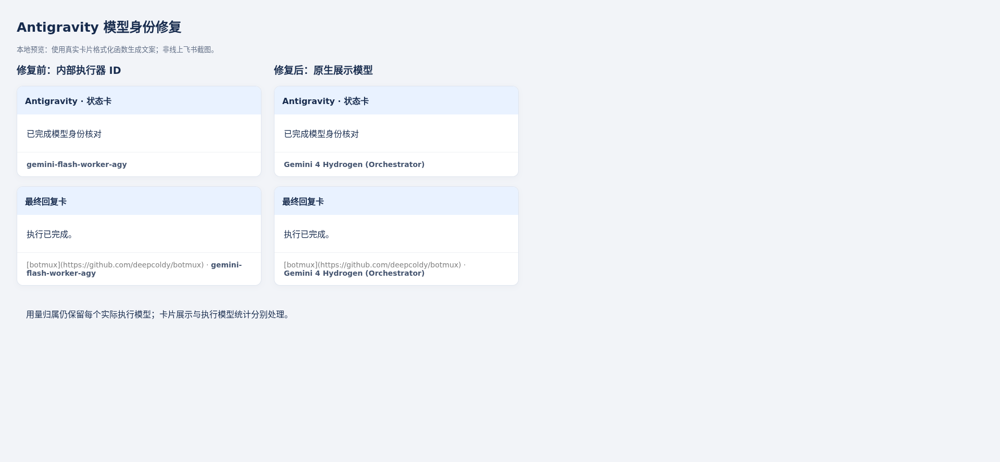

# Antigravity 模型展示与执行用量归属

Antigravity 的原生 `gen_metadata` 同时记录执行模型与展示模型。编排请求中的内部 worker 可以产生最后一条生成记录；直接把执行 ID 当成会话展示名称，会使状态卡和回复页脚显示内部 worker。

## 模型身份

- 终端模式读取同一原生会话生成记录的 `f1.f21` 展示名称；`f1.f19` 继续表示实际执行模型，用于用量归属。旧记录缺少展示名称时保留普通模型 ID 兼容，已识别的 `-worker-agy` 内部 ID 不作为主模型展示。
- ACP 模式从 `session/new/load`、选型响应和 `config_option_update` 获取已确认模型与思考强度，经 runner 的 runtime marker 传给 worker。原生 `models.currentModelId`/目录名称优先于 configOptions 的基础模型值，避免丢失别名信息。
- runtime marker 必须匹配当前原生会话且仅允许 ACP 适配器消费。恢复中的历史文本与工具通知继续忽略；与 load 响应同批到达的配置通知在会话绑定后处理。
- 沿用现有 daemon→卡片身份通道，不更改启动模型配置、后端选择或其它 CLI 的展示来源。

## 用量与兼容

原生读取器保留每个执行模型的累计 token。账本的 `models` 保存本次区间的逐模型增量，`modelTotals` 保存可用于恢复的累计归属；它们与原有聚合总数写入同一条记录。多模型区间的顶层 `model` 为空，避免把全部消耗归给最后一个模型。统计过滤和定价使用明细，汇总仍只计一次原始记录。

恢复时同时读取账本中的聚合与逐模型累计值，覆盖 append 成功但 state 文件未推进的窗口。旧 aggregate-only 记录不回写：首次无法证明逐模型增量的升级区间保持未知归属，之后按已建立的模型累计值精确计算。shrink/re-anchor 仍按现有 epoch 语义执行。零 token 的元数据模型不会导致已知金额变为未知。

## 验证

行为回归覆盖内部 worker 与展示名称、ACP 默认/恢复/别名/同批配置更新/长历史重放、marker 会话校验、按模型过滤与定价、旧数据迁移、状态丢失恢复及 shrink。持久化故障探针使用真实 SQLite、真实 EISDIR 状态写入失败和可控 `now`，验证 append 后重启不重复记账、跨日重复 reconcile 及恢复锚定。

下图由真实卡片格式化函数生成文案，在本地 HTML 预览中通过 PinchTab 截取，仅说明模型文字变化；不是线上飞书验收截图。

