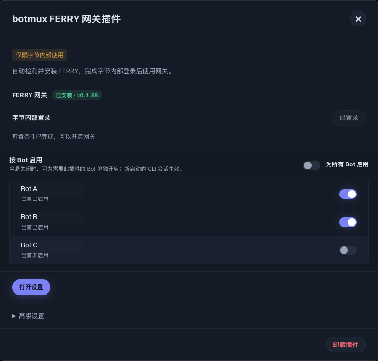

# 插件前置准备（prerequisites）与内嵌管理面宿主支持

> 日期：2026-11-16
> 范围：通用插件前置准备协议与管理面挂载点；不包含特定插件的认证或推理业务实现。

## 1. 背景与目标

FERRY 网关插件（`@xinna/botmux-plugin-ferry-gateway`，独立 npm 包，不属于本仓库）在安装后需要先完成两类前置条件，用户才能安全开启：

1. **运行环境准备**：插件私有的独立 Node.js 与官方 `@ad/ferry` 依赖可能尚未安装，需要在插件安装提交后自动准备；
2. **本人身份登录**：FERRY 需要使用者本人完成字节内部 SSO，登录态有效、网关进程认证通过、模型目录可读之后，才允许开启加速开关。

官方 v3.59.15 的宿主没有这两个机制：

- 插件安装流程没有"安装提交后回调"，插件无法在安装当下自动准备依赖；
- 启用插件（全局/按 Bot）的 CLI 与 Dashboard API 都不做前置条件校验，前端可以绕过置灰直接开启；
- 管理弹窗没有插件内嵌管理组件的挂载点，插件无法在原开关上方展示安装/登录状态。

本补丁在**宿主侧**增加一套通用的、显式 opt-in 的插件前置准备协议，让任何插件（不止 FERRY）可以在自己的 `package.json` 里声明 `prerequisites: true` 来接入。不声明的普通插件行为完全不变。

## 2. 改了什么

### 2.1 修改文件（8 个）

| 文件 | 改动 | 作用 |
| --- | --- | --- |
| `src/core/plugins/types.ts` | +3 | `BotmuxPluginManifest` 增加可选字段 `prerequisites?: true`；`PluginContributions` 增加运行时入口描述类型 |
| `src/core/plugins/manifest.ts` | +2 | 清单解析：`prerequisites` 只接受布尔 `true`，其他值直接报 `invalid_plugin_prerequisites`，防止伪造结构 |
| `src/core/plugins/convention-scanner.ts` | +5 | 约定扫描：声明了 prerequisites 就必须存在 `dist/prerequisites/index.mjs`，缺失则安装时报 `plugin_prerequisites_entry_not_found`；通过后把入口登记进 contributions |
| `src/core/plugins/install.ts` | +2 | 安装事务**提交成功之后**调用 `prepareInstalledPlugin(record)`，失败不回滚安装（启用检查仍会 fail-closed） |
| `src/cli.ts` | +2 | CLI `plugin enable` 路径：启用前 `await assertPluginPrerequisitesReady(pluginId)`，关闭不检查 |
| `src/dashboard.ts` | +3 | Dashboard 两个写入路径（全局绑定 `writeGlobalPluginBinding`、按 Bot 绑定 `writeBotPluginBinding`）：启用前同一检查，关闭不检查 |
| `src/dashboard/web/plugin-page.tsx` | +59/-2 | 新增 `PluginManagementSurface`：同源动态导入插件导出的 `management` 组件，挂在原开关上方；前置未就绪时置灰所有"关闭态"开关，已开启的开关仍允许关闭 |
| `src/dashboard/web/plugin-market.css` | +6 | 前置状态行样式与移动端适配，不改动原有控件样式 |

### 2.2 新增文件（4 个）

| 文件 | 行数 | 作用 |
| --- | --- | --- |
| `src/core/plugins/prerequisites.ts` | 62 | 核心：安装回调 `prepareInstalledPlugin` 与启用检查 `assertPluginPrerequisitesReady` |
| `test/plugin-prerequisites.test.ts` | 71 | 6 个用例：普通插件零影响、安装即准备、无 Dashboard token、启用前新鲜检查、入口缺失失败等 |
| `test/plugin-integrated-management.test.ts` | 19 | 7 个用例：内嵌管理组件只接受显式 `version:1 + placement:'before-scope-controls' + Component 函数`，其他形态一律返回 null |
| `scripts/verify-ferry-install-prerequisites.ts` | 47 | 隔离 HOME 的端到端验证脚本（经 `scripts/fenced-run.ts` 运行），PATH 中无 Node/npm 时插件仍能自备运行时 |

## 3. 怎么改的（机制链路）

### 3.1 协议约定（插件侧 opt-in）

插件在 `package.json` 的 `botmux` 段声明：

```json
{ "botmux": { "schemaVersion": 1, "id": "xxx", "prerequisites": true } }
```

并在包内提供固定入口 `dist/prerequisites/index.mjs`，支持两个参数：

- `installed`：安装提交后由宿主调用，负责准备依赖；
- `check`：启用前由宿主调用，stdout 输出 `{ "ready": boolean, "message": string }`。

宿主只定义协议与调用时机，**具体准备什么、怎么检查完全由插件自己实现**，本补丁不含任何 FERRY 业务逻辑。

### 3.2 安装时：事务提交后触发

`commitPluginInstall` 在注册表事务成功后调用 `prepareInstalledPlugin`：

- 用 `spawn(process.execPath, [entry, 'installed'], { detached: true, stdio: 'ignore' })` 独立进程执行，不阻塞安装返回；
- 注入 `BOTMUX_PLUGIN_INSTALL_RECORD`（插件记录的 SHA-256 摘要）作为安装上下文标识，插件侧可校验是否仍对应当前安装记录；它不是通用管理令牌，也不提供对同一系统用户恶意进程的认证隔离；
- 清理继承的安装授权；编译态执行外部 `.mjs` 入口时设置 `BUN_BE_BUN=1`，保证子进程按 Bun 解释器运行；
- 启动失败只 `console.warn`，安装保持已提交状态——后续 `check` 不通过时开关仍然打不开，不会出现"装坏了还能开"。

### 3.3 启用时：三条写入路径统一 fail-closed

- CLI：`cmdPlugin` 的 enable 分支；
- Dashboard 全局开关：`writeGlobalPluginBinding`；
- Dashboard 按 Bot 开关：`writeBotPluginBinding`。

三处都在**仅启用（enable=true）时** `await assertPluginPrerequisitesReady`：

- 未声明 prerequisites 的插件直接通过，零行为变化；
- 声明了则新起进程执行 `check`，20 秒超时、64KB 输出上限；
- 任何异常、非 `ready:true` 都抛错拒绝启用；
- **关闭（disable）路径不检查**，保证前置条件失效时用户永远能关掉已开启的开关。

### 3.4 前端：内嵌管理面 + 开关置灰

`PluginManagementSurface` 包裹原有 `PluginBotSettings` 与"打开设置"：

- 仅当 contributions 中存在 prerequisites 且插件只有一个同源 dashboard 入口时，才动态 `import()` 该入口；
- 强制 `new URL(entry.url, location.href).origin === location.origin`，跨源入口不加载并提示；
- 插件模块必须显式导出 `management: { version: 1, placement: 'before-scope-controls', Component }`，契约不符则不挂载、开关保持禁用；
- 组件通过 `onReadinessChange(ready)` 回传就绪态：未就绪时所有当前关闭的全局/按 Bot 开关 `disabled`，已勾选的开关不禁用（允许关闭）；
- 原有全局开关、按 Bot 开关、"打开设置"、高级设置、卸载等控件与布局保持原样，新组件只插在它们上方。

## 4. 安全与兼容设计

1. **完全 opt-in**：不声明 `prerequisites: true` 的插件走不到任何新代码路径，已有测试覆盖"普通插件安装与启用不变"。
2. **fail-closed 双保险**：前端置灰只是体验层，CLI 与两个 Dashboard 写入 API 都有独立的服务端检查，直接调 API 也绕不过。
3. **输入严格校验**：manifest 字段只接受 `true`；入口文件必须存在；前端只加载同源、契约精确匹配的模块。
4. **安装授权隔离**：`installed` 回调带插件记录摘要，且与 `check` 使用不同环境变量，安装权限不能被复用于登录或开关写入。
5. **不代做身份操作**：宿主协议只负责调用与校验，SSO 始终由使用者本人在插件页面完成，宿主与安装回调都不发起登录。
6. **资源边界**：检查子进程有超时与输出上限，独立进程 detached 运行不拖住安装主流程。

## 5. 为什么要提 PR

如果这套能力仅以**本机热修**方式存在，例如用临时签名的自编译二进制替换官方版本，会带来三个持续成本：

1. **升级即丢失**：官方 `botmux upgrade` 覆盖二进制后，插件自动降级——安装回调、启用前校验、弹窗状态行全部消失，只剩插件自己的"打开设置"路径可用；
2. **签名与系统授权风险**：ad-hoc 签名替换可能重新触发 macOS 完全磁盘访问等授权弹窗；
3. **机制归属问题**："安装后准备依赖、启用前校验前置条件、插件内嵌管理面"是通用插件平台能力，合理位置在宿主而不是某个插件的私有热修，其他需要本地依赖/本人登录的插件也能复用同一协议。

协议实现不依赖 FERRY，也不包含本机路径或凭据。示例集成脚本单独验证一个声明前置准备的插件，插件目录由调用者显式传入。官方合入并发布包含该能力的版本后，本机热修才可退役。

## 6. 验证方式

```bash
bun run test -- test/plugin-prerequisites.test.ts test/plugin-integrated-management.test.ts
bun run build
```

FERRY 示例端到端验证需要公司网络及已解压的插件包；必须通过围栏执行，不复制任何登录态：

```bash
bun scripts/fenced-run.ts -- bun scripts/verify-ferry-install-prerequisites.ts /absolute/path/to/extracted-plugin-package
```

脚本使用一次性 HOME，移除 PATH 中的 Node/npm，通过安装回调准备插件私有依赖，确认未生成 Dashboard token、未发起本人登录、未登录时不能开启。单元测试、构建和实际端到端执行结果分别在 PR 描述中报告，不把已有本机部署记录当作最新提交的复跑结果。

管理弹窗示意（Bot 名称已匿名化，来自既有界面验证记录）：



## 7. 风险与回退

- **风险面**：改动集中在插件安装/启用链路与插件管理弹窗，不涉及消息调度、会话、记忆、飞书事件等其他子系统。
- **已知局限**：`check` 每次启用都新起进程，状态查询偏重（插件侧可自行加短 TTL 缓存优化，不需要改本协议）。
- **回退方式**：本分支不包含任何数据格式变更，`git revert` 合并提交或直接还原 8 个修改文件、删除 4 个新增文件即可；已安装的插件不受影响，只是回到无前置检查的旧行为。
- 使用临时本机部署验证时，应在替换前自行保存官方二进制，并在升级至包含本协议的官方版本后移除热修。

## 8. 给评审者的检查清单

1. `prerequisites` 字段解析与扫描是否存在绕过路径（manifest 校验、入口文件校验、contributions 登记三处一致性）；
2. 三个启用写入路径（CLI、全局、按 Bot）是否都被同一检查覆盖，关闭路径是否确实不受阻；
3. `prepareInstalledPlugin` 的 detached 子进程在安装失败、进程启动失败、授权摘要不匹配时的行为；
4. 前端动态 import 的同源校验与 `integratedManagementExport` 契约判定是否可被恶意插件绕过；
5. 普通插件（不声明 prerequisites）的安装、启用、弹窗渲染是否保持字节级旧行为；
6. 测试夹具是否覆盖失败分支，而不仅是 happy path。

PR 描述应说明：显式 opt-in 协议、普通插件行为不变、前后端双层检查及实际验证范围，不包含特定插件的业务实现或私人凭据。
