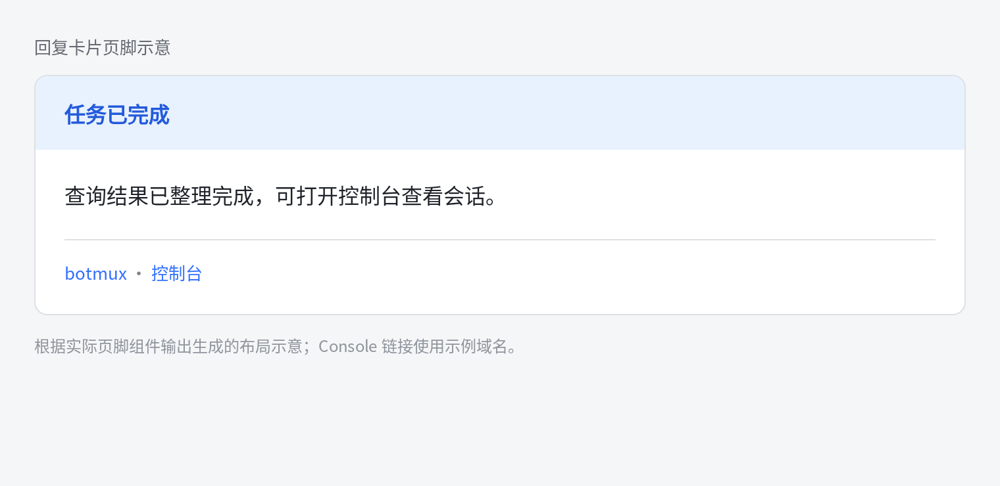

# Reply-card console entry

Final reply cards include a **Console** link next to the bot signature when
remote access is enabled and the host is bound to the central platform. The
link opens that machine's SSO dashboard and carries no dashboard token.

The same footer — and therefore the same console entry — also appears on the
`adopt_preamble` card (the last exchange shown when adopting a CLI session)
and on local-turn cards (turns typed directly into an adopted pane and synced
back to Lark), because every one of these is a signed, brand-carrying card.
Progress replies suppress the signature and the link.

The host selects the URL in the reply render snapshot. Direct sends and daemon
fallback replies use that same presentation contract; delivery retries retain
the selected URL alongside the existing footer preferences and timing.

The existing footer and signature switches also hide the console entry. An
empty signature suppresses it. When a custom signature already links to the
same console entry, it is rendered once even if the hand-written URL differs
in spelling (uppercase host, omitted trailing slash): link targets are
compared after URL normalization rather than as raw substrings.

Local dashboards, self-hosted reverse proxies, and Devbox exports keep their
existing access flow because they require owner credentials. Their long-lived
dashboard token is never added to this permanent reply footer.

