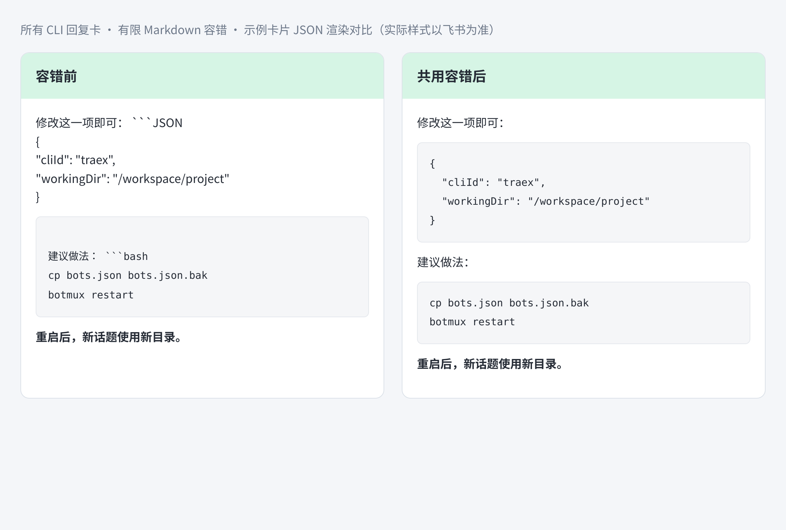

# 回复卡的有限 Markdown 容错

部分 CLI 的回复会把代码围栏紧贴在说明正文后，例如 `配置：` 后面直接接三个反引号和 `JSON`。Markdown 会把它当作普通文本，反而把原来的结束围栏当成代码块开头，让后面的正文或 Bash 示例变成代码。

所有 CLI 的回复卡在展示前统一经过 `src/services/reply-markdown.ts`，符合以下条件时仅补一个换行：

- 位于顶层正文段落，说明标签以中文或英文冒号结束，紧接三反引号和支持的语言标记。
- 开头后没有额外属性；正文非空，存在独立的三反引号结束行，扫描范围内没有嵌套或转义围栏。
- 单块检查最多 80 行、16 KiB，单条正文最多修复 16 块。

支持的标记不区分大小写：`plain_text`、`plaintext`、`text`、`txt`、`json`、`bash`、`sh`、`shell`、`zsh`、`javascript`、`js`、`typescript`、`ts`、`python`、`py`、`yaml`、`yml`、`toml`、`sql`。

正常代码块、行内代码、四空格缩进示例、引用、列表、嵌套的 Markdown 教程、未闭合围栏及未知语言保持原文。`markdown`、`mermaid`、`vega-lite` 等标记不在本次规则中，不推测图表或示例的意图。没有候选格式的普通回复直接返回，避免增加完整 Markdown 解析开销。



示意图由实际卡片正文组件 JSON 渲染，采用与 Traex 截图相同的格式结构；实际客户端样式以飞书为准。

## 影响范围

改动接入 `botmux send` 的回复卡生成，以及 worker-pool 的最终回复、统一卡片结算和卡片投递重试，覆盖 mcode、Traex、Codex、Claude 等 CLI，包含普通、群、接入及恢复会话中走这些路径的回复卡。PTY/tmux 的终端输出、CLI 输入、工具执行和问答协议不变；Linux/macOS 共用相同的纯文本逻辑，无平台文件或进程操作。公共 `md-card` 解析器及其他用途的 Markdown 渲染不变。

修复结果只用于卡片展示，历史、导出和消息原文继续保留原始正文。流式的未闭合内容不补结束围栏；格式不满足规则时保留原文。选择题卡片继续由 Ask 服务及 CLI 的原生问答桥接产生，不依靠本文的容错规则识别。

## 验证

```bash
bun run test -- test/reply-markdown.test.ts test/cli-send-reply-card.test.ts test/bridge-final-output-retry.test.ts test/md-card.test.ts
bun run switch:here
bun run daemon:restart
```

回归覆盖 mcode 的文本围栏案例、Traex 的连续 JSON/Bash 案例、正常及嵌套示例、CRLF、UTF-8 大小上限、16 块修复上限和幂等性。实际 CLI 子进程发送测试覆盖 mcode、Traex、Codex、Claude，包含 legacy/unified 卡片、机器人默认 CLI 与会话/冻结启动身份不同的场景；worker-pool 测试覆盖 bridge、local-turn 和 headless 最终投递，并验证原始消息不变。
