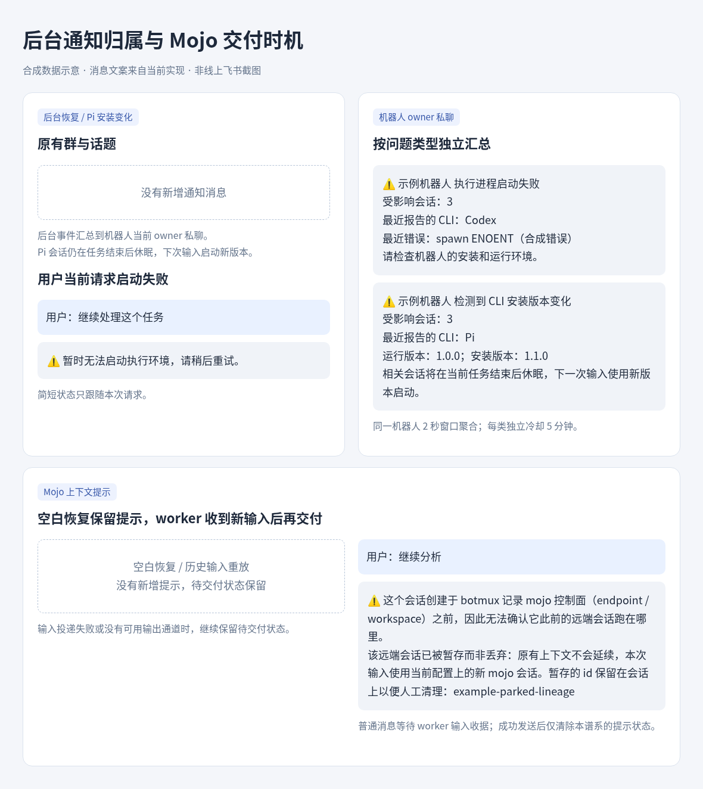

# 后台通知归属示意

该图使用合成机器人、会话和错误数据，以当前 `WorkerOwnerDiagnostics` 与 i18n 文案生成，展示发送目标及消息时机；它不是线上飞书截图。

- 后台启动失败与 Pi 安装变化汇总到机器人当前 owner 私聊，原有群与话题保持安静。
- 当前请求启动失败只向该请求回复简短状态。
- Mojo 空白恢复与历史输入重放保留待交付状态；新输入交付后才向本轮会话发送上下文提示。普通消息等待 worker 输入收据。
