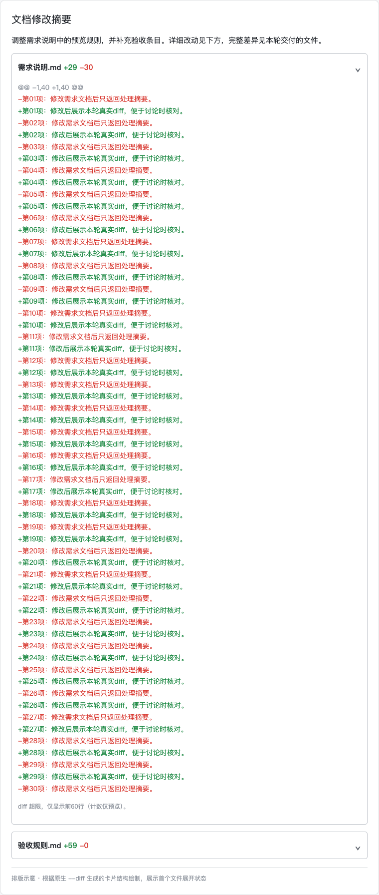

# send --diff 验证记录

## 最终行为

需求讨论中修改文档后，Agent用本轮编辑前文本和实际保存后的文本生成unified diff，通过核心send --diff提供真实折叠预览。普通Markdown与diff摘要共用md-card渲染；H1/H2沿用原heading-2字号，diff摘要移除宿主标题element_id，保持公共final校验严格。

超过2MiB仍保留部分文件/行。CLI最多读取2MiB+1字节，只解码2MiB前缀；解析器仅在明确前缀模式容忍EOF截断，其他非法内容仍拒绝。每文件默认最多60行，整卡预算可能进一步降低行数；小灰字说明实际显示行数，超大输入的计数只代表展示部分。

摘要过长或渲染超预算时，发送前返回一行原因及exit2，不发送兜底卡片。技能要求当前Agent精简摘要/表格后重试，必要时省略可选摘要。

文内链接只作文本预览，不自动收集或校验。需要防止漏发云端文档入口时，在摘要中交付URL并显式指定expected-link；保留既有整卡包含指定URL的检查，不新增摘要区域限定。

## 验证结果

- Vitest：相关13个文件464项通过，2项既有Linux专用用例在macOS跳过。
- 原生Bun：Markdown卡片174项、diff CLI22项、custom final29项，225项通过。
- 新增4个跨CLI/scope的direct与host card-file场景，逐项拒绝合法外形的宿主标题ID、feedback/footer/proposal及非法标题ID；确认exit2、零发送请求。每组使用真实生成的带标题diff卡作成功正控。
- H1/H2摘要断言同时钉住heading-2组件和无宿主标题ID；bounded relay用例包含H2摘要。
- host card-file守卫旁路变异：2个host场景失败，2个直连场景仍通过，证明能检出只放宽host的回归；验证后源码逐字节恢复。
- 覆盖率按配置条件跳过，未声称覆盖率百分比。单测流程Step1–Step7记录于任务证据。
- 当前分支bun run build通过，包含类型检查、Dashboard构建与资产审计；utree总结flush完成。

## 展示

约5.3MiB的两文件示例由实际CLI dry-run生成，两个文件各保留60行，计数仅代表预览。此前同会话已实际发送验证；下图是按schema2.0结构绘制的示意，非飞书客户端截图。

## 边界

摘要去除标题ID后，飞书仍显示标题，但消息回读不再补#或##层级前缀。比例字体不承诺精确列对齐；二进制与combined diff不提供逐行预览。

expected-link仅检查渲染卡片是否包含显式指定URL，删除行出现相同URL也会满足；该既有语义不能证明修改后的文档保留链接。

直连/host路径使用真实CLI及假provider验证，已有watcher协议回归通过；没有在真实OS sandbox做端到端验证。本轮不改变生产守卫、身份、投递或回放语义。

## FIFO修复本地回归

新增无写端FIFO的真实CLI回归，5秒保护超时内必须拿到exit2及单行“diff需要普通UTF-8文件”，不能把超时当通过；旧实现超时失败。普通文件symlink正控保留接受。修复仅使用O_RDONLY|O_NONBLOCK并保留fstat普通文件检查。目标CLI24项在Vitest与原生Bun均通过，普通/超大文件、增长、UTF-8、final/回放及relay行为保持；本轮按明确授权更新至既有PR。

本地FIFO修复完整构建与utree总结通过；移除O_NONBLOCK会再次触发回归超时，源码精确恢复。当前构建实际CLI对FIFO迅速返回exit2，对普通文件、symlink和5.3MiB差异返回exit0，超大预览保持120行（两文件各60）。
