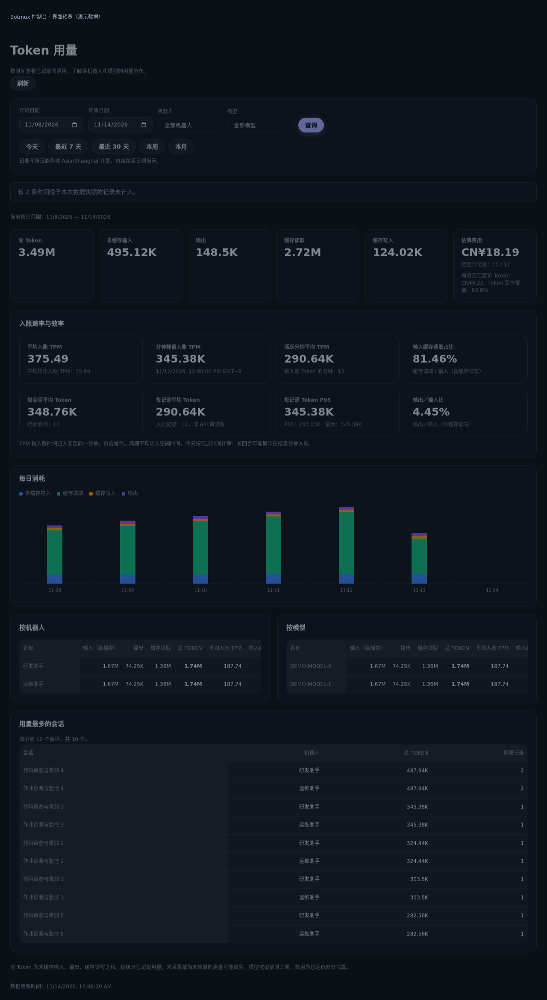
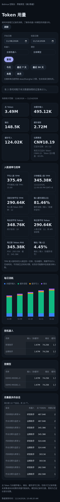

# 控制台 Token 用量

控制台「分析 → Token 用量」（`#/usage`）按所选日期汇总本机 BotMux 已记录的用量。查看需要控制台管理权限，匿名只读模式和仅有工作台权限的身份不能访问用量接口。

支持今天、最近 7 天、最近 30 天、本周（周一开始）、本月及自定义日期，单次最多 366 天。日期和每日趋势按浏览器显示的本地时区计算，包含结束日期当天；服务端使用 `[from, to)` UTC 时间边界读取账本。可以按机器人和记录时的模型筛选，并查看每日趋势、各机器人/模型分布、前 100 个用量最多的会话。

数据来自 `~/.botmux/usage/usage-YYYY-MM-DD.jsonl`（设置 `BOTMUX_USAGE_DIR` 时使用该目录）。文件名按 UTC 日期划分，查询按记录的时间过滤。读取是异步且只读的，不扫描原生会话内容，也不修改账本。

统计按机器人和 `recordId` 去重，排除 ownership 标记，累加每条记录的增量字段，不累加 `total*` 累计值。总 Token 等于未缓存输入、输出、缓存读取、缓存写入四个互斥桶之和；旧版 Codex/TraeX/Aiden 的缓存输入会从输入总量中拆出，避免重复计算。未知格式、不完整或无效记录显示未计入数量。无法读取或超过查询限制时显示错误，不把失败当作零用量。

估算费用只汇总带 `costCny` 的记录，并显示已定价记录数量；没有价格时显示未知，不估算历史价格。账本可能缺少未采集或尚未结算的用量，空白日期只表示没有记录，不能作为模型平台的完整账单。模型分组采用记录时的归属，不能精确还原一个回合内的模型切换。

管理只读接口：`GET /api/usage/summary?from=<ISO UTC>&to=<ISO UTC>&timeZone=<IANA zone>&bot=<optional>&model=<optional>`。相同查询短暂缓存 5 秒；读取最多 256 MiB、单文件最多 64 MiB、最多 50 万行，超限时缩小查询日期范围。

## 入账速率与效率

TPM 按账本的入账时间统计，包含缓存输入。固定 UTC 分钟避免夏令时重复小时合并，页面按所选时区显示峰值时间。长回合可能在结束时一次入账，因此分钟峰值描述入账量，不衡量模型解码速度或 API 配额占用。

| 指标 | 口径 |
|---|---|
| 平均入账 TPM / 平均输出入账 TPM | Token / 查询起点到数据快照或查询终点的已过分钟数，包含空闲时间 |
| 分钟峰值入账 TPM | 所选范围内固定一分钟桶的最大 Token 量；边界分钟只包含范围内记录 |
| 活跃分钟平均 TPM | Token / 有正 Token 入账的分钟数 |
| 缓存读取占比 | 缓存读取 / 输入（含缓存读写），不是请求缓存命中率 |
| 每记录 / 每会话平均 Token | 总 Token / 去重后的记录数或完整会话数；记录数不是 API 请求数 |
| P50 / P95 / 最大记录 Token | 中位数取偶数样本两个中间值的均值；P95 使用 nearest-rank |
| 输出／输入比 | 输出 / 输入（含缓存），可超过 100% |
| 每百万已定价 Token 费用 | 已记录费用 / 带价格的记录 Token × 一百万，不用未定价 Token 稀释分母 |

当前日期只计算已过时间，未来时间戳记录不计入并提示数量。没有数据或分母为零的效率指标显示未知；读取失败和缺少账本时不展示零速率。真实生成 TPS、TTFT 和 API 请求 RPM 需要请求级时序与调用计数，当前账本不提供这些证据。

## 页面示意

以下截图使用演示数据。

