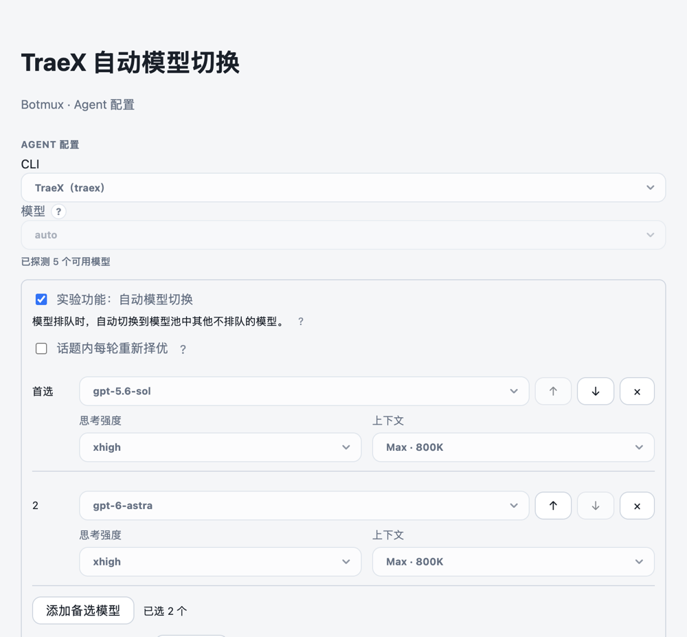

# TraeX 自动模型切换验证

本功能默认关闭。在 Dashboard 的 Bot 配置 → Agent 配置中开启「实验功能：自动模型切换」，选择有序模型池并点击「保存并生效」。实际运行只使用池里的具体模型，`auto` 不传给 TraeX。



每项分别配置思考强度和 Standard / Max 上下文。容量和兼容档位来自当前 TraeX 模型目录；截图是使用真实组件和隔离接口的演示。详细运行规则见[设计说明](design/2026-10-21-traex-auto-model.md)。

## 构建与检查

使用仓库规定的 Bun 版本和匹配的依赖。共享 `node_modules` 的 worktree 不执行安装。

```bash
bun run build
bun run test -- test/traex-auto-model.test.ts \
  test/traex-auto-model-settings.test.ts \
  test/traex-auto-model-preferences.test.ts \
  test/traex-auto-model-worker.test.ts \
  test/traex-model-load.test.ts \
  test/traex-startup-readiness.test.ts \
  test/traex-auto-rpc-config.integration.test.ts \
  test/traex-auto-rpc-runtime.integration.test.ts \
  test/traex-auto-model.integration.test.ts
```

编译态也必须测试，单纯启动成功不能证明 Worker 路径可用。版本后缀仅通过本地构建参数标识，不修改仓库版本字段：

```bash
BOTMUX_VERIFY_BAKED_VERSION=3.49.0-test.traex-auto-model.1 \
  bun scripts/build-bun-binary.mjs --out /tmp/botmux-auto-model
node scripts/smoke-bun-binary.mjs /tmp/botmux-auto-model
BOTMUX_TEST_WORKER_BINARY=/tmp/botmux-auto-model \
  bun run test -- test/traex-auto-model.integration.test.ts
```

这些集成场景使用真实 Worker、PTY/tmux 和模拟 TraeX，隔离于宿主 tmux。它们验证配置与输入链路，在线模型的真实负载和生成质量仍取决于服务状态。

## 现场复测

1. 未保存开启后刷新，开关应回到服务端保存状态；再次开启，模型顺序、档位及阈值草稿仍在。保存成功后刷新保持启用。
2. 首选持续排队达到阈值，观察按模型池顺序选择后续可尝试模型；备选实际排队后继续向后检查。最终等待后不反复换回前项。
3. 默认同话题下一轮保持当前模型；只有开启「话题内每轮重新择优」才在新输入时回首选。卡片显示实际模型和上下文档位。
4. 换模型前后原生会话 ID 相同，已有图片及历史保留，原问题不重发。恢复画面只有原生空输入框与模型/Context 状态栏时也能续接；忙碌、排队、草稿及选择器不能误触发提交。
5. 启用 Auto 自动适配当前托管 TraeX 的终端输入，不改 Bot 已保存的 RPC 偏好；关闭后恢复该偏好。其他 Bot、具体模型调用、wrapper、adopt 和共享 App Server 不套用 Auto。
6. 新版独立 tmux socket 下，冷创建与模型切换都在正确的 managed server 上；升级重新观察仍存活的旧默认 server 会话时保持其原有 pane。
7. 新话题从首选切到备选或最终等待模型后执行 `/restart`，应续接同一原生会话并保持模型、档位和最终等待状态；未变化的 Skill 目录不重复交付。再次输入仍在该模型执行，除非显式开启每轮重新择优。

新启动或重启会话加载配置。部署本地测试构建前备份配置和会话数据库，重启后分别核对磁盘版本、运行进程、原生会话 ID、tmux pane PID 以及 Dashboard HTTP。手动 `botmux upgrade` 会替换本地测试包，正式版本是否包含此功能应以合入状态为准。
