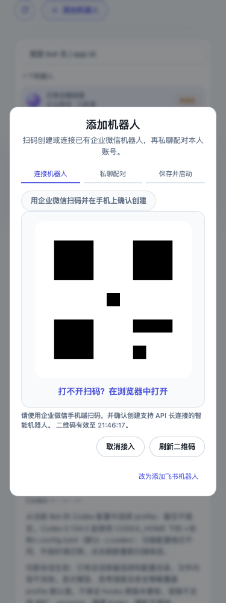
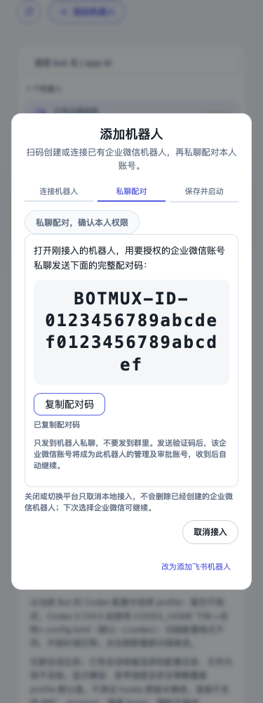
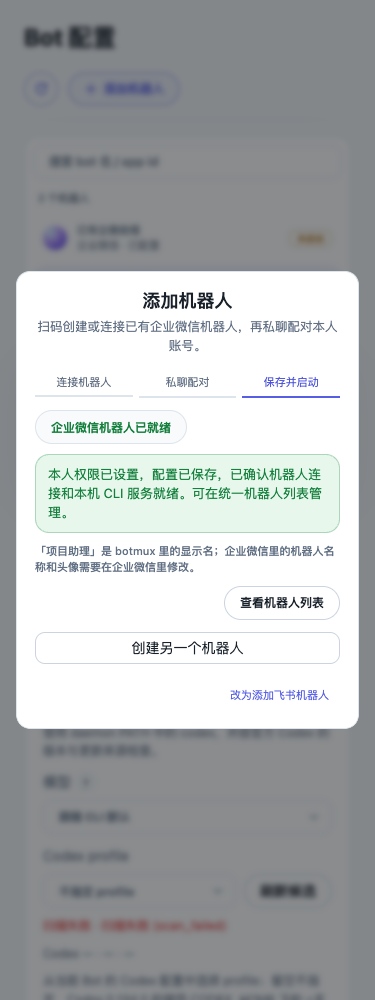

# 企业微信智能机器人接入

通过企业微信智能机器人 API 的 WebSocket 长连接接收私聊和群内 @，复用 botmux 的独立 core-only CLI 执行层。一个 BotID 只运行一个网关，使用独立机器人做灰度；新连接会挤掉其他设备上的同一机器人连接。本机文件锁只能防同一 HOME 的重复实例，不能协调其他机器。

企微聊天入口支持文字连续对话和最终文字结果。网关自己处理 `/status`、`/stop`、`/restart` 三个控制命令，名称取自共享 command-schema，不经过飞书 daemon 的话题命令路由；`/restart` 仅重置当前映射，下一条消息创建新 CLI 会话，不重启网关或整个 fleet。网关另有授权（`/grant`、`/revoke`、`/grant-approve`）、选仓（`/repo`）、`/summary`、`/ask`、`/feedback` 等命令，发送 `/help` 或 `/commands` 可查看完整列表。过程流式、思考/工具展示、卡片上的操作与反馈按钮、长任务和会话 Owner 提醒需要显式开启；旧配置默认不扩大过程披露。也可配置命令模板和允许透传的 CLI 命令。

私聊原地继续当前会话；群聊默认按真实 userid 各自建立会话，也可在 Dashboard 选择全群共享同一个 CLI 会话。群内结果公开，不提供飞书式话题编号。忙时拒绝新输入并提示等待/停止；切换模式不会复制在途任务，原发起人仍可停止自己的任务。引用不承担会话定位。授权只依据可信企微事件 userid，不使用飞书 open_id，也不合成 CLI 的飞书 owner 环境。可选发言人标签只提供上下文，不授予权限。

## 在终端统一 setup

`botmux setup` 不先询问平台，直接进入原飞书配置向导。创建企业微信机器人时，在交互终端里运行 `botmux setup`（已有机器人配置时先选「添加新机器人」），「飞书应用来源」菜单在三项飞书来源之后有一行「企业微信」分隔（不可选），下面是两种接入方式：

- 「扫码创建新机器人」：用企业微信扫码创建、私聊配对、自动上线。
- 「手动输入 BotID/Secret」：机器人已在企业微信里创建好（需支持 API 长连接）时使用。向导先收 BotID 与 Secret（输入不回显，格式不对会重问），之后同样私聊配对、保存并自动上线，与 Dashboard 向导里的「已有机器人」是同一个接入任务。Secret 只随创建请求发给本机 Dashboard，不显示、不写入日志或续办提示。

两种方式都与 Dashboard 共用接入流程；企微配置独立存储，不写 bots.json / .env，也不修改飞书配置。企业微信分区只在新增机器人的入口出现，「重新配置」「覆盖当前配置」里没有；管道输入（非交互终端）时菜单与以前完全一致，没有这个分区。

这个分区是终端里接入企业微信的唯一入口：`botmux setup` 没有选择平台的参数，企微向导也不接受命令行参数。终端向导只负责收集下面列出的本地名称、CLI、项目目录和 PTY/tmux 后端；模型等其余设置不在这里回答，接入完成后在 Dashboard 的机器人配置页修改。

企微终端向导依次收集本地名称、CLI、项目目录及 PTY/tmux 后端：CLI 用与飞书 setup 相同的级联选择器，后端也在选择器里选，名称与目录为文本输入。最后一步确认默认停在「取消」，选「继续」才创建接入任务；在任一选择器里按 Esc 即退出，不创建任何东西。扫码创建时终端显示官方授权二维码及可打开的官方地址，扫码确认后显示随机完整配对码；手动输入凭据时没有二维码，直接显示配对码。用要成为本机器人管理及审批账号的企业微信账号，私聊新机器人发送该完整配对码，不要发到群里。向导只接受这次挑战的真实回调身份，配对后自动保存凭据及权限并启动网关与专用 core；确认连接与 core 就绪后才报告上线。

终端通过既有本机 Dashboard 管理鉴权与 CSRF 调用同一任务接口，不另建身份、二维码或凭据保存流程。若本机还没有任何机器人配置，setup 与 `botmux dashboard` 一样只启动不含机器人的 supervisor 及其 Dashboard；已有配置而 Dashboard 没有运行时，setup 不启动任何进程，提示先运行 `botmux start` 再重试，并以非零状态退出；在 botmux 沙盒内（看不到宿主进程，`botmux start` 会被拒绝）则不论有无配置都不启动，提示到宿主终端启动 botmux 后再回来重试。管理 token 和 CSRF 不打印或传入子进程参数，所有管理请求只走实际发现的本机 loopback 端口。

同一管理登录下的未完成任务会在再次进入时列在选择器里（重新运行 `botmux setup`，在企业微信分区任选一项即可看到），每项以任务 ID 标出，光标默认停在最近的任务；选最后一项「创建新机器人」才新建。创建任务后终端会显示它的任务 ID，便于续办时在列表里对上。续办的任务在轮询时按 Ctrl-C，或任务失败时在提示里输入 `c`，即取消该本地任务；也可在 Dashboard 里取消。

任务有效期与 Dashboard 一致，为 24 小时。Ctrl-C 会请求取消当前本地任务；已创建的平台机器人保留。未取得凭据时，续办刷新二维码；已取得凭据时只重试同一机器人的配对、保存或启动。网络中断或创建响应丢失时不会自动再次创建，重新进入后先选择已有任务；取消未确认时任务可能仍在运行。管理登录轮换后不能读取旧登录任务，也不会自动换身份重建。

企微向导需要交互终端（管道输入时来源菜单里没有企业微信分区）；没有交互终端时请在 Dashboard 里添加。`setup list/add/configure/edit/remove` 保持原飞书脚本语义，只管理飞书机器人。

## 在 Dashboard 扫码创建

运行 `botmux dashboard`，从侧栏「创建机器人」或「机器人配置」页的「添加机器人」进入共用向导。向导默认显示飞书创建表单，不需要先选平台；点击表单底部的「改为添加企业微信机器人」进入企业微信流程，同一位置的「改为添加飞书机器人」可切回。没有机器人、只有企微机器人或混合平台部署都使用同一个入口。企业微信创建需要本机管理权限；权限检查期间、失败或当前身份无权时不显示企微入口（克隆飞书机器人时也不显示），不影响合法飞书协管入口。检查失败时关闭并重新打开向导即可重新检查。

1. 填写本地显示名，选择 CLI、模型、项目目录和 PTY/tmux 后端。显示名只影响 botmux 列表，不修改企业微信内的原生名称或头像。CLI 登录和项目权限需要在本机准备；向导先校验本机条件，再请求平台创建。
2. 保持「扫码创建」，生成二维码，用企业微信手机端扫码并确认创建支持 API 长连接的智能机器人。服务端自动取得该机器人的 BotID 和 Secret，无需复制凭据。
3. 页面出现随机配对码后，用要授权的企业微信账号向刚创建的机器人**私聊发送完整配对码**。不要发到群里。向导只接受本次配对码对应的真实机器人回调 userid。发送验证码后，该企业微信账号将成为此机器人的管理及审批账号；扫码身份不会直接用作 Owner，无需查找或填写 userid。
4. 配对成功后自动保存本地凭据与本人权限，启动专用 core 和网关，确认真实认证连接及 core 就绪后才显示完成。点击「查看机器人列表」进入共用列表，并选中这次创建的企微机器人。

已有支持 API 长连接的机器人可在同一个向导选择「已有机器人」，输入 BotID 与 Secret，然后完成同样的私聊配对；首次本地绑定也将发送验证码的账号设为管理及审批账号。已配置的机器人不能通过重复接入提升另一账号权限。Secret 仅随创建请求提交，发出后清空，不写入浏览器存储，也不在轮询快照中返回。不要把凭据发到聊天或截图中。

二维码过期或尚未取得凭据时，可「刷新二维码」；旧二维码代次随之作废。取得凭据后，本地配对、保存或启动失败时使用「继续接入同一机器人」，不会重复创建平台机器人，也不会覆盖另一份现有配置。关闭、取消或切换平台会停止本地流程和旧轮询；已经在企业微信创建的机器人仍保留，不会自动删除。重新打开向导并从底部入口进入企业微信流程，会找回当前管理登录身份尚未完成且可续办的接入；换账号或登录会话后不能读取另一身份的任务。本地接入草稿有效期为 24 小时，过期后不再沿用草稿凭据；平台机器人仍保留，可选择「已有机器人」重新提交凭据并私聊配对。成功完成会清理草稿凭据，保留已保存连接使用的正式凭据。

连接完成后的配置和运行状态在共用「机器人配置」页管理。保存成功与真正上线是两个独立状态；完成前若显示配置已保存但启动未确认，继续接入即可重试当前机器人的健康检查。

下图为隔离演示夹具，二维码与配对码不能用于真实接入。

| 扫码创建 | 私聊配对 | 完成 |
| --- | --- | --- |
|  |  |  |

## 配置与运行

终端 setup 与 Dashboard 接入保存的连接配置位于 `~/.botmux/wecom/connections/<BotID 的 SHA256>/config.json`（0600）；Secret 单独保存在同目录的 `credentials/<随机代>.secret`（0600，目录0700），不写入配置、日志或命令参数。凭据文件与配置不属于飞书 `bots.json`，也不会当作飞书 owner。已有的默认配置 `~/.botmux/wecom/config.json` 与已登记的自定义配置照常加载运行。

接入完成的连接由 botmux 的 fleet 运行，用 `botmux wecom start|stop|restart <configId|成员名>` 或 Dashboard 启停（见下文「在 Dashboard 查看与管理」）。fleet 为每个连接执行的是前台网关命令 `botmux wecom --config <配置文件>`，它管理自己启动的专用 core：固定绑定 loopback，必须确认自己子进程的就绪消息才连接企微；端口占用直接失败，不复用或杀掉其他服务。Ctrl-C/SIGTERM、连接被替换或启动失败会清理并等待自己拥有的 core 子进程退出。关闭窗口请优先正常终止，强制 SIGKILL 可能留下子进程；不要删除状态目录来解决端口占用。专用 core 子进程不继承网关 Secret 或飞书会话身份，也不重新加载全局 `.env`。

### 在 Dashboard 查看与管理

完成 setup 后，在本机运行 `botmux dashboard` 打开共用的「机器人配置」页。面板自动发现默认配置，以及通过 setup 保存或启动网关时注册的自定义配置；企微与飞书统一出现在机器人列表，并复用资料、分类、字段和保存控件。可编辑本地备注、CLI 与模型、工作目录、会话后端、权限、角色、环境及已支持的会话/消息策略。连接诊断和启动/停止位于「高级」中的运行状态。新增机器人可直接使用共用「添加机器人」向导。修改已保存连接的 BotID 或 Secret 目前没有面板或终端入口。

**设置何时生效**：除换 Agent 外，保存不会打断正在执行的任务；大多数设置也不需要重启连接。

- **立即生效**：角色、用户权限（允许 / 屏蔽用户、授权与额度）、会话方式、命令模板和消息显示。网关每处理一条消息都重新读取配置文件，保存后的下一条消息就按新设置处理。
- **无需重启，用于新会话**：Agent（CLI）、模型、工作目录、会话后端、启动环境等 core 设置。运行中的网关约每 2 秒检查一次配置文件（每条新消息派发前也会先检查），把新设置交给运行中的专用 core；之后**新建的会话**使用新设置。只改模型、工作目录、后端、启动环境等时，已在运行的会话保持原设置；想让当前对话用上，在聊天里发 `/restart`，下一条消息会新建会话。**换 Agent 会关闭旧 Agent 的会话**：core 接受新设置时关闭仍在用旧 Agent 的会话，正在执行的任务也随之以失败或停止收尾；该聊天的下一条消息自动在新 Agent 上新建会话（不必发 `/restart`；回复用流式卡片时，卡片上会提示已转到新会话），之前的对话上下文不延续——与飞书机器人换 CLI 一致。新设置暂时没能交给 core 时（例如配置有误），运行状态提示正在自动重试，core 继续使用原设置；换 Agent 时若关闭会话较慢，也可能短暂显示重试，下一次检查即恢复。
- **需要重启连接**：连接身份类设置，即 BotID、凭据来源（Secret）、core 地址 / 端口 / 状态目录和 core 身份、网关状态目录，以及是否使用专用 core。改了这些，运行状态会提示「配置已更改，重启后生效」，重启该连接后生效。其中 BotID、core 地址（含端口）、core 身份或 core 状态目录变了之后、重启之前，网关不再接纳新消息，进行中的任务也按撤销处理、不再投递结果，所以这类改动请在空闲时做、改完立即重启。

旧外部 core 手工模式（见下文）不适用第二条：外部 core 的设置由它自己的启动参数决定，网关不会改动。

逐项状态、支持的 CLI/平台/枚举子值、当前适配缺口与验证证据见 [飞书与企业微信 Bot 配置能力对照](wecom-bot-capabilities.md)。

页面分别显示配置是否可用、网关进程是否运行，以及由真实认证连接证据确认的连接状态。「已配置」或「运行中」不代表「已连接」；旧版网关未发布连接状态时显示尚未确认，需要正常停止并以新版重新启动，不会自动接管。

只有主机管理员可以在面板中启动、停止或重启连接。这些操作与终端里的 `botmux wecom start|stop|restart <configId|成员名>` 相同，都交给 botmux 的 fleet 执行；停止后 `botmux restart`、开机自启都不会再拉起它。`configId` 是配置文件绝对路径的 sha256，成员名是 `botmux status` 里的 `wecom-<12 位>`。查看日志用 `botmux wecom logs <configId|成员名>`，加 `--core` 看它的专用 core。通过 `botmux wecom` 在终端前台启动的网关只读展示，请回到原终端正常停止；面板不会接管或停止其他实例。

### 校验智能机器人实际收到的 userid

`wecom-cli whoami` 的授权真人 ID 不保证与智能机器人回调的 `from.userid` 同域。若诊断显示回调已收到但被授权名单拒绝，可以在本机校验一次实际发送账号：

```bash
# 先停止同一机器人的网关（由 fleet 运行的连接用 botmux wecom stop <configId>），再运行：
botmux wecom identify
# 自定义配置/结果位置：
botmux wecom identify --config /absolute/path/wecom.json --output /absolute/path/new-identity.json
```

认证后会显示随机验证码；用要授权的账号直接私聊机器人，只发送完整验证码，不要发到群聊。两分钟内未完成会超时；Ctrl-C 可取消。校验过程不启动 core、不执行任务、不修改白名单，也不会主动发消息。

成功后自动退出并打印私有结果文件位置（权限0600，不覆盖已有文件或symlink），不会在终端打印 userid。文件包含已验证的 userid、时间、配置标识与配置内容摘要。在自己的本机查看该结果，再在 Dashboard「权限与安全」页的「用户权限」里明确填写该 userid 并保存，然后重新启动刚才停止的网关（fleet 运行的连接用 `botmux wecom start <configId>`）；不要把结果文件或身份内容发到群聊。验证码验证只证明账号来源，授权仍需用户明确确认，不会自动认领第一个发送者。

### 入站诊断与会话展示

连接卡片的“本次运行”诊断分别显示收到回调、授权拒绝、接纳任务；规范化成功也不等于已经接纳任务。计数在网关重启后重置，不记录真实 userid、BotID 或消息正文。旧实例没有诊断字段时明确显示未知，不会用 0 代替缺失证据。出现授权拒绝时，按上节运行 `botmux wecom identify` 校验智能机器人回调实际收到的 userid，再明确更新授权名单；不要仅依据 `wecom-cli whoami`、放宽为通配符或自动认领发送者。

主 Dashboard 的「会话」页会聚合托管专用 core 中与 bridge 关联的企微会话。可以按机器人查看会话、打开详情与历史，并在在线且状态允许时管理会话或打开受控终端。网关离线时仍可查看已绑定的本地历史，实时控制不可用；旧外部 core 手工模式不加入主列表。新消息未出现会话时，先看收到回调、授权拒绝与接纳任务，再检查专用 core 是否执行；连接成功本身不代表消息已获准执行。网关不会将本机 core 的终端链接发送到企微。

### 保存与迁移语义

凭据使用不可变随机代：先 durable 写凭据，再原子替换配置引用；提交前失败删除未使用新代，旧配置仍可读。若 rename 已完成但后续 flush 失败，会报告保存未确认，并保留配置当前引用的新代，避免产生悬空凭据。旧凭据代保留供并发读取及手动回滚，后续可由管理员确认无引用后清理。并发向导以真实文件锁和原始配置快照比较防止互相覆盖，冲突时重新运行。

旧 `--config` + `secretEnv` + 外部 `coreUrl` 的双进程模式继续兼容，照常加载运行，botmux 不启动或停止外部 core。使用 `secretEnv` 的托管 core 配置在 Dashboard 里编辑时保留原环境变量来源，因此仍要求该环境变量。终端 setup 与 Dashboard 都不提供把 `secretEnv` 改存为本地凭据、或把外部 core 配置迁移为托管 core 的入口；Dashboard 也不编辑外部 core 配置。

托管 bridge 状态绑定专用 core 的持久状态目录和本地 bot 身份。手改这些字段后不能复用旧 bridge 状态，应选独立的新 `stateDir`；网关会拒绝把旧 sessionId/triggerId 带到不同 core。仅改端口而 core 持久目录/身份不变，仍属于同一 core。

### 旧外部 core 手工模式

已有配置可保持以下形式；这一模式需要另行运行 core 并设置对应环境变量：

配置保存为 `/absolute/path/wecom.json`：

```json
{
  "botId": "YOUR_WECOM_BOT_ID",
  "secretEnv": "WECOM_BOT_SECRET",
  "coreUrl": "http://127.0.0.1:19123",
  "allowedUsers": ["your_real_wecom_userid"],
  "stateDir": "/absolute/path/wecom-bridge-state"
}
```

`allowedUsers` 必填，不支持 `*`。secret 放环境变量，不写入配置或状态文件。省略 stateDir 时，使用 `~/.botmux/wecom/<BotID的SHA256>/state.json`；数据包含用户输入与结果，应限制目录访问。状态文件固定绑定 BotID，请勿复制到其他机器人。

终端一启动**独立专用** core，保持前台运行（按实际安装路径运行 `botmux`；开发 checkout 可用 `bun dist/cli.js`）：

```bash
botmux serve --api-only --port 19123 --bot local_wecom --cli codex --backend pty --working-dir /absolute/path/project --state-dir /absolute/path/wecom-core-state
```

终端二设置 secret 并启动网关：

```bash
export WECOM_BOT_SECRET='YOUR_SECRET'
botmux wecom --config /absolute/path/wecom.json
```

查看帮助：`botmux wecom --help`。停止网关用 Ctrl-C 或 SIGTERM；core 需要单独停止。生产可交由现有进程管理器管理这两个前台命令。coreUrl 仅允许 `http://127.0.0.1:<port>`，不支持远程地址或 HTTP 重定向。core API 是控制整台执行器的本机接口，不应暴露到公网或复用飞书 fleet 的 API。不同企微机器人应分别配置 core 端口及两套状态目录。CLI 的登录、模型与代码目录权限由本机管理员准备，不通过群聊授予。

先启动 core，等待就绪，再启动网关；恢复期间 core 可能返回 503，网关保留已接纳任务并重试。关闭/重启网关不保证停止已经执行中的 CLI；在企微用 `/stop` 明确中断任务。不要删除状态目录来恢复服务，否则会丢失去重、当前会话与投递进度。

## 恢复与边界

- 入站以 BotID + msgid 去重，接受任务时先原子落盘冻结请求，再向 core 派发。新会话使用 idempotencyKey，续聊使用固定 sessionId + turnIdempotencyKey，丢失 HTTP 响应后仍重用同一请求。
- 结果按精确 triggerId 查询；流结束使用相同 streamId，旧回调过期或重连后退回主动消息。长文字按 UTF-8 安全分片，正文每片采用保守的 3000 UTF-8 字节预算（群消息另加 userid 归属前缀）；主动消息官方 SDK 未明确标注长度上限，仍需租户实测，记录已确认分片进度。重启可恢复未完成任务和未确认投递。
- 平台没有已验证的出站幂等承诺：服务端成功但 ACK 丢失或确认后落盘前崩溃时，结果可能重复。不会宣称 exactly-once。断线期间平台未投递的入站消息无法凭空补回。
- 状态文件按原子方式写入并刷盘（同目录临时文件写完、fsync 后再替换）；内容没有变化时不重写，空闲时不会每轮改写文件。状态文件是符号链接时，替换的是这个链接本身，不写进它指向的文件。启动时会清理被强制终止的写入留下的临时文件。状态文件内容不完整或已损坏（如半截内容、空文件）时网关拒绝启动、不改动原文件，日志里不会出现文件内容。
- 状态写入失败后，网关在日志里打一行「状态文件写入失败」（带错误码、原因、状态目录和处理办法）并停止处理此后的消息、卡片操作与管理请求（不会自动重试，也不会自行退出，长连接本身仍在）。Dashboard 的机器人列表、配置卡片和总览不再把这条连接显示为已连接 / 在线，运行状态的第一条说明写出原因（磁盘已满、没有权限、只读文件系统等）、发生时间、处理办法和状态目录；`botmux status` 暂不显示这一状态。按说明修复后重启这个连接，从最后一次成功写入的状态继续。
- 状态文件不会无限增长，网关每 10 分钟至多整理一次：已投递的任务从创建或完成（取较晚者）起保留 30 天，`/summary` 的时间窗口更长时按窗口保留；每个会话最新的一条任务（以及最新一条已派发的任务）始终保留，Dashboard 的会话列表与管理不受影响，历史只保留到这些任务；未完成的任务不会被删除。入站去重、管理操作、权限申请、已结束任务的 CLI 提问卡和已结束的反馈 Webhook 投递记录保留 7 天，进行中的不会被删除。7 天之后平台若再次投递同一条旧的命令消息（例如旧的 `/restart`），会再执行一次；对话消息在它的任务保留期内仍按任务去重。
- 修改授权名单或屏蔽名单不需要重启网关：网关处理每条消息、每次派发和投递前都按配置文件当前内容判断。撤销用户后，其未完成任务会被持久隔离、不再派发或投递；已知执行中的任务会尝试精确中断。重新加回用户不会自动复活旧任务。
- `/stop` 对尚未派发的任务直接持久取消；派发结果未知时先以原幂等请求恢复标识，再精确中断。已完成结果的投递失败会阻止该用户继续对话，避免结果归属混乱。
- 目前 core TriggerRequest ABI 没有受信附件入口，图片/文件输入明确拒绝，不把临时 URL 或 aeskey 注入 prompt。企微原生支持这些媒体，属于尚未接入的执行层能力，并非平台缺失。语音、视频、任意历史读取、撤回编辑、群成员枚举、飞书文档/云盘等也不提供；`/summary` 只总结本机器人经手的对话。机器人不会向用户发送 core API 返回的 loopback 终端链接。
- CLI 按本机配置执行代码；网关 ACL 允许名单中的用户共享这台执行器的操作系统权限边界。每用户会话隔离不等于操作系统沙箱。
- 回复后的反馈卡与操作卡（查看输出、压缩、关闭、终端链接等按钮）上的按钮，在任务创建后 24 小时内有效，这两张卡也只在这段时间内发出：运行超过 24 小时才完成的任务不再附带它们；超过 24 小时后才开启「回复操作按钮」或反馈时，也不会给更早的任务补发。
- CLI 的提问（`botmux ask`、hook 提问）以企微卡片在发起它的那一轮里作答；这一轮结束、worker 换代或 core 重启后，提问即作废，不会在别的轮次里重新弹出。回答已作废的提问时，网关会告知「提问已失效」：文字 `/ask` 回一条提示，点卡片按钮则把卡片换成不带按钮的提示；无权回答的人、别的聊天里的 `/ask` 和重复的卡片回调仍不回应。任务结束 7 天后提问记录被整理掉，此后再回答这张卡也不再回应。core 暂时无法确认（超时、连接失败、5xx）时不当作失效。Codex App 的异步提问（模型不等答复继续运行）不支持：它的答复会在网关之外另起一轮，输出无法投递，core 在入口直接拒绝。

### 主面板中的机器人与会话

企业微信与飞书共用机器人列表、总览卡片和会话主列表。企微会话使用绑定配置与专用 core 存储身份的不透明会话键；不会伪造飞书应用、群话题或 owner 身份。当前仅本机完整 Dashboard 管理登录可查看企微会话；公开读、飞书 H5 及平台访客不会取得这些会话或分页统计。

| 能力 | 当前行为 |
| --- | --- |
| 机器人配置 | 本地显示名称、CLI、后端、模型、工作目录可编辑；原子 CAS 保存，保留凭据与授权名单。执行设置无需重启，下个新会话生效，不自动打断任务；身份类设置需重启连接。 |
| 列表、详情、历史 | 聚合专用 core 的真实且与 bridge 关联的会话；离线时只读绑定 SQLite 历史，禁用实时控制。 |
| 执行洞察 | 支持会话洞察、对话分页与单轮详情。 |
| 停止当前任务 | bridge 精确中断当前 turn；不伪造企业微信消息。 |
| 暂停、恢复、重启 CLI | 仅没有待执行/投递任务时可用，保持原会话与 IM 续聊关联。结果不确定时停用相关动作。 |
| 结束、归档、删除 | gateway 持久记录操作意图，先隔离旧路由与投递，再调用 core；下一条 IM 消息开启新会话。删除后主列表缓存同步移除。 |
| 重命名、看板 | 更新本机会话元数据；企微重命名不会向 CLI 注入命令或刷新飞书卡片。 |
| 终端与继续输入 | 经同源 Dashboard 代理、现有接管租约和管理鉴权访问；严格绑定 core/worker 代次。浏览器不会取得原始 loopback 地址或 worker 凭据。离线/暂停时先恢复会话。 |
| 飞书话题、卡片、定位、群监控 | 不提供。会话锁定及独立 Dashboard 文本发送入口暂未接入，继续输入使用受控终端。 |

同源管理写入仍要求 CSRF；不同企微 core 中同名的原生会话 ID 互不覆盖。刷新使用完整来源清单清理删除/配置切换后的缓存；读取不完整时不会把分页缺席误当作删除。外部手动 core 模式未具备受信来源绑定，因此不加入主会话聚合；保留已有独立网关模式。

在「会话」页打开企微会话后，可查看详情、历史和洞察；继续输入使用受控终端。这里的本机管理员权限不等于企微聊天授权，管理操作不会伪造用户消息，也不会把企微 userid 当作飞书 owner。

Dashboard 的「停止」针对当前精确任务；「重启 CLI」保留原会话上下文，与聊天中的 `/restart`（下一条消息新建会话）不同。「暂停」后不会把后续 IM 输入排队为未来任务，需先在面板恢复。「结束/归档/删除」先持久隔离旧会话的续聊路由和未投递结果，再操作 core，后续 IM 消息创建新会话；已发出的消息无法撤回。

若管理操作显示结果未确认（`uncertain`），不要反复点击恢复或重启，也不要删除状态文件。网关不会自动重放结果未知的管理请求，重启网关也不会解除这一隔离。先在本机核对会话与 core 状态；需要继续聊天时，可用「结束/归档/删除」隔离旧会话，再发送新消息创建新会话。保留原状态目录供排查，避免丢失去重及投递进度。

若 core 明确回答会话已不在（已关闭，例如换 Agent 时被清理、列表尚未刷新），暂停、恢复、重启会被直接拒绝（`rejected`，`session_not_active`）：什么都没有执行，网关不留锁，并解除聊天与该会话的关联，这个聊天的下一条消息自动新建会话。只有这一种确定的回答走此路径，超时、连接失败或其它错误仍按结果未确认处理。
