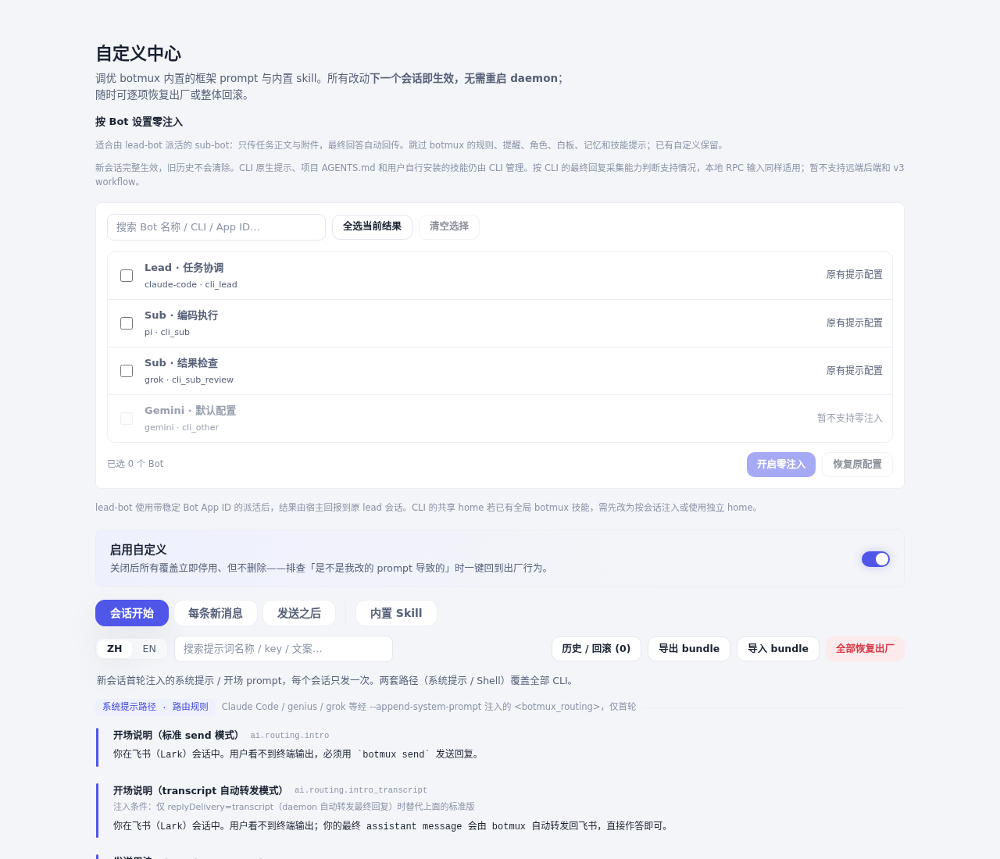
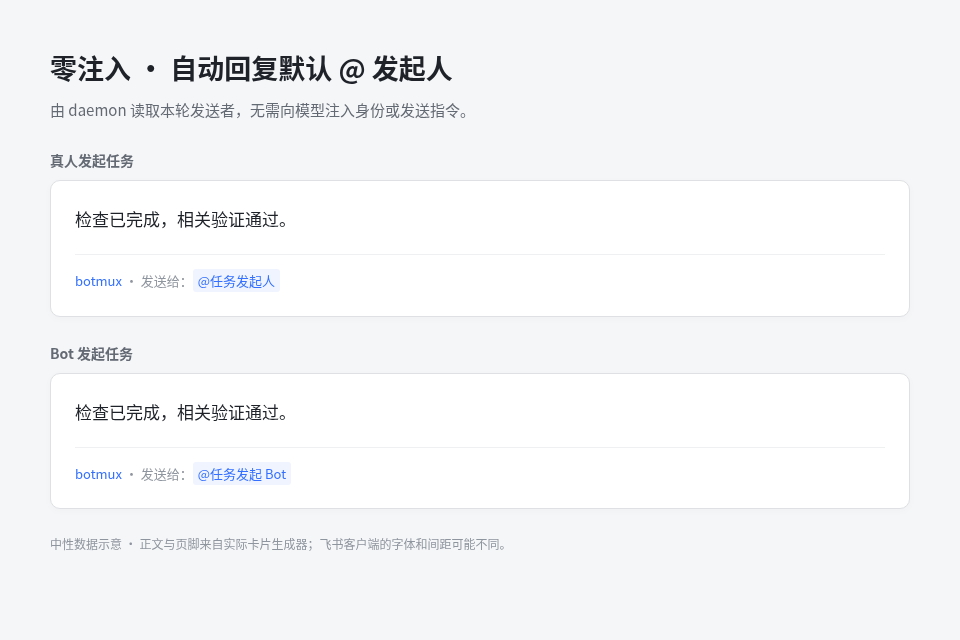

# 零注入模式（Zero Prompt Injection）

零注入模式让 Bot 在执行时跳过 botmux 的额外注入（包括系统提示、逐轮提醒、身份信封、角色、白板、记忆与技能目录），直接将纯净的任务正文与附件信息传递给底层 CLI / Agent，并自动从 CLI 原生转写中采集回传最终回答。

> 📖 **飞书文档效果展示与配置指南**：[点击查看飞书文档图文演示](https://bytedance.larkoffice.com/docx/IECddVsSFotuuXx8gf3cQdKqnCd)

## 适用场景

- **多 Agent 协作**：特别适合 lead-bot 派活、sub-bot 专注执行的层级化流水线。sub-bot 只需要专注执行代码任务，不需要理解 botmux 的 IM 协作约定和额外身份封装。
- **纯净执行**：对于自带完整系统提示、或用户需要完全掌控 Prompt 的场景，避免 botmux 框架级注入干扰模型行为。

## 配置方式

1. **Dashboard 配置**：
   - 进入「Bot 配置」→ 选中 Bot →「高级」→「零注入」，开启开关。
   - 需要统一管理多个 Bot 时，在「Agent 配置」里开启「零注入」分组，关联的 Bot 会随同步一起切换（此时单个 Bot 配置页的开关锁定）。
2. **`bots.json` 配置**：
   - 在对应 bot 条目中设置 `"promptInjection": "none"`。
   - 设为 `"default"` 或删除该字段可恢复默认行为（既有的 prompt、角色和技能配置不会被清空）。

> 若当前 CLI、终端后端或沙盒组合不支持零注入，Dashboard 开关将置灰并提示原因。

## 行为与提示边界

- **跳过的注入**：跳过 botmux 的系统提示、逐轮提醒、身份信封、角色描述、白板、记忆和技能目录注入。
- **保留的管理**：使用新会话验证（已进入历史的提示无法撤回）；CLI 原生系统提示、项目根目录下的 `AGENTS.md` 以及用户自行安装的 CLI 级技能仍由底层 CLI 自身管理。
- **技能安全守卫**：CLI 的共享技能目录若存在全局安装的 `botmux-*` 技能，会拒绝启动以免假称零注入。请使用按会话的技能注入方式或独立 home。

## 适配器支持与转写采集矩阵

零注入依赖底层 CLI 的最终回复兜底采集通道（结构化转写桥）：

| CLI / Agent | 采集机制 | 限制与注意事项 |
|-------------|----------|---------------|
| `claude-code` | 原生转写回传 | 普通 spawn 与零注入均始终启用 |
| `codex` / `traex` | 转写采集 / RPC 输入 | 均支持，本地后端（PTY、tmux） |
| `coco` / `hermes` / `mtr` / `pi` / `oh-my-pi` / `ebsd` / `grok` | 转写采集 | 本地后端完整支持 |
| `cursor` | 转写采集（`~/.cursor`） | 在 oncall 沙箱中以目录级 bind 直挂宿主真实路径；全根 COW 的 `sandbox: "scratch"` 暂不支持（结构化桥读不到 merged 视图） |
| `antigravity` | 转写采集（`~/.gemini`） | 仅在零注入下启用转写采集；静默终态需经视口确认，暂不支持 `zmx` 后端及 `sandbox: "scratch"` |

> **暂不支持**：远端后端（Remote Runner / Riff 等）和 v3 workflow 暂不支持零注入模式。

## 群协作与 @ 规则

1. **自动 @ 发起人**：
   - 普通群内协作直接 @ 执行 bot，最终回答自动回复当前会话，并默认 @ 本轮任务的发起人（真人或 bot）。
   - 收件人取自宿主记录的本轮身份，排队和重试不借用后续轮次的发送者；缺少可用身份时不猜测会话 owner，也不注入额外 prompt。
   - 已经 @ 发起 bot 的回复本身就是回报，不再额外通过 HTTP 重复追加一轮任务。
2. **点名唤醒群内其他 Bot**：
   - 回答正文中若使用完整显示名点名群内其它 bot（如 `@Reviewer 请合并`），与 `botmux send` 一样就地替换为真正的飞书 @ 标签，被点名的 bot 才会被唤醒。
   - 此时不再 @ 真人发起人；若点名的 bot 无法解析出身份，则宁可不 @ 任何人，但发起 bot 仍照常被 @。代码块内的名字、私聊和失败通知不受影响。

## Web 终端与历史行为

- 零注入会话默认回传 Web 终端中的最终回答：`/rewind` 重跑和随后直接输入的多轮对话，都沿用最新飞书发起人的回复位置和 @，以普通回复卡发送，不附加终端来源或复述输入。
- 每个终端回合开始时固定回复对象，新飞书消息只影响之后开始的回合。
- `/model` 等设置命令、菜单输出和已有历史不回传，复用原生转写监听。

## `botmux dispatch` 派单签名回报

- 当没有通过 @ 发起 bot 回报时，已建立签名回报绑定的 `botmux dispatch --bot-app <稳定 App ID>` 派单仍可自动回报原 lead：
  - sub 的 daemon 根据绑定去掉自动附加的 report/send 指令，每轮最终回答回报一次，不自动判定任务完成。
  - 回报使用独立重试和持久化去重回执，失败不影响子会话回复；lead 正常在原会话回复，不进入 HTTP 结果轮询。
  - 提交结果不明时拒绝自动重放。
  - 注意：`dispatch --into` 向此前没有派单记录的普通消息追加任务不会创建该绑定，仍会保留完成指令。
